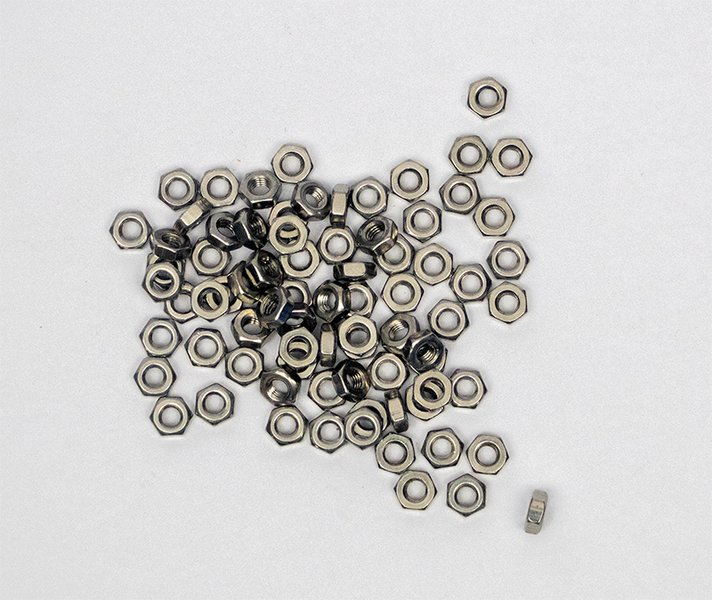

# M3 Nut

Original: <https://railcore.dozuki.com/Item/M3_Nut>

## Used in these guides

- [RailCore II: C) Top Extrusions Assembly](../railcore-ii/c-top-extrusions-assembly.md) (part, quantity 53)
- [RailCore II: D) Bottom Extrusions Assembly](../railcore-ii/d-bottom-extrusions-assembly.md) (part, quantity 8)
- [RailCore II: F) Z Installation](../railcore-ii/f-z-installation.md) (part, quantity 12)
- [RailCore II: K) Y Carriage](../railcore-ii/k-y-carriage.md) (part, quantity 2)
- [RailCore® Mini Kit: C) Top Extrusions Assembly](../railcore-mini-kit/c-top-extrusions-assembly.md) (part, quantity 88)
- [RailCore® Mini Kit: D) Bottom Extrusions Assembly](../railcore-mini-kit/d-bottom-extrusions-assembly.md) (part, quantity 59)
- [RailCore® Mini Kit: E) Upright Extrusion / Frame Final Assembly](../railcore-mini-kit/e-upright-extrusion-frame-final-assembly.md) (part, quantity 48)
- [RailCore® Mini Kit: F) Z Installation](../railcore-mini-kit/f-z-installation.md) (part, quantity 29)
- [RailCore® Mini Kit: G) Sides Installation](../railcore-mini-kit/g-sides-installation.md) (part, quantity 16)
- [RailCore® Mini Kit: K) Y Carriage](../railcore-mini-kit/k-y-carriage.md) (part, quantity 2)
- [RailCore® Mini Kit: P) Electronics](../railcore-mini-kit/p-electronics.md) (part, quantity 20)
- [RailCore® Mini Kit: Q) Wiring the Electronics](../railcore-mini-kit/q-wiring-the-electronics.md) (part, quantity 2)

[All parts and tools](index.md)

---

Original page: <https://railcore.dozuki.com/Item/M3_Nut>. Written by Tony Akens on railcore.dozuki.com. This copy was captured on 2026-11-16 and is licensed under [Creative Commons Attribution-ShareAlike 3.0 (CC BY-SA 3.0)](https://creativecommons.org/licenses/by-sa/3.0/), the license stated on the original site. This is an unofficial community mirror and is not affiliated with RailCore Labs, LLC. RAILCORE is a registered trademark of RailCore Labs, LLC.
