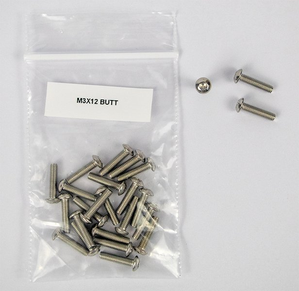

# M3 x 12mm Button Head Bolts

Original: <https://railcore.dozuki.com/Item/M3_x_12mm_Button_Head_Bolts>

## Used in these guides

- [RailCore II: H) Leadscrews and Z Yokes](../railcore-ii/h-leadscrews-and-z-yokes.md) (part, quantity 12)
- [RailCore® Mini Kit: K) Y Carriage](../railcore-mini-kit/k-y-carriage.md) (part, quantity 1)
- [RailCore® Mini Kit: M) Hotend and Extruder](../railcore-mini-kit/m-hotend-and-extruder.md) (part, quantity 4)

[All parts and tools](index.md)

---

Original page: <https://railcore.dozuki.com/Item/M3_x_12mm_Button_Head_Bolts>. Written by Robert Stacks on railcore.dozuki.com. This copy was captured on 2026-11-16 and is licensed under [Creative Commons Attribution-ShareAlike 3.0 (CC BY-SA 3.0)](https://creativecommons.org/licenses/by-sa/3.0/), the license stated on the original site. This is an unofficial community mirror and is not affiliated with RailCore Labs, LLC. RAILCORE is a registered trademark of RailCore Labs, LLC.
