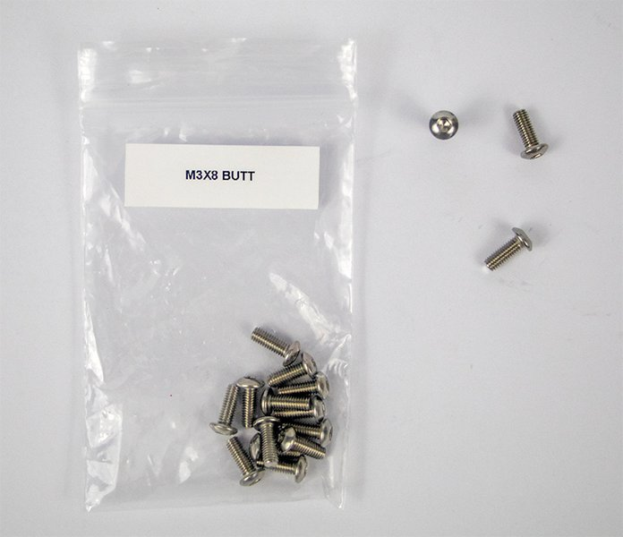

# M3 x 8mm Button Head Bolt

Original: <https://railcore.dozuki.com/Item/M3_x_8mm_button_head_bolt>

## Used in these guides

- [RailCore II: C) Top Extrusions Assembly](../railcore-ii/c-top-extrusions-assembly.md) (part, quantity 16)
- [RailCore II: D) Bottom Extrusions Assembly](../railcore-ii/d-bottom-extrusions-assembly.md) (part, quantity 8)
- [RailCore II: E) Upright Extrusion / Frame Final Assembly](../railcore-ii/e-upright-extrusion-frame-final-assembly.md) (part, quantity 8)
- [RailCore II: F) Z Installation](../railcore-ii/f-z-installation.md) (part, quantity 12)
- [RailCore II: I) Y Rail Installation](../railcore-ii/i-y-rail-installation.md) (part, quantity 8)
- [RailCore II: J) X/Y Steppers and Idlers](../railcore-ii/j-x-y-steppers-and-idlers.md) (part, quantity 24)
- [RailCore II: K) Y Carriage](../railcore-ii/k-y-carriage.md) (part, quantity 13)
- [RailCore® Mini Kit: K) Y Carriage](../railcore-mini-kit/k-y-carriage.md) (part, quantity 4)

[All parts and tools](index.md)

---

Original page: <https://railcore.dozuki.com/Item/M3_x_8mm_button_head_bolt>. Written by Tony Akens on railcore.dozuki.com. This copy was captured on 2026-11-16 and is licensed under [Creative Commons Attribution-ShareAlike 3.0 (CC BY-SA 3.0)](https://creativecommons.org/licenses/by-sa/3.0/), the license stated on the original site. This is an unofficial community mirror and is not affiliated with RailCore Labs, LLC. RAILCORE is a registered trademark of RailCore Labs, LLC.
