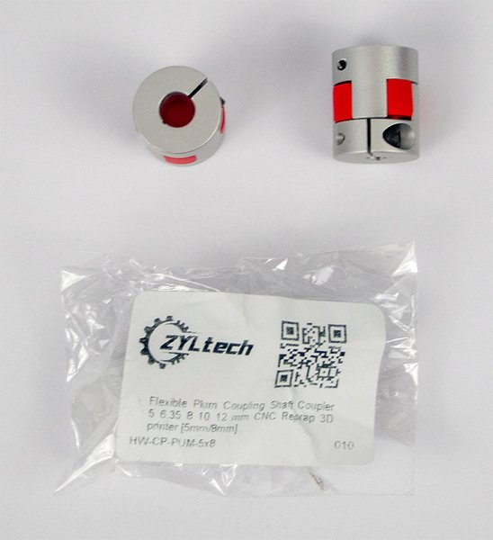

# M5 / M8 Leadscrew Coupler

Original: <https://railcore.dozuki.com/Item/M5_M8_Leadscrew_Coupler>

## Used in these guides

- [RailCore II: H) Leadscrews and Z Yokes](../railcore-ii/h-leadscrews-and-z-yokes.md) (part, quantity 3)
- [RailCore® Mini Kit: H) Z Motors and Leadscrews](../railcore-mini-kit/h-z-motors-and-leadscrews.md) (part, quantity 3)

[All parts and tools](index.md)

---

Original page: <https://railcore.dozuki.com/Item/M5_M8_Leadscrew_Coupler>. Written by Robert Stacks on railcore.dozuki.com. This copy was captured on 2026-11-16 and is licensed under [Creative Commons Attribution-ShareAlike 3.0 (CC BY-SA 3.0)](https://creativecommons.org/licenses/by-sa/3.0/), the license stated on the original site. This is an unofficial community mirror and is not affiliated with RailCore Labs, LLC. RAILCORE is a registered trademark of RailCore Labs, LLC.
