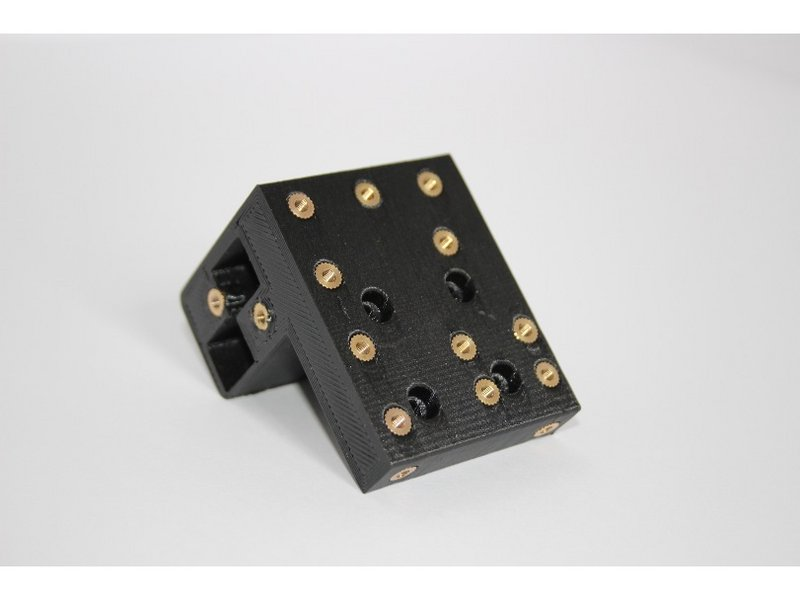
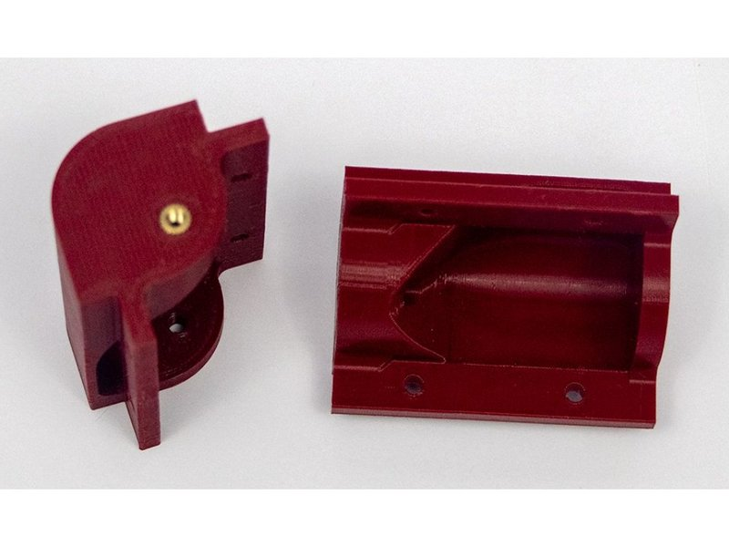

# B) Prep

Category: [RailCore II](index.md) · Original: <https://railcore.dozuki.com/Guide/B)+Prep/11>

**Difficulty:** Moderate  
**Time required:** 45 minutes  
**Author:** Tony Akens  
**Steps:** 5  
**Last modified on Dozuki:** 2020-12-27

## Tools

- [Red RTV](../items/red-rtv-21.md)

## Parts

- 1 × [Printed Y Carriage](../items/printed-y-carriage-24.md) From the printed parts bag.
- 4 × [Printed electronics box corners](../items/printed-electronics-box-corners-36.md) From the printed parts bag
- 22 × [M3 Brass Insert](../items/m3-brass-insert-23.md)
- 1 × [Bed Thermistor](../items/bed-thermistor-33.md) The bed thermister should be in the electronics bag as part of the wiring harness, and have white leads (cables) attached to them.

## Step 1: Install brass inserts

 

- **Caution:** You need to use a soldering iron to carefully sink the brass inserts into the printed Y carriage. Sink the inserts in 2/3 of the way, then press the carriage against a flat metal surface to get them flush.
- **Note:** After placing each insert you may need to clear the channel by running a tap or bolt down through the insert and into the plastic. (Be very careful not to cross thread your inserts!)
- **Note:** Here's a good article about setting the brass heat set inserts: [click here.](https://hackaday.com/2019/02/28/threading-3d-printed-parts-how-to-use-heat-set-inserts/)
- The Y carriage gets (18) 3mm brass inserts, as in the picture. (Note: there are also two on the back side, and one on the top. Not all RailCore kits include the optional one on the top, requiring only 17 inserts)
- Each Electronics Box corner gets one (1) brass insert. One end is thicker, to make putting the insert in easier. Be sure to place the inserts into the thick end, as in Picture 2.

**1 comment on step 1:**

> **Jeffery Seiffert** wrote on 2023-01-04:
> 
> The ones I bought from Filastruder.com were slightly different and I ended up putting the brass inserts in the wrong one, panel side(bottom)
>
> You need to put the insert on the side that is slanted inside and not flat. The instructions say the thick side and well the bottom on the Filastruder ones are maybe twice as thick and the Top slant wasn't as thick as the picture shown. It all worked out as the screws to mount to the panel were too short to put a nut and washer on it and the brass insert seems to be holding pretty good.

## Step 2: Install the Keenovo Heater

- Keenovo has an install guide at this [link](https://www.keenovo.com/info/downloads.html) which will download a PDF file for reference.
- Follow Section 4.2 to install using the pre-installed adhesive.
- The keenovo goes centered on the bottom of the bed (The thermistor groove goes on the top).
- The wires should exit on the same side of the bed as the thermistor.

## Step 3: Installing the bed thermistor

- **Note:** Installing the thermistor in the bed now will make it easier to install the assembled bed in the printer frame in a later step. A youtube video of this process is [here](https://www.youtube.com/watch?v=g_x9JUW02aA).
- **Caution:** Be careful with the thermistor, the bead is glass, and if it’s broken it won’t give a reading, or will be way off. The thermistors have very long leads on them and are protected in rubber all the way up to the bead.
- Place the thermistor into the channel in the top of the bed.
  - Cover about 10mm of the thermistor leads near the glass bead in RTV.
  - Cover another 10mm of the lead near the side of the bed.
  - Use a razor blade to clean up the excess RTV; there should be no RTV higher than the channel in the bed, and none on the bed surface itself.
- Set your bed aside and let the RTV dry while you continue with the following steps.
- **Note:** If you want to continue working with the bed on a later step before the RTV is fully dry, you can cover the groove with Kapton tape until it’s dry. Use a razor blade to cut the tape along the sides of the groove, and leave the part on top of the RTV, so it doesn't pull it out of the groove.

## Step 4: Install the bed surface

- Once the RTV has cured and you've cut away or removed the kapton tape, you can install the bed surface.
- If you're using a magbed, this just involves putting the magplate on.
- If using a stick on surface, remove the backing, and work from one corner. Use a straight edge to seal the surface to the bed, to avoid any air bubbles as you go.

## Step 5: Assemble the hotend

- **Note:** You will need to assemble your hotend prior to attaching it to the Y carriage in a later step. The electrical connections to the hotend components will be completed later as well.
- Since the RailCore is so flexible, there are numerous hotends to choose from and you should follow the assembly instructions for your particular hotend and manufacturer below:
  - [E3D hotend assembly (E3D V6, Volcano, etc.)](https://e3d-online.dozuki.com/)
  - [Slice Engineering hotend assembly (Mosquito, Mosquito Magnum)](https://www.sliceengineering.com/pages/documentation) (The Mosquito comes assembled, instructions should only be needed for reference)

## Comments on this guide (3)

> **Renato Delatorre** wrote on 2021-09-24:
> 
> broken link for the E3D hotend. You can use the E3D website as a bases.

> **Tony Pavlakis** wrote on 2020-07-05:
> 
> What about the J Head and Volcano - or is this just for the kits?

> **Marco Ponti** wrote on 2020-05-03:
> 
> Mosquito hotend came assembled

Previous: [A) Introduction](a-introduction.md) · [RailCore II guide list](index.md) · Next: [C) Top Extrusions Assembly](c-top-extrusions-assembly.md)

---

Original page: <https://railcore.dozuki.com/Guide/B)+Prep/11>. Written by Tony Akens on railcore.dozuki.com. This copy was captured on 2026-11-16 and is licensed under [Creative Commons Attribution-ShareAlike 3.0 (CC BY-SA 3.0)](https://creativecommons.org/licenses/by-sa/3.0/), the license stated on the original site. This is an unofficial community mirror and is not affiliated with RailCore Labs, LLC. RAILCORE is a registered trademark of RailCore Labs, LLC.
