# C) Top Extrusions Assembly

Category: [RailCore II](index.md) · Original: <https://railcore.dozuki.com/Guide/C)+Top+Extrusions+Assembly/2>

*This guide will walk you through building the top frame assembly of your RailCore II.*

[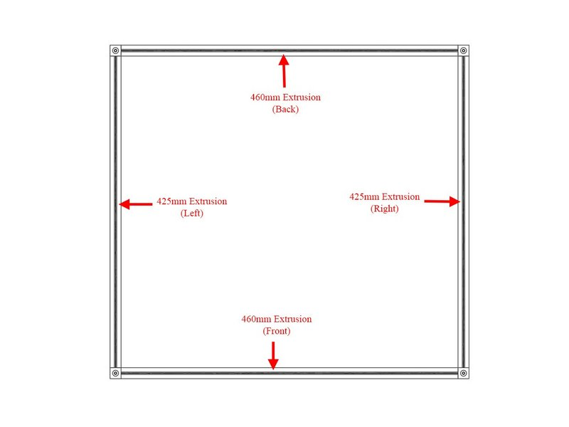](../assets/images/zoom/JWoS4oNMypLQFjWb.jpg)

**Difficulty:** Moderate  
**Time required:** 1 hour  
**Author:** Tony Akens  
**Steps:** 12  
**Last modified on Dozuki:** 2021-08-04

## Introduction

It's assumed that you're building a kit from Filastruder, and you've completed all previous sections. At the end of this section you should have a "top extrusions" assembly together for your RailCore frame.

## Tools

- [Allen Key](../items/allen-key-30.md)
- [Masking Tape](../items/masking-tape-31.md)
- [Marker](../items/marker-32.md)

## Parts

- 2 × [460mm extrusion](../items/460mm-extrusion-11.md)
- 2 × [425mm extrusion](../items/425mm-extrusion-12.md)
- 4 × [Corner Cube](../items/corner-cube-28.md)
- 53 × [M3 Nut](../items/m3-nut-25.md) (add 24 if using a Halo)
- 20 × [M3 x 10mm hex head bolt](../items/m3-x-10mm-hex-head-bolt-14.md)
- 16 × [M3 x 8mm Button Head Bolt](../items/m3-x-8mm-button-head-bolt-16.md)
- 9 × [M3 x 16mm hex head bolt](../items/m3-x-16mm-hex-head-bolt-15.md)
- 2 × [400mm linear rail with carriage](../items/400mm-linear-rail-with-carriage-81.md)
- 8 × [M3 lock washer](../items/m3-lock-washer-80.md)

## Step 1: Lay Out Top Extrusions

- Lay Out Top Extrusions as pictured
- **Caution:** The kit includes (2) untapped 425mm extrusions - for this step be sure to use the tapped extrusions.
- It can be helpful to use masking tape to add a label to the top of each extrusion indicating which it is (Top Back, Top Left, etc)
- Be sure the Corner cubes have a larger hole facing up, smaller hole facing down.

## Step 2: Bolt Corner Cube to Top Left Extrusion

[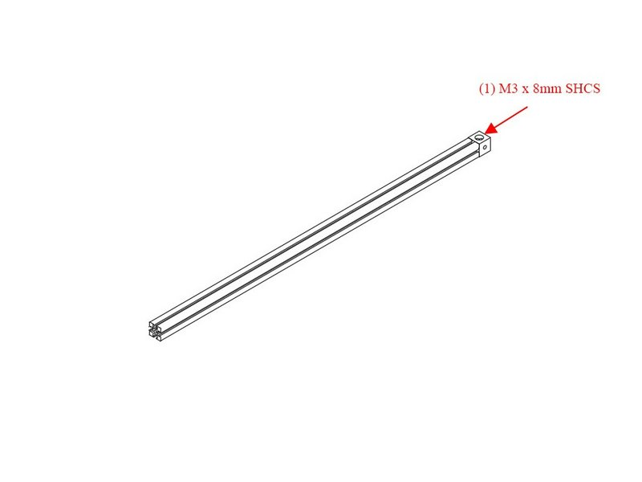](../assets/images/zoom/WrhLvmskulYoMAdL.jpg)

- Bolt Corner Cube to Top Left 425mm Extrusion using (1) M3 x 8mm Socket Head Cap Screw
- **Note:** Note on the corner cube, the small hole is pointing to the right in this image

## Step 3: Add Hardware to Top Left Extrusion

[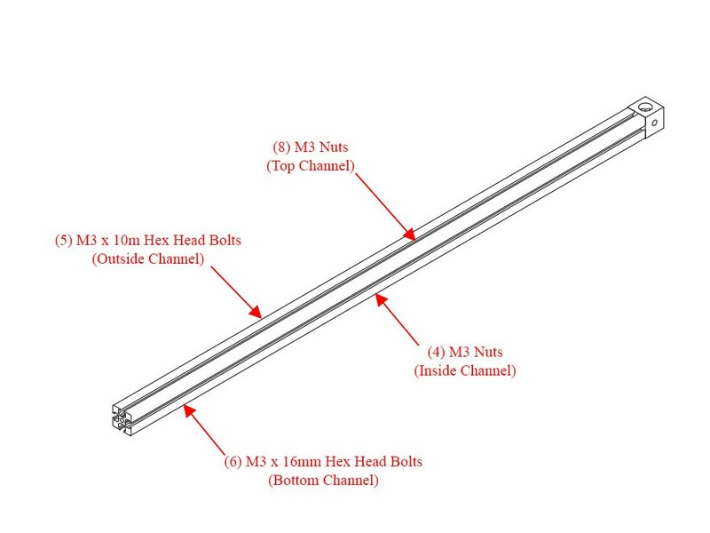](../assets/images/zoom/un2AIPByrpgyX62L.jpg)

- Hold the Extrusion as it will be oriented on the printer (make sure the big hole on the corner cube faces up)
- Slide (8) M3 nuts into the top channel (If you're installing a halo, add 6 additional M3 nuts for a total of 14)
- Slide (5) M3 x 10mm Hex Head Bolts in the outside channel
- Slide (4) M3 nuts in the inside channel
- Slide (6) M3 x 16mm Hex Head bolts in the bottom channel
- **Note:** Note on the corner cube, the small hole is pointing to the right in this image

**2 comments on step 3:**

> **RiC0_MD** wrote on 2021-11-26:
> 
> If you’re desire is to enclose the printer and/or use the interface kit to enclose the printer, I would recommend adding a 4-6 more nuts per side, to give yourself a more options for locking down the interface to the rail.

> **Max Plastix** wrote on 2020-05-12:
> 
> Consider adding a few additional M3 nuts to the Inside Channel as well as the ends of the Bottom Channel for future/unplanned mounting options, to give you future accessory mounting options.
>
> It’s much easier to do this now than take apart the top later to add them. (When unused, add a short bolt later to prevent rattling.)

## Step 4: Attach Second Corner Cube to Top Left Extrusion

[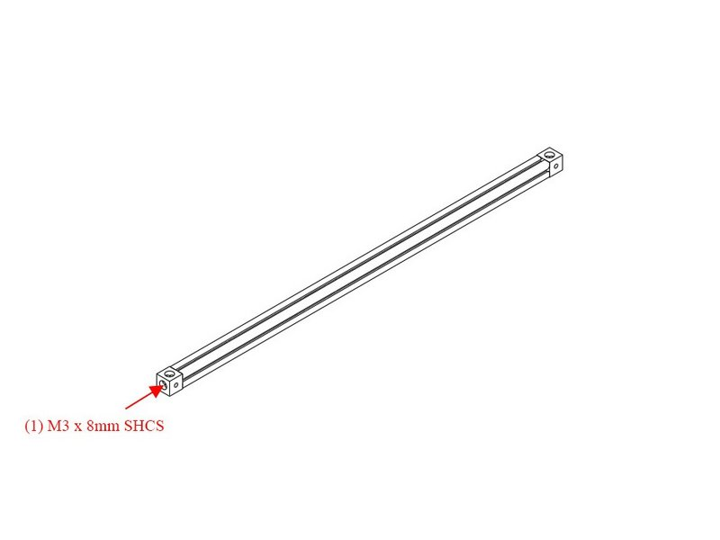](../assets/images/zoom/FFJZLxV4FOXSkKsH.jpg)

- Attach Second Corner Cube to Top Left Extrusion using (1) M3 x 8mm socket cap head screw. Be sure the large hole is up, small hole is down.
- **Note:** Note on both corner cubes, the small hole is pointing to the right in this image

## Step 5: Attach Top Front and Top Back Extrusions

[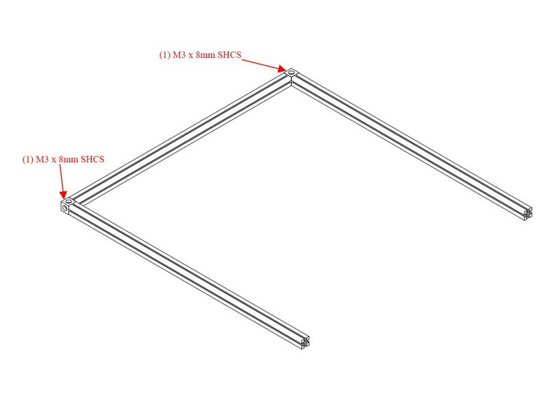](../assets/images/zoom/ABxEuxZFFTfRAncO.jpg)

- Attach the (2) 460mm Top Front and Top Back Extrusions using (1) M3 x 8mm socket cap head screw each.

## Step 6: Add Hardware to Top Front and Top Back Extrusions

[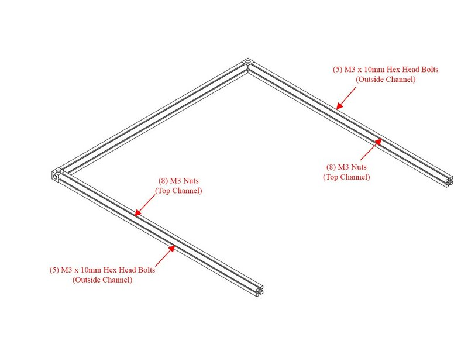](../assets/images/zoom/mG3SctXxEjYWXGBA.jpg)

- (5) M3 x 10mm Hex head bolts go in the outside channel of the back extrusion.
- (8) M3 nuts go in the top channel of the back extrusion (if installing the optional Halo, add six (6) more nuts in this channel for a total of 14).
- (8) M3 nuts go in the top channel of the front extrusion (if installing the optional Halo, add six (6) more nuts in this channel for a total of 14).
- (5) M3 x 10mm Hex Head Bolts go in the outside channel of the front extrusion.

**2 comments on step 6:**

> **Ray Milyard** wrote on 2020-07-14:
> 
> Also if using halo with end stop mount under linear rail you need add a couple m3 nuts in back/rear bottom channel.

> **Max Plastix** wrote on 2020-05-09:
> 
> Slide an additional (6) M3 nuts into each front & back top channel if installing the optional “Halo” top frame upgrade by 713Maker. (14) nuts total.

## Step 7: (2x) Install M3 Hardware into Linear Rail

[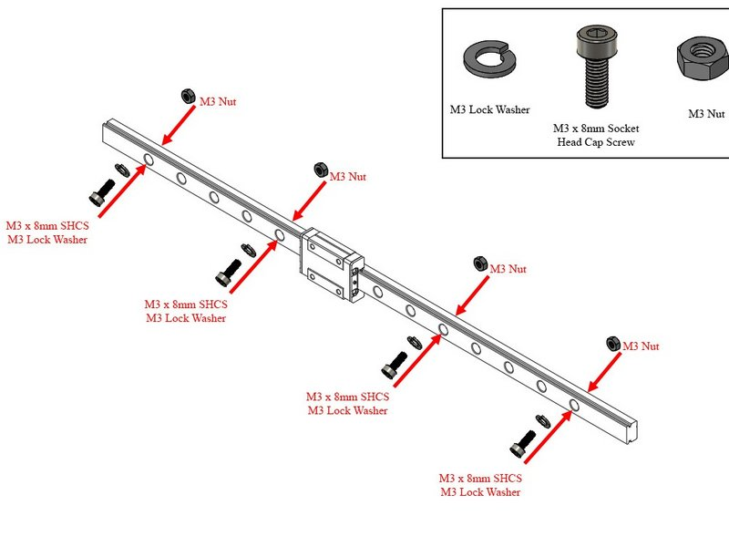](../assets/images/zoom/ubulXeFF6Kj24sbn.jpg)

- Use a bit of masking tape to keep your carriage from sliding off your linear rail.
- Select 4 evenly spaced holes in your linear rail. (roughly 3 empty holes between each bolt)
- Place a lock washer on (1) M3 x 8mm socket cap head screw, and place it into one of the holes selected. Loosely thread on (1) M3 nut to the bolt. DO NOT TIGHTEN THEM FULLY. The M3 nut only needs to be threaded onto the tip of the bolt, you want a gap between the nut and the back of the rail. Repeat for the other three (3) holes.
- Repeat the above steps for the other 400mm rail.
- **Caution:** It is highly recommended to use a bit of masking tape to keep the carriage from sliding off of the linear rail.

**1 comment on step 7:**

> **Leon Grossman** wrote on 2020-07-01:
> 
> If you have the Misumi rails the 8mm bolts are too long without using the lock washers as spacers. Per discord, 6mm may work as an alternative.

## Step 8: Attach Linear rail to Top Front and Top Back Extrusions

[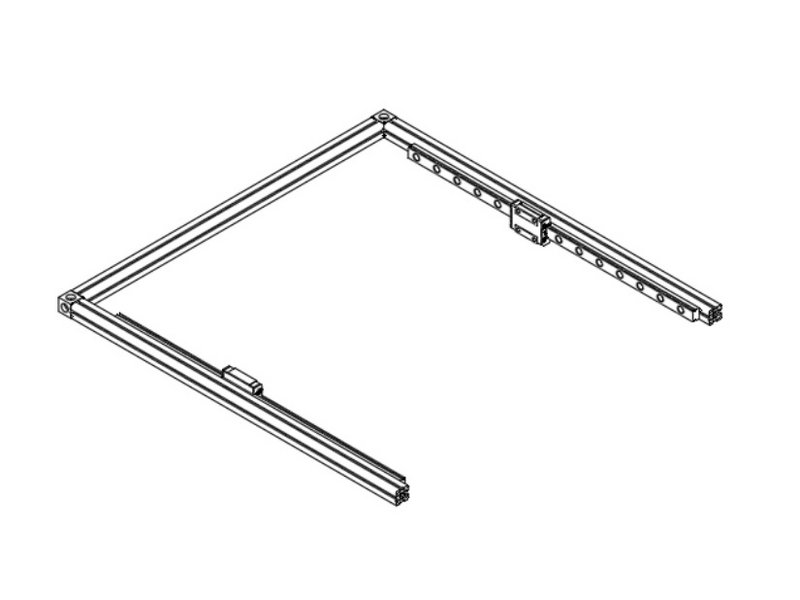](../assets/images/zoom/gPq52lY1eX45hOcR.jpg)

- Attach Linear rail to Top Front and Top Back Extrusions by sliding the M3 nuts into the inside channel on the extrusion.
- Roughly center the extrusion, and then snug up the bolts.
- **Caution:** Do not overtighten the bolts, you just need them snug for now. They'll be tightened later.
- **Caution:** It is highly recommended to use a bit of masking tape to keep the carriage from sliding off of the linear rail.

## Step 9: Attach Corner Cube to Top Right Extrusion

[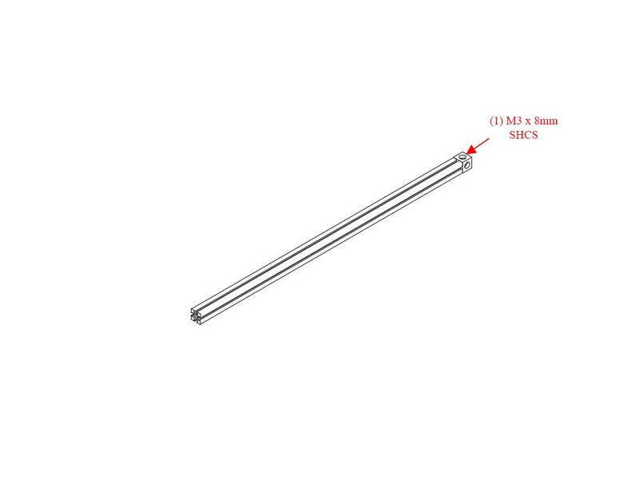](../assets/images/zoom/hkrNrXFeBELwZHW6.jpg)

- Set aside the rest of your top extrusion assembly for now, so we can work on the top right extrusion.
- Attach a corner cube to the right 425mm extrusion using (1) M3 x 8mm socket cap head screw.

## Step 10: Add Hardware to Top Right Extrusion

[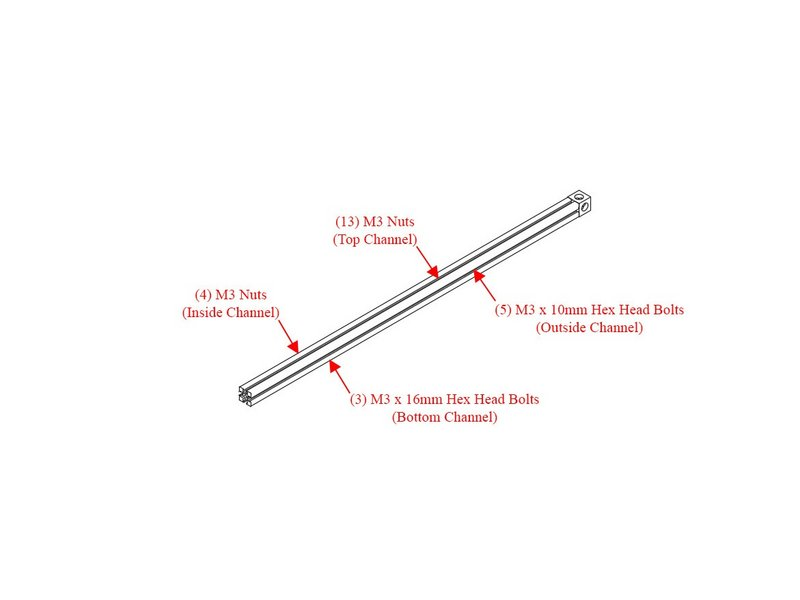](../assets/images/zoom/TZWjmyMrktmOEREE.jpg)

- Slide (13) M3 nuts into the top channel (if installing the optional Halo, add six (6) more nuts in this channel for a total of 19)
- Slide (4) M3 nuts into the inside channel
- Slide (5) M3 x 10mm Hex Head Bolts into the outside channel
- Slide (3) M3 x 16mm Hex Head Bolts into the bottom channel
- **Caution:** Be sure the orientation of the corner cube is correct. A large hole should face up, a small hole should be facing down, and a small hole should be facing towards the inside channel

**1 comment on step 10:**

> **RiC0_MD** wrote on 2021-11-26:
> 
> I’d recommend adding a few more nuts to the top channel, if your planning to enclose the printer, but also for things like a spool holder off the right side as well.

## Step 11: Attach Second Corner Cube to Top Right Extrusion

[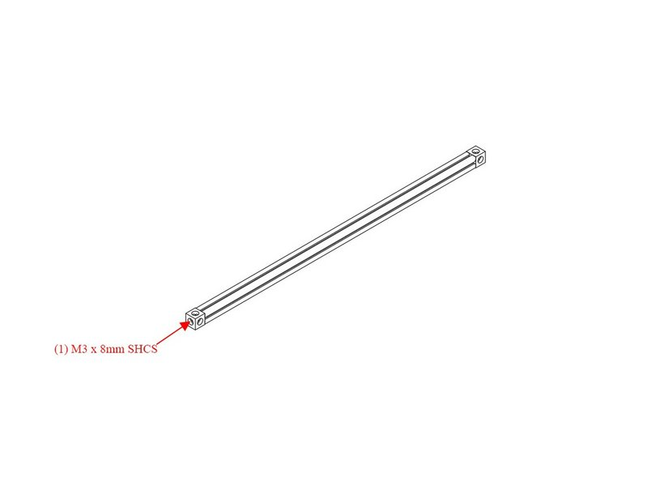](../assets/images/zoom/BKSaXgWCoUQCDAB2.jpg)

- Attach Second Corner Cube to Top Right Extrusion using (1) M3 x 8mm socket cap head screw.

## Step 12: Attach Top Right Extrusion to the Rest of the Top Extrusion Assembly

[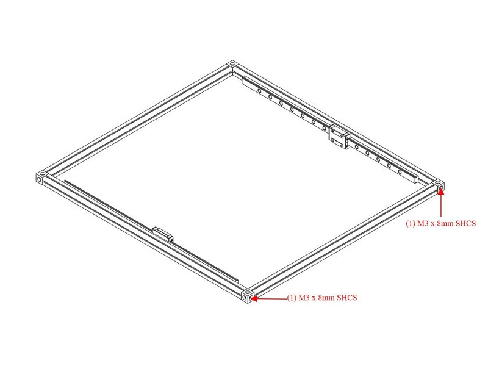](../assets/images/zoom/MZhmMsAeUM1Gge5i.jpg)

- Attach Top Right Extrusion to the rest of the Top Extrusion Assembly using (2) M3 x 8mm socket cap head screws.

Previous: [B) Prep](b-prep.md) · [RailCore II guide list](index.md) · Next: [D) Bottom Extrusions Assembly](d-bottom-extrusions-assembly.md)

---

Original page: <https://railcore.dozuki.com/Guide/C)+Top+Extrusions+Assembly/2>. Written by Tony Akens on railcore.dozuki.com. This copy was captured on 2026-11-16 and is licensed under [Creative Commons Attribution-ShareAlike 3.0 (CC BY-SA 3.0)](https://creativecommons.org/licenses/by-sa/3.0/), the license stated on the original site. This is an unofficial community mirror and is not affiliated with RailCore Labs, LLC. RAILCORE is a registered trademark of RailCore Labs, LLC.
