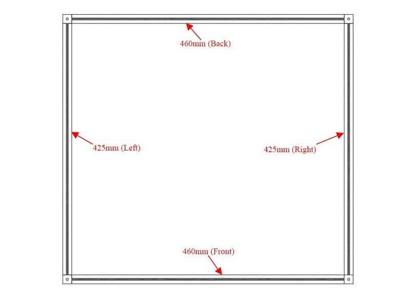
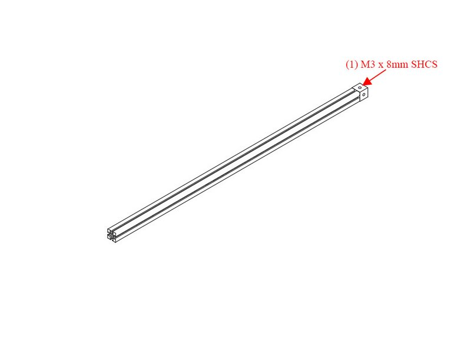
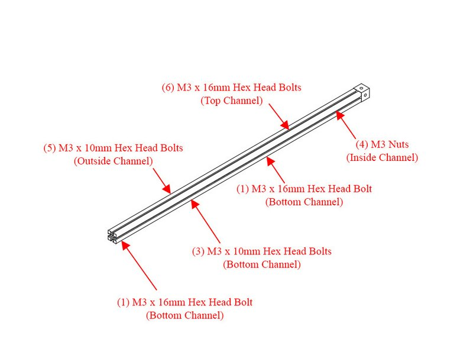
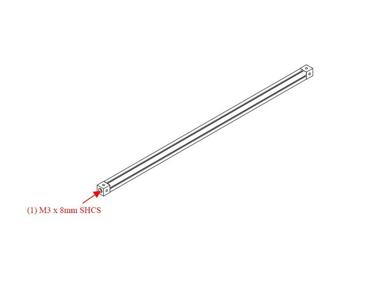
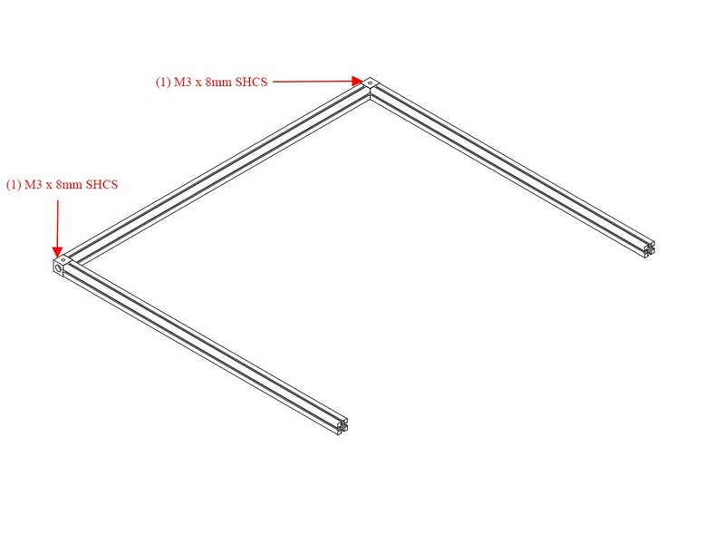
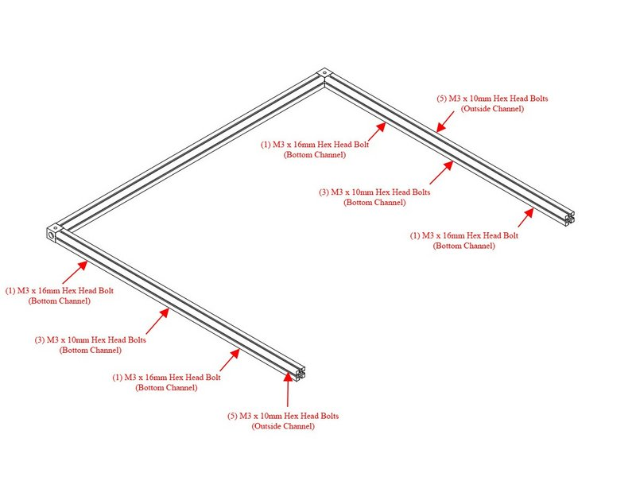
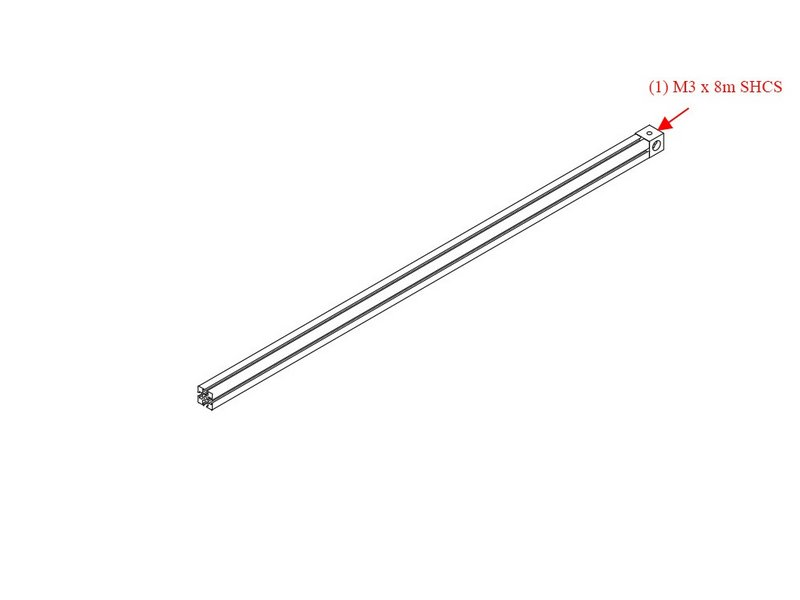
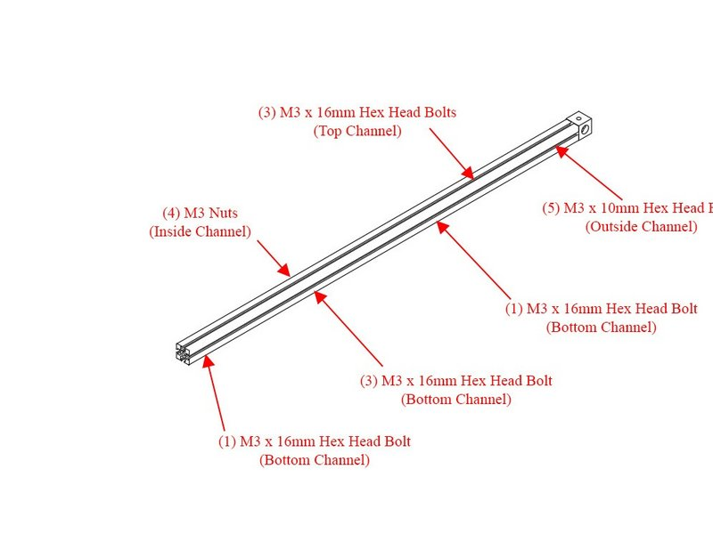
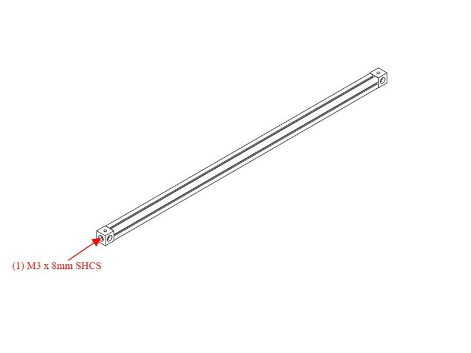
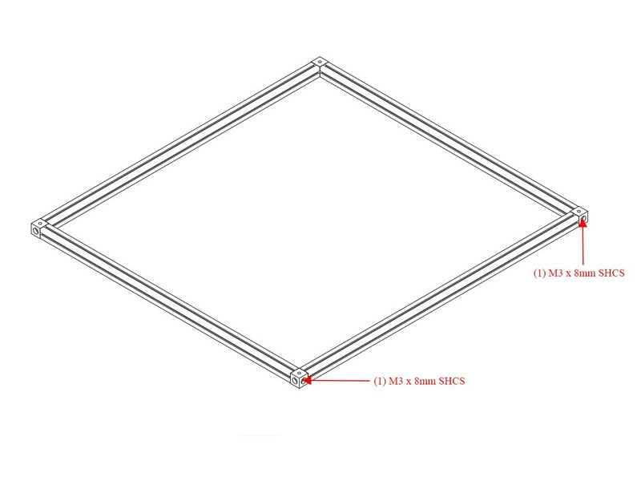

# D) Bottom Extrusions Assembly

Category: [RailCore II](index.md) · Original: <https://railcore.dozuki.com/Guide/D)+Bottom+Extrusions+Assembly/3>

**Difficulty:** Moderate  
**Time required:** 15 minutes  
**Author:** Tony Akens  
**Steps:** 10  
**Last modified on Dozuki:** 2020-12-29

## Introduction

It's assumed that you're building a kit from Filastruder, and you've completed all previous sections. At the end of this section you should have a "bottom extrusions" assembly together for your RailCore frame.

## Tools

- [5.5mm Nut Driver](../items/5-5mm-nut-driver-19.md)
- [Allen Key](../items/allen-key-30.md)

## Parts

- 2 × [460mm extrusion](../items/460mm-extrusion-11.md)
- 2 × [425mm extrusion](../items/425mm-extrusion-12.md)
- 4 × [Corner Cube](../items/corner-cube-28.md)
- 8 × [M3 Nut](../items/m3-nut-25.md)
- 8 × [M3 x 8mm Button Head Bolt](../items/m3-x-8mm-button-head-bolt-16.md)
- 32 × [M3 x 10mm hex head bolt](../items/m3-x-10mm-hex-head-bolt-14.md)
- 17 × [M3 x 16mm hex head bolt](../items/m3-x-16mm-hex-head-bolt-15.md)

## Step 1: Layout Bottom Frame

- Layout Bottom Frame as shown. Note that the corner cubes should have a small hole facing up.
- **Caution:** The kit includes (2) untapped 425mm extrusions - for this step be sure to use the tapped extrusions.
- It is a good idea to mark each extrusion with a bit of masking tape on top, indicating which extrusion it is.

**1 comment on step 1:**

> **Max Plastix** wrote on 2020-05-09:
> 
> If building with the optional 713Maker Metal Baseplate, then it’s easiest to build the bottom extrusion frame directly onto the plate in the steps below.
>
> Each downward-facing bolt goes through the baseplate for attachment with an M3 Locknut. Assemble frame, then align it flat to the baseplate before tightening corner cubes.
>
> Access to the corner cubes is still needed, so do not bolt the Feet onto the M3x16 long nuts just yet. Wait until mounting the upright extrusions next.

## Step 2: Install Corner Cube on Bottom Left Extrusion

- Use (1) M3 x 8mm socket cap head screw to the 425mm bottom left extrusion. Note the orientation of the corner cube.

**1 comment on step 2:**

> **Max Plastix** wrote on 2020-05-12:
> 
> Using the diagram above, it goes on the Back-Left corner of the Left bottom extrusion.

## Step 3: Add Hardware to Bottom Left Extrusion

- Slide (6) M3 x 16mm hex head bolts into the top channel.
- Slide (5) M3 x 10mm hex head bolts into the outside channel.
- Slide (4) M3 nuts into the inside channel. Note: If using a metal bottom (base plate), these are not needed.
- In the bottom channel the order is (1) M3 x 16mm head head bolt, (3) M3 x 10mm hex head bolts, (1) M3 x 16mm hex head bolts. It is very important they're in this order, the longer bolts on the end are for attaching the feet.

**1 comment on step 3:**

> **Max Plastix** wrote on 2020-05-12:
> 
> Note that this Cube end may be incorrectly rotated 180 degrees in the picture.
>
> The Top Channel of the Bottom Left extrusion will have a small hole showing at the top of the cube.

## Step 4: Add Second Corner Cube to Bottom Left Extrusion

- Use (1) M3 x 8mm socket cap head screw to attach the second corner cube to the other end of the bottom left extrusion. Note hole orientation.

## Step 5: Add Bottom Front and Bottom Rear Extrusions

- Attach Bottom (2) 460mm Front and Bottom Back Extrusions using (1) M3 x 8mm Socket Cap Head Screw each.

## Step 6: Add Hardware into Bottom Front and Bottom Rear Extrusions

- Slide (5) M3 x 10mm hex head bolts in the outside channel of the bottom rear extrusion.
- The bottom channel of the bottom rear extrusion gets (1) M3 x 16mm hex head bolt, (3) M3 x 10mm hex head bolts, and (1) M3 x 16mm hex head bolt, in that order.
- Slide (5) M3 x 10mm hex head bolts in the outside channel of the bottom front extrusion.
- The bottom channel of the bottom front extrusion gets (1) M3 x 16mm hex head bolt, (3) M3 x 10mm hex head bolts, and (1) M3 x 16mm hex head bolt, in that order.
- Set this assembly aside, so you can assemble the bottom right extrusion.

**1 comment on step 6:**

> **Max Plastix** wrote on 2020-05-12:
> 
> Note that the Corner Cubes in the picture for Step 6 may be shown incorrectly. They will have Small Hole on top, Large hole facing the bottom.

## Step 7: Install Corner Cube on Bottom Right Extrusion

- Use (1) M3 x 8mm Socket Cap Head Screw to add a corner cube to the bottom right 425mm extrusion. Note the orientation of the corner cube - a small hole needs to face up.

## Step 8: Add Hardware into Bottom Right Extrusion

- Slide (3) M3 x 16mm hex head bolts in the top channel
- Slide (4) M3 nuts in the inside channel. Note: If using a metal bottom (base plate), these are not needed.
- Slide (5) M3 x 10mm hex head bolts in the outside channel.
- In the bottom channel add the following hardware in this order: (1) M3 x 16mm hex head Bolt, (3) M3 x 10mm hex head bolts, (1) M3 x 16mm hex head bolt.

**1 comment on step 8:**

> **Mike Estes** wrote on 2020-11-09:
> 
> In diagram- Bottom Channel, 3 M3 x 16 should be 3 M3 x10

## Step 9: Add Second Corner Cube to Bottom Right Extrusion

- Use (1) M3 x 8mm Socket Head Cap Screw to attach a second corner cube to the bottom right extrusion. Note the orientation of the corner cube - a small hole should be facing up.

## Step 10: Attach Bottom Right Extrusion to the Rest of the Bottom Frame

- Use (2) M3 x 8mm Socket Cap Head Screws to attach the bottom right extrusion to the rest of the bottom frame assembly from earlier.

**1 comment on step 10:**

> **Keith Coventry** wrote on 2021-02-02:
> 
> If using the HDPE base, make sure the two bottom stiffening braces fit between these extrusions. I had the whole frame built with sides bolted on and the bottom braces won’t fit between the extrusions (Filastruder kit). I already had everything square so I it was a bit painful to loosen an extrusion and side panel to fit these in and then adjust for squareness again.

Previous: [C) Top Extrusions Assembly](c-top-extrusions-assembly.md) · [RailCore II guide list](index.md) · Next: [E) Upright Extrusion / Frame Final Assembly](e-upright-extrusion-frame-final-assembly.md)

---

Original page: <https://railcore.dozuki.com/Guide/D)+Bottom+Extrusions+Assembly/3>. Written by Tony Akens on railcore.dozuki.com. This copy was captured on 2026-11-16 and is licensed under [Creative Commons Attribution-ShareAlike 3.0 (CC BY-SA 3.0)](https://creativecommons.org/licenses/by-sa/3.0/), the license stated on the original site. This is an unofficial community mirror and is not affiliated with RailCore Labs, LLC. RAILCORE is a registered trademark of RailCore Labs, LLC.
