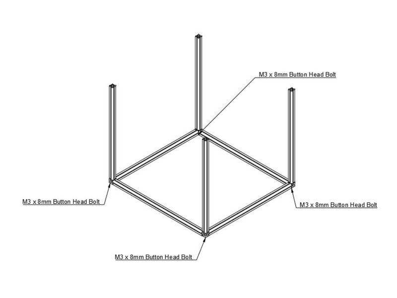
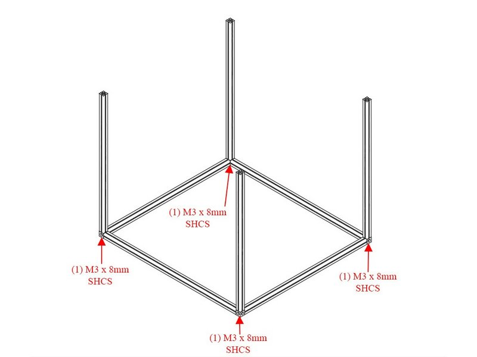
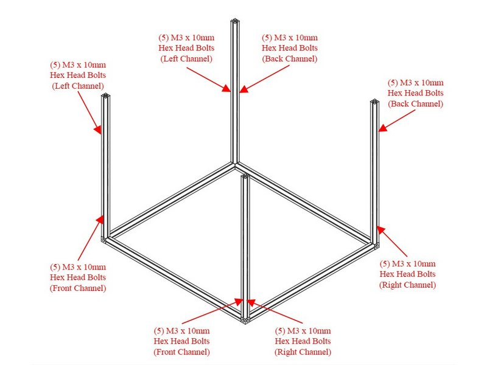
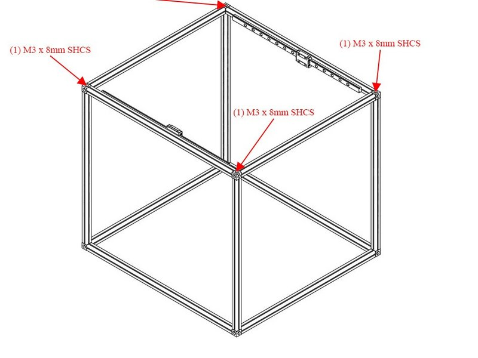

# E) Upright Extrusion / Frame Final Assembly

Category: [RailCore II](index.md) · Original: <https://railcore.dozuki.com/Guide/E)+Upright+Extrusion+-+Frame+Final+Assembly/4>

**Difficulty:** Easy  
**Time required:** 20 minutes  
**Author:** Tony Akens  
**Steps:** 3  
**Last modified on Dozuki:** 2020-12-29

## Introduction

It's assumed that you're building a kit from Filastruder, and you've completed all previous sections. At the end of this section you should have a complete frame assembled for your RailCore.

## Parts

- 4 × [415mm Extrusion](../items/415mm-extrusion-34.md)
- 8 × [M3 x 8mm Button Head Bolt](../items/m3-x-8mm-button-head-bolt-16.md)
- 40 × [M3 x 10mm hex head bolt](../items/m3-x-10mm-hex-head-bolt-14.md) For ZLT, this will be quantity 56

## Step 1: Add the Upright Extrusions to your Bottom Frame Assembly

- Use (1) M3 x 8mm Socket Cap Head Screw to attach each of the (4) 415mm (715mm for ZLT) upgright extrusions to the corner cubes on the bottom frame assembly. Note: It can be helpful to prop the bottom frame assembly up on some old filament spools so that the upright extrusions remain vertical.

## Step 2: Add Hardware into the Upright Extrusions

- Slide (5) M3 x 10mm hex head head bolts in both of the outside channels on each upright extrusion.
- **Caution:** For the ZLT you need (7) M3 x 10mm hex head bolts in each channel instead of (5). These bolts are in the ZLT supplement bag.

## Step 3: Attach Top Frame Assembly to Upright Bottom Frame Assembly

- Use (4) M3 x 8mm Socket Cap Head Screws to attach the top extrusion assembly to the upright extrusions.
- Congratulations! You've completed the frame assembly for your RailCore II 300ZL/300ZLT.

Previous: [D) Bottom Extrusions Assembly](d-bottom-extrusions-assembly.md) · [RailCore II guide list](index.md) · Next: [F) Z Installation](f-z-installation.md)

---

Original page: <https://railcore.dozuki.com/Guide/E)+Upright+Extrusion+-+Frame+Final+Assembly/4>. Written by Tony Akens on railcore.dozuki.com. This copy was captured on 2026-11-16 and is licensed under [Creative Commons Attribution-ShareAlike 3.0 (CC BY-SA 3.0)](https://creativecommons.org/licenses/by-sa/3.0/), the license stated on the original site. This is an unofficial community mirror and is not affiliated with RailCore Labs, LLC. RAILCORE is a registered trademark of RailCore Labs, LLC.
