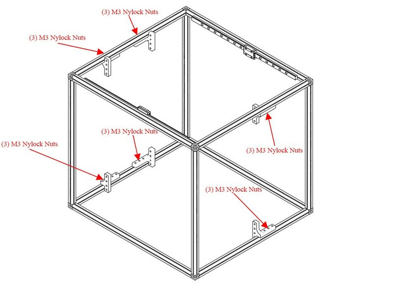
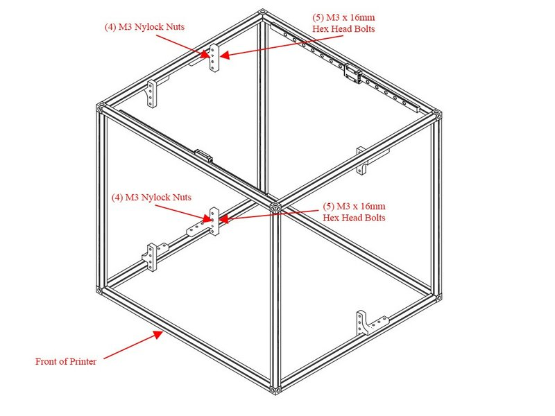
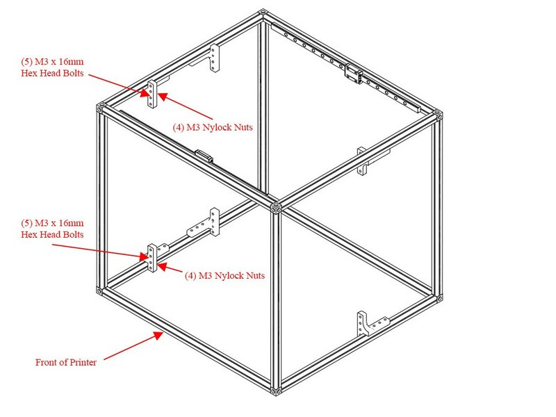
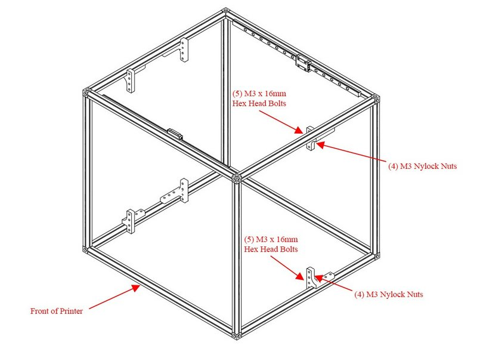
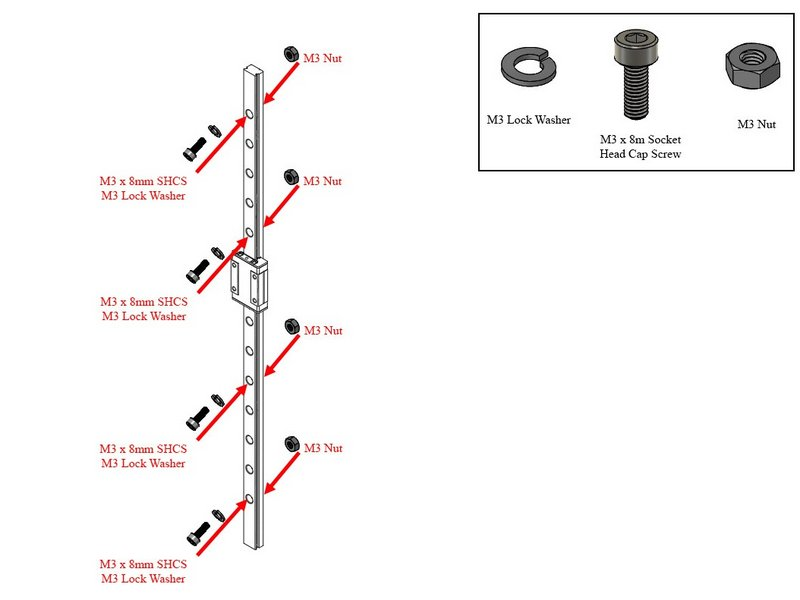
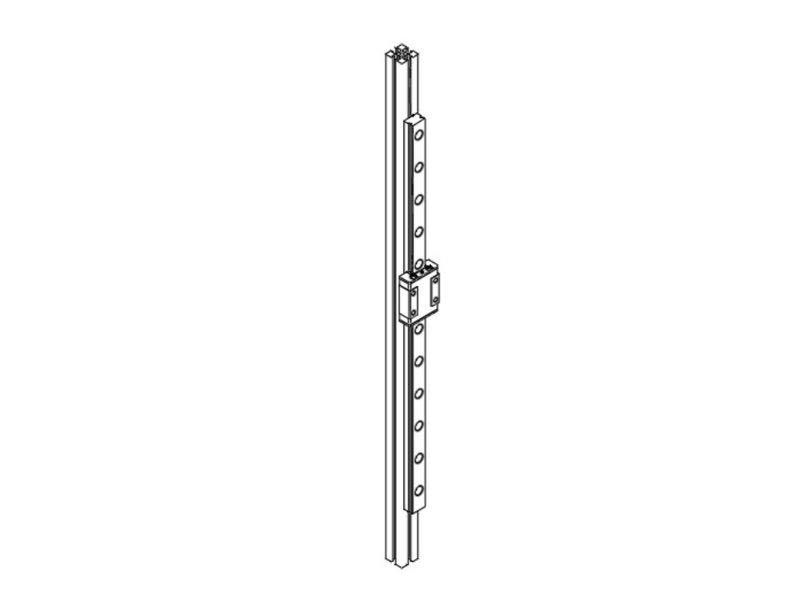
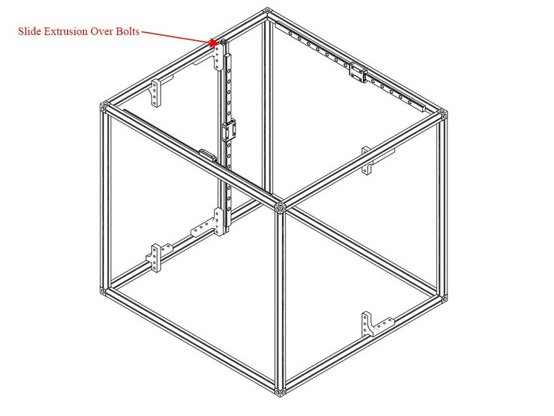
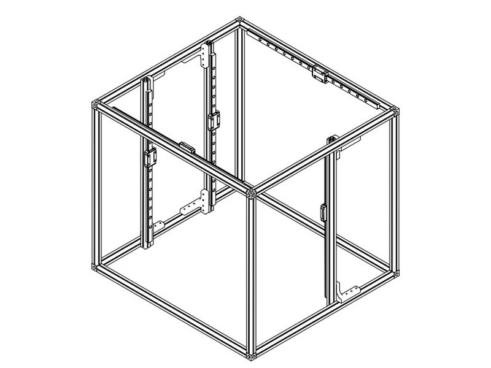

# F) Z Installation

Category: [RailCore II](index.md) · Original: <https://railcore.dozuki.com/Guide/F)+Z+Installation/5>

**Difficulty:** Moderate  
**Time required:** 1 - 2 hours  
**Author:** Tony Akens  
**Steps:** 6  
**Last modified on Dozuki:** 2021-08-04

## Introduction

It's assumed that you're building a kit from Filastruder, and you've completed all previous sections. At the end of this section you should have your Z axis attached to your frame assembly.

## Tools

- [Masking Tape](../items/masking-tape-31.md)
- [5.5mm Nut Driver](../items/5-5mm-nut-driver-19.md)

## Parts

- 3 × [445mm Extrusion](../items/445mm-extrusion-82.md)
- 3 × [400mm linear rail + carriage](../items/400mm-linear-rail-carriage-17.md)
- 6 × [Z Bracket](../items/z-bracket-83.md)
- 12 × [M3 x 8mm Button Head Bolt](../items/m3-x-8mm-button-head-bolt-16.md) For 300ZLT, this will be quantity 24
- 24 × [M3 x 16mm hex head bolt](../items/m3-x-16mm-hex-head-bolt-15.md)
- 12 × [M3 lock washer](../items/m3-lock-washer-80.md) For 300ZLT, this will be quantity 24
- 12 × [M3 Nut](../items/m3-nut-25.md) For 300ZLT, this will be quantity 24
- 42 × [M3 Nylock Nut](../items/m3-nylock-nut-84.md)

## Step 1

- Newer Filastruder kits use Socket Cap Head Screws, use them in place of all button head screws in this section.

## Step 2: Install Z Brackets

- Find the Z brackets in the parts and align each as follows.
- **Note the orientation of each bracket.** It is CRITICAL that the brackets all face the correct way.
- On the left, the long horizontal ends of the brackets point towards each other. The vertical ends of the brackets face out towards the front and back of the frame
- On the right the vertical ends of the brackets face the front of the frame.
- Loosely install each Z bracket using (3) M3 Nylock Nuts. Leave them loose enough you can easily move them, there should be about 60mm between them, and the front one about 110mm from the front of the frame, though you can adjust later.

2 comment(s) on this step

> **Ryan McKibbin** wrote on 2020-06-21:
> 
> Unpack and open up your parts from Mandala Rose Works. My Z brackets were labeled Z-yolk set… I thought they didn’t ship the parts and ended up printing my own (and installing them) before realizing they were mislabeled.

> **Max Plastix** wrote on 2020-05-10:
> 
> For the Mandala Rose Works metal Z Brackets, some assembly of those (3 Left, 3 Right) is required.
>
> Ensure that the MRW Logo piece is off-center from the 4-hole piece. See pictures on MRW web site.
>
> Leave the locknuts loose in this step.

## Step 3: Add Bolts to Z Brackets

  

- Put a M3 x 16mm hex head bolt through each Z Bracket and attach it loosely with an M3 nylock nut. Only thread the nut on loosely. Each bracket gets (4) M3 x 16mm hex head bolts with (4) M3 nylock nuts.
- Repeat this process for all (6) Z brackets.

## Step 4: Prep Z Linear Rails

- Prep the Z axis MGN12 linear rails in the same fashion as the X axis rails. There are additional hex head bolts in the ZLT supplement bag. These can be merged in with the rest of your hardware.
- Select 4 evenly spaced holes in the rail. Place a lock washer on (1) M3 x 8mm Socket Head Cap Screw, and place it into the rail. Loosely thread on (1) M3 nut to the bolt.
- **Caution:** For the ZLT you should use (8) bolts spaced evenly, instead of (4) per rail. Extra 8mm bolts are located in the ZLT supplemental hardware bag.
- Repeat for all (3) Z linear rails.
- **Caution:** It is highly recommended to use a bit of masking tape to keep the carriage from sliding off of the linear rail.

1 comment(s) on this step

> **evin Powell** wrote on 2020-06-17:
> 
> Make sure to use M3 8mm button heads instead of the 6mm the picture shows.

> > **Tony Akens** wrote on 2020-06-17:
> > 
> > I’ll be doing new images for all of the linear rail steps in the next couple of days, to fix that. All linear rails should be an m3 x 8mm with a m3 lock washer in the latest kits.

## Step 5: Install Z Linear Rails on Z Extrusions

- Slide the linear rails onto the (3) 445mm Z extrusions, and snug up the bolts (do not overtighten them.
- The rail should sit ~20mm up from the bottom of the extrusion.
- **Caution:** It is highly recommended to use a bit of masking tape to keep the carriage from sliding off of the linear rail.

2 comment(s) on this step

> **Eric Moyer** wrote on 2021-01-30:
> 
> The CAD shows the linear rail should be 20mm from the top of the extrusion and I don’t know if older instructions provided this level of detail but my printer measures 20mm from the top of the extrusion to the top of the linear rail.

> **Leon Grossman** wrote on 2020-07-01:
> 
> It’s unclear from this step where the railing should be placed. I centered mine but I’m not far enough in this build to know if that is correct.

## Step 6: Install Z Extrusion Assemblies on Z Brackets

 

- Take your Z extrusion with a linear rail attached, and slide it down onto the hex head bolts you added earlier on the Z brackets.
- The extrusion should attach to all 4 bolts on both the top & bottom Z brackets.
- Tighten down the nylock nuts to hold the Z extrusions in place.
- Repeat for all (3) Z extrusions.

## Comments on this guide (1)

> **Deepak Chandan** wrote on 2023-12-15:
> 
> Great installation guide! At **JF Engineering Products LLP**, we take pride in manufacturing top-notch [Stainless Steel 347 Hex Bolts](https://www.jfeindia.com/347-stainless-steel-bolts-studs-nut-fasteners-manufacturers-suppliers.html). Our products ensure durability and reliability for seamless installations. Check out our offerings for premium quality anchor solutions

Previous: [E) Upright Extrusion / Frame Final Assembly](e-upright-extrusion-frame-final-assembly.md) · [RailCore II guide list](index.md) · Next: [G) Sides Installation](g-sides-installation.md)

---

Original page: <https://railcore.dozuki.com/Guide/F)+Z+Installation/5>. Written by Tony Akens on railcore.dozuki.com. This copy was captured on 2026-11-16 and is licensed under [Creative Commons Attribution-ShareAlike 3.0 (CC BY-SA 3.0)](https://creativecommons.org/licenses/by-sa/3.0/), the license stated on the original site. This is an unofficial community mirror and is not affiliated with RailCore Labs, LLC. RAILCORE is a registered trademark of RailCore Labs, LLC.
