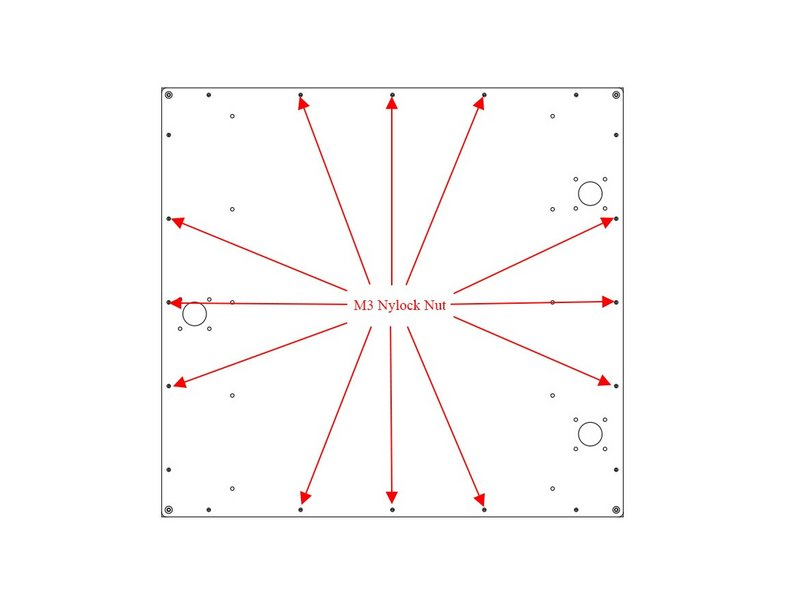
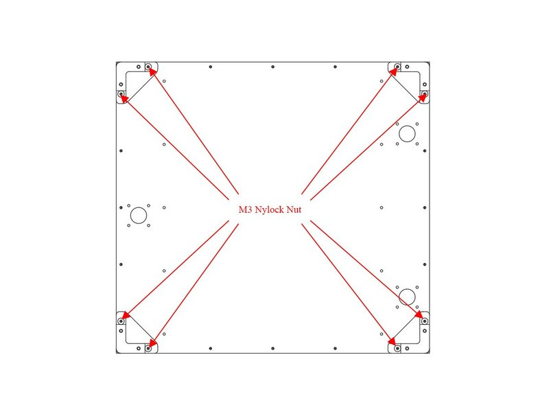
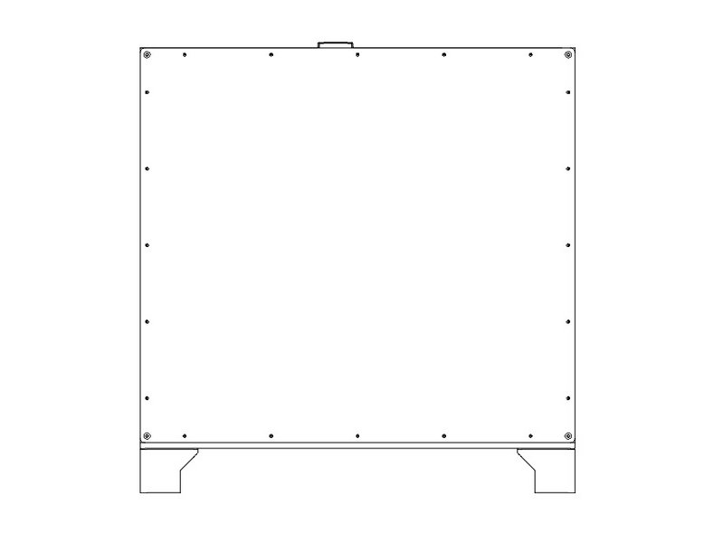
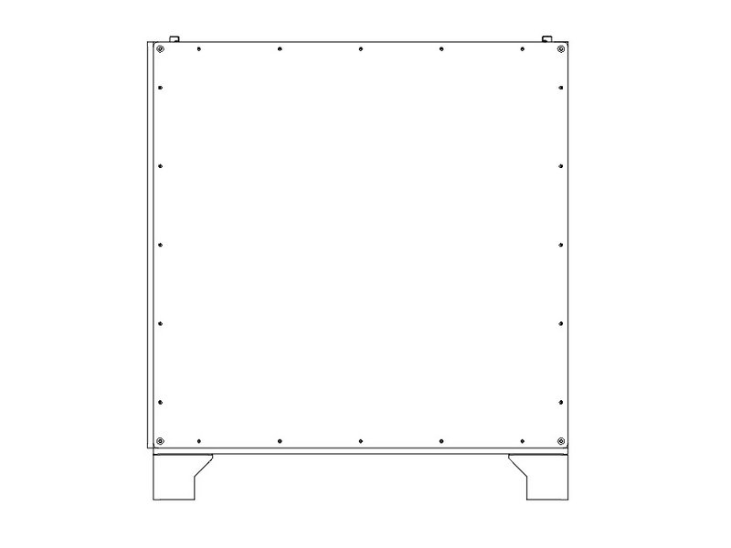
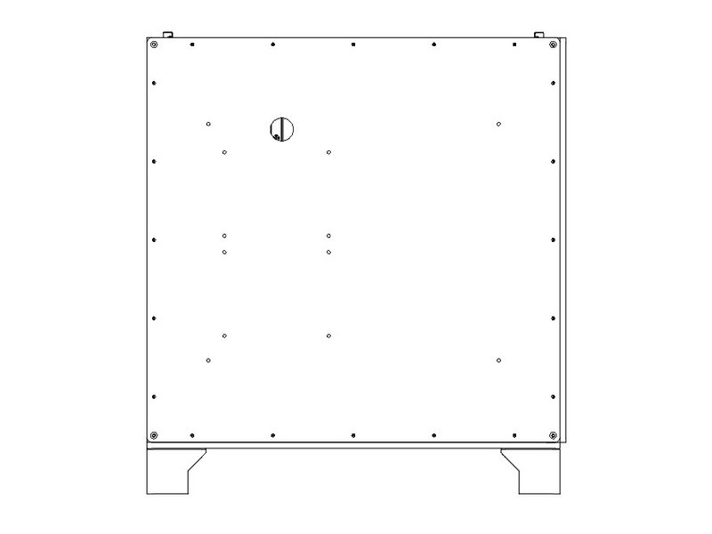
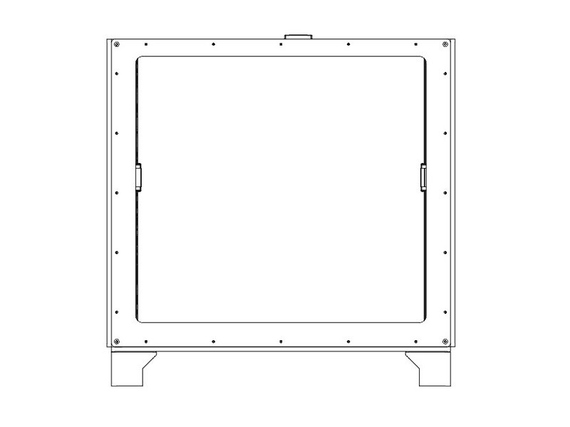
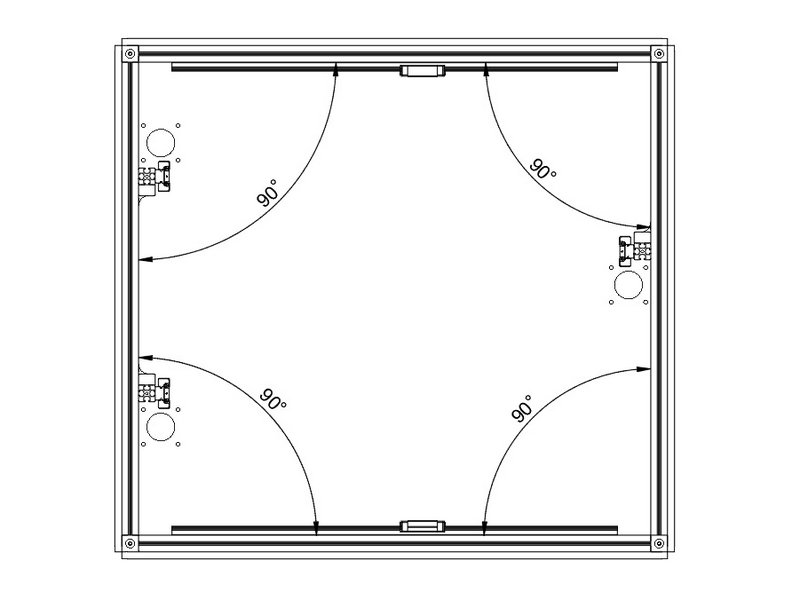

# G) Sides Installation

Category: [RailCore II](index.md) · Original: <https://railcore.dozuki.com/Guide/G)+Sides+Installation/6>

**Difficulty:** Moderate  
**Time required:** 1 - 2 hours  
**Author:** Tony Akens  
**Steps:** 8  
**Last modified on Dozuki:** 2020-12-29

## Introduction

It's assumed that you're building a kit from Filastruder, and you've completed all previous sections. At the end of this section you should have all your panels attached to your frame assembly.

## Tools

- [5.5mm Nut Driver](../items/5-5mm-nut-driver-19.md)

## Parts

- 1 × [HDPE Bottom Panel](../items/hdpe-bottom-panel-85.md)
- 4 × [Foot](../items/foot-90.md)
- 1 × [HDPE Back Panel](../items/hdpe-back-panel-88.md)
- 1 × [HDPE Left Side Panel](../items/hdpe-left-side-panel-86.md)
- 1 × [HDPE Right Side Panel](../items/hdpe-right-side-panel-87.md)
- 1 × [HDPE Front Panel](../items/hdpe-front-panel-89.md)
- 100 × [M3 Nylock Nut](../items/m3-nylock-nut-84.md) For a 300ZLT, this will be quantity 116
- 1 × [Halo (optional)](../items/halo-optional-91.md)

## Step 1

- Prior to installing the side and bottom panels, deburr each panel along each edge to avoid injury.
- It's important that you know which side is which on your frame, so the panels are installed correctly. If you haven't done so, mark the frame with tape, or write on the extrusions to note the front & top, at the least.

## Step 2: Bottom Panel Installation

 

- **Note:** When first installing the panels, only snug up the nuts, do not overly tighten them.
- Flip the printer frame upside down, to install the bottom panel first.
- It's important the two holes are on the same side as the two Z towers (left side), and the "shiny" side of the panel faces out. The holes should be offset towards the front of the printer.
- It's easiest to start by lining up the bolts close to where they'll need to be. Then start from one corner and work your way along the sides. Needle nose pliers can help to line the bolts up with the holes.
- For the Feet, put them over the two bolts at each corner, and fasten each with (2) M3 Nylock Nuts. **Do not overtighten them against the plastic.**
- Snug down the bottom panel using (3) M3 Nylock Nuts for the other bolts protruding along each side. A final tighten will be done later.

**7 comments on step 2:**

> **Islam** wrote on 2021-10-13:
> 
> It can be tough to thread some of the bolts with the nuts. Try loosening/tightening parts of the frame, as well as loosening/tightening adjacent bolts.
>
> Aas you go along and the railcore becomes more aligned overall, it gets easier.

> **Bas Borgignons** wrote on 2021-02-22:
> 
> For 713maker’s metal sidepanels (1/4” thick) and bottom panel; make sure the nut driver outside diameter is less than 9mm. Preferably 8mm even (one row was milled wrong, and the holes there were smaller than the other ones. 8mm barely fit).

> **Scott Krotz** wrote on 2021-02-21:
> 
> I’d suggest highlighting the part “The holes should be offset towards the front of the printer.” I didn’t notice that and installed my bottom panel wrong side out, which was a real pain to fix later when I realized XY 0,0 was over air due to the bed being offset. The filastruder kit I got didn’t have a “shiny” side to help identify which way it goes, mine looked the same on both sides, and at a glance things look symmetrical so I didn’t think it mattered… which it does if you want the bed in the right place!

> **Leon Grossman** wrote on 2020-07-01:
> 
> I read “only snug up the nuts” as don’t over tighten not as, the last step of this section is for squaring and tightening. Don’t be like me and tighten in this stage, loosen and re-tighten to ensure the panels are below the top frame, curse, loosen and re-tighten for square.

> **Ryan McKibbin** wrote on 2020-06-21:
> 
> Before getting started, take a deburring tool to all sharp edges of the plastic panels

> **Ryan McKibbin** wrote on 2020-06-21:
> 
> Tip:
>
> stack two M3 Nylock nuts in your wrench to make starting/reaching the screws in the feet easier.

> **Max Plastix** wrote on 2020-05-09:
> 
> Be very careful installing the printed Feet. The plastic is soft, so will crush before feeling any stop with the M3 nut. Tighten only enough to snug the foot from moving.

## Step 3: Back Panel Installation

- Lay the printer front down on some blocks to protect the bolts.
- It's important that when looking down at the printer as in the picture, the two Z towers are on the Right side of the image.
- The "textured" side of the HDPE panel should face out, shiny side in.
- Install the back panel using (20) M3 Nylock Nuts, in the same method as before. Do not fully tighten the nuts yet.
- **Caution:** For the ZLT you'll need (24) M3 Nylock Nuts total.

**2 comments on step 3:**

> **Bas Borgignons** wrote on 2021-02-22:
> 
> Then lower the other side, and center the panel on the printer. The shrinking tube pieces can be pulled out fairly easily if all went well. If it resists; don’t pull harder (that will make it worse), but raise the panel just a little bit on that side, and then take it out.

> **Bas Borgignons** wrote on 2021-02-22:
> 
> The metal sidepanels are fairly heavy, which makes it a bit more of a challenge to get all those bolts aligned with the holes. I did it as follows. The side of the printer you’re working on should be up. Take 4 objects that are roughly 50mm (or 2 inches) and put those on the corners of the printer. Put the sidepanels on top of that so the sidepanel is about 50mm above the printer, making sure the holes in the sidepanel are not blocked (look through them, you should be able to see the bolts through the holes). Take some shrinking tube that *just* fits over the M3 threads. (It was labelled 3mm in my case, but un-shrunk it was slightly larger than that). Make as many pieces as there are holes, each about 50mm / 2” longer than the 4 objects you used. Insert the tubes through the holes, and over the threads of the bolt that go there. I squeezed them into the extrusion. Now lower the panel on one side slowly, the shrinking tubes will guide the bolts into the holes. They might need some wiggling.

## Step 4: Left Panel Installation

- Lay the printer Right side down on some blocks to protect the bolts.
- It's important that this panel goes on the left end of the printer, which is the end with two Z towers.
- The "textured" side of the HDPE panel should face out, shiny side in.
- Install the left panel using (20) M3 Nylock Nuts, in the same method as before. Do not fully tighten the nuts yet.
- **Caution:** For the ZLT you'll need (24) M3 Nylock Nuts total.

## Step 5: Right Panel Installation

- Lay the printer left side down on some blocks.
- It's important that this panel goes on the side with the single Z tower. Note the position of the hole for the cables to pass through.
- The "textured" side of the HDPE panel should face out, shiny side in.
- Install the Right panel using (20) M3 Nylock Nuts, in the same method as before. Do not fully tighten the nuts yet.
- **Caution:** For the ZLT you'll need (24) M3 Nylock Nuts total.

## Step 6: Front Panel Installation

- Lay the printer back side down.
- The "textured" side of the front HDPE panel should face out, shiny side in.
- The thinner edge of the front panel goes towards the top of the printer.
- Install the front panel using (20) M3 Nylock Nuts, in the same method as before. Do not fully tighten the nuts yet.
- **Caution:** For the ZLT you'll need (24) M3 Nylock Nuts total.

## Step 7: Installing the optional Halo

- If you have a Halo, now is the time to install it. Generally use (1) M3 x 10mm button head bolt bolt and (1) M3 washer per "slot" in the Halo.
- Center the bolt in the middle slot, and put the bolts in the outside slots at the outside ends of the channels.
- Be sure to roughly balance the number of M3 nuts between the bolts holding down the Halo.
- The Stepper Mounts for the Halo go on the right side of the printer, idler mounts to the left.

**1 comment on step 7:**

> **Islam** wrote on 2021-10-13:
> 
> I found it really hard to get the 10mm bolts in, much easier to use 12mm like max suggests

## Step 8: Squaring your Frame

- Now is when you want to square up your frame. Start with the bottom panel, and get it as centered and even as you can.
- With the printer laying on its back. Tighten all 5 nuts (including the feet) along one side of the bottom panel. Use a square or 123 blocks to square up the bottom extrusions, and tighten down the rest of the nuts on the bottom panel.
- Repeat this process for each of the side panels, tightening the bolts along the bottom of each panel first.
- **Caution:** Be sure the side panels do not protrude above the top extrusions before tightening them.

**2 comments on step 8:**

> **Thomas Müller** wrote on 2022-01-25:
> 
> How square is square enough? When measuring I got the following readings.
>
> **Back**
>
> - Top left: 90.2 °
>
> - Top right: 90 °
>
> - Bottom left: 89.9 °
>
> - Bottom right: 90.05 °
>
> (so not totally precise)
>
> **Front**
>
> - Top left: 90.15 °
>
> - Top right: 89.9 °
>
> - Bottom left: 89.85 °
>
> - Bottom right: 90.15 °
>
> (relatively precise it seems)
>
> Measuring the sides is a bit tricky as my angle ruler is colliding with the Z extrusions but it looks OK to me. The left side panel protrudes ~0.3 mm above the top left extrusion in the area to the back (front area is fine). Loosening up the nuts did not really help.
>
> Is this fine or should all angles read exactly 90 °? I know this would be best… not sure if it is even possible.
>
> Thanks!

> **Max Plastix** wrote on 2020-05-13:
> 
> This might be a good time to install the optional Halo from 713Maker, while squaring the assembly with panels.
>
> I used M3x12 screws with an M3 washer, (6) per side, two per Halo ‘slot’.

## Comments on this guide (1)

> **Max Plastix** wrote on 2020-05-14:
> 
> The kit panels will interfere/collide on some edges, throwing the frame out of square. The lip of the left panel will block the rear panel from shifting over as needed, for example.
>
> Use a planer or razor to bevel the edges a bit, or even 45-degree edges to allow them to be positioned without hard contact.

Previous: [F) Z Installation](f-z-installation.md) · [RailCore II guide list](index.md) · Next: [H) Leadscrews and Z Yokes](h-leadscrews-and-z-yokes.md)

---

Original page: <https://railcore.dozuki.com/Guide/G)+Sides+Installation/6>. Written by Tony Akens on railcore.dozuki.com. This copy was captured on 2026-11-16 and is licensed under [Creative Commons Attribution-ShareAlike 3.0 (CC BY-SA 3.0)](https://creativecommons.org/licenses/by-sa/3.0/), the license stated on the original site. This is an unofficial community mirror and is not affiliated with RailCore Labs, LLC. RAILCORE is a registered trademark of RailCore Labs, LLC.
