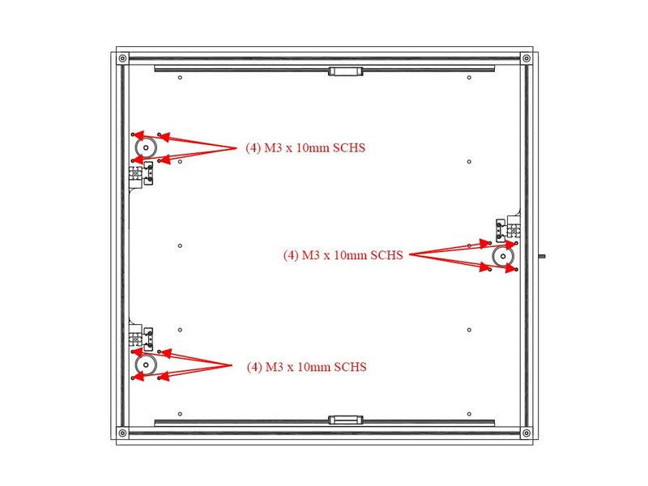
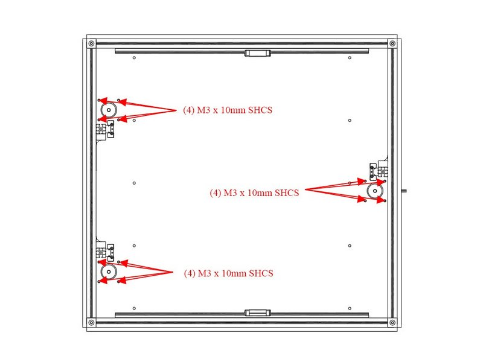
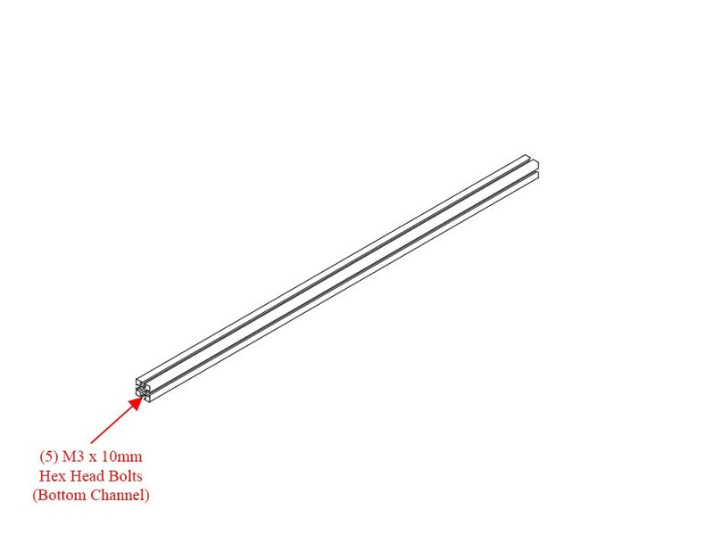
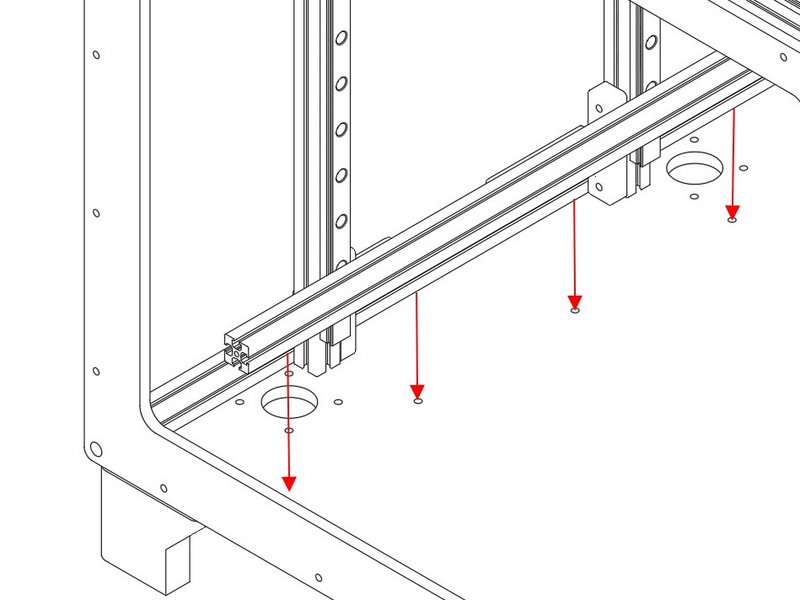
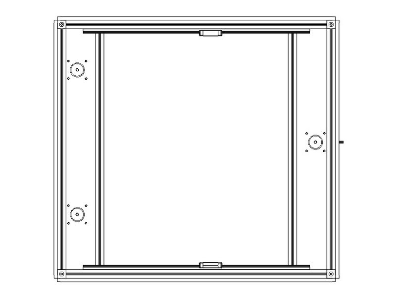
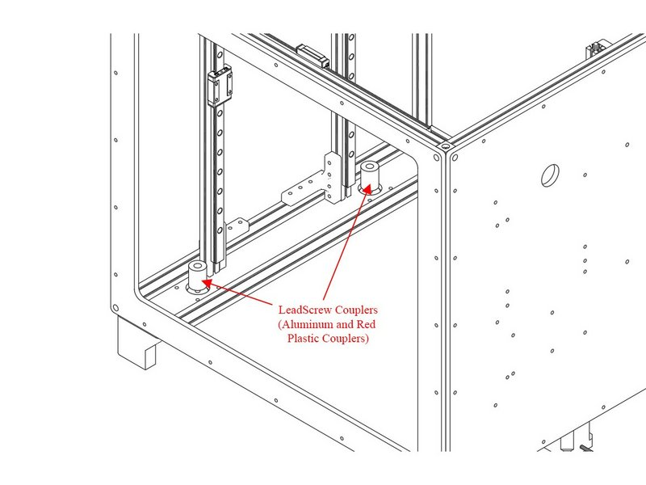
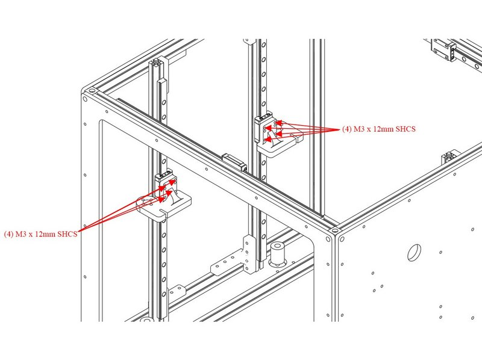
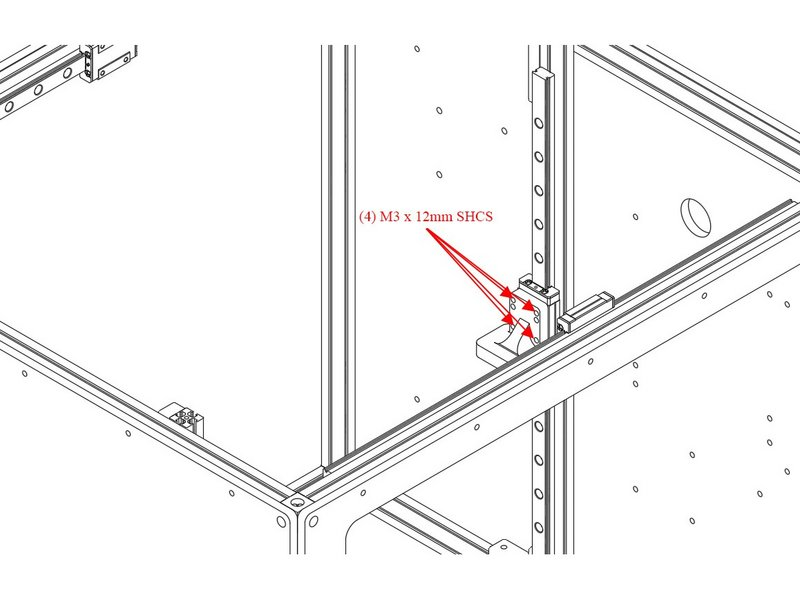
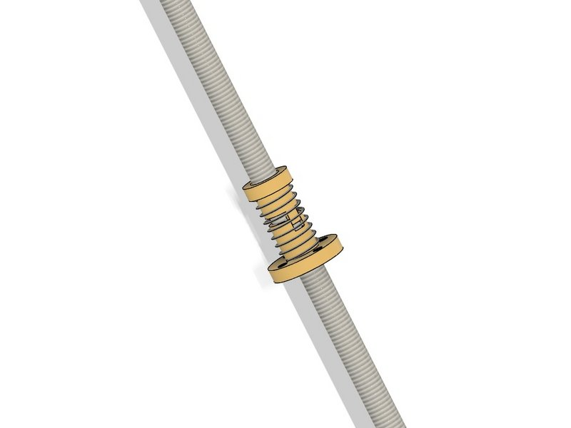
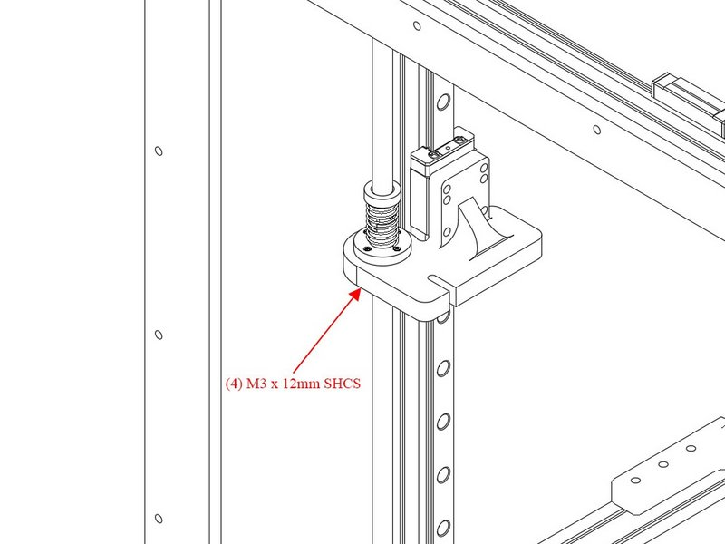

# H) Leadscrews and Z Yokes

Category: [RailCore II](index.md) · Original: <https://railcore.dozuki.com/Guide/H)+Leadscrews+and+Z+Yokes/13>

**Difficulty:** Moderate  
**Time required:** 1 - 2 hours  
**Author:** Tony Akens  
**Steps:** 6  
**Last modified on Dozuki:** 2021-08-06

## Tools

- [Set of Allen Keys](../items/set-of-allen-keys-20.md)

## Parts

- 3 × [Nema17 Stepper Motor (1.8 degrees)](../items/nema17-stepper-motor-1-8-degrees-50.md)
- 3 × [M5 / M8 Leadscrew Coupler](../items/m5-m8-leadscrew-coupler-51.md)
- 3 × [450mm Leadscrew](../items/450mm-leadscrew-52.md)
- 12 × [M3 x 10mm Button Head Bolt](../items/m3-x-10mm-button-head-bolts-53.md)
- 12 × [M3 x 12mm Button Head Bolts](../items/m3-x-12mm-button-head-bolts-54.md)
- 3 × [Anti-BackLash Nut](../items/anti-backlash-nut-55.md)
- 3 × [Z Yoke](../items/z-yoke-56.md)

## Step 1: Z Stepper Installation

- Install the (3) Z steppers into the bottom panel using (4) M3 x 10mm socket cap head screw per stepper. The connectors should point towards the right side of the printer.
- **Caution:** It's important the Z towers are positioned on the correct side of the steppers, as is shown in the picture.

**3 comments on step 1:**

> **Jeff Weiss** wrote on 2021-08-06:
> 
> I have the LDO-42STH40-1684MAC Steppers also. They say 0.9 degree not 1,8. Is this an issue?

> > **Tony Akens** wrote on 2021-08-06:
> > 
> > Doh, no. The kits updated to 0.9 on all axis when moving to tr8*4 leads. I’ll update the text!

> **Chris Cygan** wrote on 2020-08-29:
> 
> 10m were too long for my LDO42STH40-1684AC steppers. So I used 8m long button head bolts.

> **Max Plastix** wrote on 2020-05-15:
> 
> Top of the picture is the Back side of the printer.

## Step 2: Bottom Brace Installation

  

- **Caution:** Skip this step if using an aluminum base plate
- Insert (5) M3 x 10mm Hex Head Bolts into the bottom channel of one of the remaining 425mm Extrusions.
- Lower the extrusion to the bottom panel so the bolts go through the 5 holes that go front to back in the panel, near the left side steppers.
- Secure the bottom panel brace using (5) M3 washers and (5) M3 nuts on the bottom side of the printer.
- Repeat this process for the brace on the right side of the bottom panel.

**6 comments on step 2:**

> **Keith Coventry** wrote on 2021-02-06:
> 
> M3x10 bolts are not long enough if using a washer and nut per the instructions. You’re lucky if you can get 2 threads of engagement on the bolt, not sufficient, especially for Nylock nuts. Then I discovered M3 hex head bolts are not common stock at most places. McMaster to the rescue.

> **Carlos Daniel Stagnaro** wrote on 2020-09-24:
> 
> HDPE base on the Printed Solid kit presents holes slightly misaligned. That brings stress to the overall construction. Upgrade to Metal base is highly recommended. All missalignment and lack of squareness went away.

> **Glen Hoag** wrote on 2020-09-05:
> 
> It will depend on where you bought the kit. Filastruder added the bottom braces to their kits in March 2020, but Printed Solid kits do not have the braces as of this writing.

> **feds27** wrote on 2020-06-25:
> 
> My kit is from Jan 2020 and it didn’t have it either but it’s a ZL. Not sure if it’s a case of it being optional on the ZL, versus, it being standard on the ZLT due to the size and flex of the larger frame.

> **Max Plastix** wrote on 2020-06-05:
> 
> If it’s a recent kit (after Oct 2019) then it should have holes in the bottom HDPE and after March 2020 the two extra extrusions included. Older kit, [@legacyofbob](https://railcore.dozuki.com/User/97/Joshua+Smith) ?

> **Joshua Smith** wrote on 2020-06-02:
> 
> Not only does my kit not have two extra extrusions for this,but there are no holes in the bottom HDPE panel for this as well. Is this something that should have been in the filastruder kit?

## Step 3: Leadscrew Couplers

- Install the (3) Leadscrew couplers onto the Z stepper shafts. The couplers should be fully seated and tightened.
- The Couplers are silver, with colored plastic combining the two halves.
- **Note:** The third stepper on the right side of the printer is not pictured.

**3 comments on step 3:**

> **Max Plastix** wrote on 2020-06-05:
> 
> The Couplers are show here as a cylinder, but they are the “plumb” couplers. In my kit they were Zyltech, with orange rubber inserts showing in the middle. (5mm motor shaft to 8mm lead screw.)

> **Max Plastix** wrote on 2020-06-05:
> 
> Consider delaying the Coupling installation on the motor until AFTER the Z Yokes are installed and the motors can be centered with the Alignment Tool.

> **Max Plastix** wrote on 2020-05-14:
> 
> There is a Z Motor Alignment Tool in the RailCore STL files that helps position the Z motors later. Don’t stress over their precise position yet.
>
> Consider Loctite on the screw threads into the motor.
>
> Note that the LDO motors don’t have very deep holes. Ensure that the screws aren’t bottoming out in the motor.

## Step 4: Yokes

 

- Install the (3) Z Yokes onto the Z carriages using (4) M3 x 12mm Button Head Bolts each. Note the orientation of the yokes in the pictures - ensure the hole for the leadscrew lines up over the stepper.
- **Caution:** For Misumi linear rails, use M3 x 10mm instead of M3 x 12mm bolts.

**2 comments on step 4:**

> **Max Plastix** wrote on 2020-06-05:
> 
> This part about “the hole for the leadscrew lines up over the stepper” is very important, as centering the motor will center the leadscrew and keep it from waggling around as Z goes up and down.
>
> To center the motor, print the “Z Alignment Tool”. This is a post that goes over the motor shaft and fits tightly into the Yoke hole. Slide the yoke down the rail (careful not to off the end of the rail) and position the yoke over the alignment tool post. Now the motor is centered, tighten nuts, make Z rail vertical, and remove the tool. Repeat on all three and the motor shafts will be perfectly centered to the yoke for vertical lead screws.

> **feds27** wrote on 2020-05-06:
> 
> FYI, some folks talk about flipping the Z yokes on the Discord forum. This would be the time to check that out and determine if it’s for you.

> > **Chahé** wrote on 2020-11-12:
> > 
> > I inverted the z yokes because when the plate is at its highest point, the extruder fan shroud was touching part of the yoke. Inverting the a yokes gives more xy room to print.

## Step 5: Anti-backlash Nut

- Prepare the anti-backlash nut for mounting onto the leadscrew.
- Thread the bottom half (with the flange) down onto the screw until just the teeth are sticking up past the end of the leadscrew.
- Put the spring on the bottom of the leadscrew nut and hold it there until the next step.
- Insert the top of the leadscrew nut, pushing down until the teeth in the upper and lower parts interlock.
- Thread the nut assembly onto the leadscrew, until it's about 1/3 of the way down.
- Repeat the above steps for the other (2) leadscrews.

## Step 6: Leadscrews

- Insert the leadscrew down through the hole in the yoke, and into the leadscrew coupler.
- **Note:** You may need to slide the Z tower around to line it up so you can get the leadscrew into the coupler.
- Tighten the grub screw in the coupler.
- Insert (4) M3 x 12mm Button head bolts through the bottom of the yokes, and into the holes on the leadscrew nut flange. Do not overtighten, you can strip the Delrin.

Previous: [G) Sides Installation](g-sides-installation.md) · [RailCore II guide list](index.md) · Next: [I) Y Rail Installation](i-y-rail-installation.md)

---

Original page: <https://railcore.dozuki.com/Guide/H)+Leadscrews+and+Z+Yokes/13>. Written by Tony Akens on railcore.dozuki.com. This copy was captured on 2026-11-16 and is licensed under [Creative Commons Attribution-ShareAlike 3.0 (CC BY-SA 3.0)](https://creativecommons.org/licenses/by-sa/3.0/), the license stated on the original site. This is an unofficial community mirror and is not affiliated with RailCore Labs, LLC. RAILCORE is a registered trademark of RailCore Labs, LLC.
