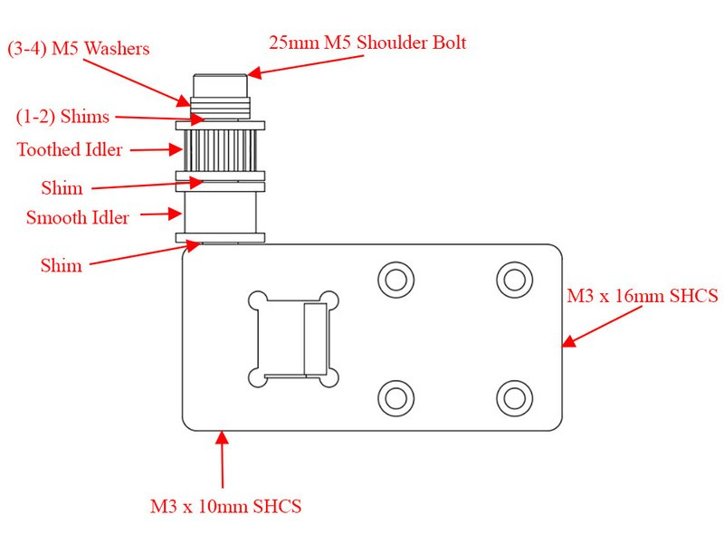
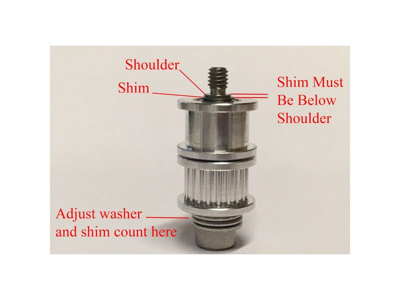
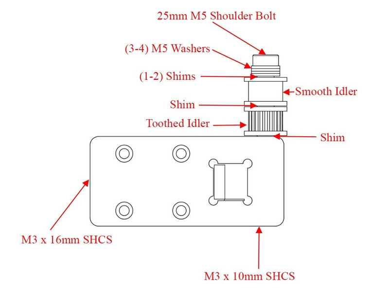
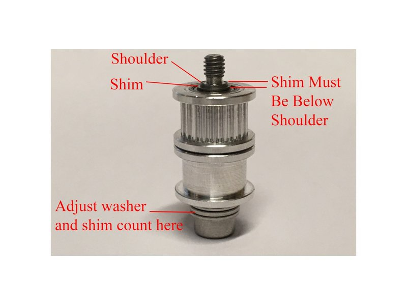
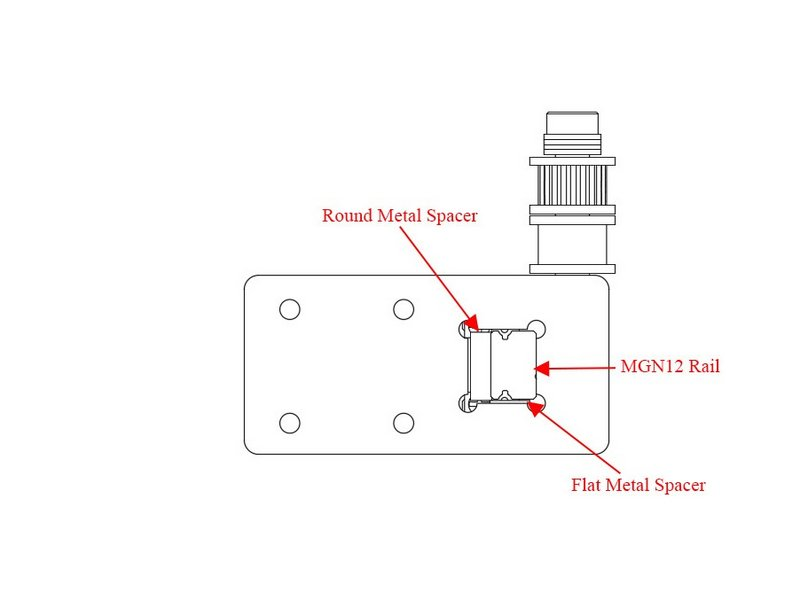
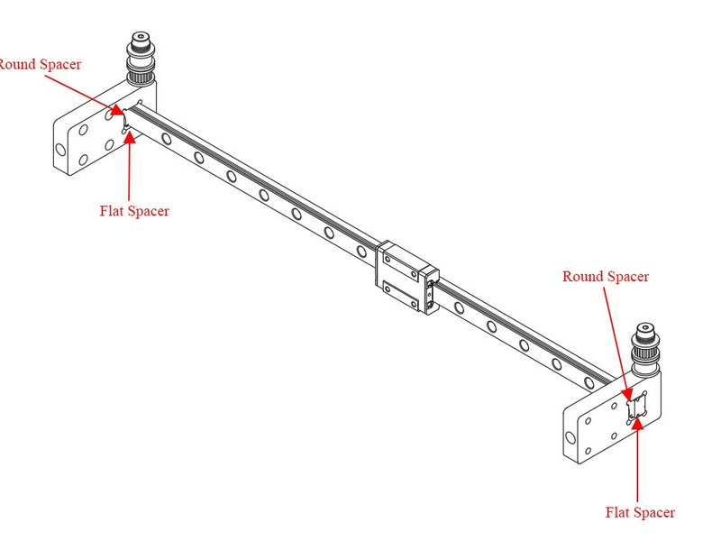
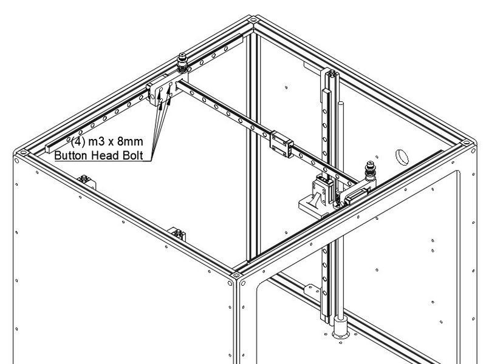

# I) Y Rail Installation

Category: [RailCore II](index.md) · Original: <https://railcore.dozuki.com/Guide/I)+Y+Rail+Installation/7>

**Difficulty:** Moderate  
**Time required:** 30 minutes - 1 hour  
**Author:** Tony Akens  
**Steps:** 5  
**Last modified on Dozuki:** 2021-10-01

## Tools

- [Set of Allen Keys](../items/set-of-allen-keys-20.md)

## Parts

- 1 × [400mm Linear Rail](../items/400mm-linear-rail-57.md)
- 1 × [Back X Carriage](../items/back-x-carriage-58.md)
- 1 × [Front X Carriage](../items/front-x-carriage-59.md)
- 2 × [25mm Shoulder Bolt](../items/25mm-shoulder-bolt-42.md)
- 8 × [M5 Washer](../items/m5-washer-46.md)
- 2 × [2GT 20T x 5mm Bore Toothed Idler](../items/gt2-20t-x-5mm-bore-toothed-idler-49.md)
- 2 × [2GT x 5mm Bore Smooth Idler](../items/gt2-x-5mm-bore-smooth-idler-60.md)
- 8 × [M3 x 8mm Button Head Bolt](../items/m3-x-8mm-button-head-bolt-16.md)
- 2 × [M3 x 10mm Button Head Bolt](../items/m3-x-10mm-button-head-bolts-53.md)
- 2 × [M3 x 16mm Button Head Bolt](../items/m3-x-16mm-button-head-bolt-61.md)
- 2 × [Round Metal Spacer](../items/round-metal-spacer-62.md)
- 2 × [Flat Metal Spacer](../items/flat-metal-spacer-63.md)

## Step 1

- **Caution:** Newer Filastruder kits use Socket Cap Head Screws, use them in place of all button head screws in this section.

## Step 2: Front X Carriage Idler Installation

 

- To prep for the Y rail installation we need to assemble the X carriages and idlers. Locate the X carriage labelled as the "Front".
- Insert an M3 x 10mm Button head bolt into the bottom of the X Carriage, and an M3 x 16mm button head bolt into the long horizontal hole in the X carriage, until they're flush with the inside edge.
- Begin by holding the shoulder bolt so the threads are pointed up. Place (3) M5 washers on the bolt, followed by (1) M5 shim. Next put on a toothed idler. Then another M5 shim, then a smooth idler, followed by a final M5 Shim.
- Visually look to see that the final shim is very close to level with the "shoulder" of the bolt.
  - **Note:** If there's a gap, see if it's best filled by a shim, or a washer. You want to place those before the first shim you put on.
  - **Note:** If instead the shim sticks out past the shoulder, you may need to remove a washer and replace it with a shim.
- Once the "stack" is level with the shoulder, thread it into the X carriage (I leave the shoulder bolt pointing up, and turn the X carriage down onto it, being careful not to cross-thread it).
- **Caution:** The shoulder must be tight against the X-Carriage, with as little vertical play as possible. If the idlers don't spin smoothly, it's too tight and you need to remove a washer or shim. THERE MUST ALWAYS BE A SHIM DIRECTLY AGAINST EACH SIDE OF THE IDLERS.

4 comment(s) on this step

> **Islam** wrote on 2022-03-14:
> 
> I bought this variety pack of shims: <https://teamyokomo.com/parts/ZC-S50/>
>
> Stack up that worked well for me:
>
> 3x m5 washer
>
> 2x 0.5mm shim
>
> 1x shim
>
> 1x toothed idler
>
> 1x shim
>
> 1x smooth idler
>
> 1x shim

> **Max Plastix** wrote on 2020-07-05:
> 
> While the standard build here is button-head screws for the top & side set screws, consider replacing with Cap Head screws if you have them. These should get a bit of Loctite and go in pretty tight, so cap-heads will help prevent stripping later on removal.

> **Max Plastix** wrote on 2020-07-05:
> 
> It’s worth noting here that shims and washers for spacing should be added to the Head side of the bolt, because you don’t want to adjust the height of the idlers (or the belt path). The bottom of the stack should remain just one shim around each idler, close to the carriage.
>
> The height of the belt path is determined entirely by the Belt Retainer height, which is not adjustable. All the idlers and pulleys must match that height as closely as possible.
>
> If there is zero up/down play in the stack, it might be too tight. Ideally, you want less than one shim in play.

> **Max Plastix** wrote on 2020-05-15:
> 
> My washers are 0.933mm and shims 0.409mm thick, if that helps adjustment.

## Step 3: Back X Carriage Idler Installation

 

- Locate the X carriage labelled as the "Back".
- Insert an M3 x 10mm Button head bolt into the bottom of the X Carriage, and an M3 x 16mm bolt into the long horizontal hole in the X carriage, until they're flush with the inside edge.
- Begin by holding a 25mm shoulder bolt so the threads are pointed up. Place (3) M5 washers on the bolt, followed by (1) M5 shim. Next put on a smooth idler. Then another M5 shim, then a toothed idler, followed by a final M5 Shim.
- Visually look to see that the final shim is very close to level with the "shoulder" of the bolt.
  - If there's a gap, see if it's best filled by a shim, or a washer. You want to place those before the first shim you put on.
  - If instead the shim sticks out past the shoulder, you may need to remove a washer and replace it with a shim.
- Once the "stack" is level with the shoulder, thread it into the X carriage (I leave the shoulder bolt pointing up, and turn the X carriage down onto it, being careful not to cross-thread it). The shoulder must be tight against the X-Carriage, with as little vertical play as possible.
- **Caution:** The shoulder must be tight against the X-Carriage, with as little vertical play as possible. If the idlers don't spin smoothly, it's too tight and you need to remove a washer or shim. THERE MUST ALWAYS BE A SHIM DIRECTLY AGAINST EACH SIDE OF THE IDLERS.

## Step 4: Insert Y rail into X carriages

 

- To insert the Y rail into the X carriages it gets oriented as in the image. Be sure the "inside' faces with the text milled into them face each other.
- There is a round metal spacer that goes between the Y rail and the horizontal part of the carriage. Lightly tighten the horziontal M3 bolt t hold it in place.
- There is a flat aluminum spacer that goes under the Y rail. Lightly tighten vertical bolt under the Rail against that spacer.

1 comment(s) on this step

> **Max Plastix** wrote on 2020-05-15:
> 
> Do not make the X Carriages flush against the end of the rail! The carriage will span 400mm of space, and the rail is only 395mm, so it should be recessed about 2mm in from each outer face.

## Step 5: Bolt Y Rail Assembly onto X Rails

- Attach the X carriages to the X rails using (4) M3 x 8mm Button head bolts each.

2 comment(s) on this step

> **Max Plastix** wrote on 2020-07-05:
> 
> Before mounting the carriages, do a quick test to make sure the bare rail blocks travel smooth from end to end. Note how they sound and feel as they roll.
>
> After mounting the carriages, check again that each one moves smoothly as before, and no new binding or rough spots have been introduced by mounting the carriages.

> **Max Plastix** wrote on 2020-07-05:
> 
> There might be some (tilt) play in how the carriages mount to the rail blocks, so take extra care to make sure they are nicely horizontal and level to the rail.

Previous: [H) Leadscrews and Z Yokes](h-leadscrews-and-z-yokes.md) · [RailCore II guide list](index.md) · Next: [J) X/Y Steppers and Idlers](j-x-y-steppers-and-idlers.md)

---

Original page: <https://railcore.dozuki.com/Guide/I)+Y+Rail+Installation/7>. Written by Tony Akens on railcore.dozuki.com. This copy was captured on 2026-11-16 and is licensed under [Creative Commons Attribution-ShareAlike 3.0 (CC BY-SA 3.0)](https://creativecommons.org/licenses/by-sa/3.0/), the license stated on the original site. This is an unofficial community mirror and is not affiliated with RailCore Labs, LLC. RAILCORE is a registered trademark of RailCore Labs, LLC.
