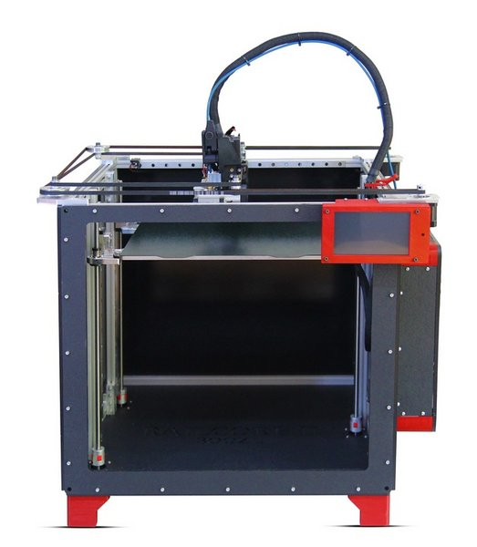

# RailCore II

Original: <https://railcore.dozuki.com/c/RailCore_II>

## Guides (20)

| Guide | Difficulty | Time | Steps |
|---|---|---|---|
| [A) Introduction](a-introduction.md) | Very easy | 2 minutes | 0 |
| [B) Prep](b-prep.md) | Moderate | 45 minutes | 5 |
| [C) Top Extrusions Assembly](c-top-extrusions-assembly.md) | Moderate | 1 hour | 12 |
| [D) Bottom Extrusions Assembly](d-bottom-extrusions-assembly.md) | Moderate | 15 minutes | 10 |
| [E) Upright Extrusion / Frame Final Assembly](e-upright-extrusion-frame-final-assembly.md) | Easy | 20 minutes | 3 |
| [F) Z Installation](f-z-installation.md) | Moderate | 1 - 2 hours | 6 |
| [G) Sides Installation](g-sides-installation.md) | Moderate | 1 - 2 hours | 8 |
| [H) Leadscrews and Z Yokes](h-leadscrews-and-z-yokes.md) | Moderate | 1 - 2 hours | 6 |
| [I) Y Rail Installation](i-y-rail-installation.md) | Moderate | 30 minutes - 1 hour | 5 |
| [J) X/Y Steppers and Idlers](j-x-y-steppers-and-idlers.md) | Moderate | 1 hour | 13 |
| [K) Y Carriage](k-y-carriage.md) | Moderate | No estimate | 10 |
| [L) X/Y Belts](l-x-y-belts.md) | Moderate | No estimate | 8 |
| [M) Hotend and Extruder](m-hotend-and-extruder.md) | Moderate | No estimate | 8 |
| [N) Aligning your RailCore](n-aligning-your-railcore.md) | Moderate | No estimate | 5 |
| [O) Bed](o-bed.md) | Moderate | No estimate | 3 |
| [P) Electronics](p-electronics.md) | Moderate | No estimate | 12 |
| [Q) Wiring the Electronics](q-wiring-the-electronics.md) | Moderate | No estimate | 34 |
| [R) Firmware, Config, and Smoke Test](r-firmware-config-and-smoke-test.md) | Moderate | No estimate | 6 |
| [S) First Moves](s-first-moves.md) | Moderate | No estimate | 11 |
| [T) Adjusting Your Configuration](t-adjusting-your-configuration.md) | Moderate | No estimate | 9 |

[Back to the archive home](../index.md)

---

Original page: <https://railcore.dozuki.com/c/RailCore_II>. Written by Tony Akens on railcore.dozuki.com. This copy was captured on 2026-11-16 and is licensed under [Creative Commons Attribution-ShareAlike 3.0 (CC BY-SA 3.0)](https://creativecommons.org/licenses/by-sa/3.0/), the license stated on the original site. This is an unofficial community mirror and is not affiliated with RailCore Labs, LLC. RAILCORE is a registered trademark of RailCore Labs, LLC.
