# J) X/Y Steppers and Idlers

Category: [RailCore II](index.md) · Original: <https://railcore.dozuki.com/Guide/J)+X-Y+Steppers+and+Idlers/8>

**Difficulty:** Moderate  
**Time required:** 1 hour  
**Author:** Tony Akens  
**Steps:** 13  
**Last modified on Dozuki:** 2020-12-29

## Tools

- [Set of Allen Keys](../items/set-of-allen-keys-20.md)

## Parts

- 24 × [M3 x 8mm Button Head Bolt](../items/m3-x-8mm-button-head-bolt-16.md)
- 2 × [16t Pulley](../items/16t-pulley-38.md)
- 2 × [Nema17 Stepper Motor (0.9 Degrees)](../items/nema17-stepper-motor-0-9-degrees-39.md)
- 1 × [Front Motor Mount](../items/front-motor-mount-40.md)
- 1 × [Rear Motor Mount](../items/rear-motor-mount-41.md)
- 2 × [25mm Shoulder Bolt](../items/25mm-shoulder-bolt-42.md)
- 2 × [15mm Shoulder Bolt](../items/15mm-shoulder-bolt-43.md)
- 1 × [Front Idler Mount](../items/front-idler-mount-44.md)
- 1 × [Back Idler Mount](../items/back-idler-mount-45.md)
- 10 × [M5 Washer](../items/m5-washer-46.md)
- 12 × [5mm Shim](../items/5mm-shim-47.md)
- 2 × [Printed Idler Spacer](../items/printed-idler-spacer-48.md)
- 4 × [2GT 20T x 5mm Bore Toothed Idler](../items/gt2-20t-x-5mm-bore-toothed-idler-49.md)

## Step 1

- Newer Filastruder kits use Socket Cap Head Screws, use them in place of all button head screws in this section.

## Step 2: Front Stepper Mount

[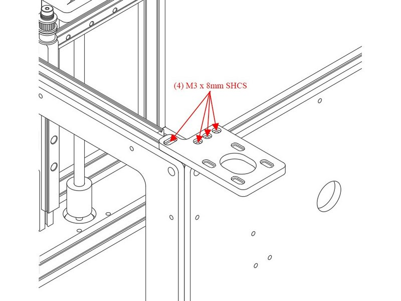](../assets/images/zoom/RRXJHkWgeZmSGkr5.jpg)

- Attach the front stepper mount to the top of the frame using (4) m3 x 8mm button head bolts.
- **Note:** Don't overtighten them - you'll need to be able to adjust the position of the idler mount to align the belts later.

**1 comment on step 2:**

> **Max Plastix** wrote on 2020-05-15:
> 
> Not applicable for Halo, of course.

## Step 3: Install Front Stepper

[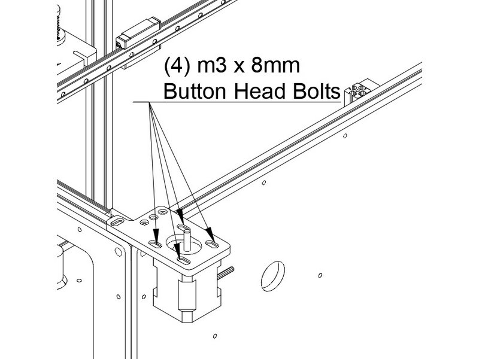](../assets/images/zoom/XrObxOMqSxTXOZMw.jpg)

- Attach one of the 0.9 degree NEMA 17 steppers to the front idler mount using (4) m3 x 8mm Button Head Bolts.
- The wiring connector should point towards the rear of the machine.

**1 comment on step 3:**

> **Max Plastix** wrote on 2020-05-15:
> 
> Halo requires longer screws: M3x10mm
>
> Also consider adding an M3 washer to better fit the Halo slot.

## Step 4: Install Front Pulley

[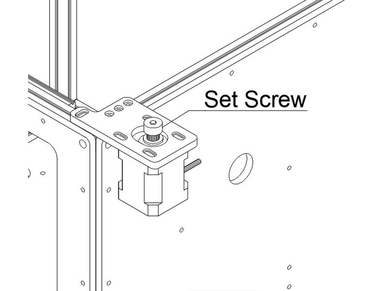](../assets/images/zoom/YLGiTf2FgvIoPjOt.jpg)

- Install one of the 16t pulleys onto the stepper shaft with the teeth facing down. There are two set screws, be sure one of them is against the flat of the stepper shaft.
- **Note:** Don't overtighten the set screws, you'll need to adjust the pulley height to align the belt later

**1 comment on step 4:**

> **Max Plastix** wrote on 2020-06-26:
> 
> (Halo) The thicker material of the Halo causes the motor to sit a bit lower, with less usable motor shaft. Install this Front Pulley “right side up” with the Teeth facing Up to better reach the belt and position the grub screw. This way, the pulley is fully on the shaft when aligned, rather than hanging off the tip of the shaft.

## Step 5: Rear Stepper Mount

[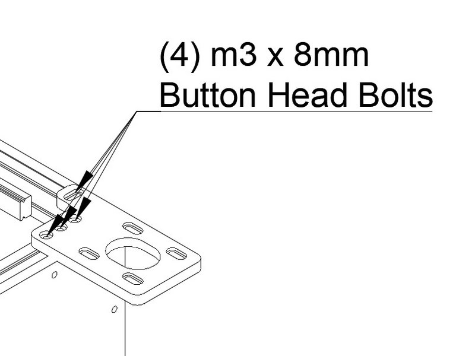](../assets/images/zoom/KfZJlF1dJDAWPqpL.jpg)

- Attach the rear stepper mount to the top of the frame using (4) m3 x 8mm button head bolts.
- **Note:** Don't overtighten them - you'll need to be able to adjust the position of the idler mount to align the belts later.

## Step 6: Install Rear Stepper

[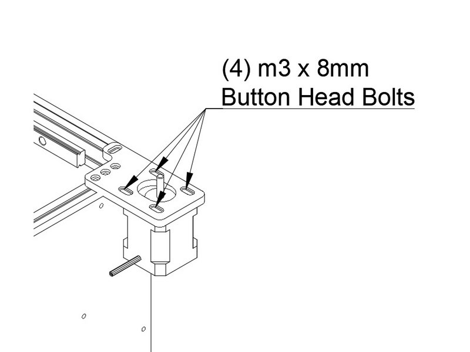](../assets/images/zoom/6GlXYhqIpRAGnDoC.jpg)

- Attach one of the 0.9 degree NEMA 17 steppers to the front idler mount using (4) m3 x 8mm Button Head Bolts.

**1 comment on step 6:**

> **Max Plastix** wrote on 2020-05-15:
> 
> Again, longer screws needed for Halo: M3x10mm with M3 washer.

## Step 7: Install Rear Pulley

[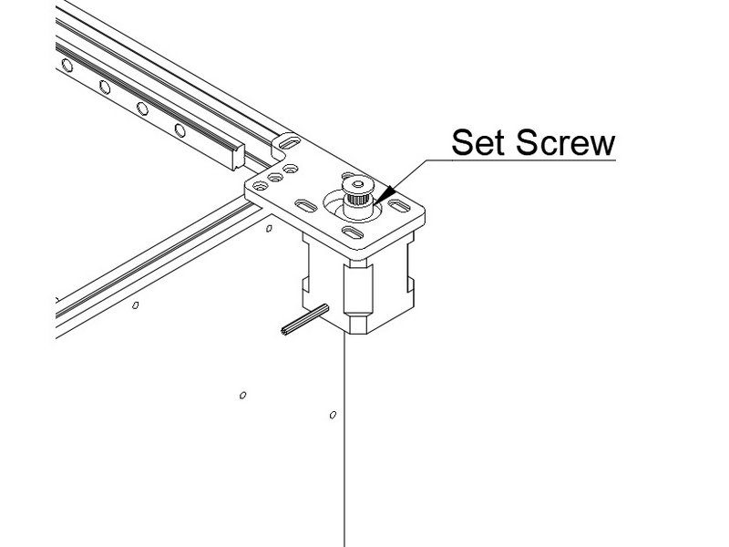](../assets/images/zoom/MPKAGhoTRpyvLoqI.jpg)

- Install one of the 16t pulleys onto the stepper shaft with the teeth facing up. There are two set screws, be sure one of them is against the flat of the stepper shaft.
- **Note:** Don't overtighten the set screws, you'll need to adjust the pulley height to align the belt later

## Step 8: Install Idlers on Front Idler Mount (Diagrams)

[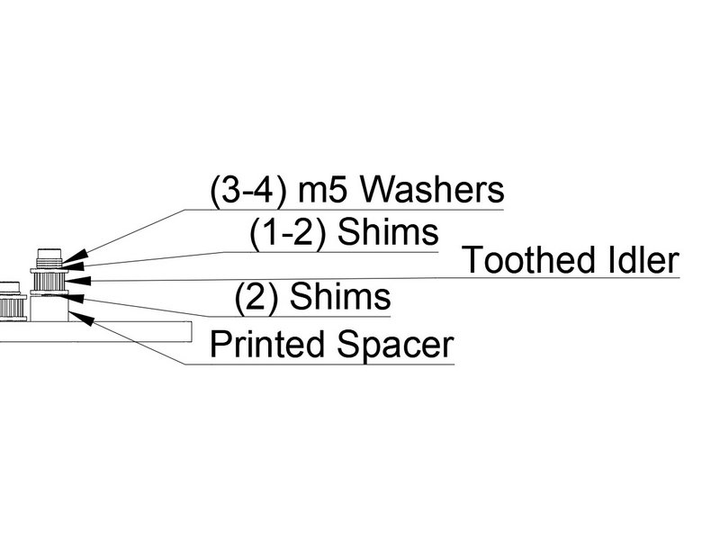](../assets/images/zoom/JCEeUBSVREvxcU5p.jpg) [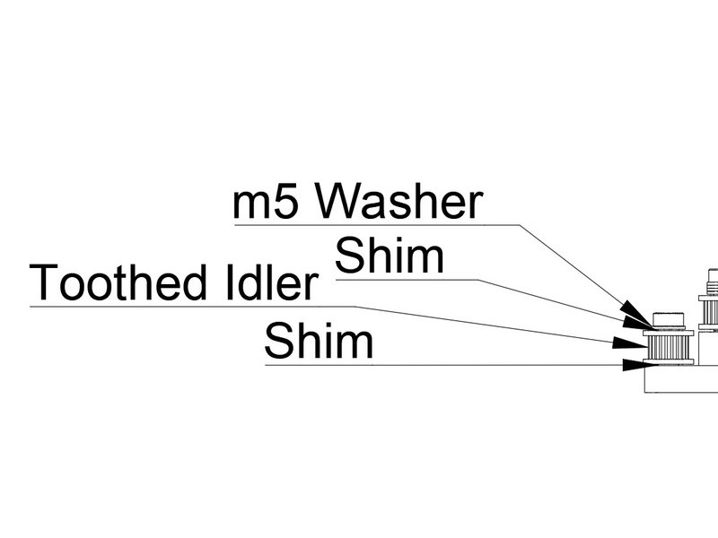](../assets/images/zoom/HrxkyHaXainBxA2w.jpg) [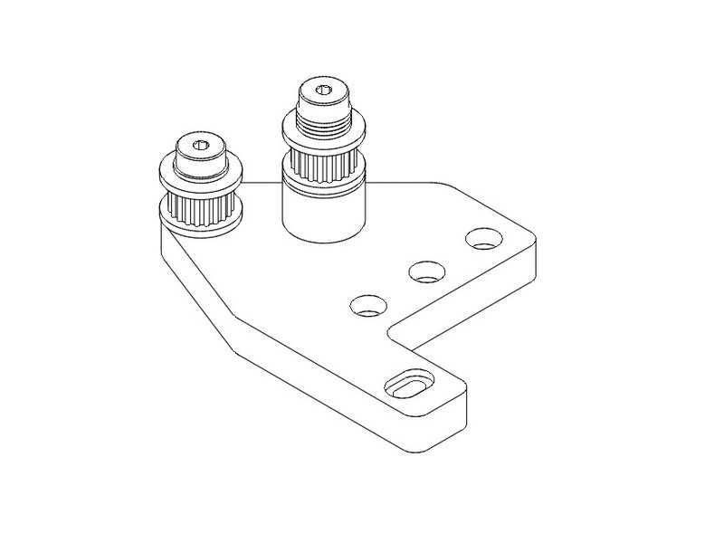](../assets/images/zoom/vBjDo3jC5iXhN2pa.jpg)

- Building the idler stacks is very similar to how the stacks were built for the Y carriage stacks.
- **Note:** There are photos to accompany this step in the next step.
- For the front idler, the stack for the outside bolt is the short stack. Turn a 12mm shoulder bolt upside down and install (1) M5 washer, then (1) M5 shim. Next add the 20T idler, then lastly (1) M5 shim.
- **Note:** You want to be sure the total stack is just slightly below the shoulder on the shoulder bolt. If there is room for another shim, take the last shim and pulley off, and put the extra shim on before the pulley.
- Install the shorter idler stack in the outside hole on the idler mount.
- For the front idler, the stack for the inside bolt is the tall stack. Turn a bolt upside down and install (3) M5 washers, then (1) M5 shim. Next add the 20T idler, then lastly (1) M5 shim.
- **Note:** You want to be sure the total stack is just slightly below the shoulder on the shoulder bolt. If there is room for another shim or washer, take the last shim and pulley off, and put the extra shim on before the pulley. If you can fit an extra washer, be sure to put it on before the first shim.
- Install the taller idler stack in the inside hole on the idler mount.

**5 comments on step 8:**

> **Islam** wrote on 2022-03-17:
> 
> The final stack I’m going with:
>
> 2 - 5mm washers
>
> 1 - shim washer
>
> 1 - gates idler or big pulley
>
> 1 - shim washer
>
> 1 - gates idler or big pulley
>
> 4 - shim washers
>
> 1 - 0.13mm shim (from <https://teamyokomo.com/parts/ZC-S50/>)
>
> 1- 5mm washer

> **Islam** wrote on 2022-03-17:
> 
> For magnums, instead of this at the bottom:
>
> 2 - shim washers
>
> 2 - 5mm washers
>
> You can replace one of the 5mm washers with 2 shims.
>
> 4 - shim washers
>
> 1 - 5mm washers
>
> For me, I measured each 5mm washer at 1.02mm thickness and each shim at 0.38mm, so this gives 0.26mm more room.

> **Max Plastix** wrote on 2020-05-15:
> 
> For Magnum Idler Pulleys, the Front position gets Magnum Pulley on the bottom. The rear position has Magnum Pulley on Top.

> **Max Plastix** wrote on 2020-05-15:
> 
> From Mandala’s web site:
>
> Idler stacks with Magnum Pulley:
>
> 2 - 5mm washers
>
> 1 - shim washer
>
> 1 - gates idler or big pulley
>
> 1 - shim washer
>
> 1 - gates idler or big pulley
>
> 2 - shim washers
>
> 2 - 5mm washers

> **feds27** wrote on 2020-05-06:
> 
> For those using the Magnum pulleys, check out Mandala Rose Works page for guidance on washer and shim placement. They give a good starting point.

## Step 9: Install Idlers on Front Idler Mount (Pictures)

[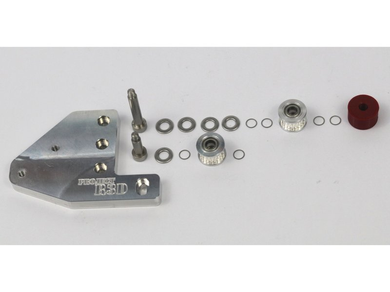](../assets/images/zoom/6QMPTd4OMt5PAVZe.jpg) [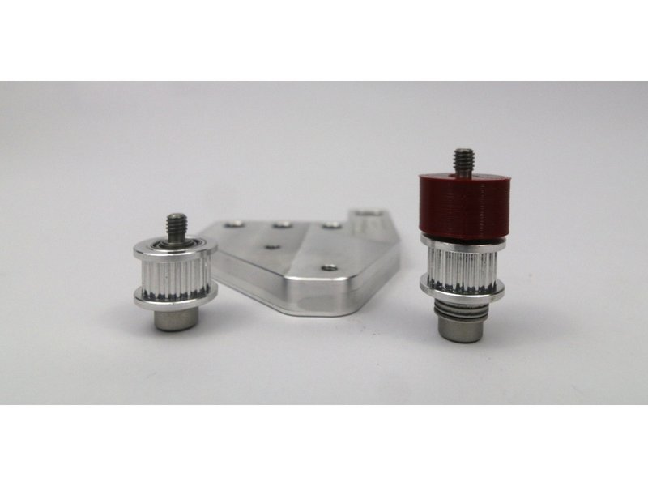](../assets/images/zoom/lwxAW52oAJBsXuSK.jpg) [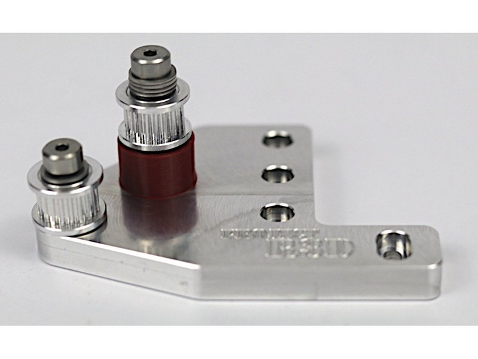](../assets/images/zoom/PnoFEFdgLFXZhvBa.jpg)

- These photos can be used to validate the correct installation of the idler stacks on the front idler mount.

**1 comment on step 9:**

> **Wayne Saverud** wrote on 2020-05-06:
> 
> If you're looking for the big red spacer like I was, it’s a printed part.

## Step 10: Install Front Idler Mount

[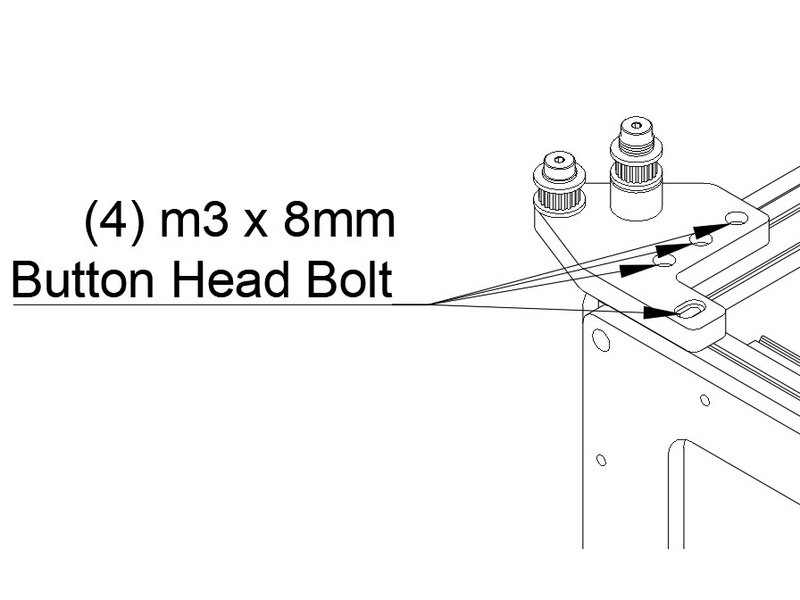](../assets/images/zoom/RWgmvVSKFMJpQrP3.jpg) [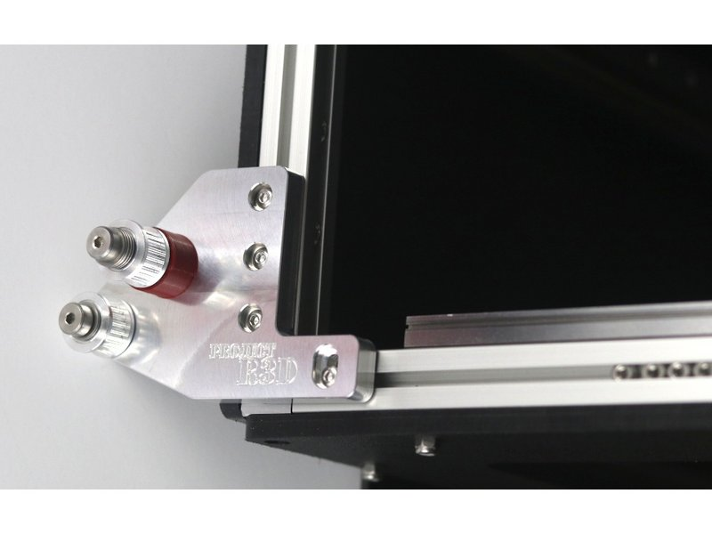](../assets/images/zoom/jhyQ2HCQOO6UmPGQ.jpg)

- Attach the front idler mount to the left side of the top of the frame using (4) m3 x 8mm button head bolts. Don't overtighten them - you'll need to be able to adjust the position of the idler mount to align the belts later.

## Step 11: Install Idlers on Rear Idler Mount (Diagrams)

[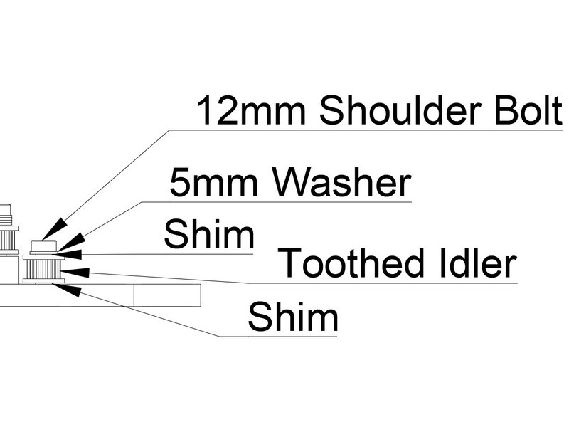](../assets/images/zoom/tXolbMTEjKip6UyG.jpg) [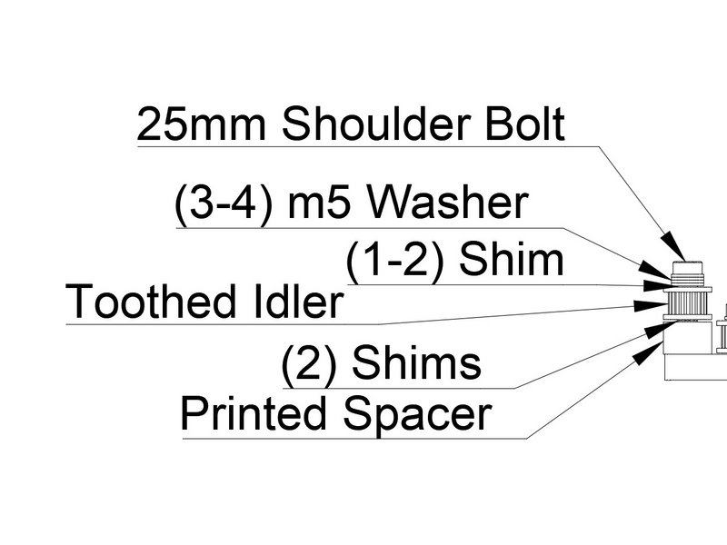](../assets/images/zoom/FPUQtDxZWdHiOE1D.jpg) [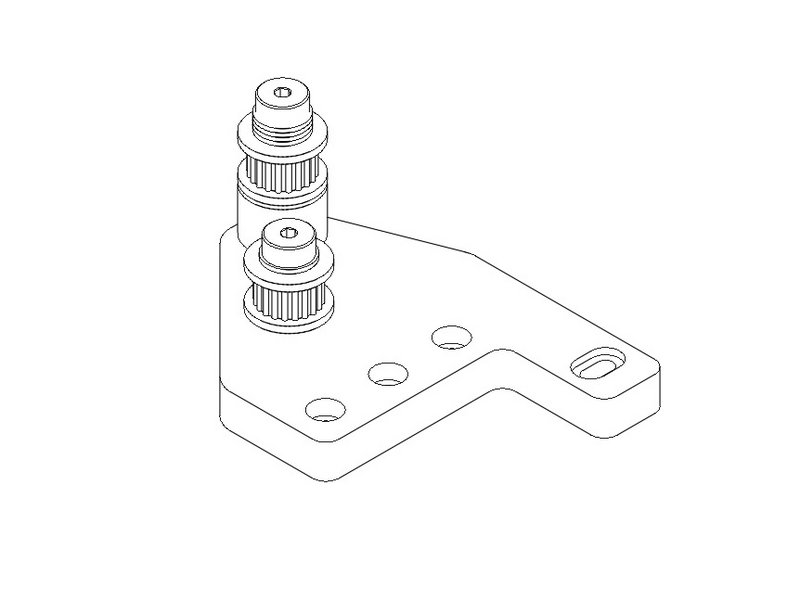](../assets/images/zoom/FkcN2wxQoEZCHgb2.jpg)

- There are photos to accompany this step in the next step.
- For the rear idler, the stack for the inside bolt is the short stack. Turn a 12mm shoulder bolt upside down and install (1) M5 washer, then (1) M5 shim. Next add the 20T idler, then lastly (1) M5 shim.
- You want to be sure the total stack is just slightly below the shoulder on the shoulder bolt. If there is room for another shim, take the last shim and pulley off, and put the extra shim on before the pulley.
- Install the shorter idler stack in the inside hole on the idler mount.
- For the rear idler, the stack for the inside bolt is the tall stack. Turn a bolt upside down and install (3) M5 washers, then (1) M5 shim. Next add the 20T idler, then lastly (1) M5 shim.
- You want to be sure the total stack is just slightly below the shoulder on the shoulder bolt. If there is room for another shim or washer, take the last shim and pulley off, and put the extra shim on before the pulley. If you can fit an extra washer, be sure to put it on before the first shim.
- Install the taller idler stack in the outside hole on the idler mount.

## Step 12: Install Idlers on Rear Idler Mount (Pictures)

[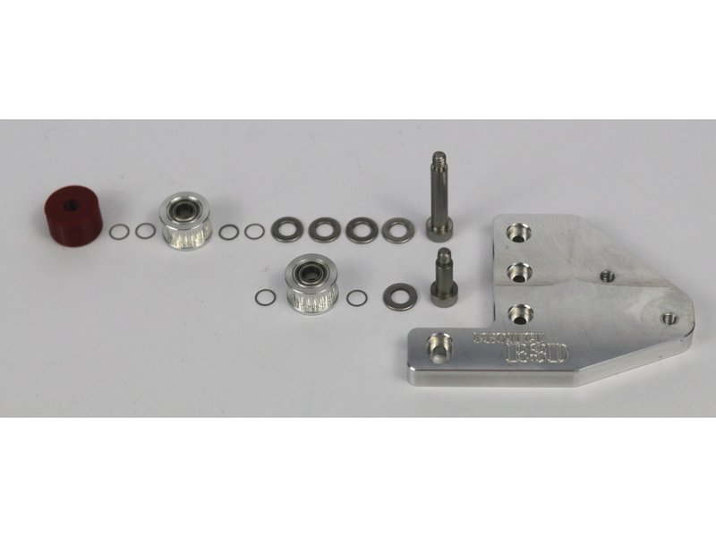](../assets/images/zoom/jBJrLiHuM2hYsaOC.jpg) [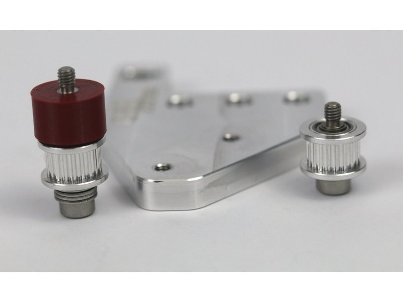](../assets/images/zoom/QgPCSkOdBSt1LY4S.jpg) [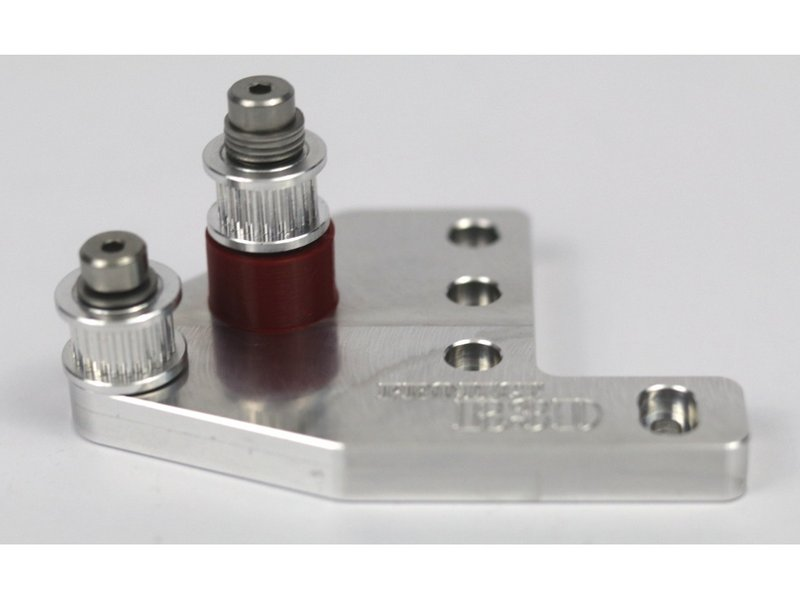](../assets/images/zoom/VwVLGTBgMcbVIuZH.jpg)

- These photos can be used to validate the correct installation of the idler stacks on the front idler mount.

## Step 13: Install Rear Idler Mount

[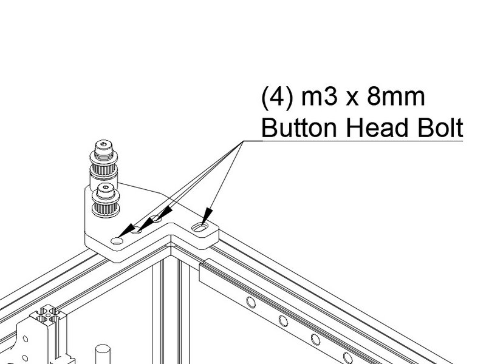](../assets/images/zoom/CTxHOLDGrN4ofMdC.jpg)

- Attach the rear idler mount to the rear left top of the frame using (4) m3 x 8mm button head bolts. Don't overtighten them - you'll need to be able to adjust the position of the idler mount to align the belts later.

## Comments on this guide (1)

> **feds27** wrote on 2020-05-06:
> 
> Great job Tony. Thanks for updating the guide and making it available on Dozuki.

Previous: [I) Y Rail Installation](i-y-rail-installation.md) · [RailCore II guide list](index.md) · Next: [K) Y Carriage](k-y-carriage.md)

---

Original page: <https://railcore.dozuki.com/Guide/J)+X-Y+Steppers+and+Idlers/8>. Written by Tony Akens on railcore.dozuki.com. This copy was captured on 2026-11-16 and is licensed under [Creative Commons Attribution-ShareAlike 3.0 (CC BY-SA 3.0)](https://creativecommons.org/licenses/by-sa/3.0/), the license stated on the original site. This is an unofficial community mirror and is not affiliated with RailCore Labs, LLC. RAILCORE is a registered trademark of RailCore Labs, LLC.
