# K) Y Carriage

Category: [RailCore II](index.md) · Original: <https://railcore.dozuki.com/Guide/K)+Y+Carriage/9>

**Difficulty:** Moderate  
**Time required:** No estimate  
**Author:** Tony Akens  
**Steps:** 10  
**Last modified on Dozuki:** 2020-12-28

## Tools

- [Set of Allen Keys](../items/set-of-allen-keys-20.md)

## Parts

- 1 × [Printed Y Carriage](../items/printed-y-carriage-24.md)
- 1 × [Printed BLTouch Mount](../items/printed-bltouch-mount-64.md)
- 1 × [BLTouch Sensor](../items/bltouch-sensor-73.md)
- 13 × [M3 x 8mm Button Head Bolt](../items/m3-x-8mm-button-head-bolt-16.md)
- 2 × [M3 Washer](../items/m3-washer-65.md)
- 2 × [M3 Brass Insert](../items/m3-brass-insert-23.md)
- 2 × [M3 x 16mm Button Head Bolt](../items/m3-x-16mm-button-head-bolt-61.md)
- 1 × [5012 Blower Fan](../items/5012-blower-fan-67.md)
- 1 × [Y Endstop Switch](../items/y-endstop-switch-68.md)
- 1 × [Y Endstop Mount](../items/y-endstop-mount-69.md)
- 2 × [M2 x 12mm Bolt](../items/m2-x-12mm-bolt-70.md)
- 2 × [M2 Nut](../items/m2-nut-71.md)
- 1 × [Printed Hotend Groove  Mount](../items/printed-hotend-groove-mount-72.md)
- 2 × [M3 Nut](../items/m3-nut-25.md)
- 1 × [BMG mount](../items/bmg-mount-74.md)

## Step 1

- Newer Filastruder kits use Socket Cap Head Screws, use them in place of all button head screws in this section unless noted.

## Step 2: Y Carriage Installation

[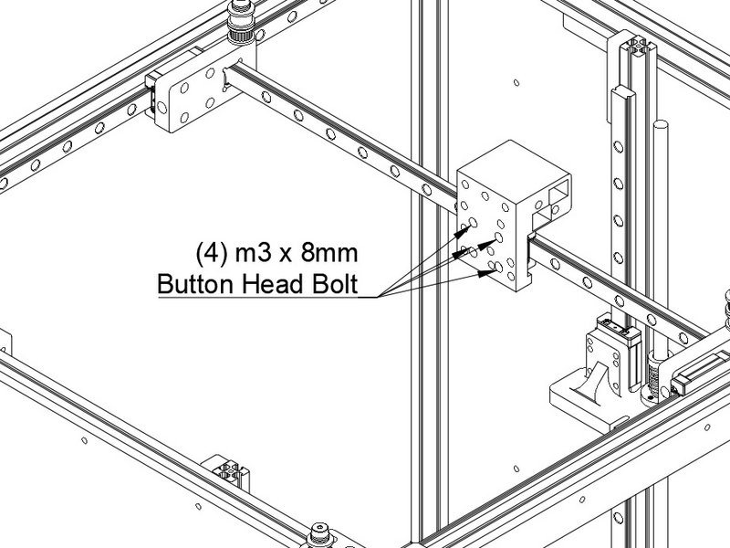](../assets/images/zoom/YP2pqyweDiGZRmXp.jpg)

- Before you bolt the Y Carriage onto the Y rail, double check that all the brass inserts are in.
- Bolt the Y Carriage to the Y rail using (4) m3 x 8mm button head bolts. (Socket Cap Head Screws will not work here, use Button Head regardless of the kit you're building) Make sure they're snug.
- **Note:** You may want a dab of loctite on the bolts for attaching the Y carriage to the Rail, they're hard to get to later.

3 comment(s) on this step

> **Max Plastix** wrote on 2020-05-17:
> 
> Well, after Step 5 so you don’t block the rail mount screw hole

> **Max Plastix** wrote on 2020-05-17:
> 
> Consider doing this AFTER Step 6, as it’s easier to mount things to the carriage before it is installed onto the rail block.

> **Max Plastix** wrote on 2020-05-17:
> 
> For the 713Maker Aluminum Y carriage on Misumi rails, M3x8 is too long. Use (4) M3x6 screws instead.

## Step 3: Attach BLTouch to BLTouch Mount

[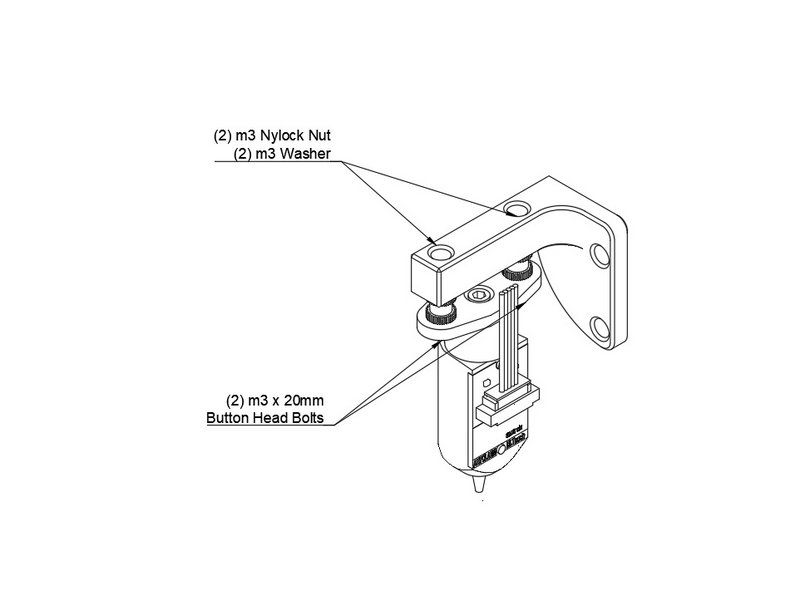](../assets/images/zoom/eIVrpLSgDYxEARvO.jpg) [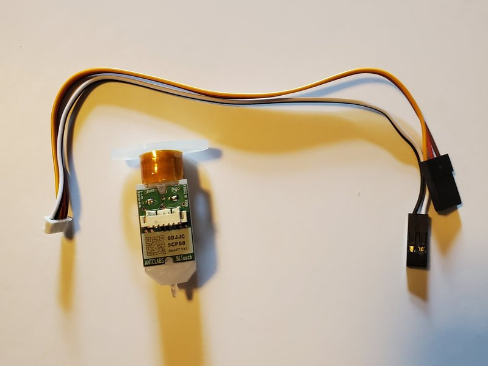](../assets/images/zoom/sFCJEKyNadaWTLwL.jpg)

- Remove the wiring that comes pre-installed on the bltouch by disconnecting the connector. The kit wiring harness has a connector, these wires are not needed.
- Put (2) m3 x 20mm Button Head Bolts pointing up through the holes in the BLTouch.
- Thread a brass insert down on the bolt, tight against the bltouch.
- Pass the bolt up through the BLTouch mount
- Put an m3 washer on the bolt, and then an m3 Nylock Nut.

1 comment(s) on this step

> **Christian Harrell** wrote on 2020-08-04:
> 
> It may be beneficial to note; the brass fittings are not labeled on the diagram, but should be included

## Step 4: Install BLTouch

[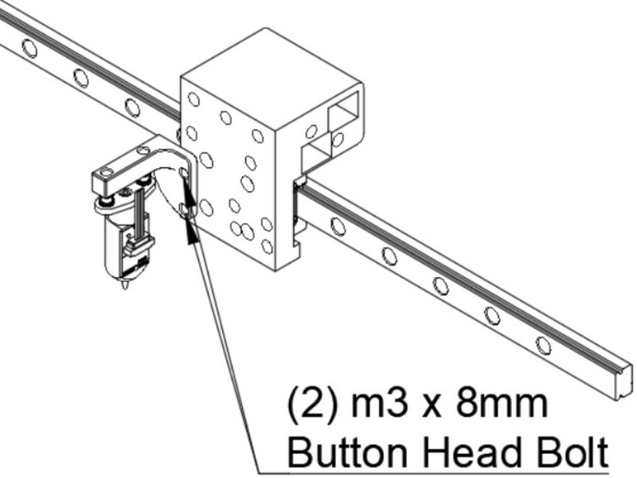](../assets/images/zoom/hQl4UyS5MoqYcxtB.jpg)

- Attach the BLTouch mount to the lower left two holes in the Y carriage using (2) m3 x 8mm Button Head Bolts.

## Step 5: Prep Layer Fan Install

[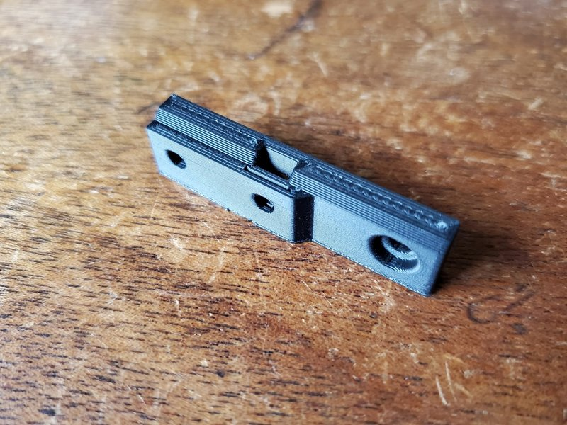](../assets/images/zoom/GURZ4Gui5J1aRDj2.jpg) [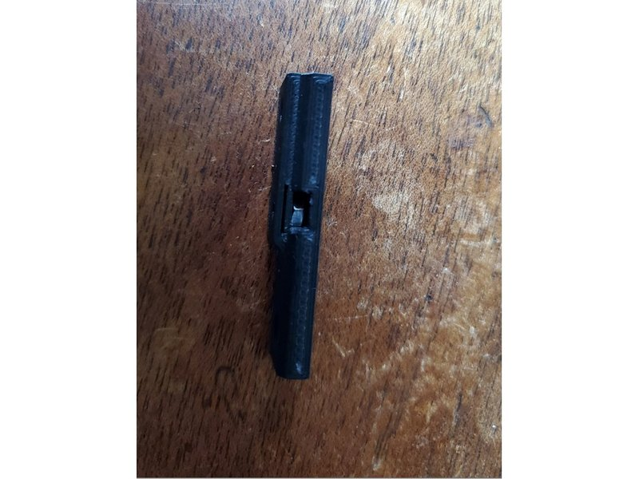](../assets/images/zoom/jqOPjS3CXx5EbIDw.jpg) [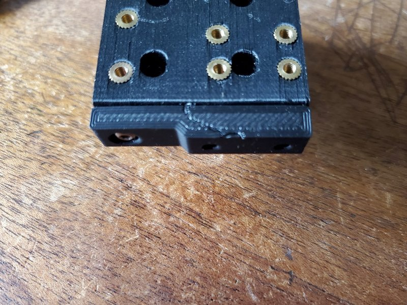](../assets/images/zoom/5yhVTGOpideSvJUl.jpg)

- Locate the layer fan adapter (In this kits this part is white, not black as shown), and insert an M3 nut into the slot on it as shown.
- Attach the layer fan to the bottom of your Y carriage using a single M3 x 6mm button head bolt. (Image is shown off of a printer for clarity)

2 comment(s) on this step

> **evin powell** wrote on 2020-06-18:
> 
> The Alu-Mount_Adapter.stl found here ([https://www.thingiverse.com/thing:336762...](https://www.thingiverse.com/thing:3367622/files "https://www.thingiverse.com/thing:3367622/files")) does not seem to have the same hole pattern as the kit-provided fan duct. Is there another file to use for printing to mount the kit-provided fan duct on the 713 Maker ultralight Y plate?

> **Max Plastix** wrote on 2020-05-17:
> 
> For the 713Maker Aluminum Y Carriage option, there is a different shroud adapter to use. “Alu_Mount_Adapter.stl” Not included in kit.

## Step 6: Part Cooling Fan and Y Endstop Install

[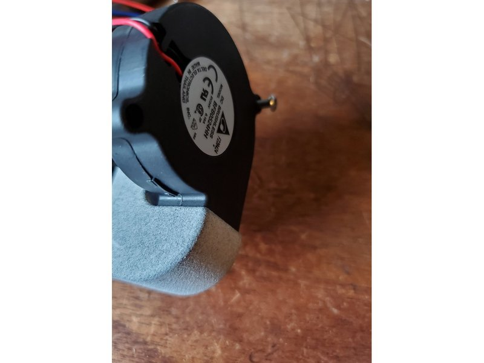](../assets/images/zoom/VunOLvSZTAmuOCKB.jpg) [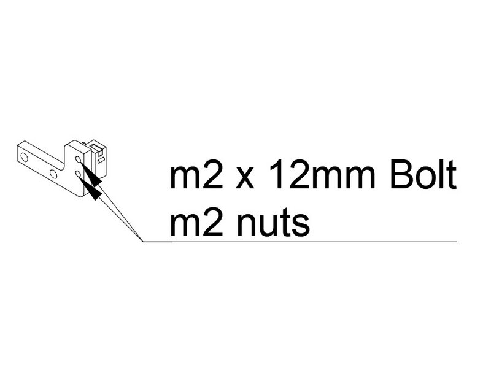](../assets/images/zoom/MxrmZNptTceSWmSe.jpg)

- The Y endstop and part cooling fan share a cable harness, so we need to install them at the same time.
- Attach the 5015 blower to the JT shroud using a 20mm Button Head Bolt.
- Attach the Y endstop switch to the Y endstop mount using (2) m2 x 12mm Bolts and (2) m2 nuts.

## Step 7: Attach Part Cooling Fan and Y Endstop

[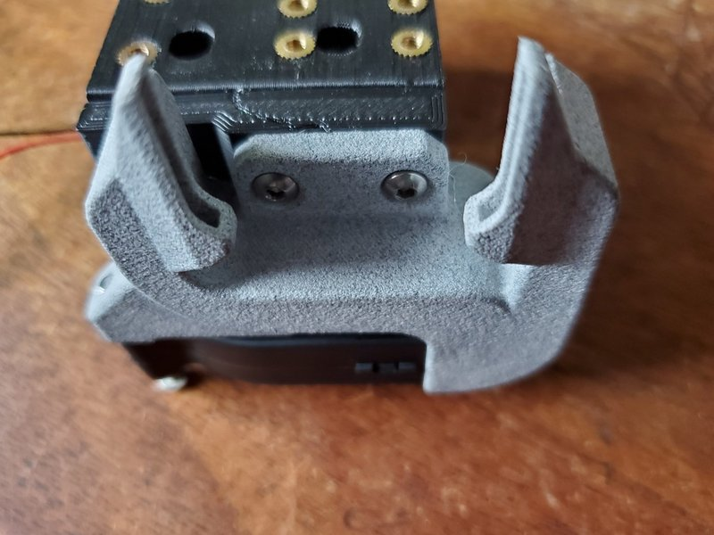](../assets/images/zoom/FnkNKDd4eAQUsJEi.jpg) [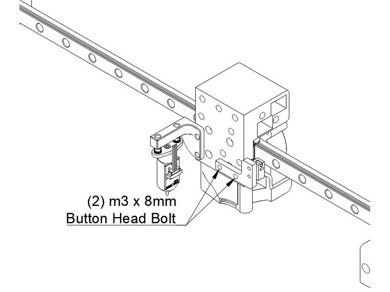](../assets/images/zoom/25A4UilSNKL54IsQ.jpg)

- Start by attaching the Layer fan and shroud. Attach the Layer fan to the bottom of the adapter using one m3x8mm Button head bolt into the rear hole (the one going to the m3 washer) and one m3 x 12mm Button head bolt that will pass through the other hole and into the brass insert in the Y carriage.
- Attach the Y endstop mount to the bottom right two holes in the Y carriage using (2) m3 x 8mm Button Head Bolts

4 comment(s) on this step

> **Nick Howarth** wrote on 2024-08-23:
> 
> The Y stop switch is attached with M2 bolts and nuts, not M3

> **Nick Howarth** wrote on 2024-08-23:
> 
> The Y stop switch is held on by (2) M2 x 12 bolts and nuts, not M3. The switch hole is 2mm.

> **Islam** wrote on 2021-11-17:
> 
> Attaching the endstop to the other side and wrapping the wire around the back worked best for me.
>
> 1. Cut the label around the wire so there’s a bit more flexibility
>
> 2. Attach the endstop to the other side of the mount
>
> The wire between the fan and the endstop should go:
>
> 1. up from the fan
>
> 2. towards the back of the printer
>
> 3. above the y rail
>
> 4. above the bl touch mount
>
> 5. and finally to the endstop

> **Marco Ponti** wrote on 2020-05-11:
> 
> I had to attach the y stop on the other side of the mount otherwise the wires rubbed on the rail

## Step 8: Prep Hotend Groove Mount

[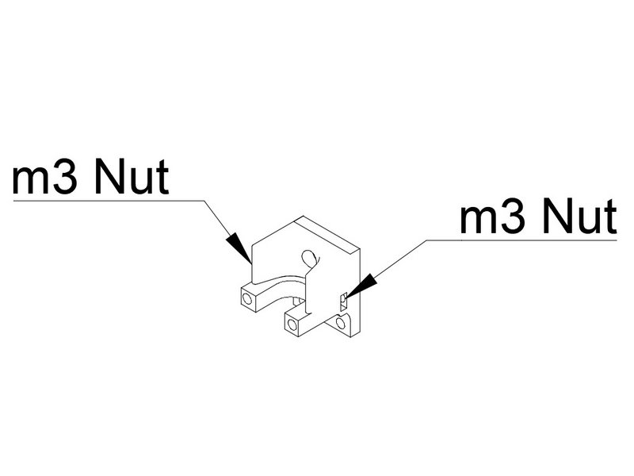](../assets/images/zoom/h16eiDJ3plxgoJBy.jpg)

- Insert one m3 nut into each side of the printed hotend mount. They can be hard to push in, using a screwdriver can help.
- **Note:** Push an allen wrench down through the bolt holes for attaching the hotend to center the M3 nuts, it will make threading a bolt in easier.

## Step 9: Hotend Mount Installation

[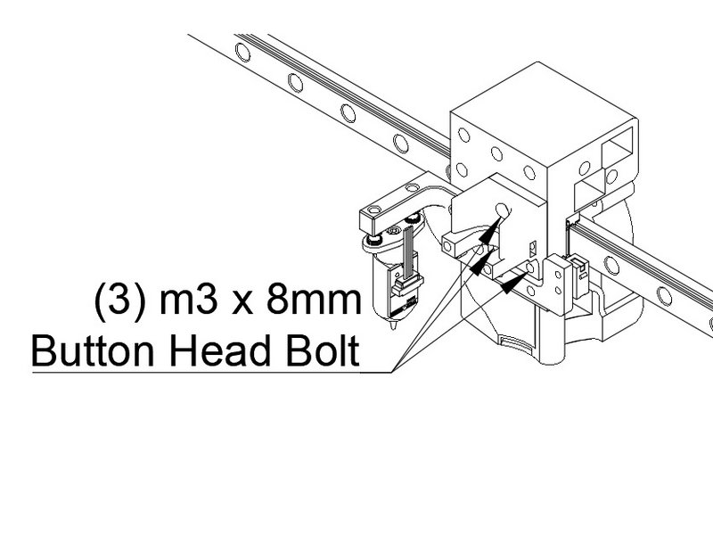](../assets/images/zoom/jdKphowjU3QajX4H.jpg)

- Attach the hotend mount to the Y carriage using (3) m3 x 8mm button head bolts. (Socket Cap Head Screws will not work for the bottom two, use Button Head regardless of the kit you're building)

## Step 10: BMG Mount Installation

[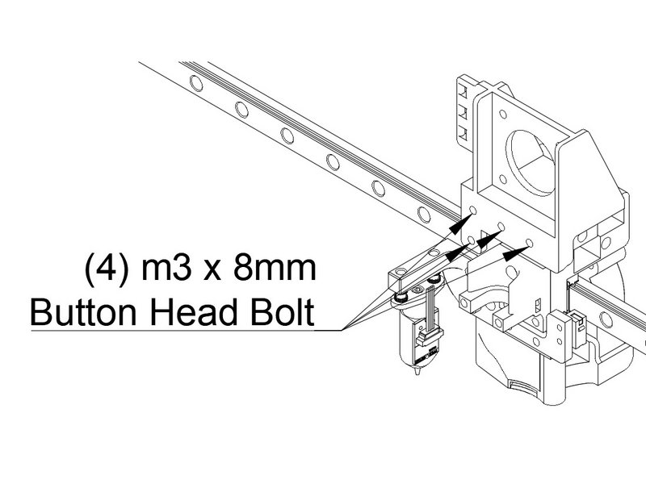](../assets/images/zoom/BcCMfGHo14bCAPBR.jpg)

- Attach the BMG mount to the hotend mount using (4) m3 x 8mm Button Head Bolts.

Previous: [J) X/Y Steppers and Idlers](j-x-y-steppers-and-idlers.md) · [RailCore II guide list](index.md) · Next: [L) X/Y Belts](l-x-y-belts.md)

---

Original page: <https://railcore.dozuki.com/Guide/K)+Y+Carriage/9>. Written by Tony Akens on railcore.dozuki.com. This copy was captured on 2026-11-16 and is licensed under [Creative Commons Attribution-ShareAlike 3.0 (CC BY-SA 3.0)](https://creativecommons.org/licenses/by-sa/3.0/), the license stated on the original site. This is an unofficial community mirror and is not affiliated with RailCore Labs, LLC. RAILCORE is a registered trademark of RailCore Labs, LLC.
