# L) X/Y Belts

Category: [RailCore II](index.md) · Original: <https://railcore.dozuki.com/Guide/L)+X-Y+Belts/10>

**Difficulty:** Moderate  
**Time required:** No estimate  
**Author:** Tony Akens  
**Steps:** 8  
**Last modified on Dozuki:** 2020-06-21

## Tools

- [Set of Allen Keys](../items/set-of-allen-keys-20.md)

## Parts

- 4 × [Belt Clip](../items/belt-clip-75.md)
- 4 × [M3 x 45mm Cap Head Bolt](../items/m3-x-45mm-cap-head-bolt-76.md)
- 4 × [M3 Washer](../items/m3-washer-65.md)
- 1 × [Belt](../items/belt-77.md)

## Step 1: How to Install Belt Clips

[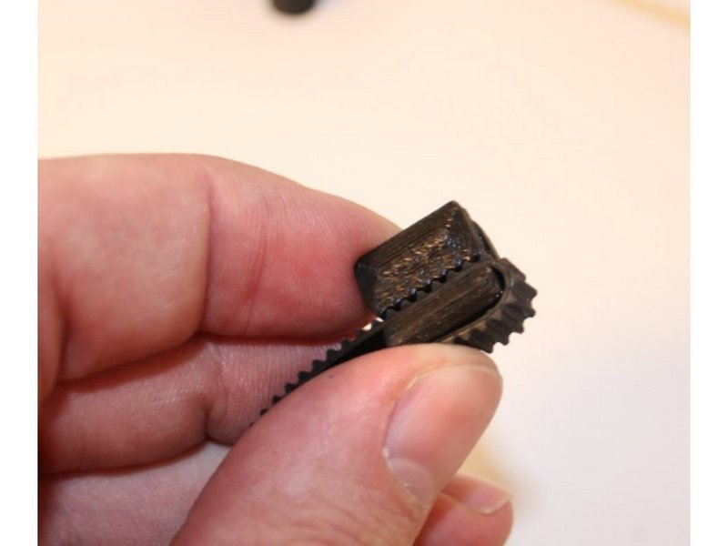](../assets/images/zoom/mPTWreLE4uZgYVTS.jpg)

- To install a belt into a belt clip, put the belt through the clip, and leave a bit of a tail - about an inch or so, to allow some adjustment later.

## Step 2: Y / Front Belt Installation

[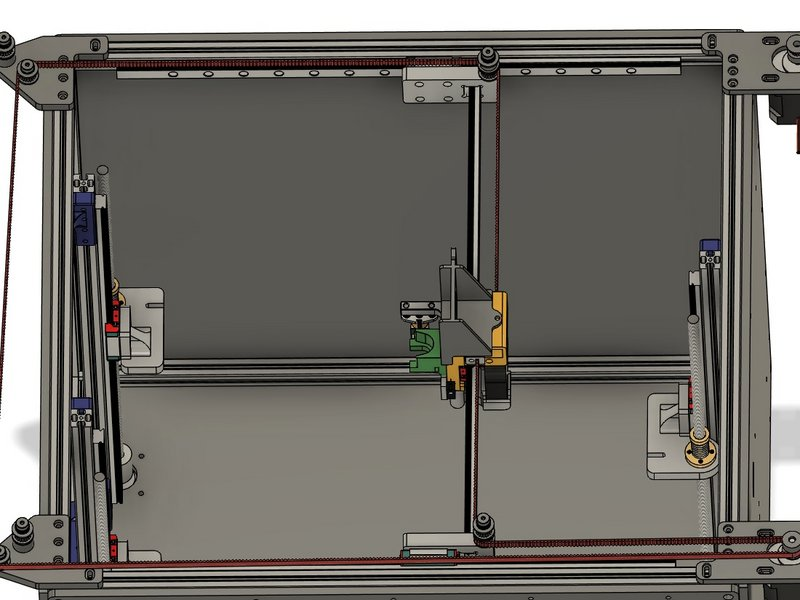](../assets/images/zoom/WyJ2UHmH2BQnlOPf.jpg) [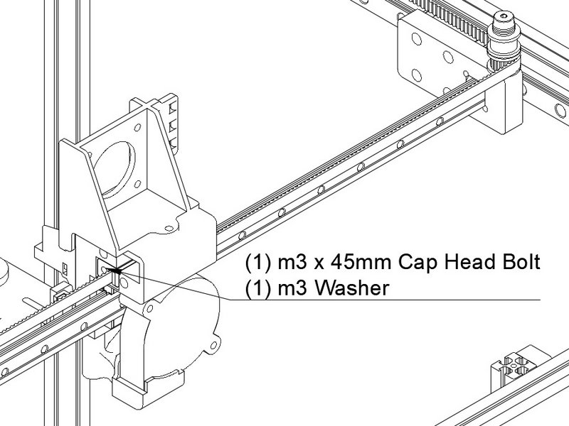](../assets/images/zoom/NwNWM3ZHZqSUoZ6q.jpg)

- Start with the front or "Y" belt. Insert the clip with the belt on it into the lower left hole at the front of the Y carriage. Make sure the bolt hole lines up properly.
- Attach the clip using (1) m3 x 45mm cap head bolt and (1) m3 washer.
- **Caution:** The Belt teeth should be facing the left of the printer.

## Step 3: Y Belt Installation Continued

[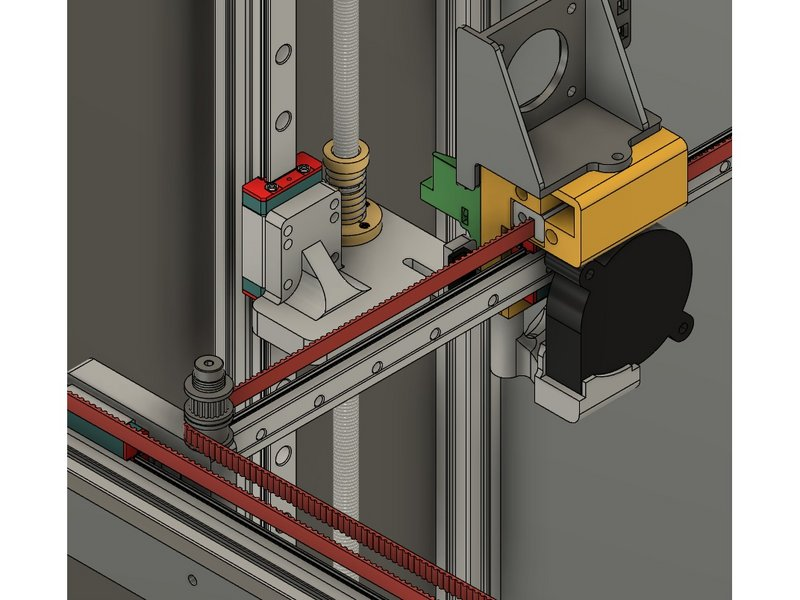](../assets/images/zoom/NXDLJyee6Nh1GweI.jpg) [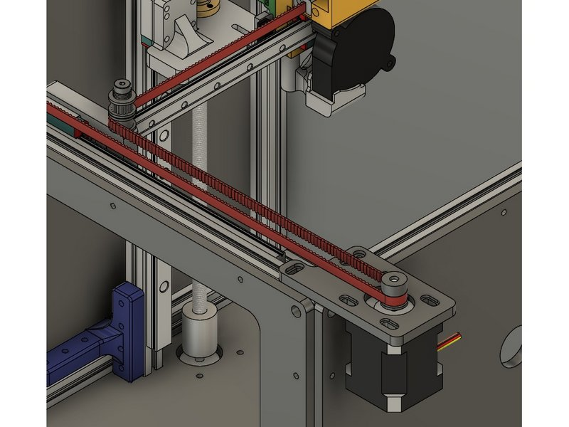](../assets/images/zoom/k5xBkNNVYRnjPBrK.jpg) [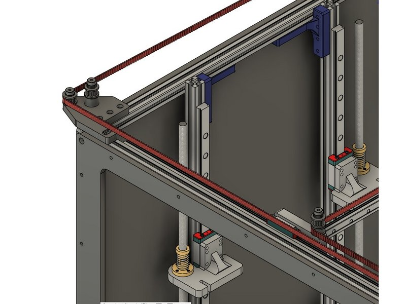](../assets/images/zoom/dCj2CeTKuBcqLjUI.jpg)

- The belt (shown in red) should go from the Y carriage and then around the lower smooth idler on the front X carriage.
- From the idler the belt should turn to the right and loop around the front stepper pulley.
- **Caution:** The teeth should engage the pulley.
- From the stepper the belt goes across the front of the printer and around the toothed idler on the outside, shorter shoulder bolt.

## Step 4: Finishing Y Belt Installation

[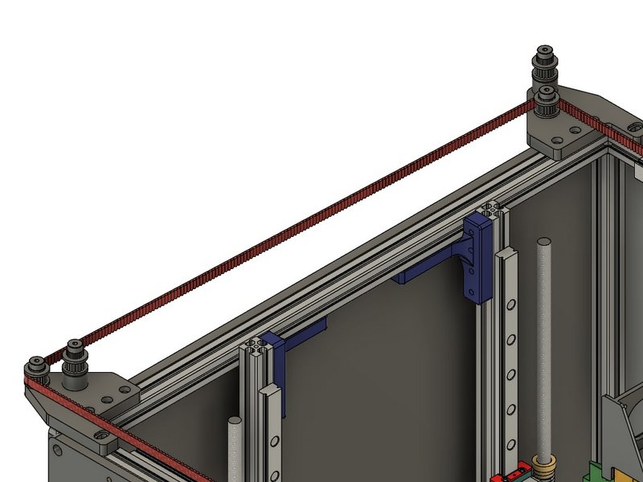](../assets/images/zoom/jBe4QMftfQQb5Dfx.jpg) [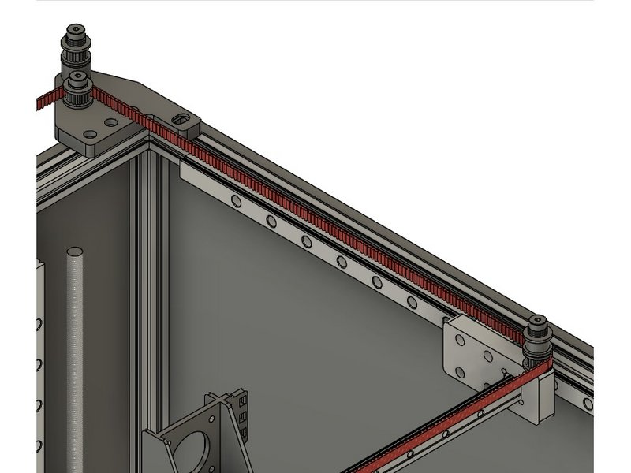](../assets/images/zoom/BKSess2iYJQGXMPn.jpg) [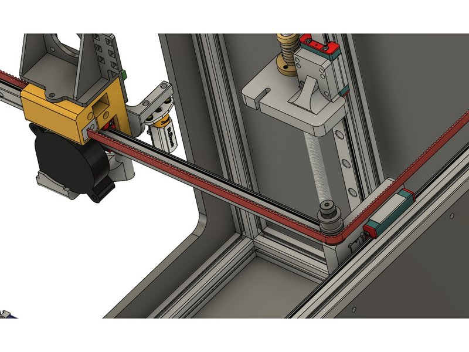](../assets/images/zoom/PXEfkr3HpZdcnOvW.jpg)

- The belt should cross to the left of the printer, and the teeth should engage the toothed idler on the shorter, inside shoulder bolt on the rear idler mount.
- From there the belt should follow along the back of the printer, with the toothed side wrapping around the lower toothed idler on the X carriage.
- Put another belt clip on, and insert the bolt into the lower rear hole on the Y carriage. Attach it with (1) m3 x 45mm bolt and (1) m3 washer.
- **Caution:** Be sure the belt is properly seated around the idlers and pulley, and not twisted along its length.
- Don't worry about the belt being tight - we'll tension it later. For now "close" is good enough.
- Cut the belt, leaving an approximately 1" tail in case you need to adjust it.

## Step 5: X / Rear Belt Installation

[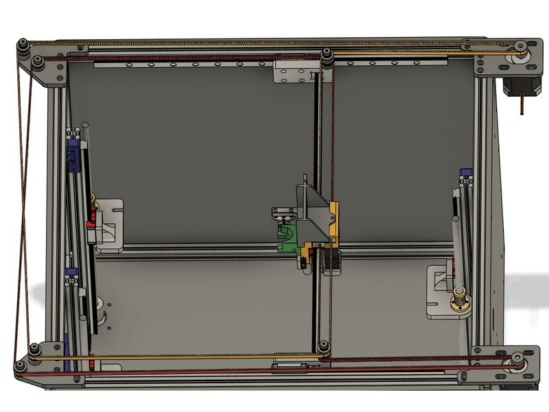](../assets/images/zoom/rlj6bDWtc6M3VbKG.jpg) [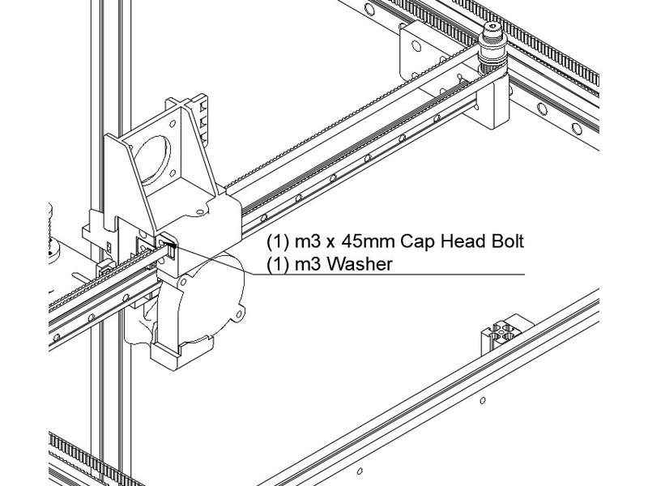](../assets/images/zoom/bRDX2IfnpAqOBsuu.jpg)

- To install the rear or "X" belt, start by installing a belt clip on the end of the belt, and insert it into the top hole on the front of the Y carriage.
- Attach the belt clip using (1) m3 x 45mm cap head bolt and (1) m3 washer.
- **Caution:** The belt teeth should be facing the left of the printer.

## Step 6: Y Belt Routing

[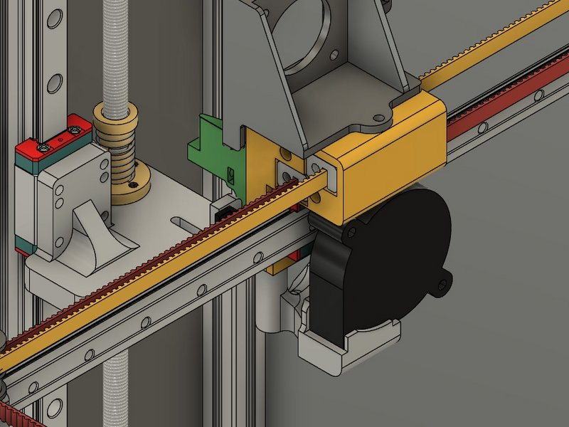](../assets/images/zoom/PElBs1UGOYsT2fwT.jpg) [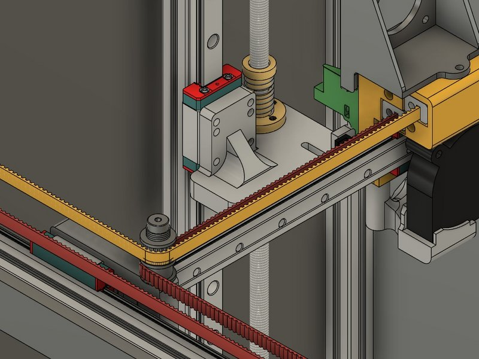](../assets/images/zoom/WBYQmTiNBuPALaPL.jpg) [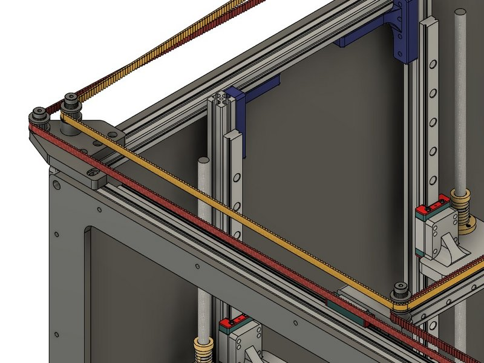](../assets/images/zoom/TQwt3ZBduEMeYZfT.jpg)

- To route the belt it should leave the Y carriage and wrap around the toothed idler at the top of the stay on the front X carriage.
- From the X carriage the belt follows along the front of the printer to the toothed idler at the top of the tall stack on the front idler mount.

## Step 7: Y Belt Routing Continued

[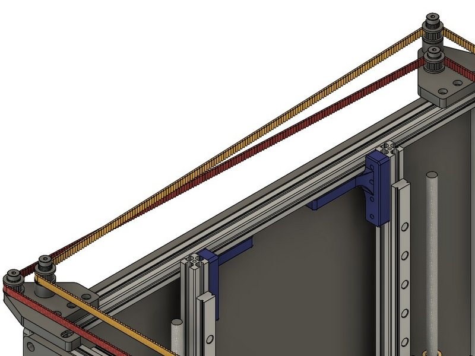](../assets/images/zoom/CduVWOJZKP1ZcmsH.jpg) [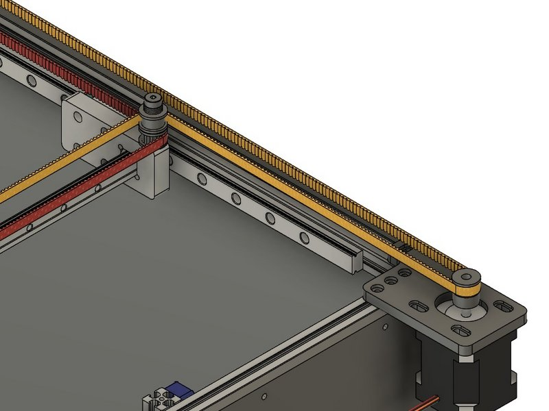](../assets/images/zoom/D6rCBDvtufdILDY2.jpg)

- The belt crosses the left side of the printer, to the toothed idler on the tall stack of the rear idler mount.
- From the rear idler mount the belt extends along the back of the printer, all the way to the rear stepper pulley.
- The belt wraps around the rear stepper pulley, and goes back to the rear X carriage, with the back of the belt against the smooth idler at the top of the rear X carriage idler stack.

## Step 8: Finishing the Y Belt Installation

[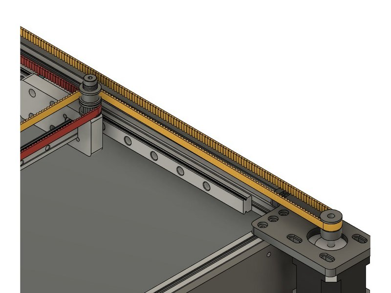](../assets/images/zoom/yFrYMLCEg41FtgaS.jpg) [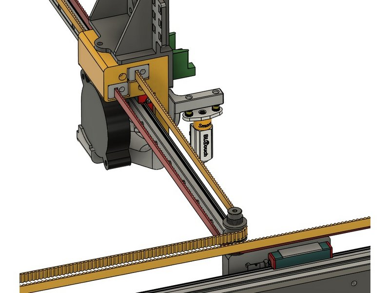](../assets/images/zoom/DsCiU41Oc6DasYQ5.jpg)

- From the Rear X carriage the belt goes back to the Y carriage block.
- Put another belt clip on, and insert the belt and clip into the top hole on the Y carriage. Attach it with (1) m3 x 45mm bolt and (1) m3 washer.
- Be sure the belt is properly seated around the idlers and pulley, and not twisted along its length.
- Don't worry about the belt being tight - we'll tension it later. For now "close" is good enough.
- At this point both belts should not have any major slack in them. Test tightening them by pulling the X/Y steppers in their grooves, you should be unable to easily pull the steppers to the end of the grooves in the mounts. If you can, remove a belt clip and adjust it a couple teeth, then try again.
- Cut the belt, leaving approximately an inch of tail for adjustment.
- It is best if both belts are the same length - now is a great time to do it, once the clips are adjusted. To do so, remove both belts (Mark the front clip for each so you know which was which), lay them out on the floor side by side, and adjust the clips to be the same # of teeth apart. Reinstall the belts.

**3 comments on step 8:**

> **Steven Moon** wrote on 2020-05-30:
> 
> The interesting thing about the belt length is that they can only be identical lengths if the X Carriages and Y rail are square to the frame. If they are not square, the belts will be different lengths. This confirms Max Plastix’s procedure #2. I struggled with this, but after following this procedure it worked perfectly and I ended up with identical length belts and a square Y rail!

> **Max Plastix** wrote on 2020-05-30:
> 
> Best steps for setting the carriage alignment and belt tension seem to be:
>
> 1) Set stepper motors to the same distance from the frame to start. Ensure the Y rail is centered in the carriages and retained by all four set screws/shims.
>
> 2) Route belt and get the Y rail mostly square (X carriages aligned)
>
> 3) Remove belts, look at the average length and set them both to be the same length, exactly. (Same number of teeth)
>
> 4) Reinstall the belts, and then go to Wade’s X Carriage Alignment and Belt Tensioning Video: [https://www.youtube.com/watch?v=9-1PNzsm...](https://www.youtube.com/watch?v=9-1PNzsmrZM "https://www.youtube.com/watch?v=9-1PNzsmrZM") This will set the stepper motor distances to keep the Y rail aligned.
>
> 5) Set both belts tension for 41Hz when plucked at the center of the left side, using the tensioners in the belt retainer.
>
> 6) Confirm that the X carriage blocks are still perfectly aligned per the video and tighten everything down.

> **Max Plastix** wrote on 2020-05-17:
> 
> It helped to center the X/Y stepper motors in the mounting hole slots, so they start from the same position (belt length).

Previous: [K) Y Carriage](k-y-carriage.md) · [RailCore II guide list](index.md) · Next: [M) Hotend and Extruder](m-hotend-and-extruder.md)

---

Original page: <https://railcore.dozuki.com/Guide/L)+X-Y+Belts/10>. Written by Tony Akens on railcore.dozuki.com. This copy was captured on 2026-11-16 and is licensed under [Creative Commons Attribution-ShareAlike 3.0 (CC BY-SA 3.0)](https://creativecommons.org/licenses/by-sa/3.0/), the license stated on the original site. This is an unofficial community mirror and is not affiliated with RailCore Labs, LLC. RAILCORE is a registered trademark of RailCore Labs, LLC.
