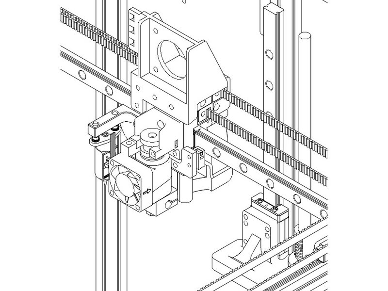
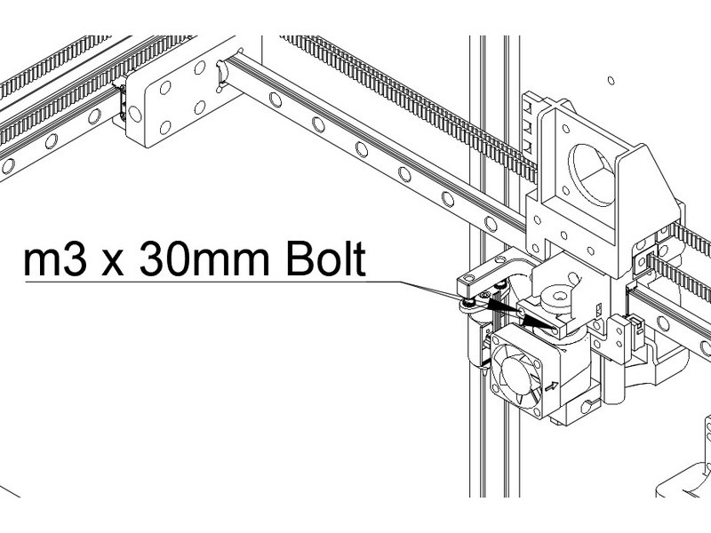
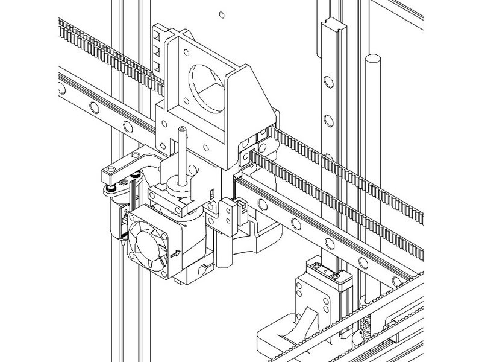
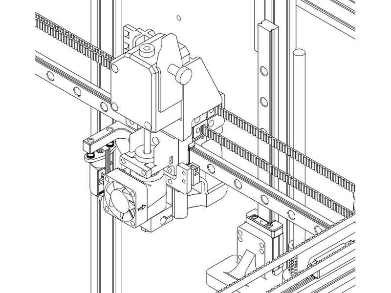
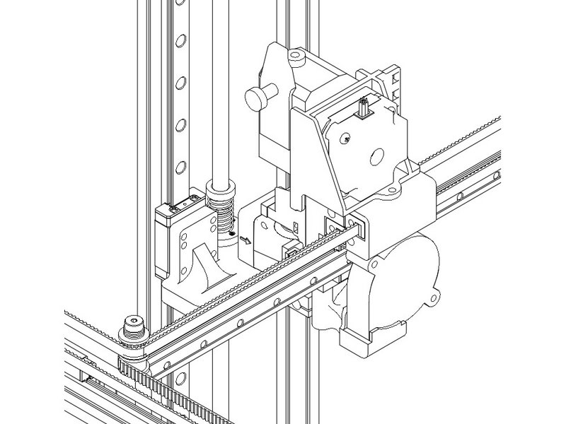
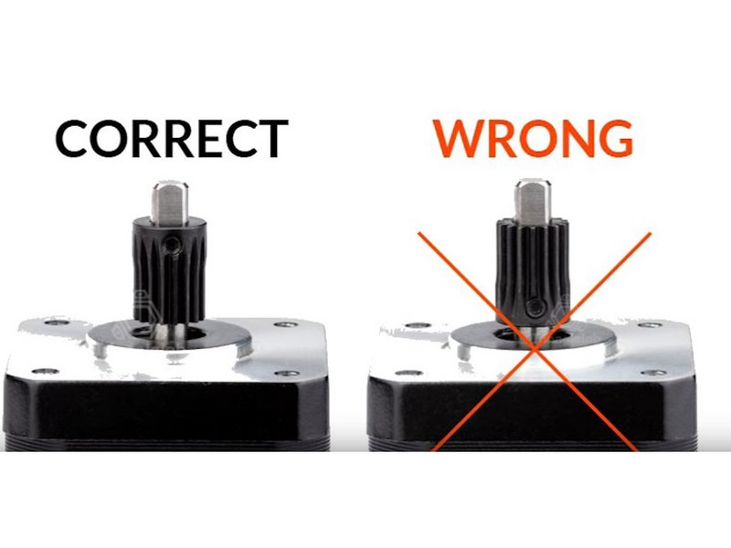
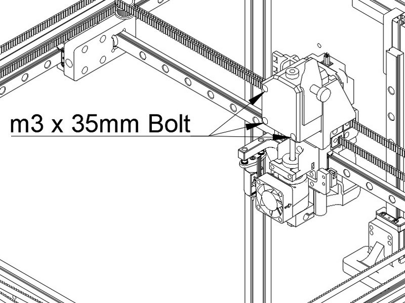
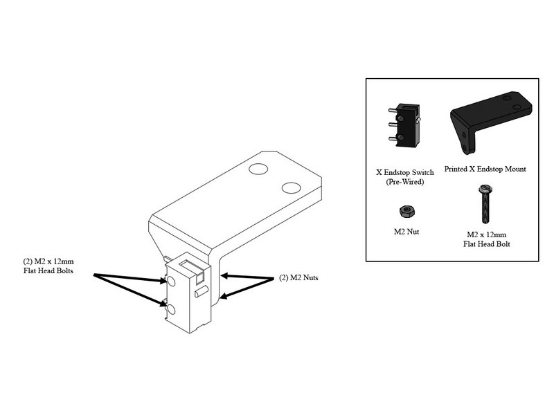
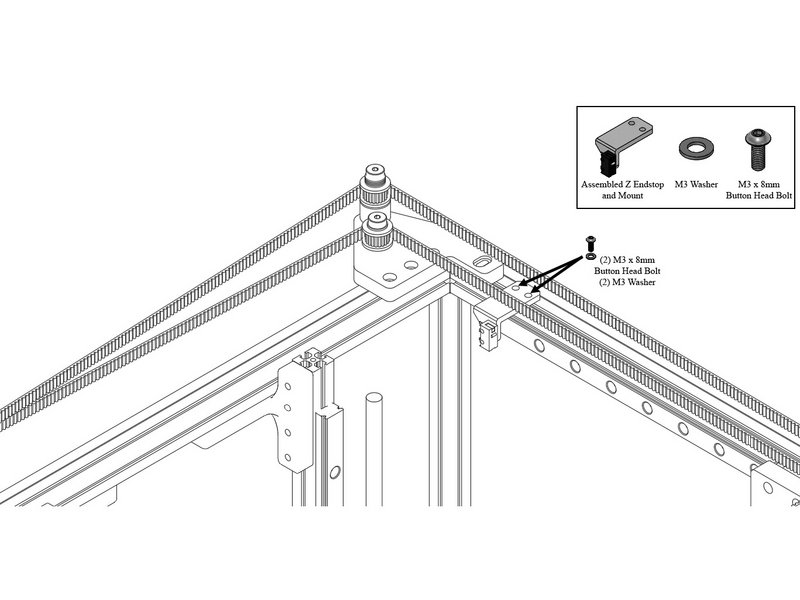

# M) Hotend and Extruder

Category: [RailCore II](index.md) · Original: <https://railcore.dozuki.com/Guide/M)+Hotend+and+Extruder/12>

**Difficulty:** Moderate  
**Time required:** No estimate  
**Author:** Tony Akens  
**Steps:** 8  
**Last modified on Dozuki:** 2020-10-26

## Step 1: E3D V6 Hotend

- The E3D v6 should have been assembled already. It fits into the groovemount adapter as shown. It's best to turn it so the heat block is not too close to the fan shroud.

## Step 2: Hotend Retainer Clip

- Use the hotend retainer (a small printed part) to fasten in the E3d v6 using (2) m3 x 30mm button head bolts.

## Step 3: PTFE Tube

- Insert a length of PTFE into the hotend, at least 91mm long. (You want around 45mm sticking out of the hotend when it's fully seated)

## Step 4: Bondtech BMG Extruder

- Place the bowden coupler in the BMG mount
- Slide the bowden tube onto the PTFE, and fit the BMG into the extruder mount
- Trim down the ptfe slightly, until the BMG fits correctly in the mount - You want the ptfe tube as long as possible, so it's fully seated in both the hotend, and the BMG. The PTFE should end up with around 41mm sticking out of the hotend)

## Step 5: Pancake Stepper

 

- Attach the BMG toothed gear onto the pancake stepper motor.
- Fit the stepper motor through the BMG (it helps to take the front off of the BMG)

**1 comment on step 5:**

> **Max Plastix** wrote on 2020-05-20:
> 
> Might be a good place to note the BMG gear orientation, with the screw away from the motor. It feels backwards, but it’s correct.

## Step 6: Bolt the BMG to Stepper

- Fasten the BMG and stepper together on the extruder mount using (3) M3 x 35mm bolts. (These bolts come with the BMG)

**1 comment on step 6:**

> **Max Plastix** wrote on 2020-05-25:
> 
> Here is where you check the gear mesh between the stepper gear and BMG secondary gear.

## Step 7: X Endstop Assembly

- Attach the X Endstop (it comes pre-wired) to the printed X Endstop Mount using (2) M2 x 12mm Flat Head Bolts and (2) M2 Nuts
- **Note:** Don't worry about the wire for now, it's routed later.

**2 comments on step 7:**

> **Islam** wrote on 2021-11-14:
> 
> Using a magnum halo I found I could make it fit with 14mm bolts. Will see if it needs to be remounted.

> **Max Plastix** wrote on 2020-07-05:
> 
> Halo: If you build with a Halo, this X Endstop mount will not work as shown, since the top of the frame is blocked. You will need to print an X Endstop mount that bolts to the Bottom of the top extrusion instead. For example:
>
> Railcore II X and Y Endstop Brackets by theMachinista on Thingiverse: [https://www.thingiverse.com/thing:375969...](https://www.thingiverse.com/thing:3759698 "https://www.thingiverse.com/thing:3759698")

## Step 8: X Endstop Installation

- Mount the X endstop to the rear left corner of the frame, on the top Extrusion, using (2) M3 x 8mm Button Head Bolts and (2) M3 Washers.
- **Note:** Don't worry about exact placement for now, it will be adjusted later.

Previous: [L) X/Y Belts](l-x-y-belts.md) · [RailCore II guide list](index.md) · Next: [N) Aligning your RailCore](n-aligning-your-railcore.md)

---

Original page: <https://railcore.dozuki.com/Guide/M)+Hotend+and+Extruder/12>. Written by Tony Akens on railcore.dozuki.com. This copy was captured on 2026-11-16 and is licensed under [Creative Commons Attribution-ShareAlike 3.0 (CC BY-SA 3.0)](https://creativecommons.org/licenses/by-sa/3.0/), the license stated on the original site. This is an unofficial community mirror and is not affiliated with RailCore Labs, LLC. RAILCORE is a registered trademark of RailCore Labs, LLC.
