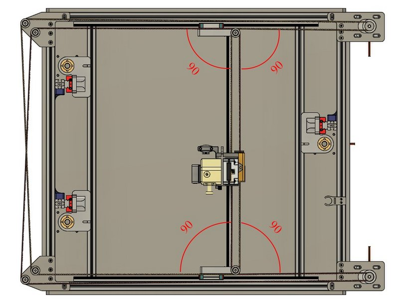
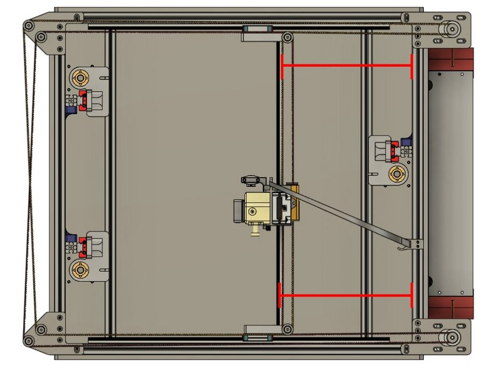
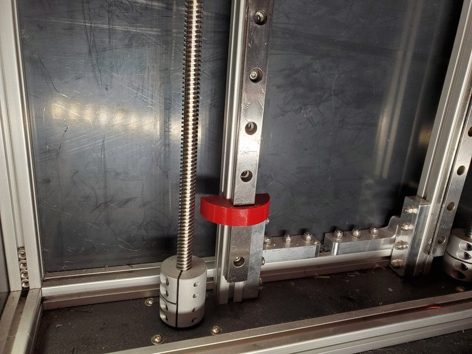

# N) Aligning your RailCore

Category: [RailCore II](index.md) · Original: <https://railcore.dozuki.com/Guide/N)+Aligning+your+RailCore/17>

*Now that the build is done, its an ideal time to align your RailCore.*

**Difficulty:** Moderate  
**Time required:** No estimate  
**Author:** Tony Akens  
**Steps:** 5  
**Last modified on Dozuki:** 2020-06-20

## Step 1: Align the Belts

- The first step is to align your belts. Adjust the steppers so there's some tension - doesn't take much, just enough that the belts are straight.
- Loosen the bolts holding each stepper and idler mount, and move them on the frame until the belts form 90 degree angles to each other.
- **Caution:** If you have a Halo, this alignment is done automatically.

## Step 2: Tension the Belts

- Earlier in the process you should have made sure your belts are equal lengths, if you did, that will make getting proper tension easier.
- **Caution:** Each X Carriage has two bolts retaining the Y rail in place. Loosen those bolts in both carriages just a little before proceeding. (They should still keep the rail in position, but should not be tight)
- Pull on the Front stepper in the mounts to lightly tension the front belt. You don't need too much tension.
- Pull the rear stepper back in the mount until the measurements marked in red on the image are equal. (Measure from the right side of the Y rail marked in red, to the left side of the top right extrusion where marked in red).
- **Caution:** 1-2-3 blocks can be used in place of measuring.
- Once the Y rail is squared you should re-tighten the bolts in the X carriages to retain the Y rail.
- Ideal belt tension is between 40 - 50hz as measured on the short spans on the left of the printer between the idler mounts.

3 comment(s) on this step

> **Glen Hoag** wrote on 2020-09-06:
> 
> The Gates Carbon Drive app for tuning the belts is also available for iPhone at [https://itunes.apple.com/us/app/carbon-d...](https://itunes.apple.com/us/app/carbon-drive-bicycle-calculator/id438346486?mt=8 "https://itunes.apple.com/us/app/carbon-drive-bicycle-calculator/id438346486?mt=8")

> **Wade Wendorf** wrote on 2020-06-17:
> 
> Feel free to add my alignment video if you like: <https://youtu.be/9-1PNzsmrZM>

> **Max Plastix** wrote on 2020-06-16:
> 
> There is a free Android app from Gates, the maker of belts and pulleys, to help measure the vibration frequency by sound and your phone microphone. It can be downloaded here [https://play.google.com/store/apps/detai...](https://play.google.com/store/apps/details?id=com.gates.carbondrivecalculator&hl=en_US "https://play.google.com/store/apps/details?id=com.gates.carbondrivecalculator&amp;hl=en_US")

## Step 3: Centering the Linear Rails

- Loosen all the bolts holding your linear rail to one Z extrusion. Adjust the Rail so it's 20mm above the bottom panel.
- Tighten only the top bolt holding the rail to the extrusion.
- Place the Rail Alignment Tool over the linear rail near the bottom bolt. This will center the linear rail on the extrusion. Tighten the bottom bolt.
- Loosen the top bolt. Now work your way up from the bottom, putting the rail alignment tool near each bolt, then tightening it.
- Repeat this process for each of your Z rails.
- Repeat this process for your X rails, working end to end. Center the X rails in the extrusion.

## Step 4: Aligning the Z Towers

- There is a video on aligning the Z towers here: [https://www.youtube.com/watch?v=CNWzMLc5...](https://www.youtube.com/watch?v=CNWzMLc5-Cg "https://www.youtube.com/watch?v=CNWzMLc5-Cg")
- Loosen the bolts in the Z brackets for one tower, so it can move freely.
- Lower the Z yoke by spinning the lead screw, until the yoke is just above the leadscrew coupler.
- Tighten down the lower Z bracket, be sure the Z extrusion is pushed flush against the side extrusions as you tighten the brackets.
- Move the yoke into the center of the Z tower.
- Use a calipers or a ruler to measure from your front panel to the Z extrusion at the bottom.
- Repeat the same measurement near the top of the Z tower, and adjust until it's equal.
- Tighten the top of the Z tower. Repeat for all 3 towers.

## Step 5: Adjust X Endstop

- Loosen your X endstop mount. Move it to the left side of the rear extrusion.
- Manually move the Y rail until the hotend is approx 5mm from one of the left leadscrews.
- Move the X endstop to be against the rear X carriage, be sure the switch triggers.
- Tighten down the X endstop.

Previous: [M) Hotend and Extruder](m-hotend-and-extruder.md) · [RailCore II guide list](index.md) · Next: [O) Bed](o-bed.md)

---

Original page: <https://railcore.dozuki.com/Guide/N)+Aligning+your+RailCore/17>. Written by Tony Akens on railcore.dozuki.com. This copy was captured on 2026-11-16 and is licensed under [Creative Commons Attribution-ShareAlike 3.0 (CC BY-SA 3.0)](https://creativecommons.org/licenses/by-sa/3.0/), the license stated on the original site. This is an unofficial community mirror and is not affiliated with RailCore Labs, LLC. RAILCORE is a registered trademark of RailCore Labs, LLC.
