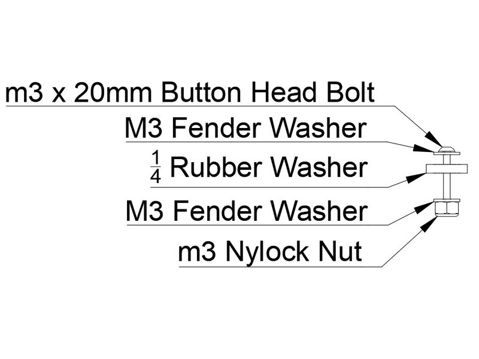
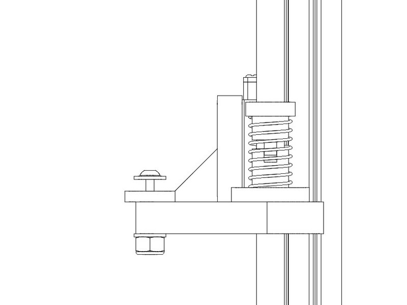
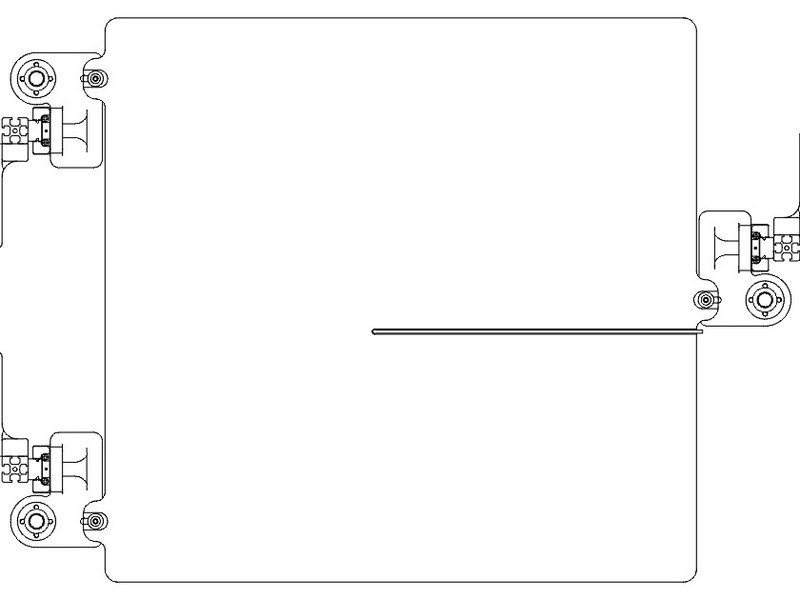
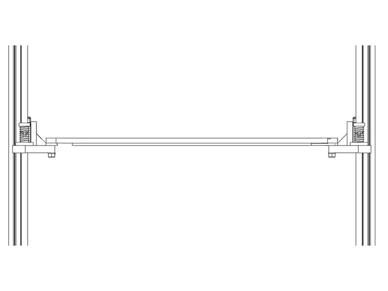

# O) Bed

Category: [RailCore II](index.md) · Original: <https://railcore.dozuki.com/Guide/O)+Bed/14>

**Difficulty:** Moderate  
**Time required:** No estimate  
**Author:** Tony Akens  
**Steps:** 3  
**Last modified on Dozuki:** 2020-12-28

## Step 1: Assemble the Bolt Stacks for Attaching the bed

- It works best to build the bolt stacks for attaching the bed, then put them in place on the yokes.
- (Filastruder kits use a Socket Cap Head Screw in place of a button head bolt)
- On a 20mm Button Head Bolt place:
  - (1) M3 Fender Washer
  - 1/4 rubber washer
  - (1) M3 Fender Washer
  - (1) m3 Nylock Nut

## Step 2: Put Bolt Stacks on the Yokes

- Place the bolt stack on the yoke, so the Nylock nut and m3 fender washer are below the Yoke, and the 1/4 rubber washer is on top of the yoke.
- Repeat for all 3 yokes.
- **Note:** The right yoke gets a ground wire from the bed wiring harness above the top washer. (not yet pictured). This requires a 25mm bolt to do as shown, currently the kits ship with only 20mm bolts, leaving out the lower washer is temporary fix.

## Step 3: Install Bed

 

- Install the bed by fitting it onto the yokes, with the best resting on the 1/4 rubber washers, and the m3 fender washer in the grooves on the bed tabs.
- Snug up the m3 nylock nuts to hold the bed in place.

Previous: [N) Aligning your RailCore](n-aligning-your-railcore.md) · [RailCore II guide list](index.md) · Next: [P) Electronics](p-electronics.md)

---

Original page: <https://railcore.dozuki.com/Guide/O)+Bed/14>. Written by Tony Akens on railcore.dozuki.com. This copy was captured on 2026-11-16 and is licensed under [Creative Commons Attribution-ShareAlike 3.0 (CC BY-SA 3.0)](https://creativecommons.org/licenses/by-sa/3.0/), the license stated on the original site. This is an unofficial community mirror and is not affiliated with RailCore Labs, LLC. RAILCORE is a registered trademark of RailCore Labs, LLC.
