# P) Electronics

Category: [RailCore II](index.md) · Original: <https://railcore.dozuki.com/Guide/P)+Electronics/15>

*This guide will take you through installing the electronics components and wiring on your RailCore II kit*

**Difficulty:** Moderate  
**Time required:** No estimate  
**Author:** Tony Akens  
**Steps:** 12  
**Last modified on Dozuki:** 2021-11-15

## Step 1

- **Caution:** Newer Filastruder kits use Socket Cap Head Screws, use them in place of all button head screws in this section unless noted.

## Step 2: Safety

- **Caution:** THE RAILCORE IS A “DIY” PROJECT - BUILD SAFE, BUILD SMART, AND BE RESPONSIBLE.
- **Caution:** BUILD AT YOUR OWN RISK.
- **Caution:** WHEN IN DOUBT, DOUBLE CHECK THINGS.
- **Caution:** 3D PRINTERS CAN GET VERY HOT. USE COMMON SENSE AND QUALITY COMPONENTS.
- **Caution:** If you need help, find us at the RailCore Facebook page or RailCore Discord channel. Both are linked from RailCore.org

## Step 3: Power Supply

[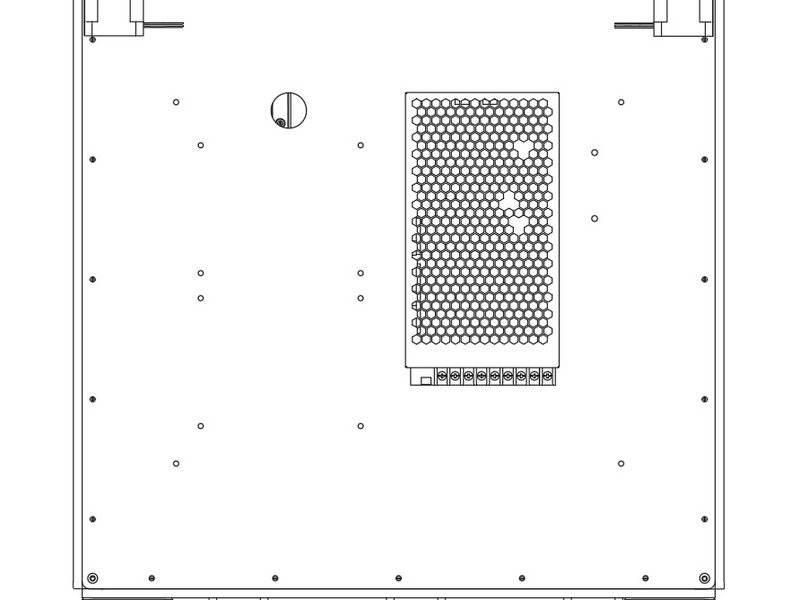](../assets/images/zoom/lGAoWhrOhXGGQSFd.jpg)

- **Caution:** Check the voltage setting on the side of your Power Supply before installing it.
- Attach the PSU using (4) M4 x 10mm Button Head Bolts. The bolts go through holes in the right panel, and into the back of the PSU.
- Be sure to install the PSU so the wiring terminals are to the bottom of the printer.

**2 comments on step 3:**

> **Jeff Weiss** wrote on 2021-08-07:
> 
> How am I supposed to attach these two parts with 6 4mm x 10mm SHCS when my kit only comes with 5 and there are no button head cap screws in this kit? Why only 5?

> > **Tony Akens** wrote on 2021-08-09:
> > 
> > I’m sorry it sounds like your kit was short one SCHS, there should have been 6.

> **Carlos Daniel Stagnaro** wrote on 2020-09-28:
> 
> AGAIN…Remember to check the voltage!! The power brick comes preset at 220V for safety. In the USA nominal voltage is 110 V. When you give power to the printer later on nothing will happen. Make sure you check the voltage before assambly.

## Step 4: SSR

[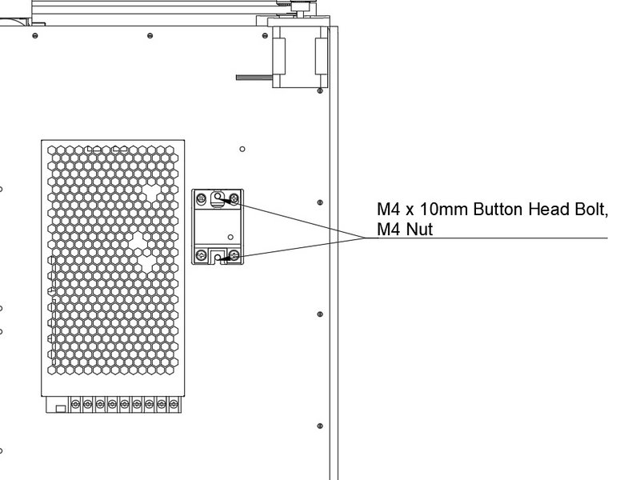](../assets/images/zoom/5fujukIxHgTlgc2h.jpg)

- Install the SSR as shown.
- Each hole is held in place using (1) M4 x 15mm Socket Cap Head Screws and an M4 nut & Washer

**5 comments on step 4:**

> **Jeffery Seiffert** wrote on 2023-01-04:
> 
> I personally didn't feel comfortable with the SSR sitting on plastic so I purchased two metal standoffs. spacers would work too, to raise it up about 10mm. I'm putting a 40mm x 40mm heat sink with thermal conductive tape to the bottom of the SSR. May be overkill but...
>
> Either way you will probably need to get more or longer screws depending if you use threaded or non-threaded spacers or standoffs.
>
> Make sure the wires are **not** touching the underside of the SSR or it could melt the plastic around the wire and cause all sorts of problems and it will be dangerous too.
>
> Remember, always be concerned with safety when using Electricity and things that heat like hot ends and heated beds.

> **Islam** wrote on 2021-11-15:
> 
> I got 5 m4x10 and 6 m4x15. The m4x15 is for the ssr because the m4x10s are a tad short.

> **Jeff Weiss** wrote on 2021-08-07:
> 
> My kit came with 5 M4 x 10mm SCHS screws not 6 and it did have 3 M4 nuts. Please count these fasteners and make the necessary changes to the kits for future customers. Obviously this is an issue. My kit had no M4 button Head screws either.

> **Ran Wei** wrote on 2020-07-14:
> 
> My Kit has neither the m4 x 10mm Button Head Bolt nor the nuts.

> **Koofic** wrote on 2020-06-27:
> 
> The kit doesn’t include M4 nuts

## Step 5: Duet and Duex5

[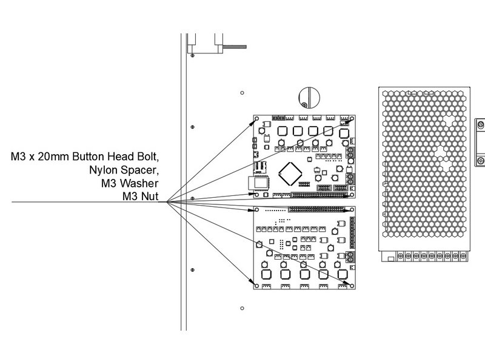](../assets/images/zoom/eUryx5u5wN4Jrqfo.jpg)

- Attach the Duet and Duex5.
- Be sure the Duet is on top, Duex5 is on bottom.
- Pay careful attention to the orientation.
- Mount them by putting one M3 x 16mm bolt through the board. Put the black nylon 5mm tall spacer behind the board.
- **Note:** The image says 20mm, it needs to be corrected.
- Pass the bolts through the panel, attach with an M3 Washer and M3 nut.

**4 comments on step 5:**

> **Islam** wrote on 2022-02-07:
> 
> If you’re running a Duet3 double check that the fan voltage jumper is set to 24v.

> **Islam** wrote on 2021-11-15:
> 
> If duet3 + raspberry pi then:
>
> The duet 3 goes on top with the Ethernet port facing the front of the printer and ribbon connector facing the bottom.
>
> tThe raspberry pi goes below the duet with the Ethernet facing the front of the printer. The ribbon between them goes under the raspberry pi.

> **Jeff Weiss** wrote on 2021-08-07:
> 
> Why can’t they just edit the directions to say M3 x 16 SHCS? I had no M3 X 16 or 20 mm button head screws in my kit.

> **evin powell** wrote on 2020-06-24:
> 
> M3 x 16 Button Heads work. I only had 5 M3x20 when I got to this stage

## Step 6: Rear Ebox Corners

[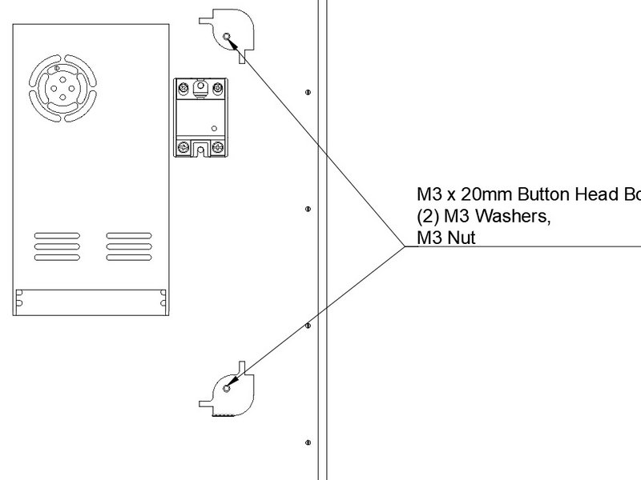](../assets/images/zoom/vCfcmRpetJSQYBZm.jpg)

- Attach the two rear Ebox Corners.
- Use an M3 x 16mm Socket Cap Head Screws and washer.
- **Note:** Image says 20mm bolt, will be corrected
- Pass them through the short side of the Ebox corner, and through the right panel.
- Fasten with an M3 washer and M3 nut.

**2 comments on step 6:**

> **Jeffery Seiffert** wrote on 2023-01-04:
> 
> The Filastruder.com Corner pieces I received were thicker on the bottom so the 16mm screws weren't really long enough but I had mistakenly put inserts in the panel side so the M3 x 16mm Socket Head Cap Screws worked just fine and seems to be holding pretty good.

> **Ran Wei** wrote on 2020-07-14:
> 
> I used M3 x 16 Button Head bolts as there were no M3 x 20 left (only 8 in total).

## Step 7: Power Switch

[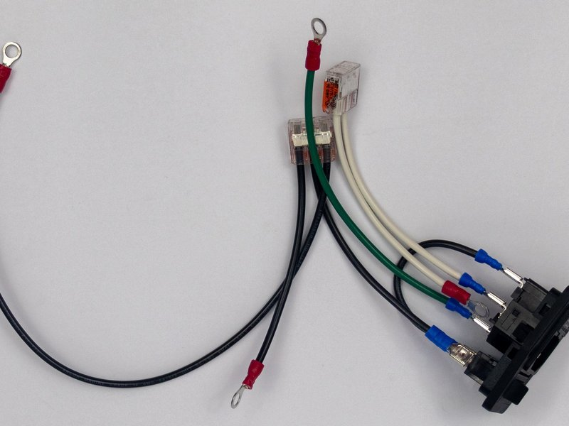](../assets/images/zoom/23Kr5cYrpa6ZruVH.jpg)

- The power switch in your kit should come pre-wired. This guide will walk you through it if it's not, and also serve as a way to double check it.

## Step 8: Power Switch

[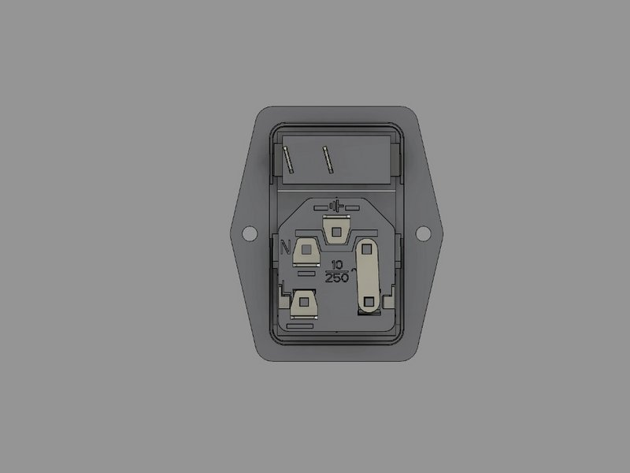](../assets/images/zoom/BYmOQnQBr6c33TyC.jpg) [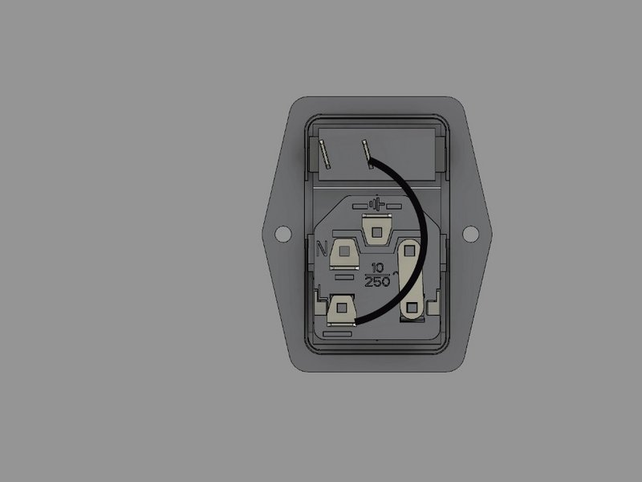](../assets/images/zoom/MXYy1h5XdnJCut1Y.jpg) [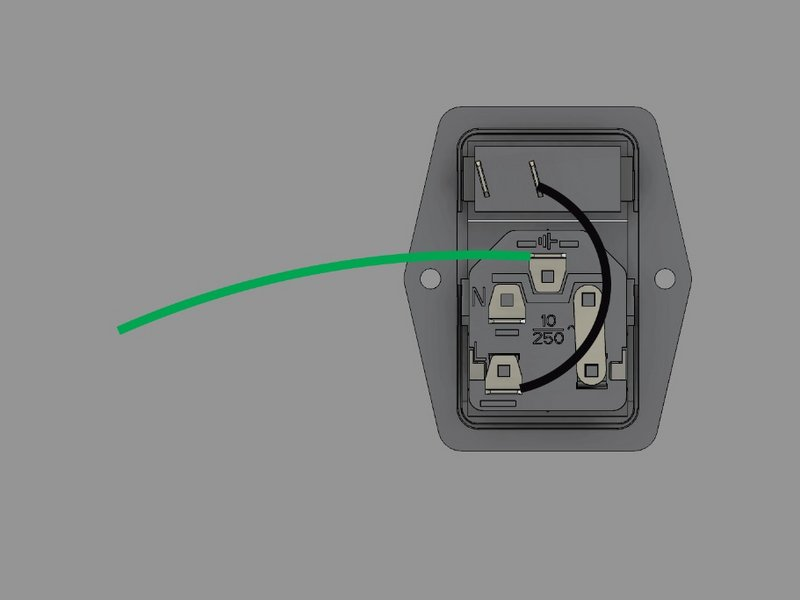](../assets/images/zoom/cWLaUY2EfFTqpOWg.jpg)

- If your switch isn't already wired, lay it face down as shown.
- Install the 75mm black wire between the switch and the fuse. It's a short black wire, with a spade terminal on each end.
- Install the 150mm green ground wire to the ground terminal on the plug. It has a spade terminal on one end, and a ring terminal on the other.

**1 comment on step 8:**

> **RiC0_MD** wrote on 2021-11-26:
> 
> The filastruder kit comes with a newer plug+switch combo, you should only have L/N/Earth Ground coming from it, no jump wires required.

## Step 9: Power Switch

[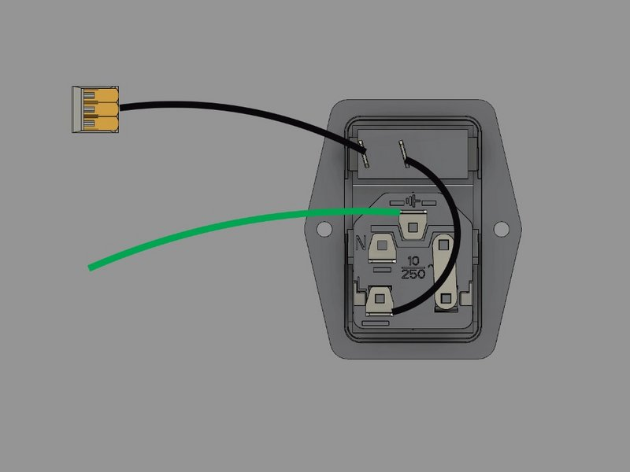](../assets/images/zoom/UIYNb3INkHGYZ1dc.jpg) [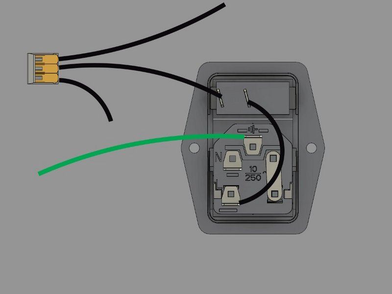](../assets/images/zoom/NxbhsMRSHPw5QEdN.jpg)

- Install the 100mm black wire onto the other terminal on the switch. One end is a spade terminal, the other end is bare wire, and goes into a 3 connector WAGO.
- Add a 80mm black wire with a ring terminal into one slot in the WAGO, and a 300mm black wire with a ring terminal into the other slot in the wago.

## Step 10: Power Switch

[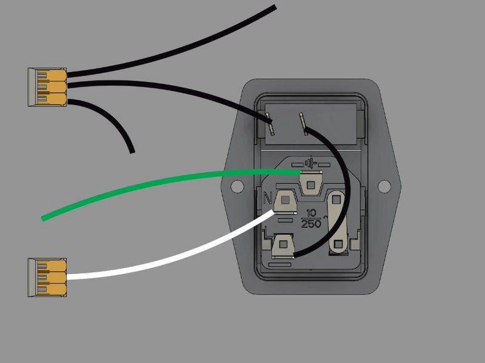](../assets/images/zoom/JW1e6fpggImBFHwr.jpg) [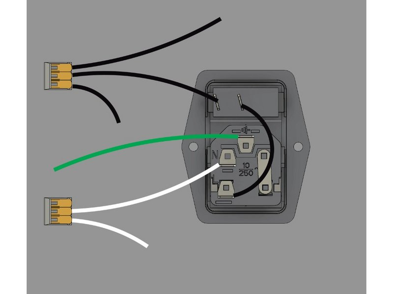](../assets/images/zoom/hjgGdPSNJIBaAQow.jpg)

- Install a 100mm white wire into the remaining spot on the plug with a spade connector. The other end of the wire is bare, and goes into a 3 slot WAGO connector.
- Add the bare end of a 100mm white wire into the WAGO. The other end has a ring connector.

## Step 11: Power Switch / Plug

[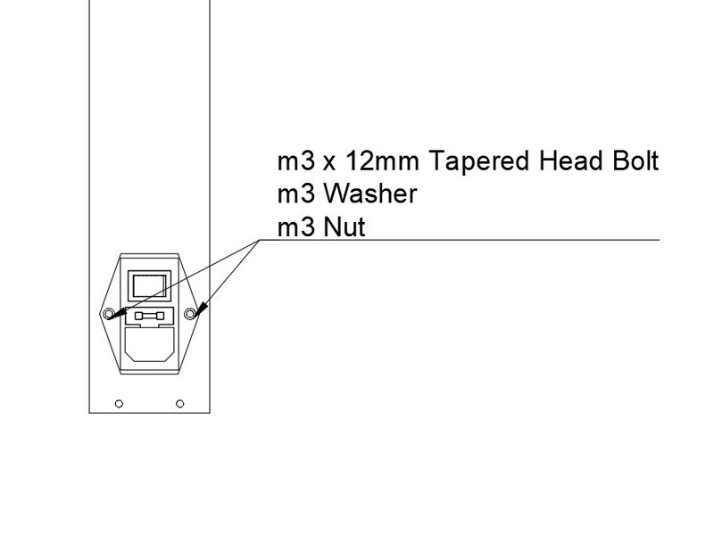](../assets/images/zoom/Fgtb1Bkv11clAEjD.jpg)

- Install the assembled and wired Power Switch / Plug module into the rear Ebox Panel.
- Pass the wiring already attached to the plug through the panel.
- Insert (2) M3 x 12mm Tapered Head Bolts through the switch and panel.
- Fasten using an M3 washer and M3 nut.

## Step 12: Rear Ebox Panel

[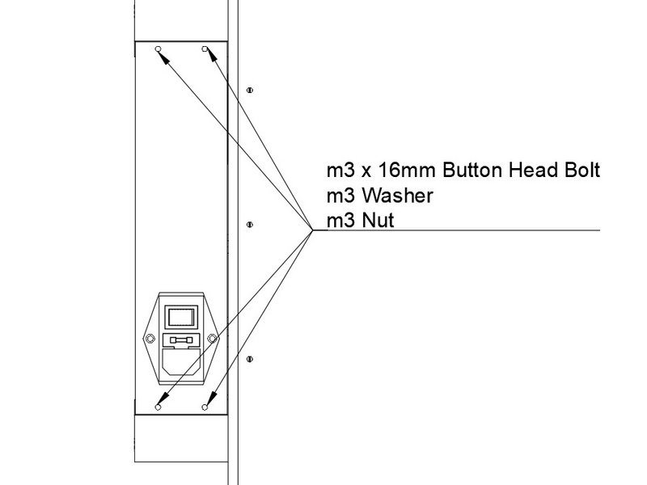](../assets/images/zoom/gUylqw2VIfbetRLg.jpg)

- Install the Rear Ebox panel onto the Ebox corners you've installed.
- Pass an M3 x 16mm Button Head Bolt through each of the panel holes.
- Fasten each bolt using an M3 washer and M3 nut.

## Comments on this guide (2)

> **Jeffery Seiffert** wrote on 2023-01-04:
> 
> It would sure be great if there was a Next button on the bottom of the pages to go to the next step. A Previous button too.

> **Aaron Craft** wrote on 2020-06-18:
> 
> Great to see all of these documents in the same place, finally! The illustrations are very nice.

Previous: [O) Bed](o-bed.md) · [RailCore II guide list](index.md) · Next: [Q) Wiring the Electronics](q-wiring-the-electronics.md)

---

Original page: <https://railcore.dozuki.com/Guide/P)+Electronics/15>. Written by Tony Akens on railcore.dozuki.com. This copy was captured on 2026-11-16 and is licensed under [Creative Commons Attribution-ShareAlike 3.0 (CC BY-SA 3.0)](https://creativecommons.org/licenses/by-sa/3.0/), the license stated on the original site. This is an unofficial community mirror and is not affiliated with RailCore Labs, LLC. RAILCORE is a registered trademark of RailCore Labs, LLC.
