# Q) Wiring the Electronics

Category: [RailCore II](index.md) · Original: <https://railcore.dozuki.com/Guide/Q)+Wiring+the+Electronics/16>

*This guide will walk you through wiring the electronics for your RailCore*

[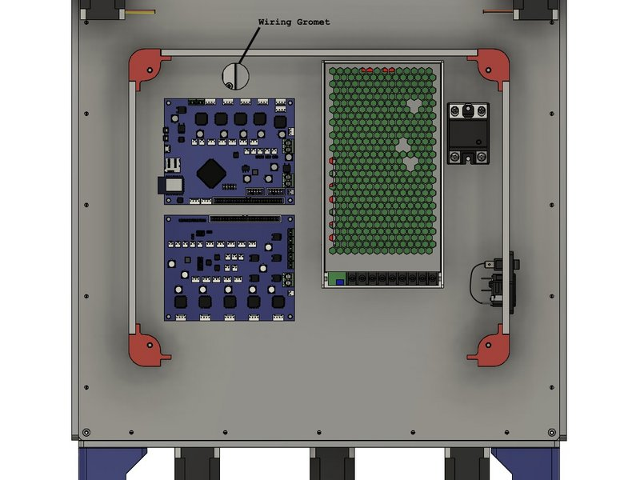](../assets/images/zoom/3KPO6yDS5qIqs1N5.jpg)

**Difficulty:** Moderate  
**Time required:** No estimate  
**Author:** Tony Akens  
**Steps:** 34  
**Last modified on Dozuki:** 2023-03-28

## Step 1: Wiring Grommet

 [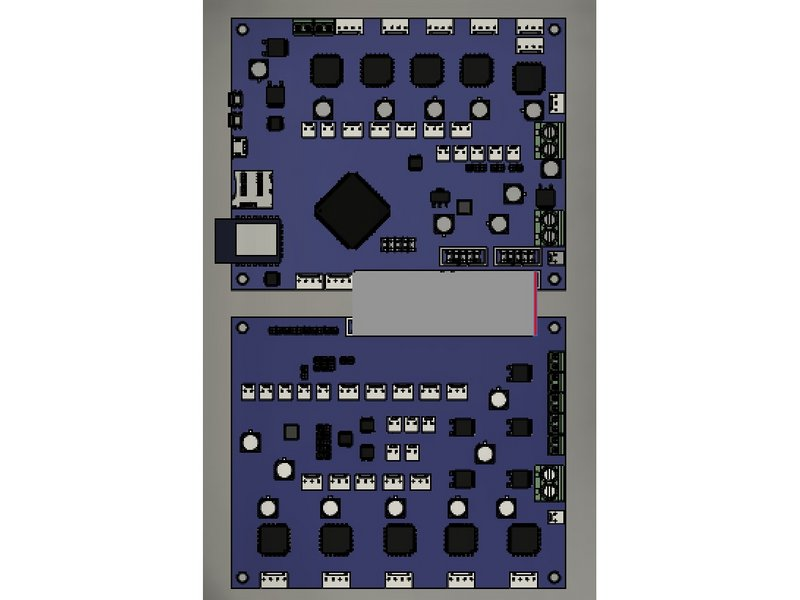](../assets/images/zoom/wvBIVlAJpZwuALNw.jpg)

- **Note:** The top and left panels are pictured for reference - they're not actually installed yet because it makes the wiring much easier to route.
- Install the grommet in the panel, to keep the wires from rubbing. If you've already pulled any of the wires through, you'll need to remove them to add the grommet.
- Both the wire bundle from the bed, and from the hotend, will run through this hole.
- Install the Ribbon Cable between the Duet & Duex5. Note the red strip should go to the right.
- You can tuck the excess length of the ribbon cable under the Duex5 to help keep things tidier.

1 comment(s) on this step

> **Max Plastix** wrote on 2020-06-16:
> 
> Yes, this Ribbon Cable is longer than the distance between boards. You have your choice of the classic “bow” outward, or ripple fold, or carefully removing one of the long IDC headers and shortening the cable to size (not recommended).

## Step 2: Switch to PSU

[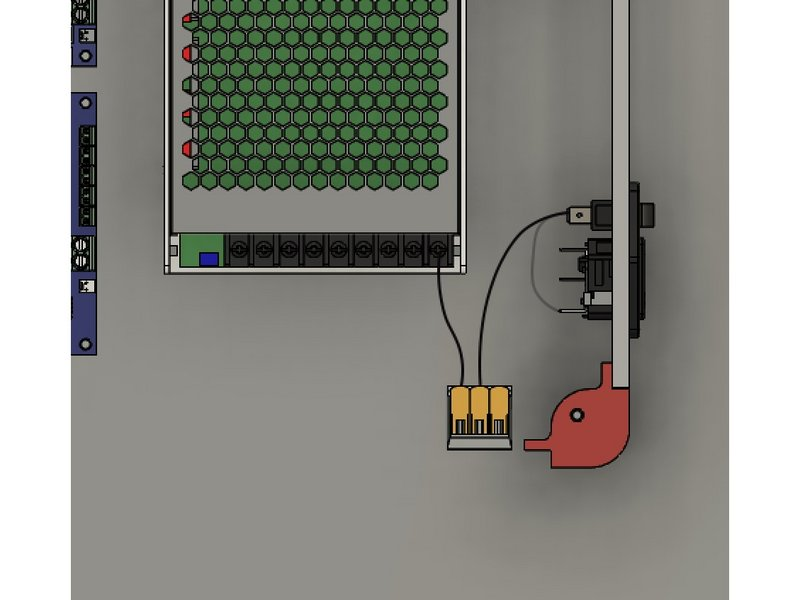](../assets/images/zoom/33eVpeCGMcxrgUES.jpg)

- Connect the short black wire from the WAGO connector to the port marked L on the PSU using the ring terminal.

## Step 3: Switch to SSR

[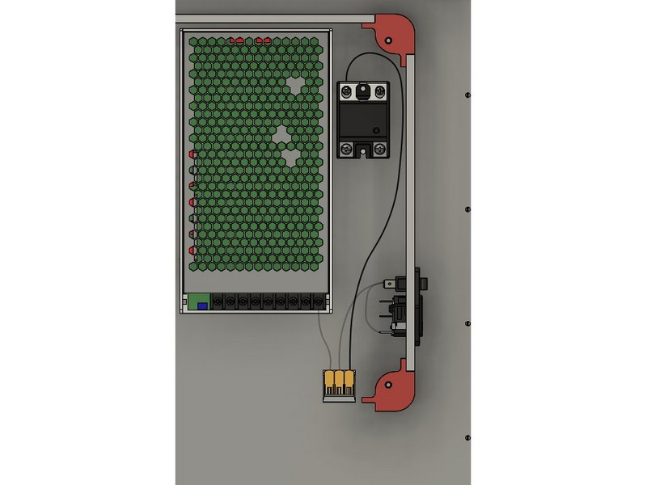](../assets/images/zoom/R1pNXqWsbhTLNB54.jpg)

- Connect the long black wire from the WAGO connector to the ring terminal marked 1 on the SSR.
- The SSR has a protective plastic cover over the AC terminals, #1 & #2. This cover needs to be opened (flipped back) to fully remove the terminal screw for the ring terminal. The screw is mildly captive, so continue unscrewing to release it. Re-install the snap cover after installing both #1 & #2.

1 comment(s) on this step

> **Max Plastix** wrote on 2020-06-16:
> 
> The Panasonic kit SSR has a protective plastic cover over the AC terminals, 1 & 2. This cover needs to be opened (flipped back) to fully remove the screw and install the ring terminal. The screw is mildly captive, so will take some unscrewing to release entirely. Re-install the snap cover after installing both 1 & 2.
>
> Note that 1 & 2 are interchangeable A/C lines if this makes routing easier.

## Step 4: Plug to PSU

[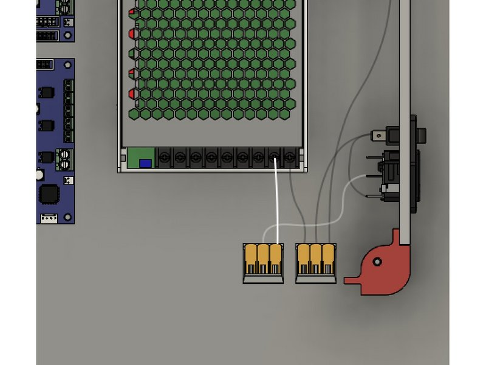](../assets/images/zoom/us5D6XPHWyO32lhA.jpg)

- Use a WAGO to connect both the White (Neutral) lead from the AC Plug and a short white wire with a Ring terminal.
- Attach that ring terminal to the port marked N on the PSU.

## Step 5: Ground Wire

[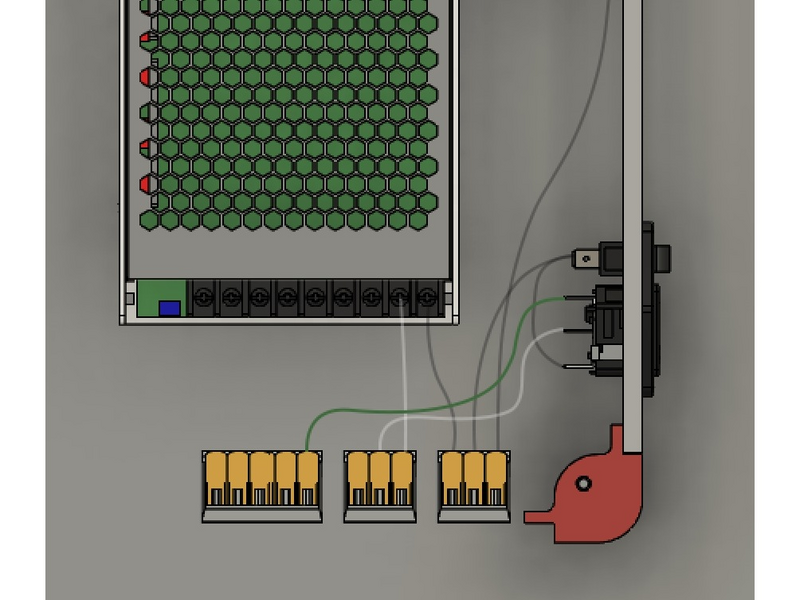](../assets/images/zoom/YpiJuSOjcYsWiJfG.jpg)

- Connect the green ground wire from the plug to the 5 port WAGO connector.

## Step 6: PSU Ground

[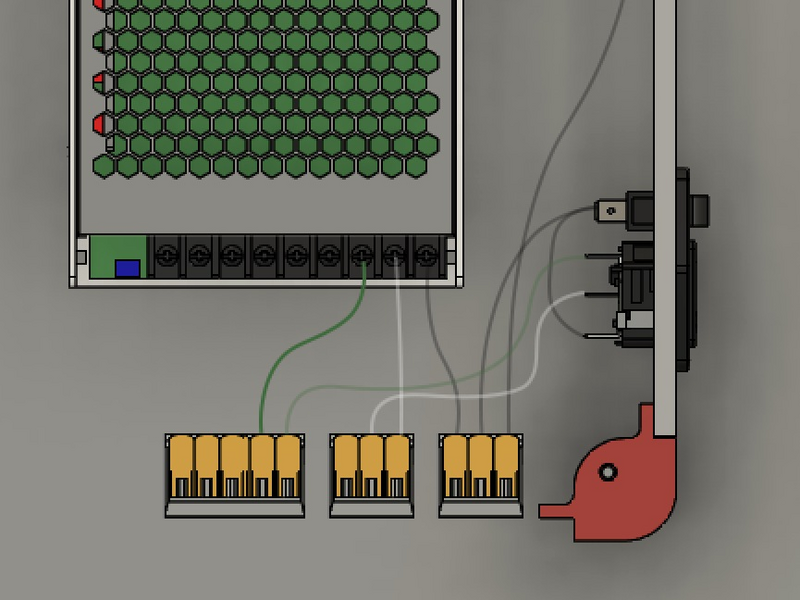](../assets/images/zoom/NKEyuySUhhytciOV.jpg)

- Connect a green wire from the 5 port WAGO to the ground terminal on the PSU.
- The Ground terminal is designated with the Earth Ground ⏚ symbol

## Step 7: SSR to Duet Bed Negative

[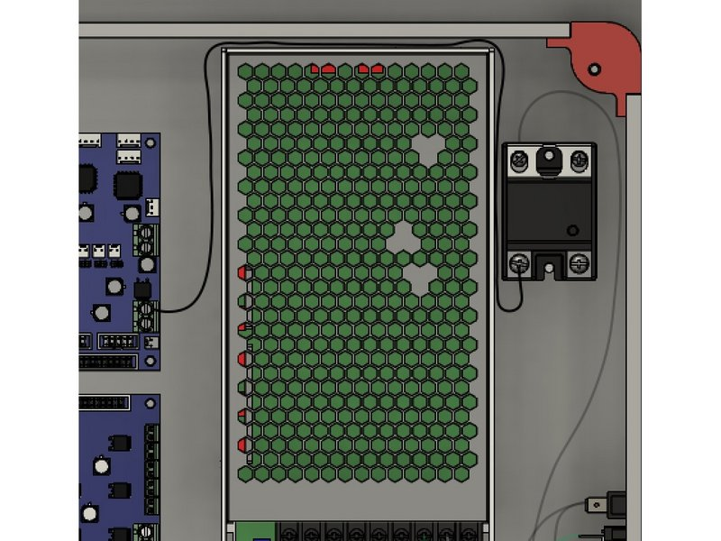](../assets/images/zoom/ikCD1LNHvH4LXqJs.jpg)

- Use the long black wire for the SSR to Duet. The SSR end has a ring terminal, and goes in SSR port 4.
- The other crimped end goes in the Duet Bed "-" terminal.

## Step 8: SSR to Duet Bed Positive

[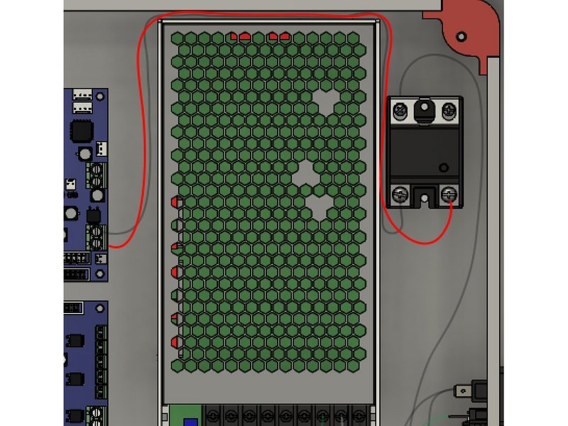](../assets/images/zoom/OGIjOILRqRUEbHHQ.jpg)

- Connect the long red wire to the SSR port 3 using the ring terminal.
- The other crimped connector goes into the Duet Bed "+" terminal.

## Step 9: PSU to Duet Positive

[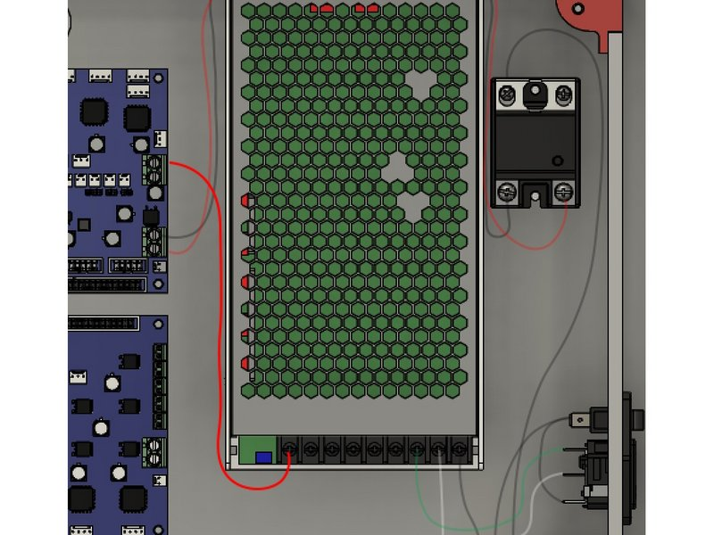](../assets/images/zoom/nt6dgEH2IIGiZyeG.jpg)

- Connect the red wire ring terminal to the PSU "+" connector.
- Connect the end marked Duet to the "+" power input on the Duet.

## Step 10: PSU to Duex5 Positive

[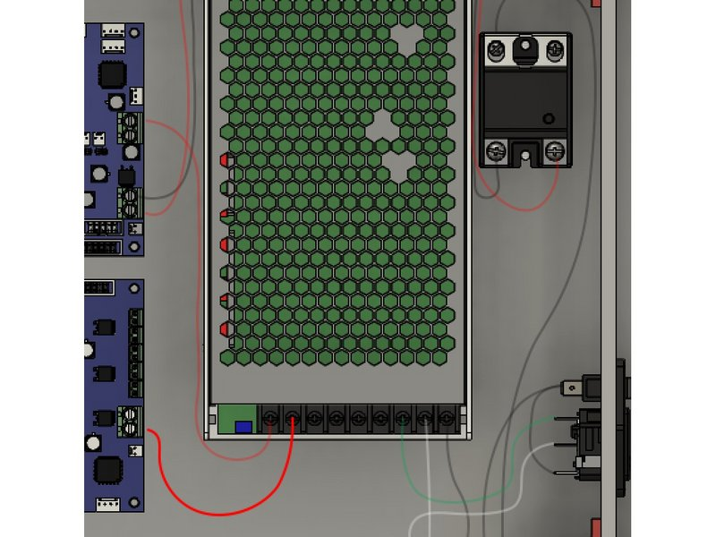](../assets/images/zoom/kFZ56YYvdJeN3LCh.jpg)

- Connect the short red wire with the Duex5 label's ring terminal to the PSU "+" connection.
- The crimped end goes in the Duex5 "+" terminal.
- **Caution:** Be sure to note which terminal is the Duex5 "+" terminal. It is the opposite of the Duet2.

## Step 11: PSU to Duex to Duet2 Negative

[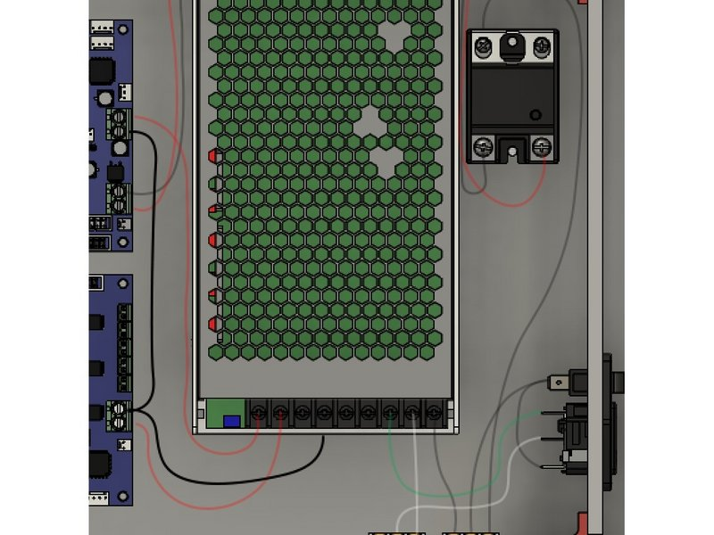](../assets/images/zoom/kB3IduL35CrvEFK3.jpg)

- Connect the ring terminal on the Y cable to the PSU "-" connection.
- The center crimped connection goes in the Duex5 "-" power connector.
- The other crimped connection goes in the Duet2 "-" power connector.

## Step 12: Bed to Neutral

[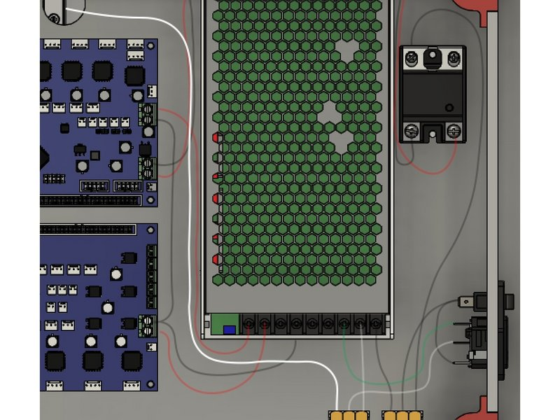](../assets/images/zoom/VHZFjEnBYpBY4BHg.jpg)

- The bed has two white braided wires coming from it. One of them is longer, and has a bare end.
- Straighten out the wired on the bare end. Lift up the arm for the open spot on the WAGO connector.
- Insert the wire into the WAGO, and close the lever arm.

## Step 13: Bed to SSR

[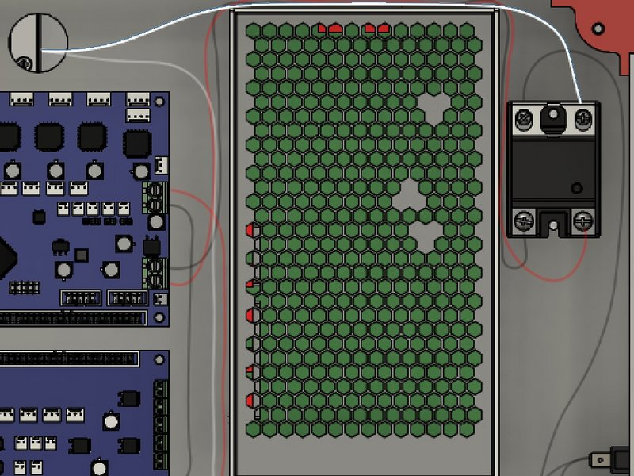](../assets/images/zoom/knAuUXXbcNdSOYBf.jpg)

- The shorter end of the white braided bed wires has a ring terminal on it.
- Connect the ring terminal to the SSR port 2.

## Step 14: Bed Thermistor

[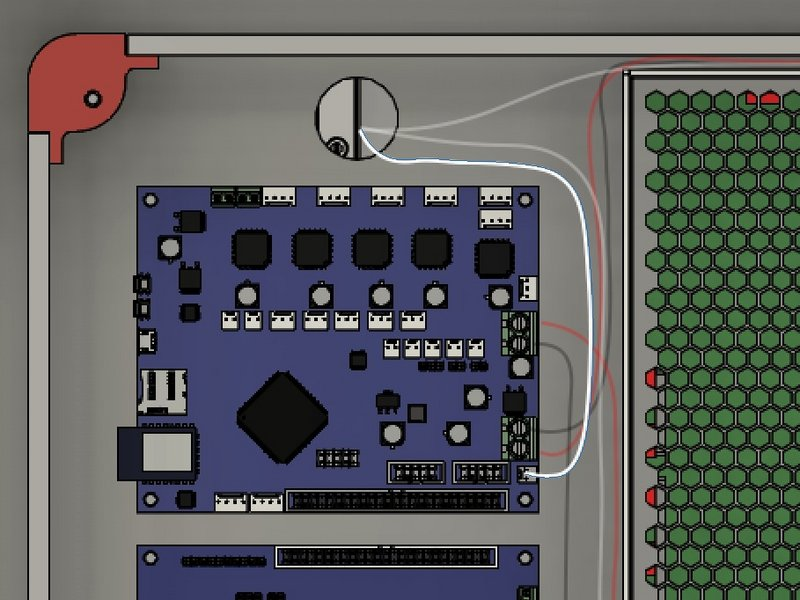](../assets/images/zoom/JYWdSTSaEYqrUQcy.jpg)

- The bed wiring has two thin white wires with a molex connector for the bed thermistor.
- Connect these wires to the bed thermistor port on the Duet2.

## Step 15: Bed Ground

[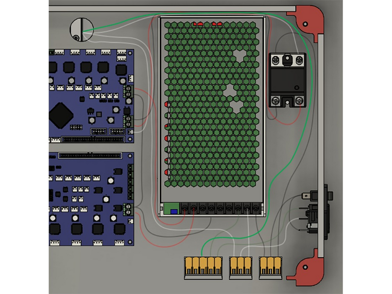](../assets/images/zoom/nCwrjwIIdBUai3hn.jpg)

- The bed harness has a green ground wire that was attached to the bed earlier in the build.
- Run the ground wire over the PSU and SSR, down to the 5 port WAGO the green wires from the PSU and Power Inlet were run to.

1 comment(s) on this step

> **Jeff Weiss** wrote on 2021-08-07:
> 
> My Magnetic bed and Keenovo heater has no ground wire nor was there a step to add it to the bed?There is no ground wire in the kit to add to the bed either. There is no place on the bed to add a ground wire as well. This seems like an important detail to be skipped altogether.

## Step 16: Frame Ground

[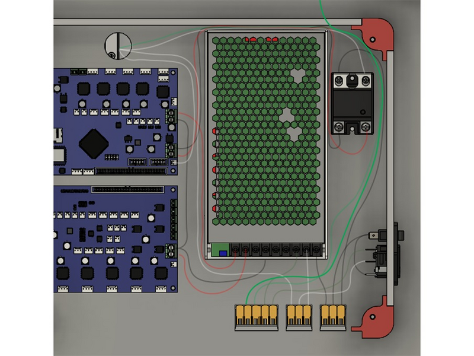](../assets/images/zoom/CyTSamle2uLA5Wm5.jpg)

- There is a long green ground cable used for grounding the frame. It has ring terminals on one end.
- One end goes in the same 5 port WAGO as used for the bed ground, Power Inlet Ground, and PSU ground (green wires)
- Run the cable up past the SSR, and attach it to the top frame on the extrusion near the rear stepper.
- Use the toothed lockwasher and an M3 x 8mm button head bolt. Place the toothed washer under the ring terminal.

1 comment(s) on this step

> **Jeff Weiss** wrote on 2021-08-07:
> 
> The m3 bolt and lockwasher are way too small to properly attach the chassis ground to the top extrusion in this way. The eyelet in the chassis ground wire is far too big to attach in this manner. I had to use two m3 washers to install the ground wire with sufficient attachment strength and reliability.

## Step 17: Extruder Wiring Bundle

[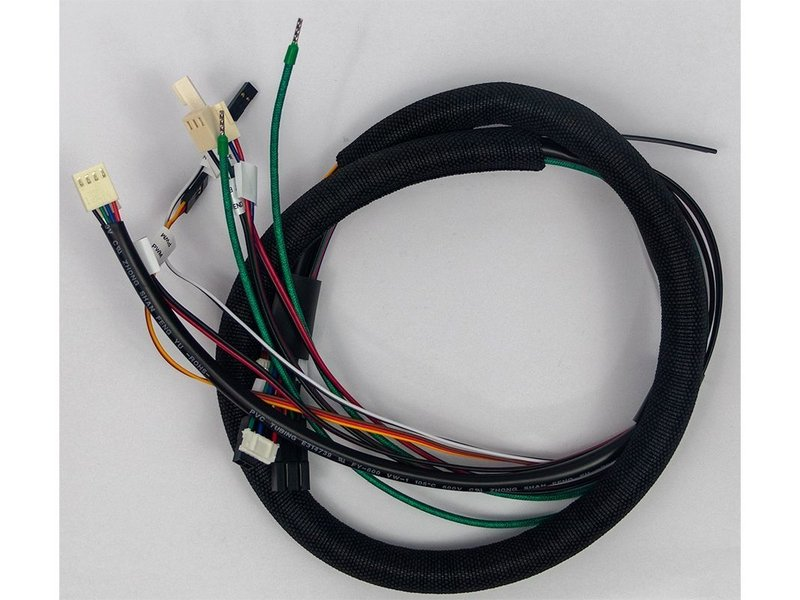](../assets/images/zoom/fxFurX2AnBuyypSq.jpg) [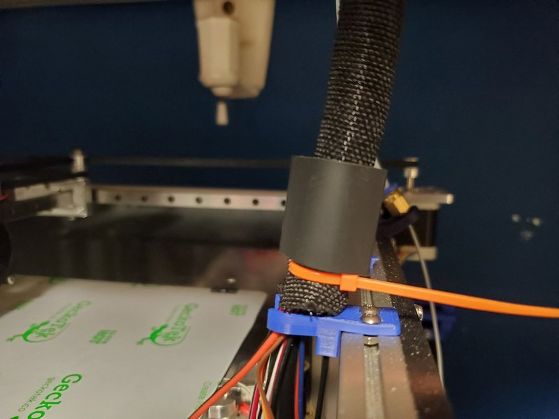](../assets/images/zoom/qKYt6fvR5AROUHqE.jpg) [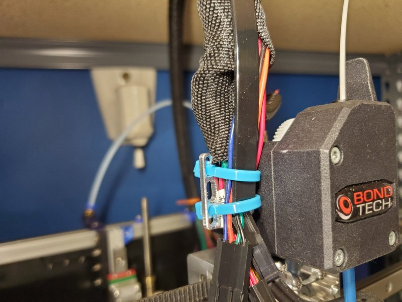](../assets/images/zoom/XJSmRLNrtKroJgCh.jpg)

- All of your Y carriage items should already be mounted. Now you'll add the wiring harness for the hotend.
- There is a 36" zip tie inside the wiring bundle. One end of it slots into the wiring clip on the right side of the printer.
- Run the ends of all the wires through the grommet you installed.
- The other end gets zip-tied to the wiring mount on the extruder mount.

## Step 18: Extruder Wiring

- **Caution:** Photos of these steps will be added ASAP
- You'll need to remove the wiring that came pre-installed on the BLTouch if you haven't already. The wiring harness includes a new BLTouch connector.
- Connect the hotend, hotend fan, thermistor, BLTouch, and the Fan/Y Endstop.
- You may need to pull the wires further through the wiring harness in one direction or the other to make them reach, or to reduce slack. You don't want them super taught, but you don't want a lot of slack on the extruder end once they're connected.

## Step 19: X Endstop wiring

- **Caution:** Images for this step will be added ASAP
- The X Endstop was installed earlier.
- The X Endstop wire can be pushed into the bottom of the top rear extrusion to the right rear corner, then into the bottom channel of the top right extrusion, until it gets to the hole in the panel for the wiring.

## Step 20: Hotend

[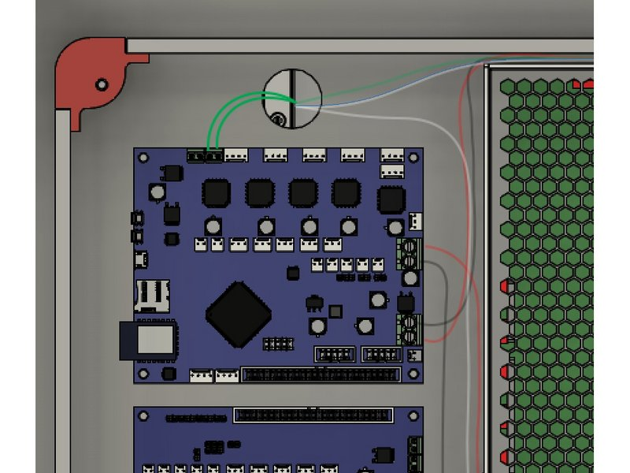](../assets/images/zoom/l2BcYisre1ebRhJw.jpg)

- There are two cloth wrapped green wires for the hotend. The ends have crimped bootlace connectors.
- Insert the connectors into the E0 heater port on the duet, and carefully tighten it down with a screwdriver.

## Step 21: Hotend Thermistor

[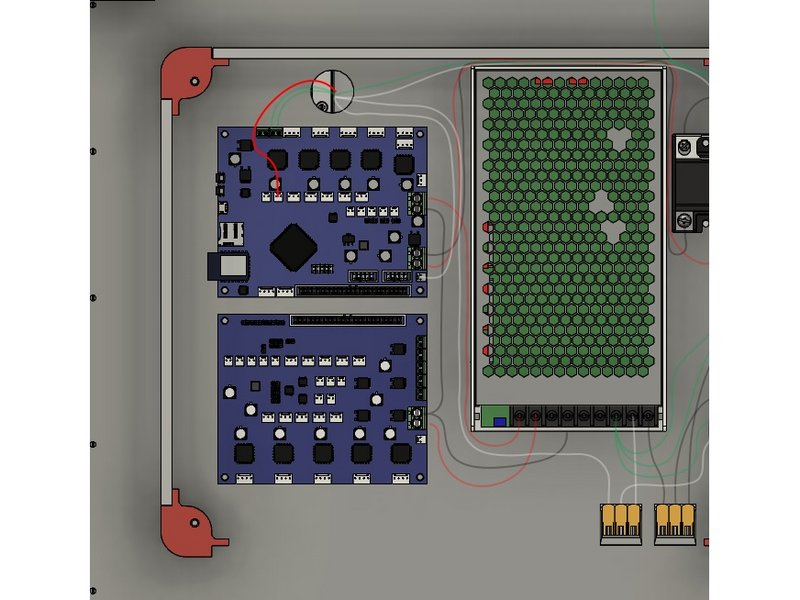](../assets/images/zoom/hBMYqQPDZXlOUDv5.jpg)

- The Hotend Thermistor is a red and black pair of wires. Plug it in to the E0 Temp port on the Duet2.

## Step 22: Extruder Stepper

[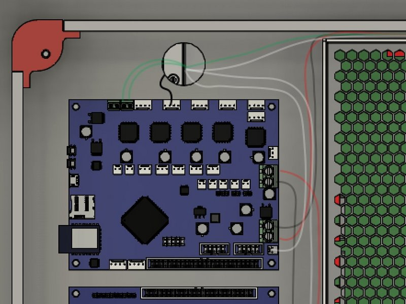](../assets/images/zoom/KCNKJU2wlORyZLBA.jpg)

- Connect the extruder stepper wire to the 4-pin E0 Stepper port on the Duet2.

## Step 23: Hotend Fan

[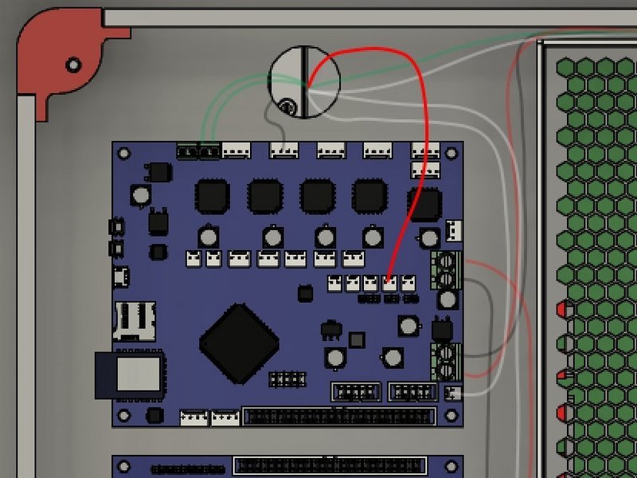](../assets/images/zoom/G1O2Nv1n64mpV1VW.jpg)

- Connect the Hotend Fan to one of the always on Fan ports on the Duet2.
- **Caution:** It's good to double check that the red wire is to the right side pin, nearest the Duet2 Power connectors.

1 comment(s) on this step

> **Islam** wrote on 2022-01-24:
> 
> If you’re running a Duet3 double check that the fan voltage jumper is set to 24v.

## Step 24: Layer Fan

[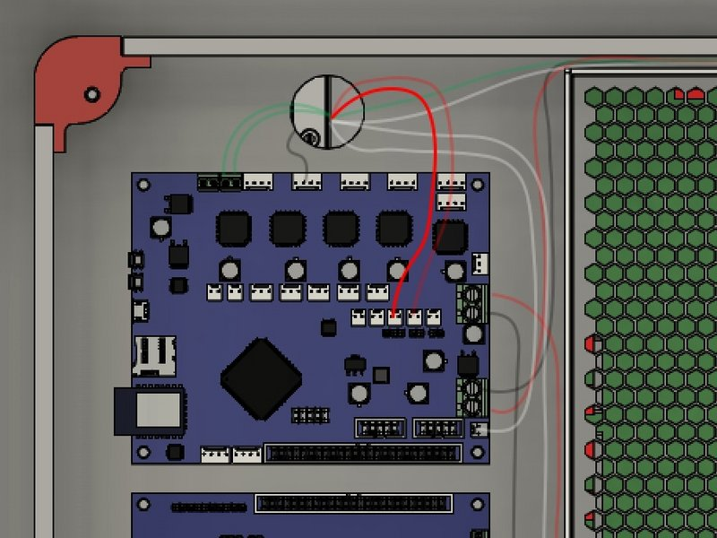](../assets/images/zoom/yUkNhHq4tA4Dp2CY.jpg)

- Connect the Layer Fan wires to the Fan0 connector on the Duet2.
- **Caution:** It's best to double check the red wire is on the right side pin, nearest the Duet2 power connectors.

1 comment(s) on this step

> **Islam** wrote on 2022-01-24:
> 
> If you’re running a Duet3 double check that the fan voltage jumper is set to 24v.

## Step 25: Keenovo Thermistor

[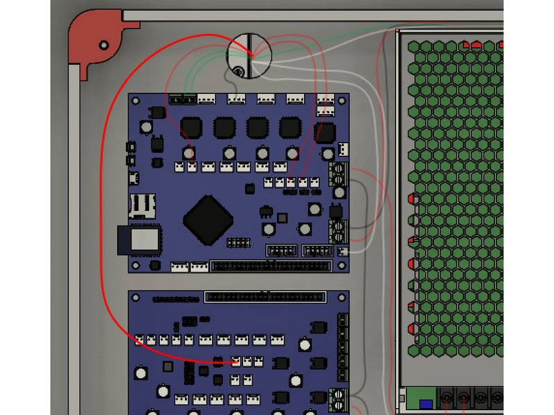](../assets/images/zoom/mX3IdhO5DPBGSSOs.jpg)

- The Keenovo comes with its own thermistor. It's not used to control the bed temp, we use the one in the channel on the bed. However it can be used as an extra bed temp monitor.
- The keenovo thermistor wires are two red wires with a molex connector. Connect it to the E4 Thermistor port on the Duex5.

## Step 26: X Endstop Wiring

[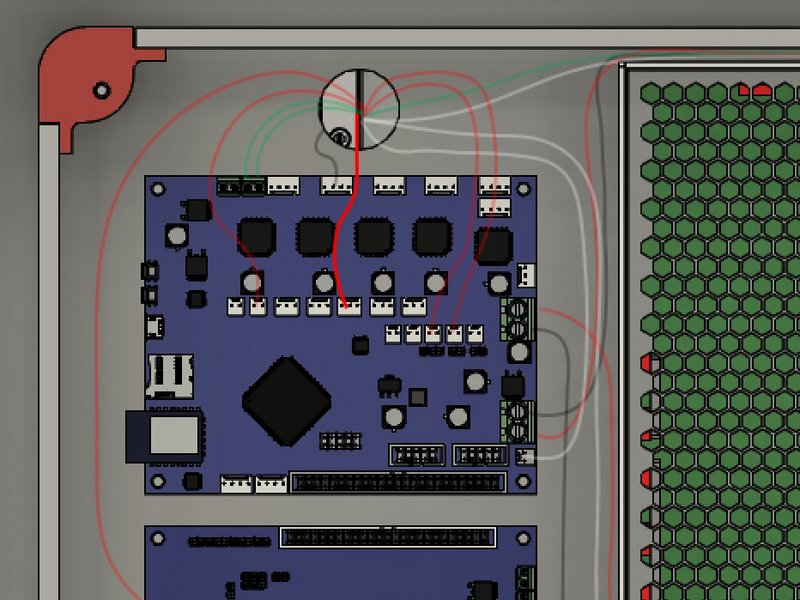](../assets/images/zoom/UcYhKUxwKSVhaGLt.jpg)

- Connect the X Endstop wire to the X_Stop connector on the Duet2.

## Step 27: Y Endstop

[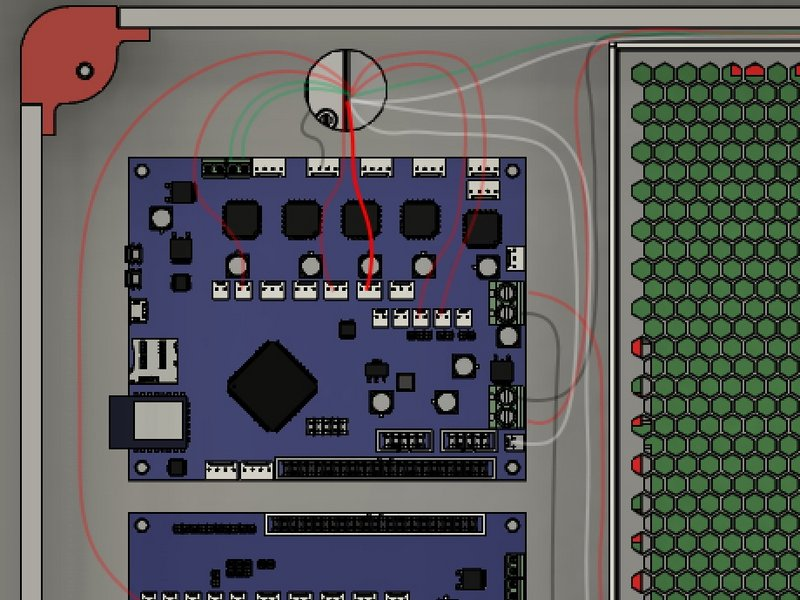](../assets/images/zoom/CPTdRxjBHAvl5qHe.jpg)

- Connect the Y endstop connector to the Y_Stop port on the Duet2.

## Step 28: Z Probe

[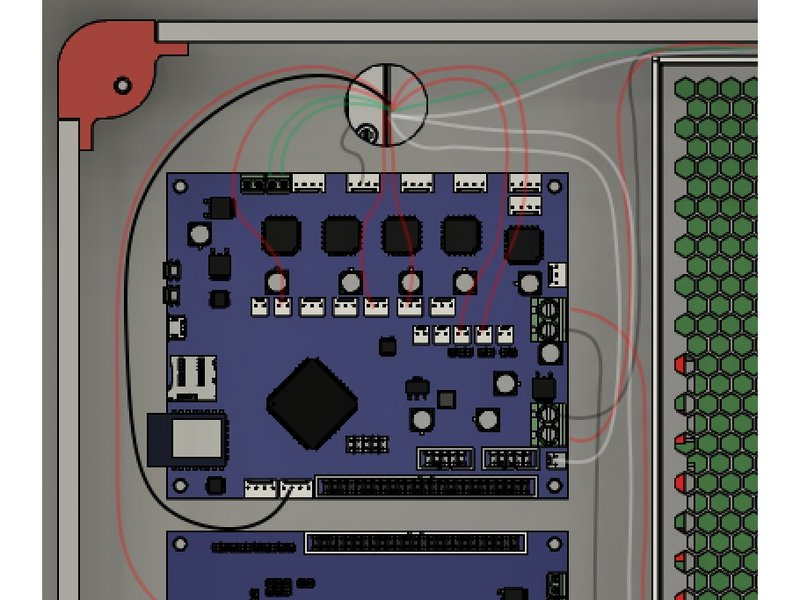](../assets/images/zoom/LFtXGVOJFDtCo2Pk.jpg)

- The Z Probe connector is a black and white wire pair. It goes to the left two pins in the Z_Probe connector on the Duet2.
- It is important that the white wire is on the left in the first pin, nearest to the PanelDue connector, and the black wire is on the right to the second pin.

## Step 29: BLTouch

[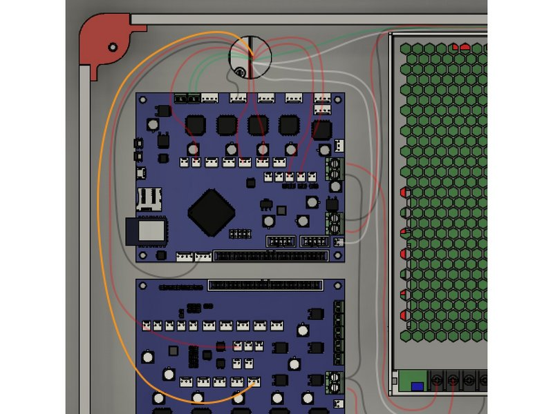](../assets/images/zoom/2eULtnGasuLyGM1w.jpg)

- The 3 wire connector for the BLTouch goes to the PWM1 port on the Duex5.
- **Caution:** The wire color, from left to right, is Orange, Red, Brown.

## Step 30: Y Stepper

[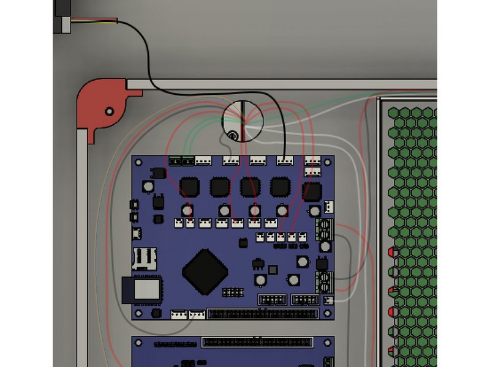](../assets/images/zoom/J1yHcfORO4dg1XEE.jpg)

- The Front Stepper Cable (Y Stepper) cable plugs into the connector on the stepper.
- The other end of the connector goes to the Y Motor connector on the Duet2.

## Step 31: X Stepper

[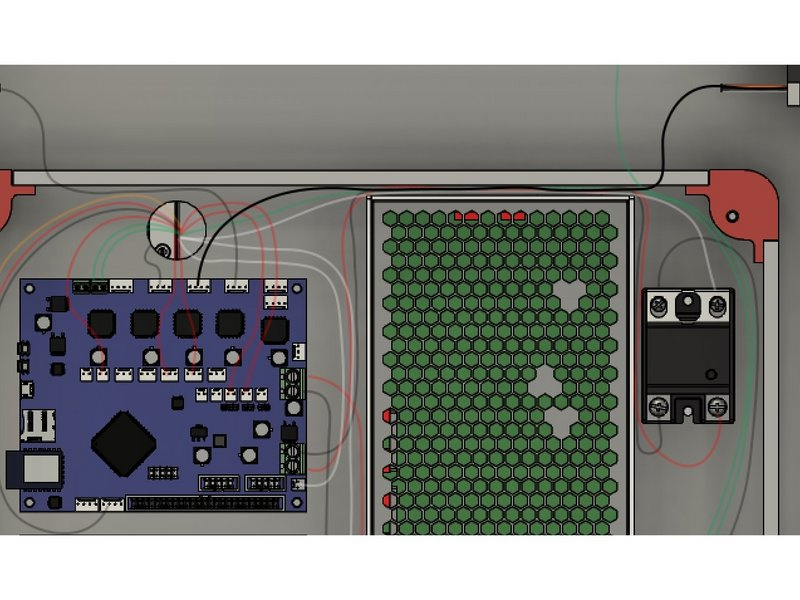](../assets/images/zoom/BbMyajosHcjJqBUR.jpg)

- Connect the Rear X Stepper to the X_Motor port on the Duet2.
- **Caution:** Double check the X/Y Stepper connections are in the correct ports - if they're incorrect you will have motion issues.

## Step 32: Front Left Z Stepper

[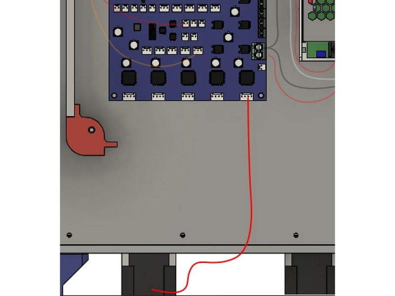](../assets/images/zoom/jHbwBLvLWlDcvsde.jpg)

- For the Z steppers it can help to lay the printer on its back.
- Connect all 3 Z stepper wires to the steppers. Route them so they can reach the stepper motors on the bottom edge of the Duex5, using zip ties and the zip tie mounts to hold them to the bottom panel.
- Connecting these steppers to the correct ports is critical, otherwise your bed leveling will not work correctly.
- Connect the Front Left Z Stepper Cable to the Drive 5 port on the Duex5, which is labelled E2 MOT.

## Step 33: Rear Left Z Stepper

[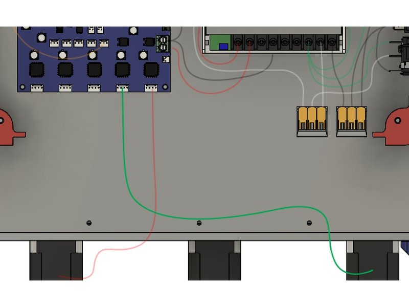](../assets/images/zoom/pKY2jx4LrqNF1h3R.jpg)

- Connect the Rear Left Z Stepper to the Drive 6 port on the Duex5, which is labelled E3 MOT.

## Step 34: Right Z Stepper

[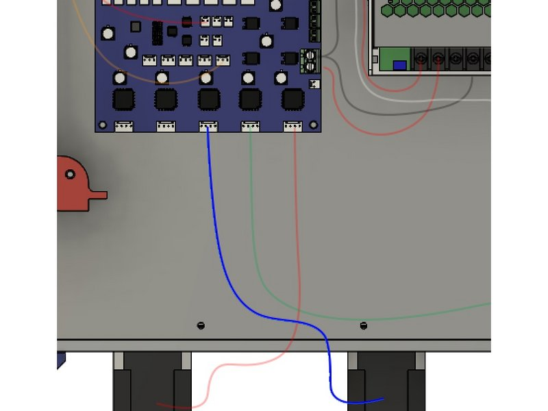](../assets/images/zoom/UDPWvI53VioTttYJ.jpg)

- Connect the Right Z stepper to the Drive 7 port on the Duex5, which is labelled E4 MOT.

## Comments on this guide (2)

> **Craig Manning** wrote on 2021-12-19:
> 
> Lots of broken image links on the railcore dozuki.

> **evin powell** wrote on 2020-06-25:
> 
> looks like we are missing the thermistor to duet connection in pictures.

Previous: [P) Electronics](p-electronics.md) · [RailCore II guide list](index.md) · Next: [R) Firmware, Config, and Smoke Test](r-firmware-config-and-smoke-test.md)

---

Original page: <https://railcore.dozuki.com/Guide/Q)+Wiring+the+Electronics/16>. Written by Tony Akens on railcore.dozuki.com. This copy was captured on 2026-11-16 and is licensed under [Creative Commons Attribution-ShareAlike 3.0 (CC BY-SA 3.0)](https://creativecommons.org/licenses/by-sa/3.0/), the license stated on the original site. This is an unofficial community mirror and is not affiliated with RailCore Labs, LLC. RAILCORE is a registered trademark of RailCore Labs, LLC.
