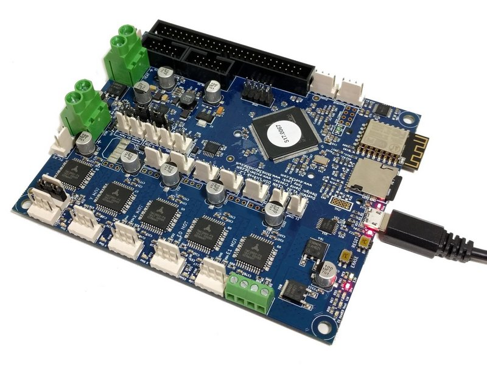

# R) Firmware, Config, and Smoke Test

Category: [RailCore II](index.md) · Original: <https://railcore.dozuki.com/Guide/R)+Firmware+Config+and+Smoke+Test/18>

**Difficulty:** Moderate  
**Time required:** No estimate  
**Author:** Tony Akens  
**Steps:** 6  
**Last modified on Dozuki:** 2023-04-07

## Step 1: A Word of Warning

- **Caution:** It can be tempting to rush ahead - you're almost done, after all, and you want to see your printer print. Don't rush these steps.
- **Caution:** Read each step carefully, and follow the instructions closely, you'll save yourself a lot of time and headache.
- **Caution:** If at any point you feel over your head here, stop and ask questions in the RailCore Discord (Best option) or RailCore Facebook group.
- **Caution:** Be very careful near your electronics with the cover off. You can install the cover first, but it can be difficult to adjust things, so I install it after the smoke test.
- **Caution:** NEVER UNPLUG ANYTHING FROM YOUR DUET WITH THE POWER ON, ESPECIALLY STEPPERS.

## Step 2: Default Config Files

- Your Duet comes with an SD Card pre-loaded with configuration files. We need to change those to the RailCore default files.
- Remove the SD card and put it in your PC. On it you'll find a series of folders.
- Make a copy of the "sys" folder, and call it "sys_original".
- **Caution:** If your Kit came with RRFv2 installed: Copy all of the files from here into your sys folder, overwriting the original files: [https://www.dropbox.com/sh/dmguq264vp7aw...](https://www.dropbox.com/sh/dmguq264vp7awvh/AAClCCy32o2VxvKDzsNJQWGEa?dl=0 "https://www.dropbox.com/sh/dmguq264vp7awvh/AAClCCy32o2VxvKDzsNJQWGEa?dl=0")
- **Caution:** If your Kit came with RRFv2 installed: Copy the files here into the /macros folder: [https://www.dropbox.com/sh/gp2ur784zapus...](https://www.dropbox.com/sh/gp2ur784zapus20/AAAHEGTLxU1ULeWPbAyXiosya?dl=0 "https://www.dropbox.com/sh/gp2ur784zapus20/AAAHEGTLxU1ULeWPbAyXiosya?dl=0")
- **Caution:** If your Kit came with RRFv3 installed: Copy all of the files from here into your sys folder, overwriting the original files: [https://www.dropbox.com/sh/6hvt9u44logql...](https://www.dropbox.com/sh/6hvt9u44logqlca/AAC0TdEtTRaCxYIj6hRaoEbwa?dl=0 "https://www.dropbox.com/sh/6hvt9u44logqlca/AAC0TdEtTRaCxYIj6hRaoEbwa?dl=0")
- **Caution:** If your Kit came with RRFv3 installed: Copy the files here into the /macros folder: [https://www.dropbox.com/sh/rnumrdwvmmmqo...](https://www.dropbox.com/sh/rnumrdwvmmmqohr/AABIl5hocRomJl2WglI1PjSUa?dl=0 "https://www.dropbox.com/sh/rnumrdwvmmmqohr/AABIl5hocRomJl2WglI1PjSUa?dl=0")
- Eject the SD card from your PC, and put it back in the Duet.

2 comment(s) on this step

> **bluxero** wrote on 2020-12-31:
> 
> The current config.g file in the RRF 3.x dropbox in the above comment is missing a value in “Heater 1 model”. If your bed is showing -273 degrees ambient, make sure to add “V24.0” after D6.7

> **Andrew Tosh** wrote on 2020-10-18:
> 
> With RRF 3.x, the configuration files have to be updated.
>
> Updated configuration files can be found here:
>
> [https://www.dropbox.com/sh/pg0ugu5qunokj...](https://www.dropbox.com/sh/pg0ugu5qunokjc9/AAD8PkPqVGPp-yWV5Cug3_Usa?dl=0&fbclid=IwAR34QOCDe8QBza2rBmPofFK8dcl0a5DGfRcshysLDSi7lufiN9AyP5OEWJM "https://www.dropbox.com/sh/pg0ugu5qunokjc9/AAD8PkPqVGPp-yWV5Cug3_Usa?dl=0&amp;fbclid=IwAR34QOCDe8QBza2rBmPofFK8dcl0a5DGfRcshysLDSi7lufiN9AyP5OEWJM")

## Step 3: Connecting to your Duet

- Before powering-on the first time, You need to connect to your duet with a microUSB cable.
- Follow the instructions here for getting connected to your Duet: [https://docs.duet3d.com/en/How_to_guides...](https://docs.duet3d.com/en/How_to_guides/Getting_connected/Getting_connected_to_your_Duet "https://docs.duet3d.com/en/How_to_guides/Getting_connected/Getting_connected_to_your_Duet") You can use YAT as suggested, or any other serial console program.
- Don't worry about upgrading your firmware yet, but take note of the version installed.
- Send an M115 command to your Duet, be sure you see "Duet 2 WiFi + Duex 5" in the output.
  - If you do not see Duex 5, STOP. Your Duet to Duex5 ribbon connector is not working. Disconnect the USB to shut off the Duet and fix it before proceeding.
- Continue following the instructions to get the Duet connected to your network.
- Ensure that you can reach your Duet via Duet Web Control before disconnecting the USB. When you unplug the USB the duet will lose power.

## Step 4: Smoke Test

- Double check all your connections.
- Double check them again.
- Once the printer is powered, do not work on the electronics until you power it off. Keep your fingers entirely away from the electronics area while the printer is on.
- Connect the power cord to the IEC inlet plug.
- Power on the printer.
- You should be able to connect to the web interface you set up earlier.

## Step 5: Updating the Duet Firmware

- Connect to your Duet via the web interface.
- Navigate to the *Settings*, *Machine Specific* and look under *Electronics* to see your Firmware version. Under *Settings*, *General* you can see the Duet Web Control (DWC) version. If you're not at *Reprap Firmware 2.05.1*, *DuetWebControl 2.0.7*, and *DuetWiFiServer-1.23* (for WiFi versions), follow the steps below to upgrade.
  - Download `Duet2Firmware-2.05.1.zip` and `aip4e.bin` from [https://github.com/Duet3D/RepRapFirmware...](https://github.com/Duet3D/RepRapFirmware/releases/tag/2.05.1 "https://github.com/Duet3D/RepRapFirmware/releases/tag/2.05.1")
  - In the Duet Web Control GUI, navigate to the "System" section and select `UPLOAD SYSTEM FILES`.
  - Upload `iap4e.bin` into System files. (It might be there already.)
  - Upload `Duet2Firmware-2.05.1.zip` and reboot when prompted. Note that the .zip file should be sent as-is, and not extracted on your PC.
  - Check your firmware versions in the GUI to make sure they match the expected versions.

2 comment(s) on this step

> **Ray Milyard** wrote on 2020-07-06:
> 
> When I update my Duet Web Control shows version 2.0.4. Had to also download the DuetWebControl-SD-2.0.7

> **Lee Williams** wrote on 2020-07-02:
> 
> Is this still the proper firmware revision and Github source? The "iap4e.bin" file doesn’t seem to be there.

## Step 6

- Now is a good time to install your top and left panels. Each gets (4) M3 x 16mm button head bolts, (4) m3 washers, and (4) m3 nuts.
- Install your Ebox Cover using (4) M3 x 8mm button head bolts.

Previous: [Q) Wiring the Electronics](q-wiring-the-electronics.md) · [RailCore II guide list](index.md) · Next: [S) First Moves](s-first-moves.md)

---

Original page: <https://railcore.dozuki.com/Guide/R)+Firmware+Config+and+Smoke+Test/18>. Written by Tony Akens on railcore.dozuki.com. This copy was captured on 2026-11-16 and is licensed under [Creative Commons Attribution-ShareAlike 3.0 (CC BY-SA 3.0)](https://creativecommons.org/licenses/by-sa/3.0/), the license stated on the original site. This is an unofficial community mirror and is not affiliated with RailCore Labs, LLC. RAILCORE is a registered trademark of RailCore Labs, LLC.
