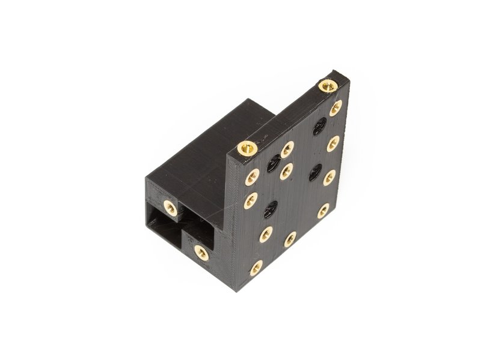
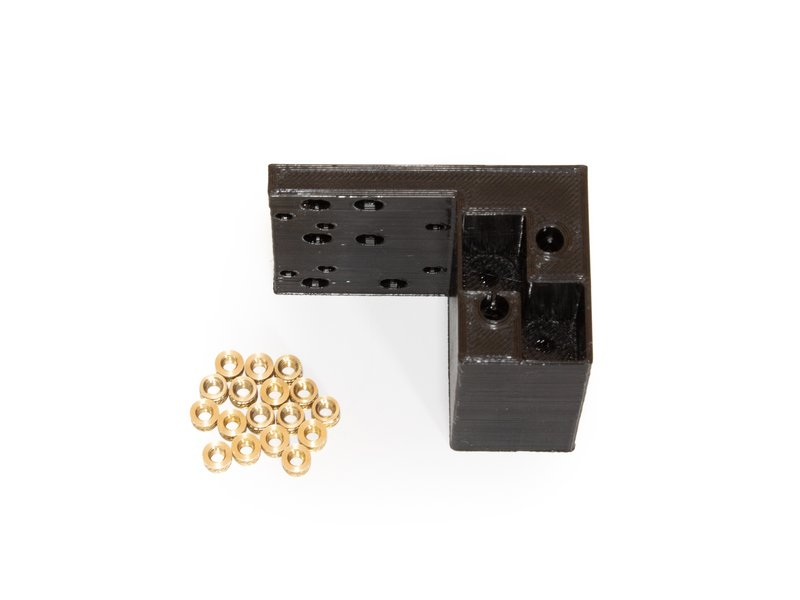
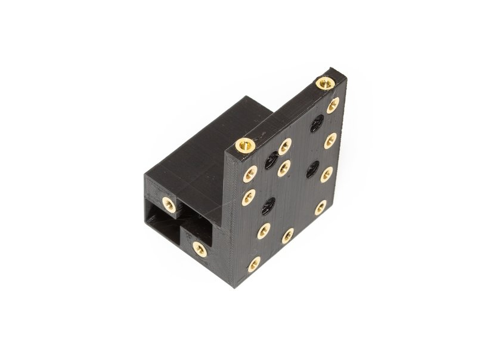

# B) Prep

Category: [RailCore® Mini Kit](index.md) · Original: <https://railcore.dozuki.com/Guide/B)+Prep/24>

**Difficulty:** Easy  
**Time required:** 15 minutes  
**Author:** Ben Withem  
**Steps:** 1  
**Last modified on Dozuki:** 2022-04-04

## Tools

- [Soldering Iron](../items/soldering-iron-27.md)

## Parts

- 1 × [Printed Mini Y Carriage](../items/printed-mini-y-carriage-95.md)
- 17 × [M3 Brass Insert](../items/m3-brass-insert-23.md)

## Step 1: Install Brass Inserts

 

- **Caution:** You need to use a soldering iron to carefully sink the brass inserts into the printed Y carriage. Sink the inserts in 2/3 of the way, then press the carriage against a flat metal surface to get them flush.
- **Note:** After placing each insert you may need to clear the channel by running a tap or bolt down through the insert and into the plastic. (Be very careful not to cross thread your inserts!)
- **Note:** Here's a good article about setting the brass heat set inserts: [click here.](https://hackaday.com/2019/02/28/threading-3d-printed-parts-how-to-use-heat-set-inserts/)
- The Y carriage gets (17) 3mm brass inserts, as in the picture. (Note: there are also two on the back side, and one on the top. Not all RailCore kits include the optional one on the top, requiring only 17 inserts)

Previous: [A) Introduction](a-introduction.md) · [RailCore® Mini Kit guide list](index.md) · Next: [C) Top Extrusions Assembly](c-top-extrusions-assembly.md)

---

Original page: <https://railcore.dozuki.com/Guide/B)+Prep/24>. Written by Ben Withem on railcore.dozuki.com. This copy was captured on 2026-11-16 and is licensed under [Creative Commons Attribution-ShareAlike 3.0 (CC BY-SA 3.0)](https://creativecommons.org/licenses/by-sa/3.0/), the license stated on the original site. This is an unofficial community mirror and is not affiliated with RailCore Labs, LLC. RAILCORE is a registered trademark of RailCore Labs, LLC.
