# C) Top Extrusions Assembly

Category: [RailCore® Mini Kit](index.md) · Original: <https://railcore.dozuki.com/Guide/C)+Top+Extrusions+Assembly/25>

**Difficulty:** Moderate  
**Time required:** 1 hour  
**Author:** Ben Withem  
**Steps:** 12  
**Last modified on Dozuki:** 2022-04-18

## Tools

- [Allen Key](../items/allen-key-30.md)
- [Masking Tape](../items/masking-tape-31.md)

## Parts

- 4 × [270mm 1515 Extrusion](../items/270mm-1515-extrusion-96.md)
- 4 × [Corner Cube](../items/corner-cube-28.md)
- 88 × [M3 Nut](../items/m3-nut-25.md)
- 16 × [M3 x 8 Socket Head Screw](../items/m3-x-8-socket-head-screw-97.md)
- 8 × [M3 lock washer](../items/m3-lock-washer-80.md) For Misumi Rails Only
- 2 × [245mm Linear Rail](../items/245mm-linear-rail-99.md)
- 8 × [5mm Acrylic Extrusion Spacer](../items/5mm-acrylic-extrusion-spacer-100.md)
- 12 × [81mm Acrylic Extrusion Spacer](../items/81mm-acrylic-extrusion-spacer-101.md)

## Step 1: Lay Out Top Extrusions

[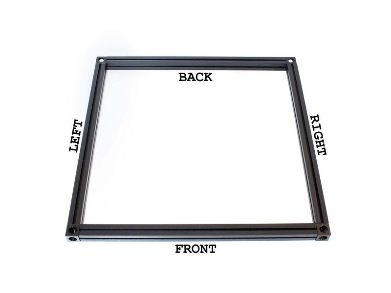](../assets/images/zoom/DLSNKYyLKIKESdnK.jpg)

- Lay out top extrusions as pictured.
- It can be helpful to use masking tape to add a label to the top of each extrusion indicating which it is (Top Back, Top Left, etc).
- Be sure the Corner cubes have a larger hole facing up, smaller hole facing down.

## Step 2: Bolt Corner Cube to Top Left Extrusion

[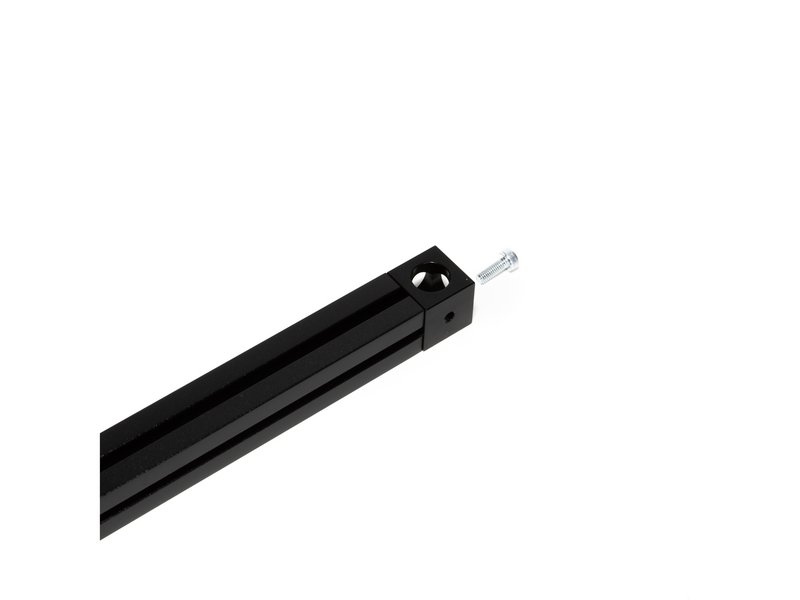](../assets/images/zoom/MWK51gc2mmCXfSRR.jpg) [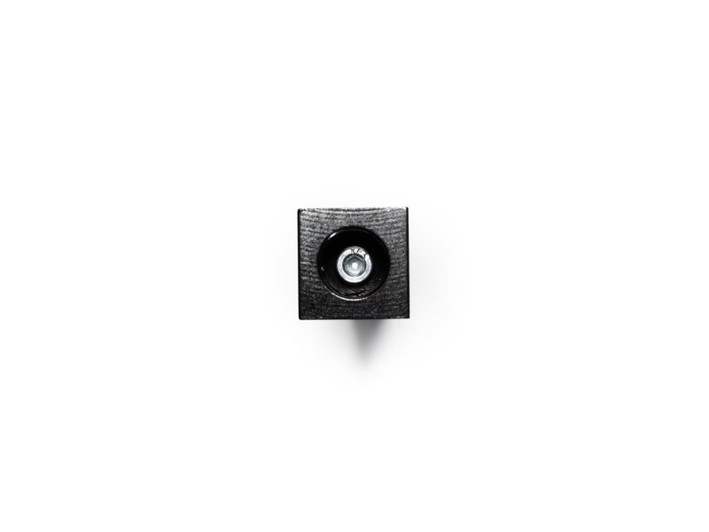](../assets/images/zoom/dOKvwUTyJuZBVZjD.jpg)

- Bolt corner cube to top left 270mm extrusion using (1) M3 x 8mm socket head screw.
- **Note:** Note on the corner cube, the small hole is pointing to the right in this image.

## Step 3: Add Hardware to Top Left Extrusion

[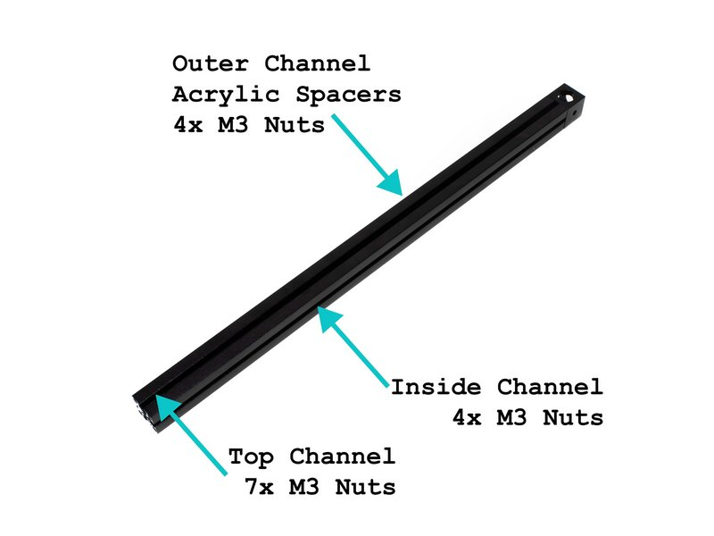](../assets/images/zoom/KdMhNZtF5CxHLlcr.jpg)  [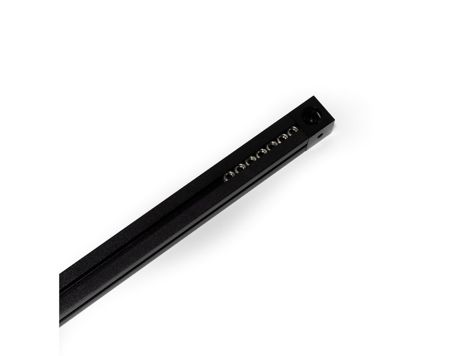](../assets/images/zoom/I1j16Q2xfPljFkxd.jpg)

- Hold the extrusion as it will be oriented on the printer (make sure the big hole on the corner cube faces up).
- In the layout shown in the image, insert the acrylic spacer inserts and M3 nuts in the outer channel. There should be (2) 5mm spacers, (3) 81mm spacers, and 4 M3 nuts.
- Slide (7) M3 nuts into the top channel.
- Slide (4) M3 nuts into the top channel.
- **Note:** Note on the corner cube, the small hole is pointing to the right in this image.

## Step 4: Attach Second Corner Cube to Top Left Extrusion

[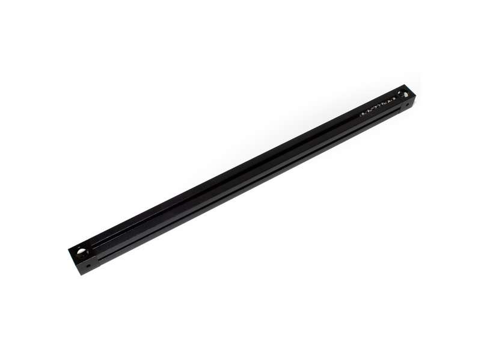](../assets/images/zoom/LDl1QDHLZsMgmPWM.jpg)

- Attach the second corner cube to the top left extrusion using (1) M3 x 8mm socket cap screw. Be sure the large hole is up, small hole is down.
- **Note:** Note on both corner cubes, the small hole is pointing to the right in this image

## Step 5: Attach Top Front and Top Back Extrusions

[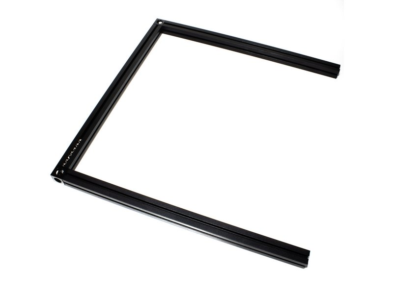](../assets/images/zoom/NmXvBSXWWNKbRCA2.jpg)

- Attach the (2) 245mm top front and top back extrusions using (1) M3 x 8mm socket head screw for each.

## Step 6: Add Hardware to Top Front and Top Back Extrusions

[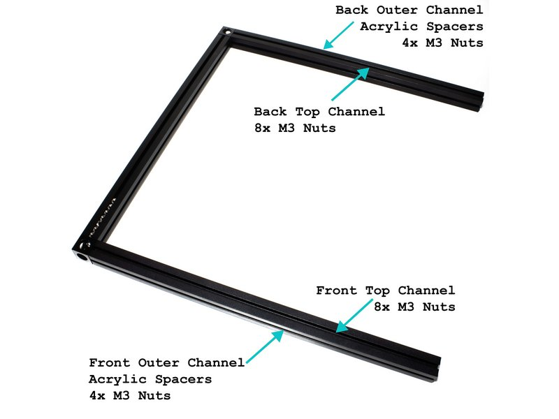](../assets/images/zoom/bW232l5S3TT64FUu.jpg) 

- (8) M3 nuts go in the top channel of the back extrusion.
- (8) M3 nuts go in the front channel of the front extrusion.
- Insert the acrylic spacer inserts and M3 nuts in the top outer channel. There should be (2) 5mm spacers, (3) 81mm spacers, and 4 M3 nuts (See second image for reference).
- Insert the acrylic spacer inserts and M3 nuts in the front outer channel. There should be (2) 5mm spacers, (3) 81mm spacers, and 4 M3 nuts (See second image for reference).

## Step 7: (2x) Install M3 Hardware into Linear Rail

[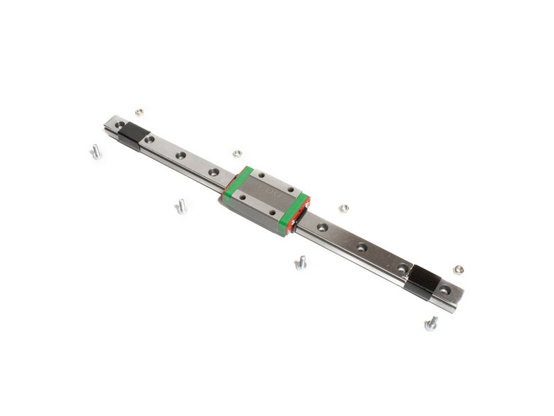](../assets/images/zoom/YrwrRUkjcsk5fWev.jpg)

- Select 4 evenly spaced holes in your linear rail. (2 empty holes between each bolt)
- Place a M3 x 8mm socket cap head screw into one of the holes selected. Loosely thread on (1) M3 nut to the bolt. DO NOT TIGHTEN THEM FULLY. The M3 nut only needs to be threaded onto the tip of the bolt, you want a gap between the nut and the back of the rail. Repeat for the other three (3) holes.
- Repeat the above steps for the other 245mm rail.
- **Note:** If you are using Misumi rails, use a M3 lock washer between the M3 x 8mm and the rail.
- **Caution:** It is highly recommended to use a bit of masking tape to keep the carriage from sliding off of the linear rail.

## Step 8: Attach Linear rail to Top Front and Top Back Extrusions

[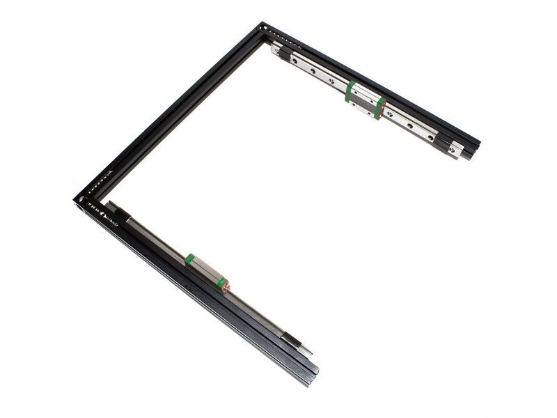](../assets/images/zoom/MhfIDGvDuqqR2owm.jpg)

- Attach each linear rail to top front and top back extrusions by sliding the M3 nuts into the inside channel on the extrusion.
- Roughly center the extrusion, and then snug up the bolts.
- **Caution:** Do not overtighten the bolts, you just need them snug for now. They'll be tightened later.

## Step 9: Attach Corner Cube to Top Right Extrusion

[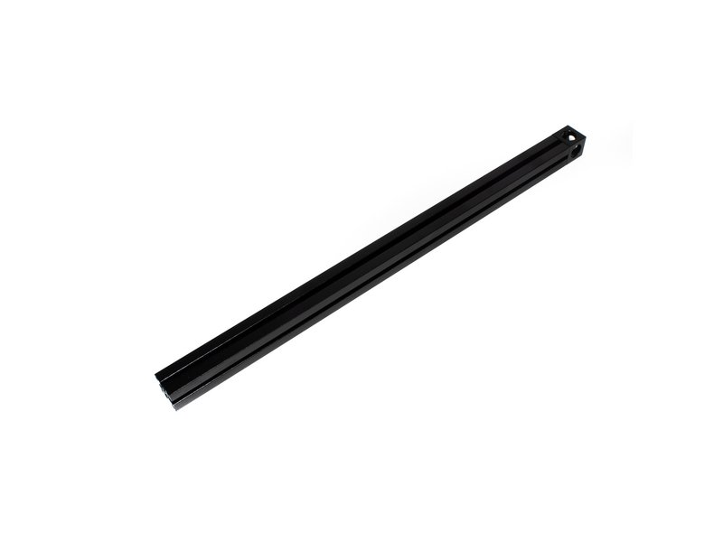](../assets/images/zoom/GNFAJDuq6RGh23kJ.jpg)

- Set aside the rest of your top extrusion assembly for now, so we can work on the top right extrusion.
- Attach a corner cube to the right 270mm extrusion using (1) M3 x 8mm socket head screw.

## Step 10: Add Hardware to Top Right Extrusion

[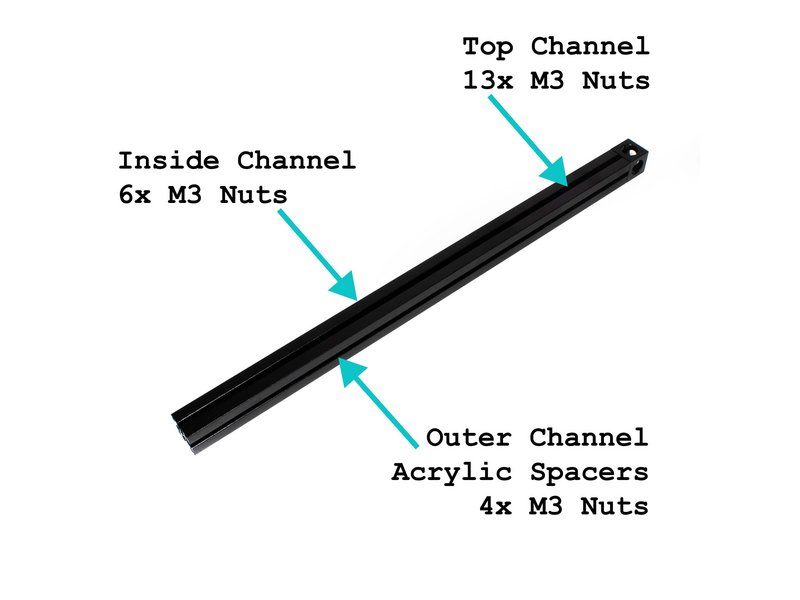](../assets/images/zoom/EeMjHsL3UnvTTuVE.jpg) [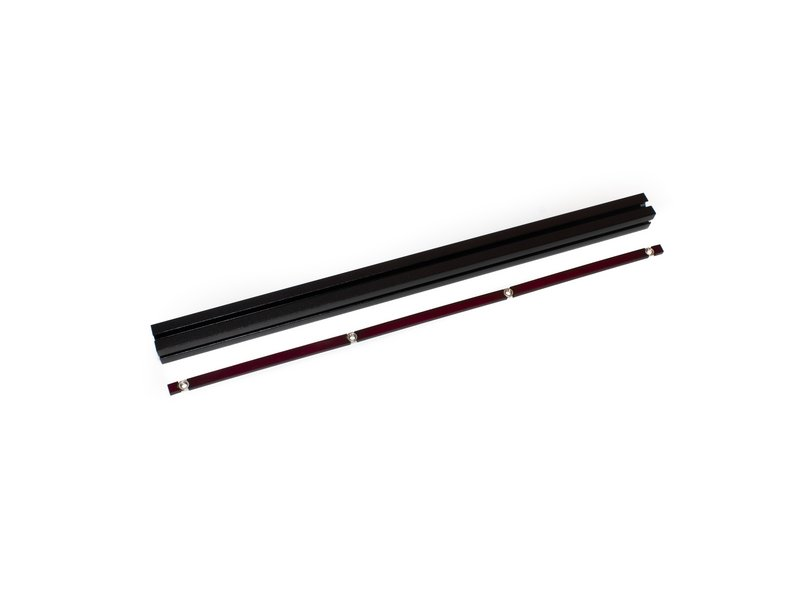](../assets/images/zoom/PV5lgXCnlVatkW1w.jpg)

- Slide (13) M3 nuts into the top channel.
- Slide (6) M3 nuts into the inside channel.
- Insert the acrylic spacer inserts and M3 nuts in the outer channel. There should be (2) 5mm spacers, (3) 81mm spacers, and (4) M3 nuts (See second image for reference).
- **Caution:** Be sure the orientation of the corner cube is correct. A large hole should face up, a small hole should be facing down, and a small hole should be facing towards the inside channel.

## Step 11: Attach Second Corner Cube to Top Right Extrusion

[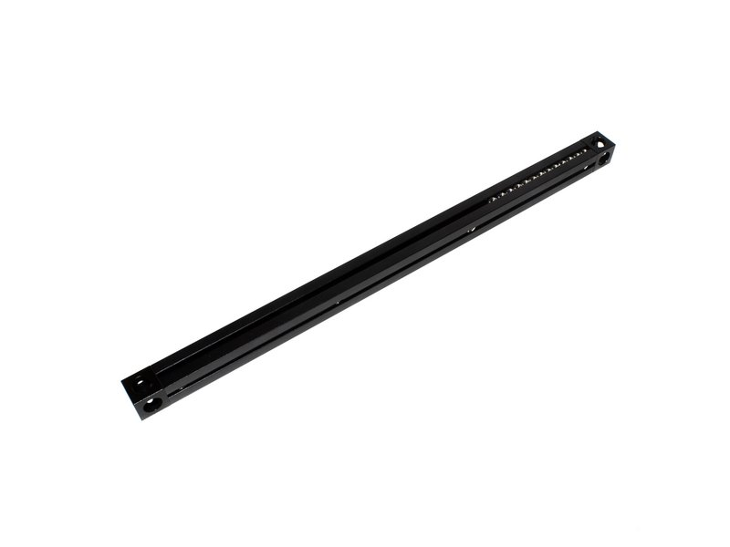](../assets/images/zoom/2nmYeigRunhp6uCm.jpg)

- Attach second corner cube to top right extrusion using (1) M3 x 8mm socket head screw.

## Step 12: Attach Top Right Extrusion to the Rest of the Top Extrusion Assembly

[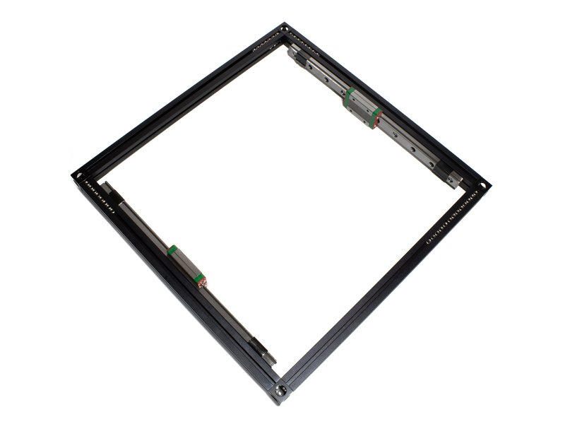](../assets/images/zoom/WwUCEAbyPKyyOckI.jpg)

- Attach Top Right Extrusion to the rest of the Top Extrusion Assembly using (2) M3 x 8mm socket head screws.

Previous: [B) Prep](b-prep.md) · [RailCore® Mini Kit guide list](index.md) · Next: [D) Bottom Extrusions Assembly](d-bottom-extrusions-assembly.md)

---

Original page: <https://railcore.dozuki.com/Guide/C)+Top+Extrusions+Assembly/25>. Written by Ben Withem on railcore.dozuki.com. This copy was captured on 2026-11-16 and is licensed under [Creative Commons Attribution-ShareAlike 3.0 (CC BY-SA 3.0)](https://creativecommons.org/licenses/by-sa/3.0/), the license stated on the original site. This is an unofficial community mirror and is not affiliated with RailCore Labs, LLC. RAILCORE is a registered trademark of RailCore Labs, LLC.
