# D) Bottom Extrusions Assembly

Category: [RailCore® Mini Kit](index.md) · Original: <https://railcore.dozuki.com/Guide/D)+Bottom+Extrusions+Assembly/26>

[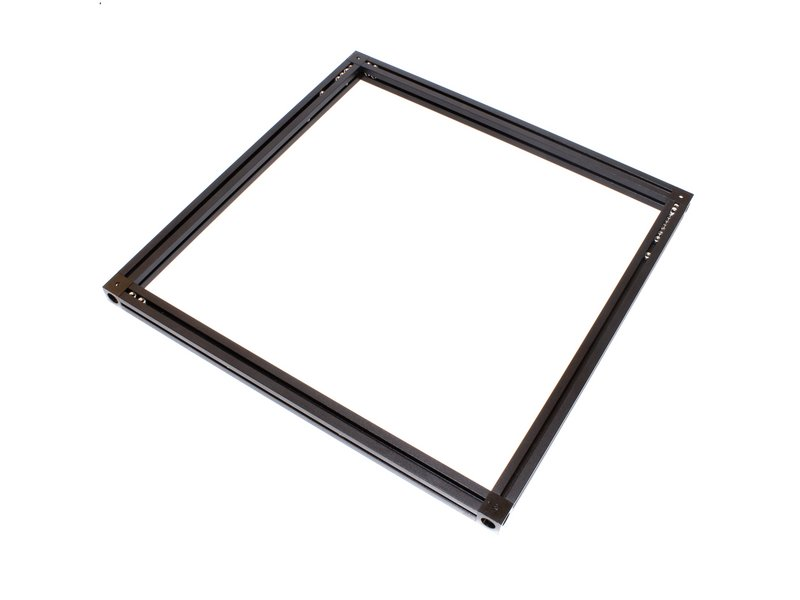](../assets/images/zoom/RfWT2YMKGPycN5TB.jpg)

**Difficulty:** Moderate  
**Time required:** 30 minutes  
**Author:** Ben Withem  
**Steps:** 10  
**Last modified on Dozuki:** 2022-04-04

## Introduction

It's assumed that you're building a kit from Filastruder, and you've completed all previous sections. At the end of this section you should have a "bottom extrusions" assembly together for your RailCore frame.

## Tools

- [Allen Key](../items/allen-key-30.md)

## Parts

- 4 × [Corner Cube](../items/corner-cube-28.md)
- 8 × [M3 x 8 Socket Head Screw](../items/m3-x-8-socket-head-screw-97.md)
- 59 × [M3 Nut](../items/m3-nut-25.md)
- 4 × [270mm 1515 Extrusion](../items/270mm-1515-extrusion-96.md)
- 16 × [5mm Acrylic Extrusion Spacer](../items/5mm-acrylic-extrusion-spacer-100.md)
- 24 × [81mm Acrylic Extrusion Spacer](../items/81mm-acrylic-extrusion-spacer-101.md)

## Step 1: Layout Bottom Frame

[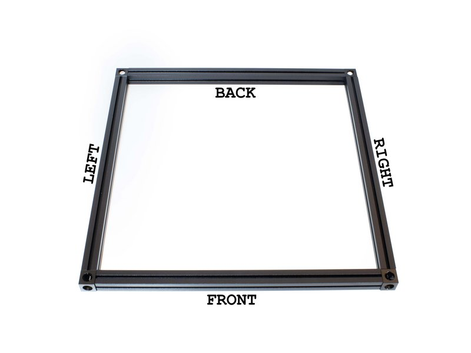](../assets/images/zoom/V2piGIydwEvSSUoh.jpg)

- Layout bottom frame as shown. Note that the corner cubes should have a small hole facing up.
- **Note:** It is a good idea to mark each extrusion with a bit of masking tape on top, indicating which extrusion it is.

## Step 2: Install Corner Cube on Bottom Left Extrusion

[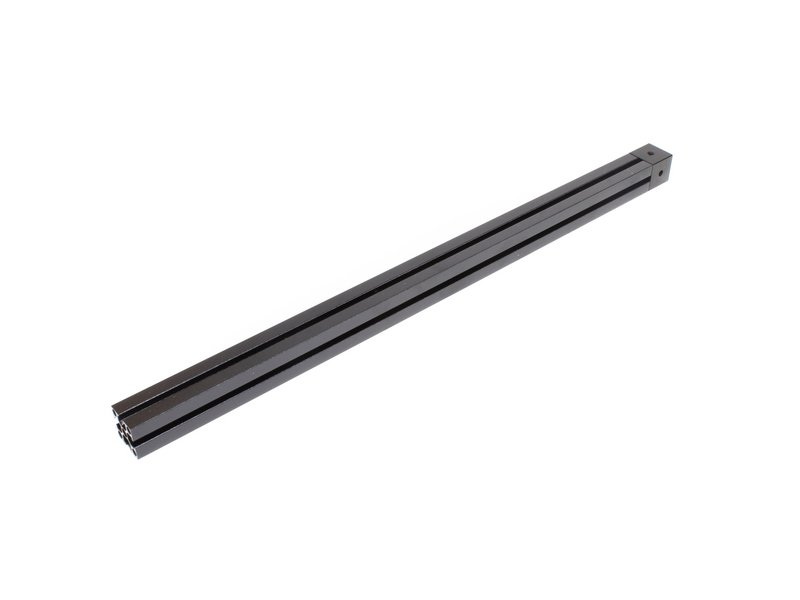](../assets/images/zoom/mhn3MMdnvfQ6VTCk.jpg) [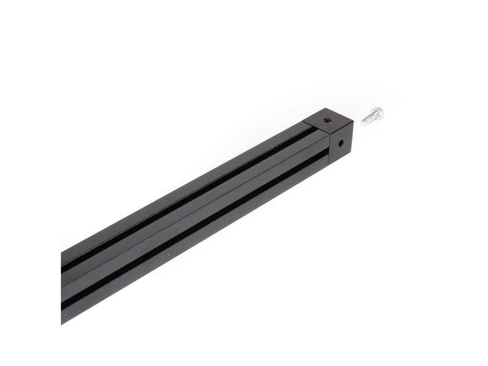](../assets/images/zoom/6lNuVCXtY6LiDFFj.jpg)

- Use (1) M3 x 8mm socket head screw to the 270mm bottom left extrusion. Note the orientation of the corner cube.

## Step 3: Add Hardware to Bottom Left Extrusion

[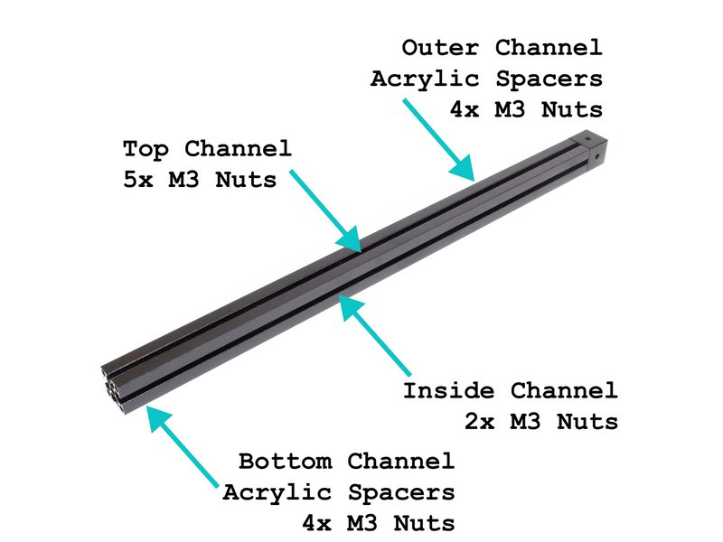](../assets/images/zoom/OSMkDmBG6SFjUQlj.jpg) 

- Slide (5) M3 x 16mm hex head bolts into the top channel.
- In the layout shown in the second image, insert the acrylic spacer inserts and M3 nuts in the outer channel. There should be (2) 5mm spacers, (3) 81mm spacers, and (4) M3 nuts.
- Slide (2) M3 nuts into the inside channel. Note: If using a metal bottom (base plate), these are not needed.
- In the layout shown in the second image, insert the acrylic spacer inserts and M3 nuts in the bottom channel. There should be (2) 5mm spacers, (3) 81mm spacers, and (4) M3 nuts.

## Step 4: Add Second Corner Cube to Bottom Left Extrusion

[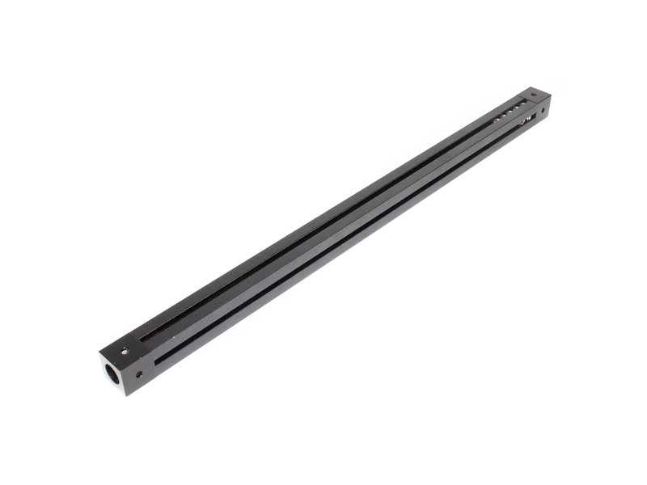](../assets/images/zoom/TG4iUlHTHgHLHABc.jpg)

- Use (1) M3 x 8mm socket head screw to attach the second corner cube to the other end of the bottom left extrusion. Note hole orientation.

## Step 5: Add Bottom Front and Bottom Rear Extrusions

[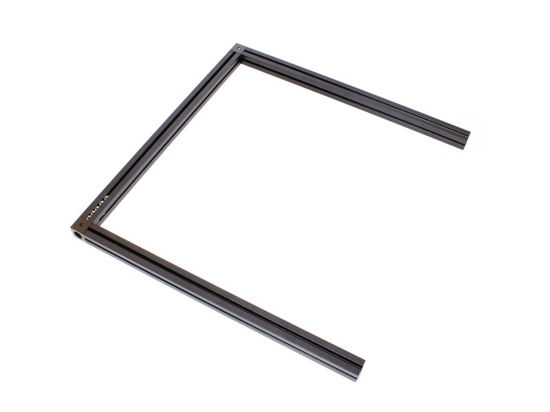](../assets/images/zoom/CjSCCWTuNWJGHhVo.jpg)

- Attach bottom (2) 270mm front and bottom back extrusions using (1) M3 x 8mm socket head screw each.

## Step 6: Add Hardware into Bottom Front and Bottom Rear Extrusions

[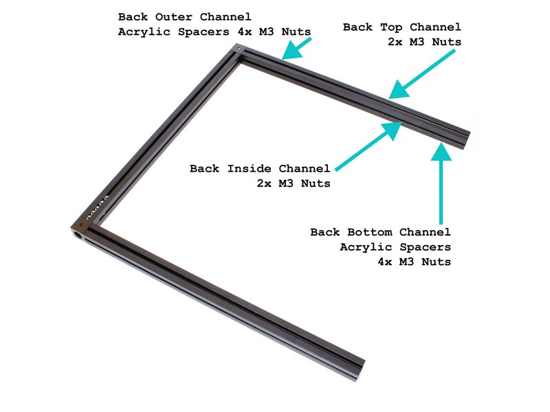](../assets/images/zoom/ApgHUvG65pgeEPTJ.jpg) [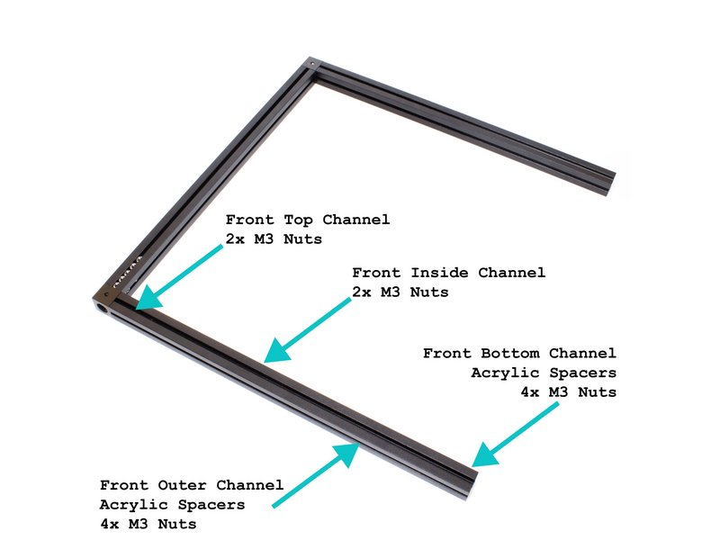](../assets/images/zoom/oAtKEBErxTpAgfTT.jpg) [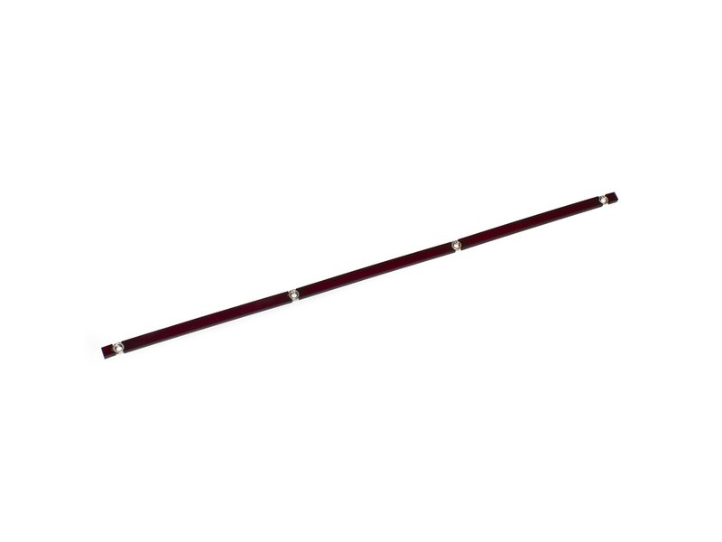](../assets/images/zoom/kiT2HyDNwfedCDa5.jpg)

- In the layout shown in the third image, insert the acrylic spacer inserts and M3 nuts in the outer and bottom channels of the back extrusion. There should be (2) 5mm spacers, (3) 81mm spacers, and (4) M3 nuts in each.
- Slide (2) M3 nuts in the top channel of the back extrusion.
- Slide (2) M3 nuts in the inside channel of the back extrusion.
- In the layout shown in the third image, insert the acrylic spacer inserts and M3 nuts in the outer and bottom channels of the front extrusion. There should be (2) 5mm spacers, (3) 81mm spacers, and (4) M3 nuts in each.
- Slide (2) M3 nuts in the inside channel of the front extrusion.
- Slide (2) M3 nuts in the inside channel of the front extrusion.

## Step 7: Install Corner Cube on Bottom Right Extrusion

[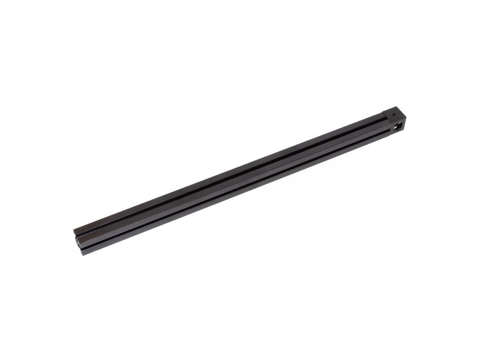](../assets/images/zoom/CtwCLM6J1VA2xeCk.jpg)

- Use (1) M3 x 8mm socket head screw to add a corner cube to the bottom right 270mm extrusion. Note the orientation of the corner cube - a small hole needs to face up.

## Step 8: Add Hardware into Bottom Right Extrusion

[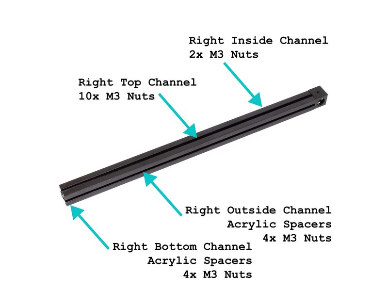](../assets/images/zoom/Q5HyHgeptBdQWusA.jpg) 

- Slide (10) M3 nuts into the top channel.
- In the layout shown in the second image, insert the acrylic spacer inserts and M3 nuts in the outer channel. There should be (2) 5mm spacers, (3) 81mm spacers, and (4) M3 nuts.
- Slide (2) M3 nuts into the inside channel.
- In the layout shown in the second image, insert the acrylic spacer inserts and M3 nuts in the bottom channel. There should be (2) 5mm spacers, (3) 81mm spacers, and (4) M3 nuts.

## Step 9: Add Second Corner Cube to Bottom Right Extrusion

[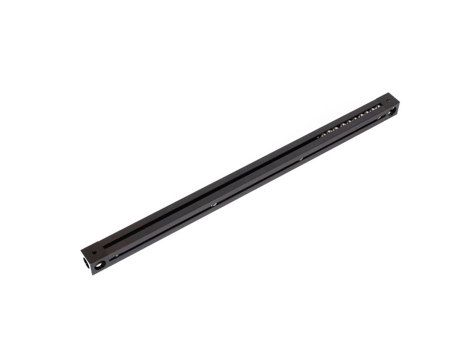](../assets/images/zoom/C56mAmSNyEftnRNG.jpg)

- Use (1) M3 x 8mm socket head screws to attach a second corner cube to the bottom right extrusion. Note the orientation of the corner cube - a small hole should be facing up.

## Step 10: Attach Bottom Right Extrusion to the Rest of the Bottom Frame

- Use (2) M3 x 8mm socket head screws to attach the bottom right extrusion to the rest of the bottom frame assembly from earlier.

Previous: [C) Top Extrusions Assembly](c-top-extrusions-assembly.md) · [RailCore® Mini Kit guide list](index.md) · Next: [E) Upright Extrusion / Frame Final Assembly](e-upright-extrusion-frame-final-assembly.md)

---

Original page: <https://railcore.dozuki.com/Guide/D)+Bottom+Extrusions+Assembly/26>. Written by Ben Withem on railcore.dozuki.com. This copy was captured on 2026-11-16 and is licensed under [Creative Commons Attribution-ShareAlike 3.0 (CC BY-SA 3.0)](https://creativecommons.org/licenses/by-sa/3.0/), the license stated on the original site. This is an unofficial community mirror and is not affiliated with RailCore Labs, LLC. RAILCORE is a registered trademark of RailCore Labs, LLC.
