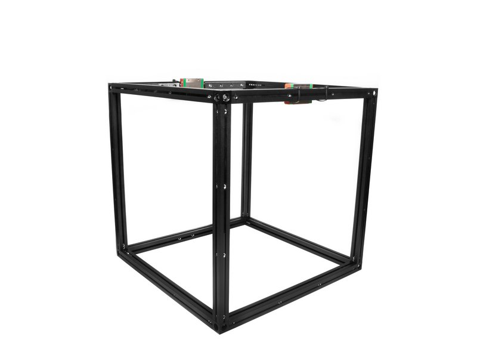
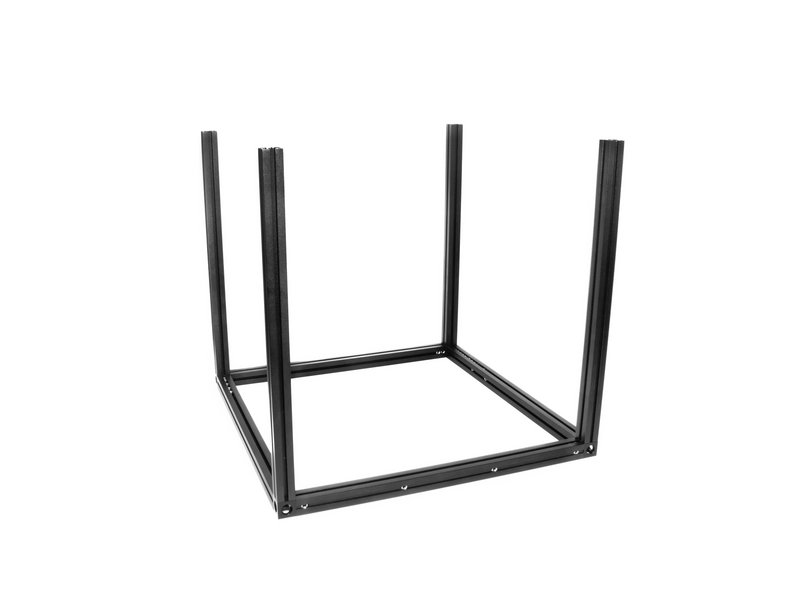
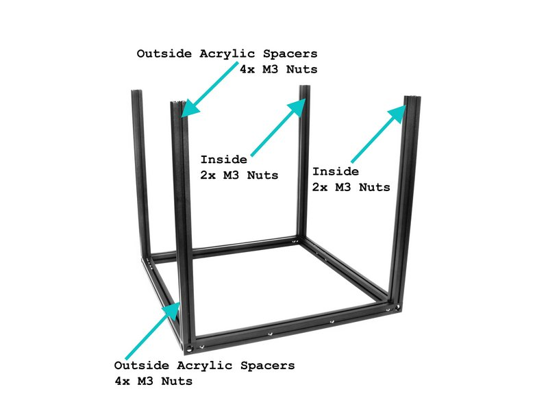
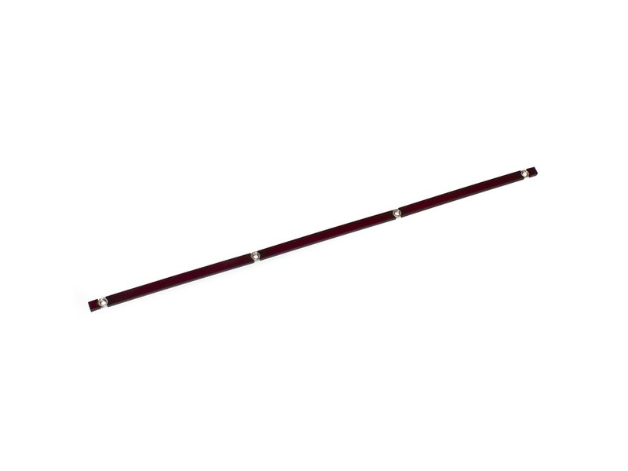

# E) Upright Extrusion / Frame Final Assembly

Category: [RailCore® Mini Kit](index.md) · Original: <https://railcore.dozuki.com/Guide/E)+Upright+Extrusion+-+Frame+Final+Assembly/27>

**Difficulty:** Moderate  
**Time required:** No estimate  
**Author:** Ben Withem  
**Steps:** 3  
**Last modified on Dozuki:** 2022-04-04

## Introduction

It's assumed that you're building a kit from Filastruder, and you've completed all previous sections. At the end of this section you should have a complete frame assembled for your RailCore.

## Tools

- [Allen Key](../items/allen-key-30.md)

## Parts

- 48 × [M3 Nut](../items/m3-nut-25.md)
- 16 × [5mm Acrylic Extrusion Spacer](../items/5mm-acrylic-extrusion-spacer-100.md)
- 24 × [81mm Acrylic Extrusion Spacer](../items/81mm-acrylic-extrusion-spacer-101.md)

## Step 1: Add the Upright Extrusions to your Bottom Frame Assembly

- Use (1) M3 x 8mm socket head screws to attach each of the (4) 270mm upright extrusions to the corner cubes on the bottom frame assembly.

## Step 2: Add Hardware into the Upright Extrusions

 

- Insert acrylic spacers in all extrusion channels facing the outside of the frame. Each extrusion has two outer facing channels.
  - In the layout shown in the second image, insert the acrylic spacer inserts and M3 nuts in all 8 of the outer facing channels. There should be (2) 5mm spacers, (3) 81mm spacers, and (4) M3 nuts in each channel.
- Insert (2) M3 nuts in each of the remaining 8 channels.

## Step 3: Attach Top Frame Assembly to Upright Bottom Frame Assembly

- Use (4) M3 x 8mm Socket Cap Head Screws to attach the top extrusion assembly to the upright extrusions.
- **Caution:** Be sure both the bottom and top frame pieces are in the right orientation. The top right extrusion should have (13) M3 nuts in it's top channel. The bottom right extrusion should have (10) M3 nuts in it's top channel.

Previous: [D) Bottom Extrusions Assembly](d-bottom-extrusions-assembly.md) · [RailCore® Mini Kit guide list](index.md) · Next: [F) Z Installation](f-z-installation.md)

---

Original page: <https://railcore.dozuki.com/Guide/E)+Upright+Extrusion+-+Frame+Final+Assembly/27>. Written by Ben Withem on railcore.dozuki.com. This copy was captured on 2026-11-16 and is licensed under [Creative Commons Attribution-ShareAlike 3.0 (CC BY-SA 3.0)](https://creativecommons.org/licenses/by-sa/3.0/), the license stated on the original site. This is an unofficial community mirror and is not affiliated with RailCore Labs, LLC. RAILCORE is a registered trademark of RailCore Labs, LLC.
