# F) Z Installation

Category: [RailCore® Mini Kit](index.md) · Original: <https://railcore.dozuki.com/Guide/F)+Z+Installation/28>

[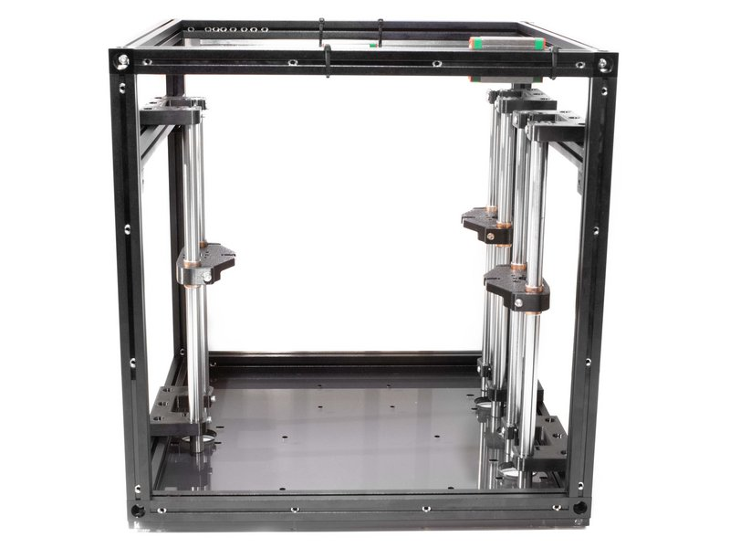](../assets/images/zoom/Ta2CvZZwXuZdpsnq.jpg)

**Difficulty:** Moderate  
**Time required:** 2 hours  
**Author:** Ben Withem  
**Steps:** 9  
**Last modified on Dozuki:** 2022-04-20

## Introduction

It's assumed that you're building a kit from Filastruder, and you've completed all previous sections. At the end of this section you should have a complete frame assembled for your RailCore.

## Tools

- [Allen Key](../items/allen-key-30.md)

## Parts

- 2 × [270mm 1515 Extrusion](../items/270mm-1515-extrusion-96.md)
- 6 × [245mm Smooth Rod](../items/245mm-smooth-rod-107.md)
- 4 × [Corner Cube](../items/corner-cube-28.md)
- 6 × [Sleeve Bearing](../items/sleeve-bearing-106.md)
- 16 × [M3 Washer](../items/m3-washer-65.md)
- 29 × [M3 Nut](../items/m3-nut-25.md)
- 34 × [M3 x 10 Socket Head Screw](../items/m3-x-10-socket-head-screw-98.md)
- 8 × [M3 x 6mm Socket Head Screw](../items/m3-x-6mm-socket-head-screw-108.md)
- 3 × [Printed Z Yoke (Mini)](../items/printed-z-yoke-mini-104.md)
- 6 × [Printed Z Rod Holders (Mini)](../items/printed-z-rod-holders-mini-105.md)
- 18 × [M3 x 8 Socket Head Screw](../items/m3-x-8-socket-head-screw-97.md) instead of M3 x 10 for MRW aluminum Z Rod Holders
- 18 × [M3 x 16 Socket Head Screw](../items/m3-x-16-socket-head-screw-113.md) Instead of M3 x 20 for MRW aluminum Z Rod Holders and Sliders, Button head also works here
- 8 × [M3 x 5 Socket Head Screw](../items/m3-x-5-socket-head-screw-131.md) M3 x 6 Socket Head screws bottom out on misumi extrusions when torqued down without an m3 washer, consider changing this part to 5mm or specify the use of washers.  I found washers to be a bit fiddly in this area.

## Step 1: Install Bottom Panel

[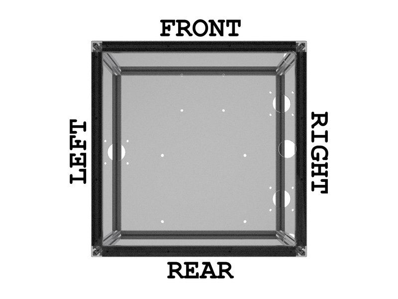](../assets/images/zoom/K4WnRLmgirXnTXcT.jpg) [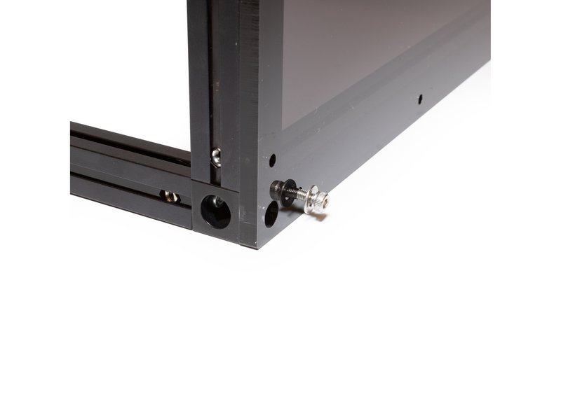](../assets/images/zoom/BN3Mmtn3XqYQO4dv.jpg) [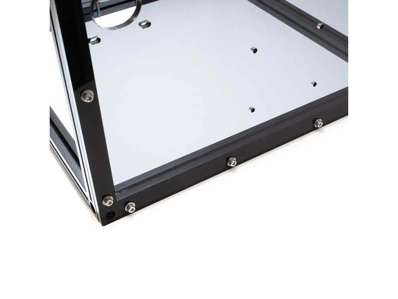](../assets/images/zoom/Lp4ASNYdCVhPTGKN.jpg)

- Using (16) M3x10 socket head screws and (16) M3 washers, attach the bottom to the frame.
- **Note:** Loosen your corner cubes when attaching the bottom or sides to the frame. The acrylic pieces will attempt to pull the frame into square.
- **Caution:** Be sure the bottom panel is in the right orientation.
  - **Caution:** The side with (5) large holes should be on the right side of the printer. For reference, the bottom right extrusion should have (10) M3 nuts in it's top channel.
  - **Caution:** There are (2) sets of (4) holes for mounting the electronics. The larger pattern is for the Duet, and the smaller for an optional Raspberry Pi. The Duet holes should be closer to the back of the printer.

## Step 2: Printed Parts

[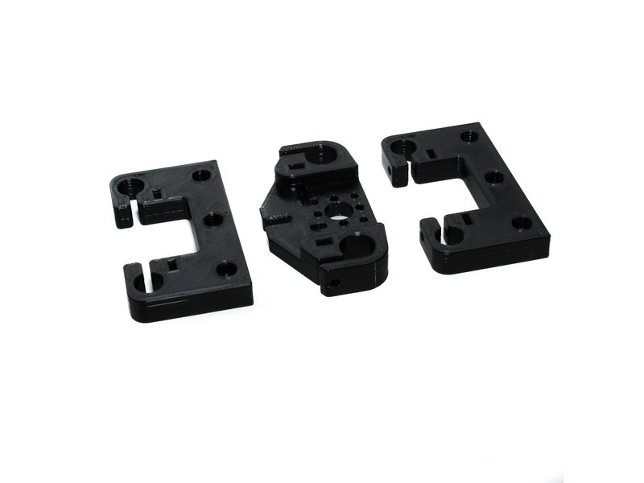](../assets/images/zoom/5hauV5RRSkuSKYDY.jpg) [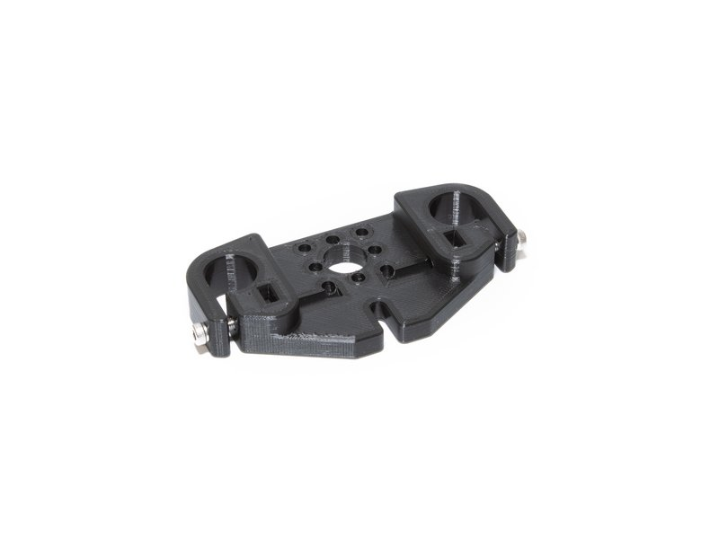](../assets/images/zoom/5kFm6ibOSXQNUQt6.jpg) [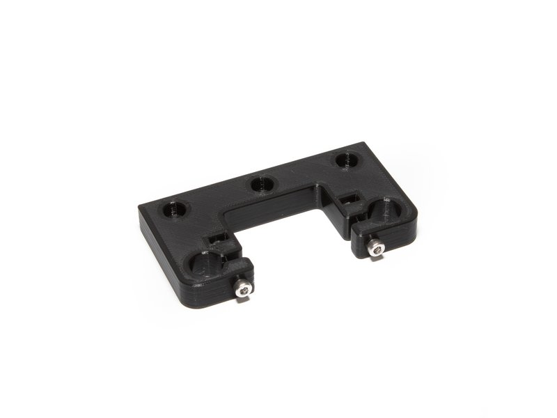](../assets/images/zoom/GEuSyep6BASVQruN.jpg)

- **Note:** Each Z tower consists of the following printed parts: (1) printed Z yoke and (2) printed Z rod holders.
- For each printed part insert (2) M3 nuts and (2) M3 x 20 socket head screws. You should do this for all 9 of the printed parts.

## Step 3: Assemble Z Tower Extrusions (x2)

[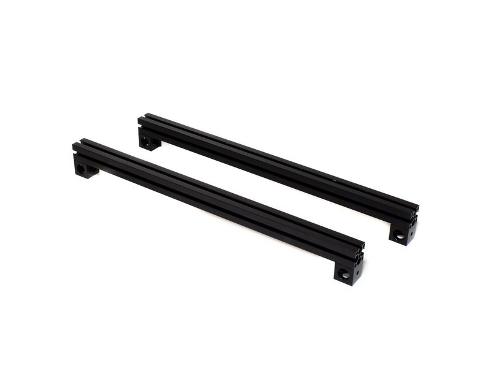](../assets/images/zoom/jDYQdZXBegY1ROLm.jpg)

- The top of the Z towers will fasten to horizontal extrusions on the left and right sides of the frame.
- Attach corner cubes to opposing ends of the extrusion with (1) M3 nuts inside the extrusion channel and (1) M3 x 6 socket head screw for each corner cube. (Optional) Use an M3 washer on each M3 x 6 fastener to prevent the fastener from bottoming out on the extrusion when torqued.
- **Note:** A small hole should face up and towards the outside of the extrusion. Use the image as a reference.

## Step 4: Attach Rod Holders to Extrusions

[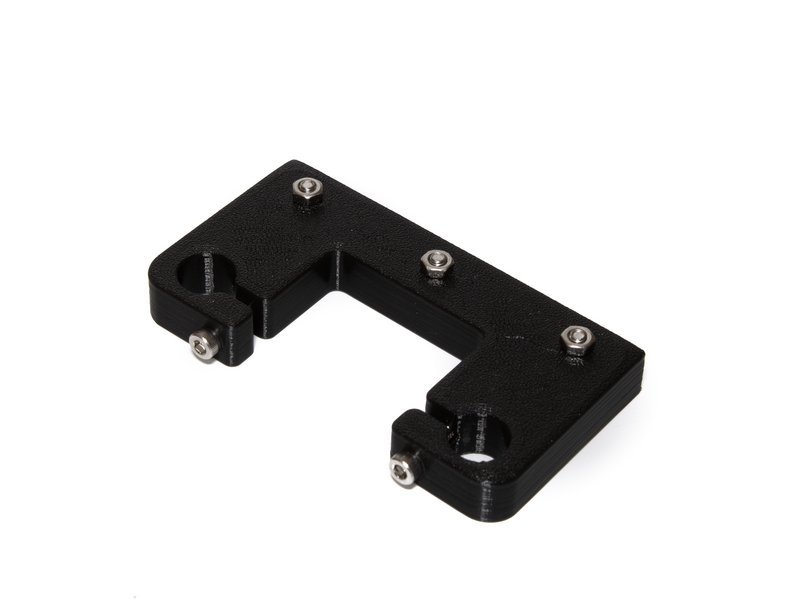](../assets/images/zoom/cMpXwTFSjrJ5jaxY.jpg) [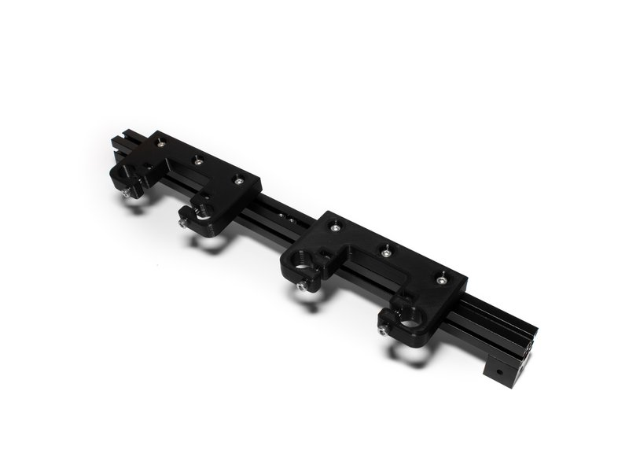](../assets/images/zoom/GHVtpiJ3jS3RTiYw.jpg) [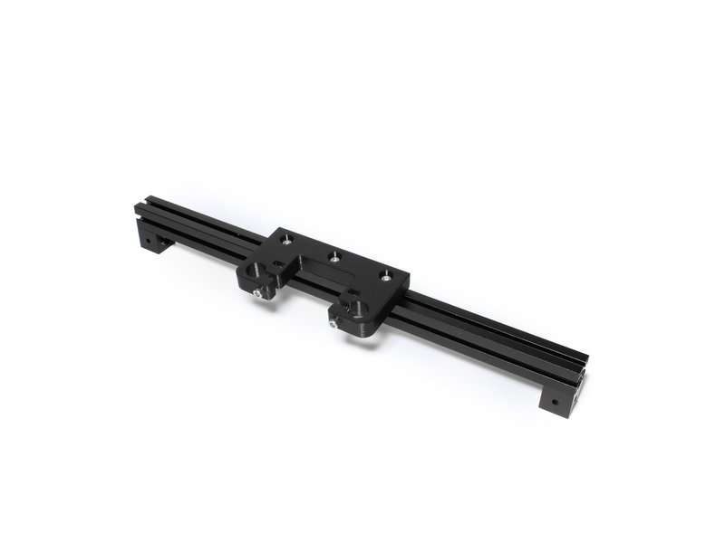](../assets/images/zoom/FEkPFrAAfPQECBOY.jpg)

- Set aside 3 printed Z rod holders. Using (3) M3 nuts and (3) M3 x 10 socket head screws, prepare each rod holder to slide into the extrusions.
- Mount (2) Z rod holders to the right extrusion by sliding the M3 nuts into the top channel. Place (2) M3 nuts into the channel between the (2) rod holders. Tighten the Z rod holders to the extrusion just enough to keep them from moving freely.
- Mount (1) Z rod holders to the right extrusion by sliding the M3 nuts into the top channel. Tighten the Z rod holder to the extrusion just enough to keep them from moving freely.
- **Note:** Note the proper orientation of the Z rod holders and corner cubes using the provided images.

## Step 5: Attach Rod Holders to Frame

[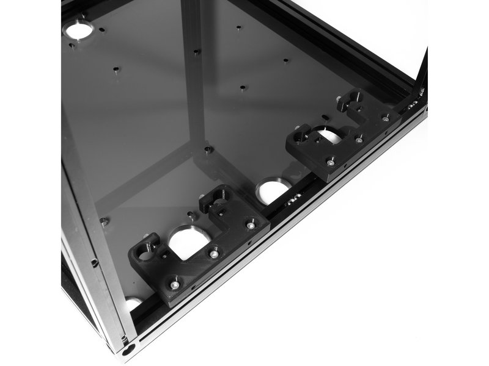](../assets/images/zoom/avwrXvBLADfJVybf.jpg) [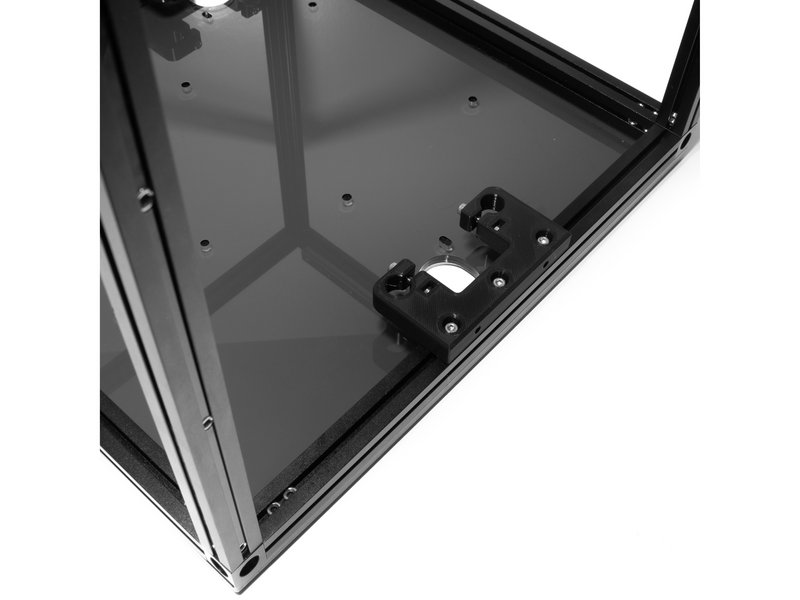](../assets/images/zoom/2ZFOl3pPbDCjrXux.jpg)

- On the right side of the frame, attach (2) Z rod holders to the bottom right extrusion using (6) M3 x 10 socket head screws. Leave 2 M3 nuts between the rod holder and another two after the rod holder towards the back extrusion as pictured.
- On the left side of the frame, attach (1) Z rod holder to the bottom right extrusion using (3) M3 x 10 socket head screws. Leave 2 M3 nuts free towards the back extrusion as pictured.

## Step 6: Attach Z Rod Holder Extrusions to Frame

[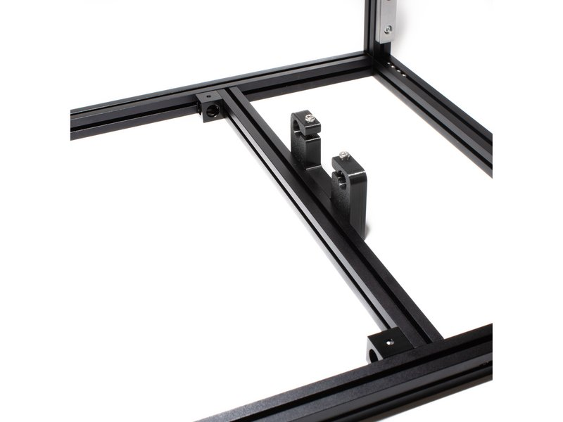](../assets/images/zoom/EE3wHXCODJfoItQL.jpg) [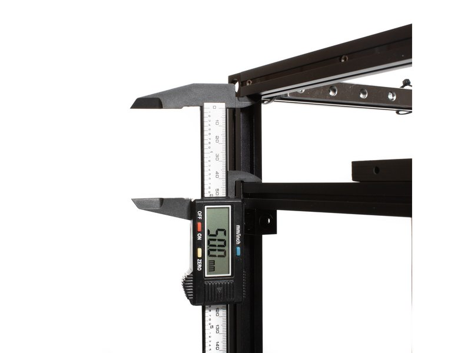](../assets/images/zoom/My6t1D5ikYVWSn2I.jpg) [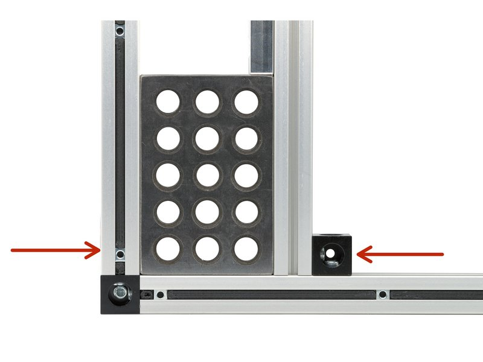](../assets/images/zoom/T2GsN4M1dADCQJ6d.jpg)

- Attach both the left and right Z rod holder extrusions to the frame using the corner cubes and existing M3 nuts in the inside channels. Note: use top M3 nut, the bottom one is left for spacing and ease of assembly.
- Using M3 x 6 socket head screws for each corner cube, attach each to the frame. Do not tighten the corner cubes to the frame at this point. (optional) Use an M3 washer on each M3 x 6 fastener to prevent fasteners from potentially bottoming out.
- Use calipers to measure the distance between the bottom of the top extrusion, and the top of the Z rod holder extrusion. Tighten the corner cubes to the frame leaving a gap of 50mm as shown in the image. (Alternate Method) Optionally use 123 or 25,50,75 blocks and firmly squeeze the block between the two extrusions while fastening each corner cube.
- **Note:** This step is easier with the frame on it's side.

## Step 7: Prepare Printed Z Yokes (x3)

[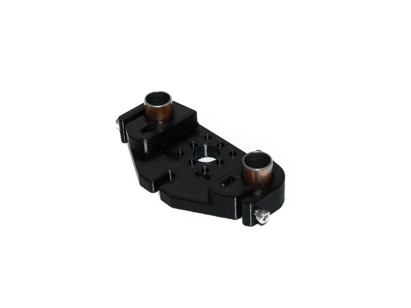](../assets/images/zoom/RuKqZK2yHF4ikXdB.jpg) [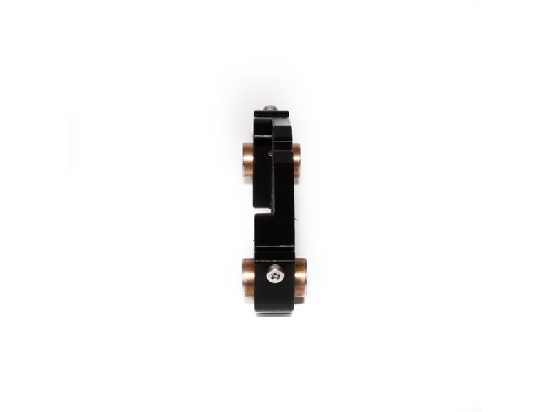](../assets/images/zoom/XOQCLpULLEnmIeML.jpg) [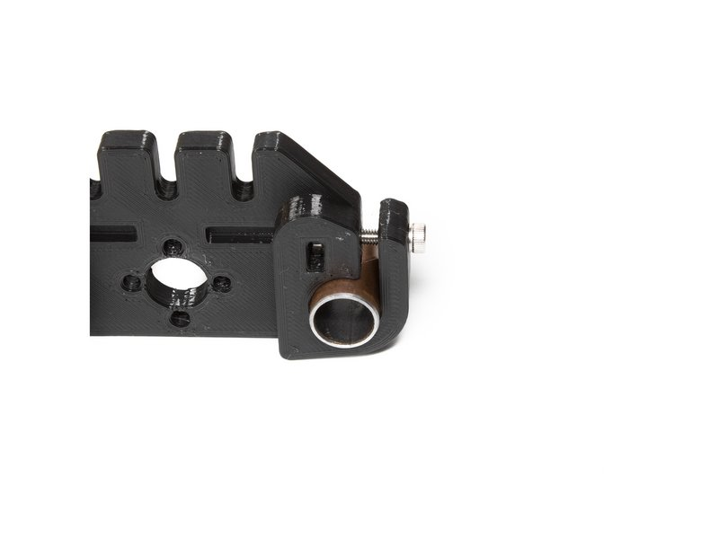](../assets/images/zoom/TkcBZ41gD1TvLfGC.jpg)

- In each printed Z yoke, insert (2) bushings.
- Center the bushings as shown before tightening the (2) M3 x 20 socket head screws you installed earlier.
- **Caution:** Be careful not to overtighten. they do not need to be tightened past the point of the printed faces of the clamp being parallel.

## Step 8: Insert Smooth Rods and Yokes

[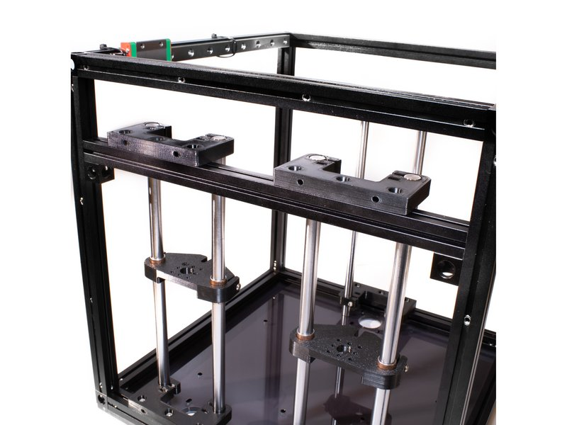](../assets/images/zoom/MRFMZ1mTJPQDd22h.jpg)

- Loosen the M3 x 10 socket head screws holding the Z rod holders to the frame.
- Slide the (6) smooth rods through the top Z rod holder and through the Z yokes. Each Z yoke should be facing flat side up.
- Fasten the (6) smooth rods to the Z rod holders by tightening the M3 x 20 socket head screws.
- **Note:** The top of the smooth rods should be flush with the top of Z rod holders.

## Step 9: Complete Z Installation

[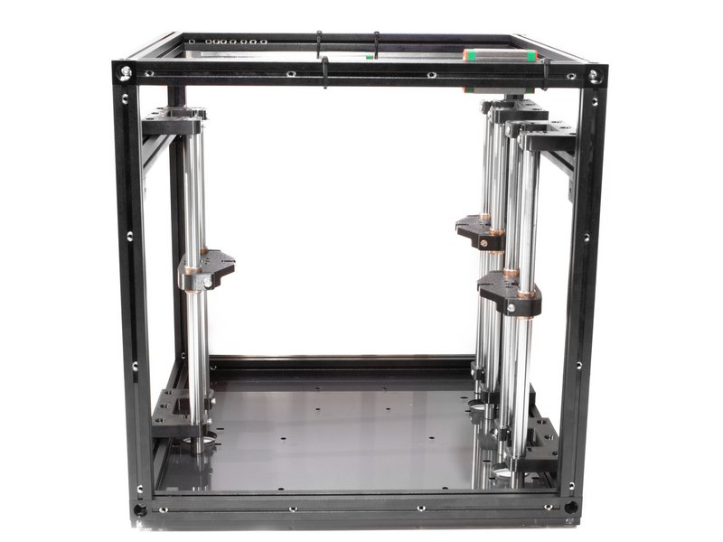](../assets/images/zoom/IRbBY3a4cYFXFjcK.jpg)

- Center each of assembled Z towers over their corresponding motor mount holes in the base of the frame.
- Tighten down each of the towers to the frame.

Previous: [E) Upright Extrusion / Frame Final Assembly](e-upright-extrusion-frame-final-assembly.md) · [RailCore® Mini Kit guide list](index.md) · Next: [G) Sides Installation](g-sides-installation.md)

---

Original page: <https://railcore.dozuki.com/Guide/F)+Z+Installation/28>. Written by Ben Withem on railcore.dozuki.com. This copy was captured on 2026-11-16 and is licensed under [Creative Commons Attribution-ShareAlike 3.0 (CC BY-SA 3.0)](https://creativecommons.org/licenses/by-sa/3.0/), the license stated on the original site. This is an unofficial community mirror and is not affiliated with RailCore Labs, LLC. RAILCORE is a registered trademark of RailCore Labs, LLC.
