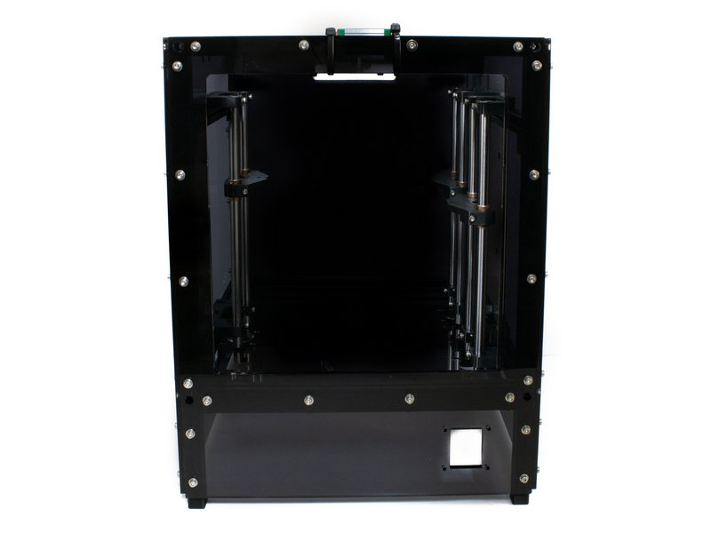
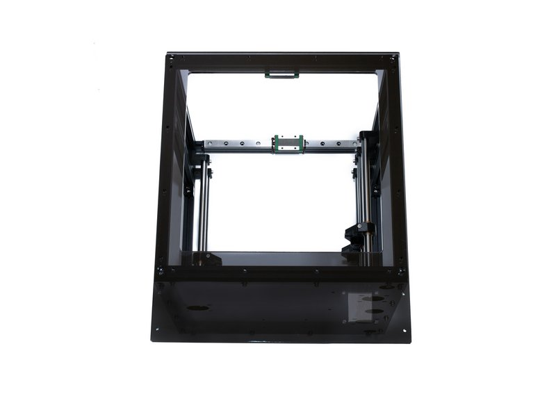
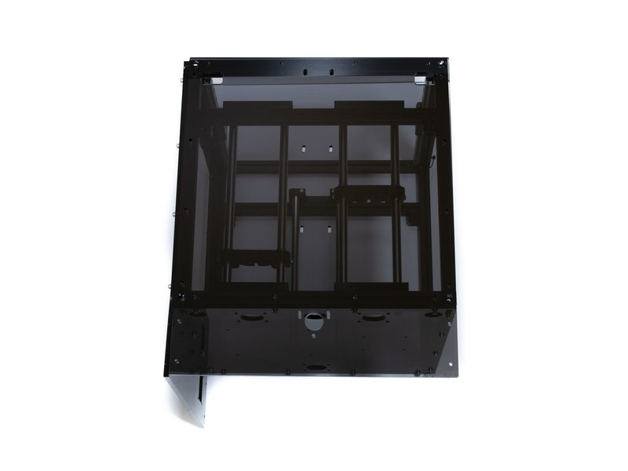
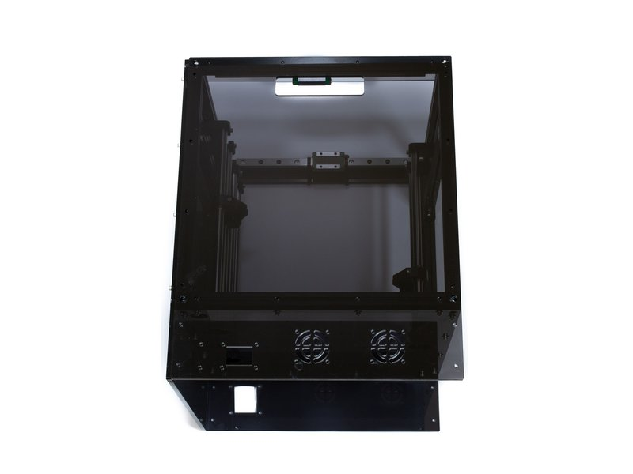
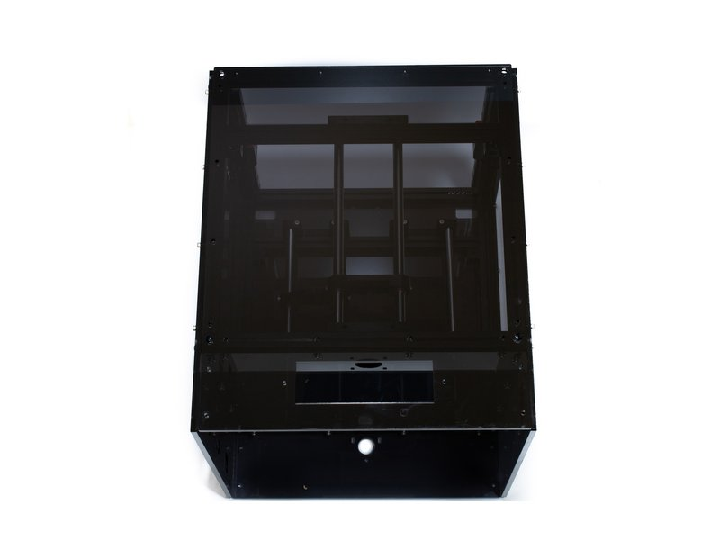
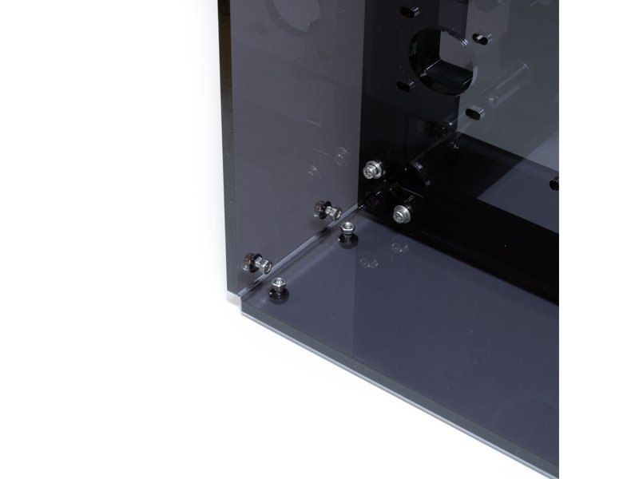
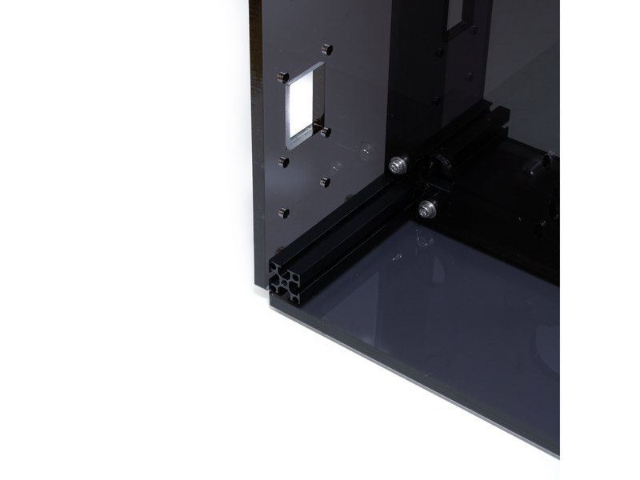
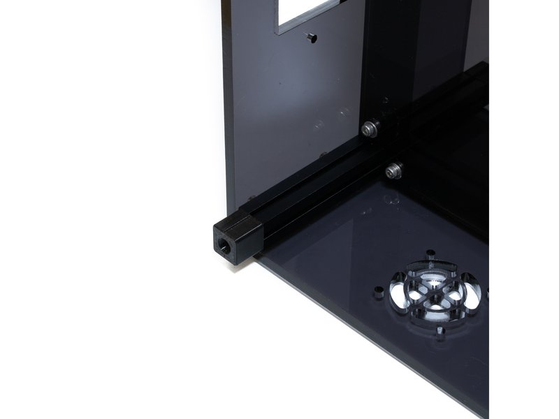
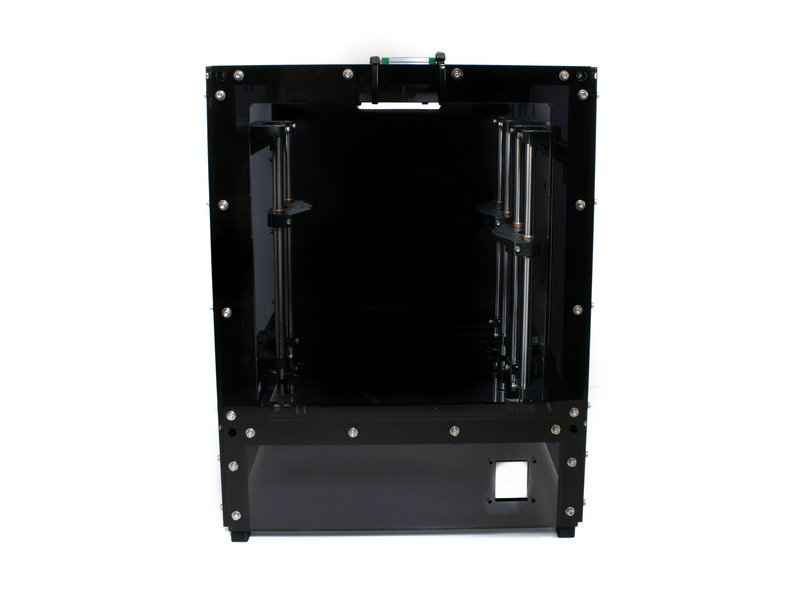

# G) Sides Installation

Category: [RailCore® Mini Kit](index.md) · Original: <https://railcore.dozuki.com/Guide/G)+Sides+Installation/29>

**Difficulty:** Moderate  
**Time required:** 45 minutes  
**Author:** Ben Withem  
**Steps:** 6  
**Last modified on Dozuki:** 2022-04-04

## Tools

- [Allen Key](../items/allen-key-30.md)

## Parts

- 4 × [Acrylic Sides](../items/acrylic-sides-109.md)
- 4 × [73 mm 1515 Extrusion](../items/73-mm-1515-extrusion-110.md)
- 4 × [Printed Feet](../items/printed-feet-111.md)
- 84 × [M3 x 10 Socket Head Screw](../items/m3-x-10-socket-head-screw-98.md)
- 80 × [M3 Washer](../items/m3-washer-65.md)
- 16 × [M3 Nut](../items/m3-nut-25.md)

## Step 1: Install Front

- **Note:** You may need to loosen the bottom corner cubes and base acrylic panel. This will ensure all mating faces are not under tension.
- Using (16) M3 x 10 socket head screws and (16) M3 washers attach the front acrylic panel.

## Step 2: Install Right Acrylic

- Using (16) M3 x 10 socket head screws and (16) M3 washers attach the right acrylic panel.

## Step 3: Install Rear Acrylic

- Using (16) M3 x 10 socket head screws and (16) M3 washers attach the rear acrylic panel.

## Step 4: Install Left Acrylic

- Using (16) M3 x 10 socket head screws and (16) M3 washers attach the left acrylic panel.
- **Note:** Tighten the corner cubes and panels you may have loosened.

## Step 5: Install Feet (x4)

  

- Insert (4) M3 x 10 socket head screws and (4) M3 washers into each corner.
- Thread (4) M3 nuts onto the screws you inserted.
- Slide the 73 mm 1515 extrusion on the (4) M3 nuts and tighten the socket head screws.
- Attach the printed foot to the bottom of the extrusion using a M3 x 10 socket head screw.

## Step 6: Complete Side Installation

- Panel assembly complet.

Previous: [F) Z Installation](f-z-installation.md) · [RailCore® Mini Kit guide list](index.md) · Next: [H) Z Motors and Leadscrews](h-z-motors-and-leadscrews.md)

---

Original page: <https://railcore.dozuki.com/Guide/G)+Sides+Installation/29>. Written by Ben Withem on railcore.dozuki.com. This copy was captured on 2026-11-16 and is licensed under [Creative Commons Attribution-ShareAlike 3.0 (CC BY-SA 3.0)](https://creativecommons.org/licenses/by-sa/3.0/), the license stated on the original site. This is an unofficial community mirror and is not affiliated with RailCore Labs, LLC. RAILCORE is a registered trademark of RailCore Labs, LLC.
