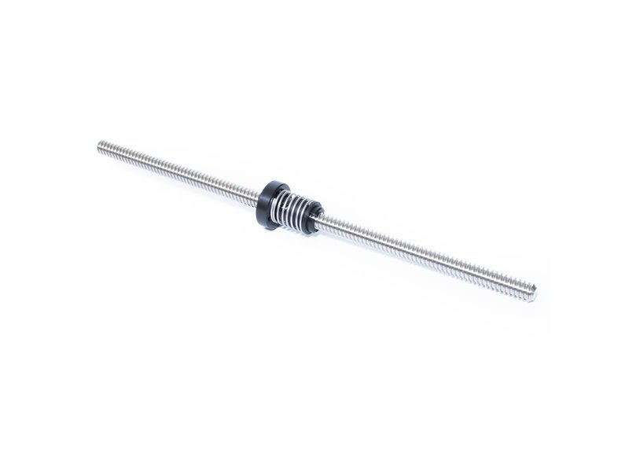
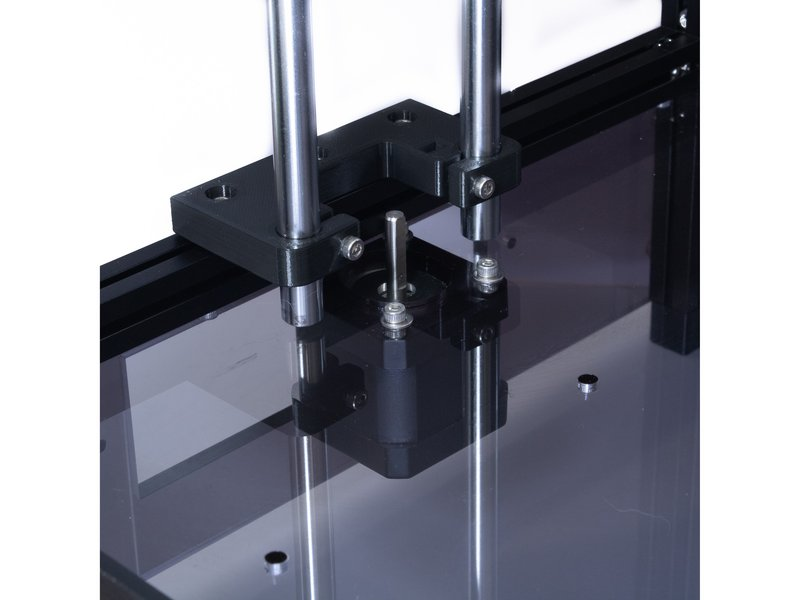
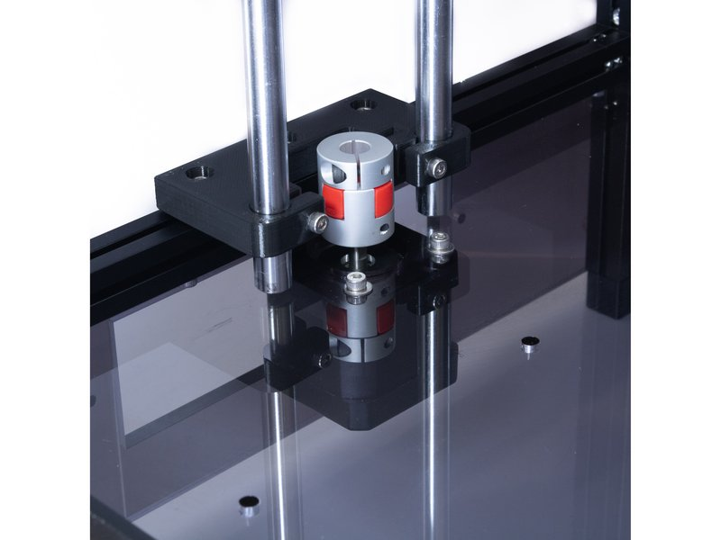
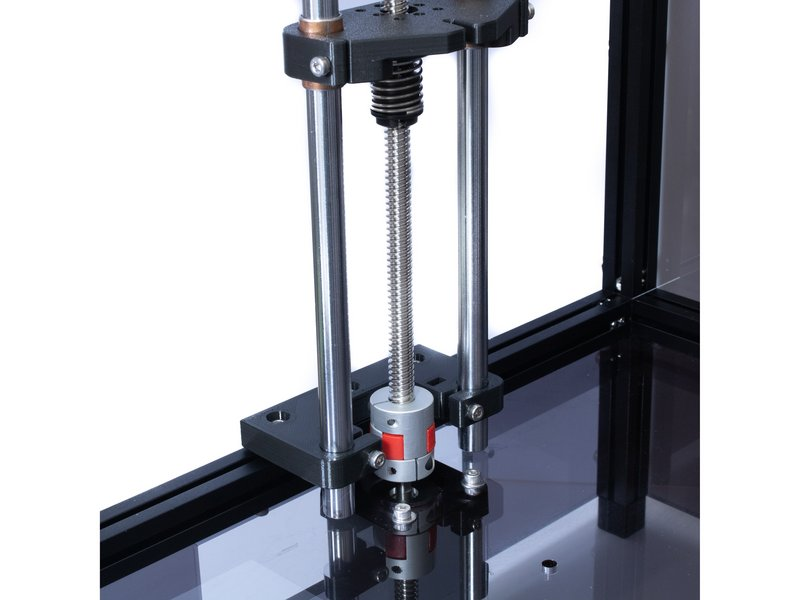
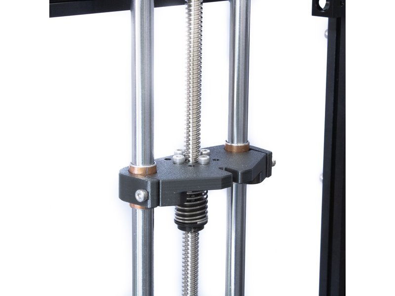

# H) Z Motors and Leadscrews

Category: [RailCore® Mini Kit](index.md) · Original: <https://railcore.dozuki.com/Guide/H)+Z+Motors+and+Leadscrews/30>

**Difficulty:** Moderate  
**Time required:** 30 minutes  
**Author:** Ben Withem  
**Steps:** 4  
**Last modified on Dozuki:** 2022-04-04

## Tools

- [Allen Key](../items/allen-key-30.md)

## Parts

- 3 × [Nema17 Stepper Motor (0.9 Degrees)](../items/nema17-stepper-motor-0-9-degrees-39.md)
- 3 × [130mm Leadscrew](../items/130mm-leadscrew-112.md)
- 3 × [M5 / M8 Leadscrew Coupler](../items/m5-m8-leadscrew-coupler-51.md)
- 3 × [Anti-BackLash Nut](../items/anti-backlash-nut-55.md)
- 24 × [M3 x 10 Socket Head Screw](../items/m3-x-10-socket-head-screw-98.md)
- 12 × [M3 Washer](../items/m3-washer-65.md)

## Step 1: Thread Anti-Backlash Nuts on Leadscrews (x3)

- Compress the anti-backlash nut and thread it onto the leadscrew. Once the threads are fully through the nut, release the tension on the spring.
- Thread the nut half way up the leadscrew.

## Step 2: Install Z Motors (x3)

- Using (4) M3 x 10 socket head screws and (4) M3 washers attach the stepper motor to the base.
- **Note:** For easy cable management later, point the cable plugs toward the rear of the machine.
- **Caution:** If your Z towers are still loose, make sure they are centered over the mounting holes for the stepper motors before installing the motors.

## Step 3: Install Leadscrews (x3)

 

- Slide the small side of the coupler on the stepper shaft and tighten the set screw on the bottom half.
- Raise the Z yoke and slide the leadscrew up through the yoke.
- Set the leadscrew in the top half of the coupler and tighten the set screw.
- Slide the yoke half way down the Z tower so it is flush with the top of the anti-backlash nut.

## Step 4: Tighten Z Yokes to Anti-backlash Nuts (x3)

- Using (4) M3 x 10 socket head screws, attach the Z Yokes to the anti-backlash nuts.
- If your Z towers are still loose, or not aligned with the leadscrew, now is the time to align and tighten them.
- **Note:** Turn the coupler by hand to make sure the yoke move freely.
- **Caution:** Be careful when tightening the screw attaching the yokes to the anti-backlash nuts. POM will easily strip if you are not careful.

Previous: [G) Sides Installation](g-sides-installation.md) · [RailCore® Mini Kit guide list](index.md) · Next: [I) Y Rail Installation](i-y-rail-installation.md)

---

Original page: <https://railcore.dozuki.com/Guide/H)+Z+Motors+and+Leadscrews/30>. Written by Ben Withem on railcore.dozuki.com. This copy was captured on 2026-11-16 and is licensed under [Creative Commons Attribution-ShareAlike 3.0 (CC BY-SA 3.0)](https://creativecommons.org/licenses/by-sa/3.0/), the license stated on the original site. This is an unofficial community mirror and is not affiliated with RailCore Labs, LLC. RAILCORE is a registered trademark of RailCore Labs, LLC.
