# I) Y Rail Installation

Category: [RailCore® Mini Kit](index.md) · Original: <https://railcore.dozuki.com/Guide/I)+Y+Rail+Installation/31>

[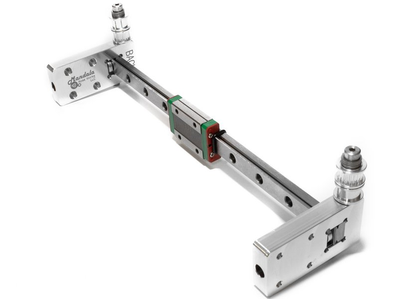](../assets/images/zoom/gssiedBpJ4PJFKvw.jpg)

**Difficulty:** Moderate  
**Time required:** 1 hour  
**Author:** Ben Withem  
**Steps:** 5  
**Last modified on Dozuki:** 2022-04-04

## Parts

- 1 × [245mm Linear Rail](../items/245mm-linear-rail-99.md)
- 1 × [Back X Carriage](../items/back-x-carriage-58.md)
- 1 × [Front X Carriage](../items/front-x-carriage-59.md)
- 2 × [25mm Shoulder Bolt](../items/25mm-shoulder-bolt-42.md)
- 8 × [M5 Washer](../items/m5-washer-46.md)
- 2 × [2GT x 5mm Bore Smooth Idler](../items/gt2-x-5mm-bore-smooth-idler-60.md)
- 2 × [2GT 20T x 5mm Bore Toothed Idler](../items/gt2-20t-x-5mm-bore-toothed-idler-49.md)
- 6 × [5mm Shim](../items/5mm-shim-47.md)
- 8 × [M3 x 8 Socket Head Screw](../items/m3-x-8-socket-head-screw-97.md)
- 2 × [M3 x 16 Socket Head Screw](../items/m3-x-16-socket-head-screw-113.md)
- 2 × [M3 x 10 Socket Head Screw](../items/m3-x-10-socket-head-screw-98.md)
- 2 × [Round Metal Spacer](../items/round-metal-spacer-62.md)
- 2 × [Flat Metal Spacer](../items/flat-metal-spacer-63.md)

## Step 1: Front X Carriage Idler Assembly

[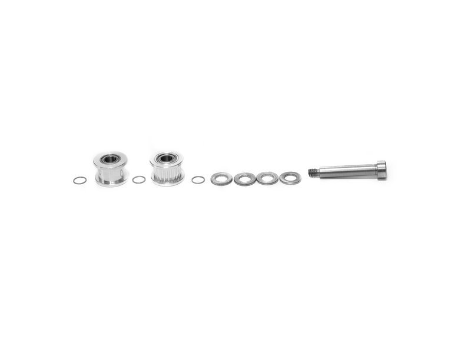](../assets/images/zoom/BLw3vPeJYBMSnp6g.jpg) [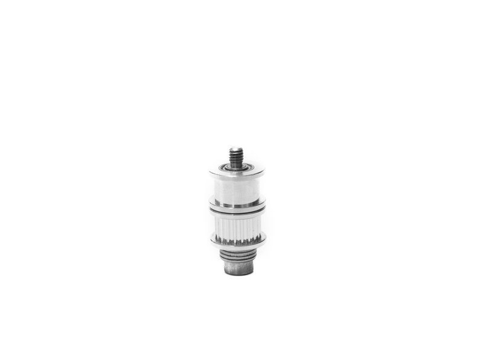](../assets/images/zoom/txkHBZueBIEqYWNC.jpg) [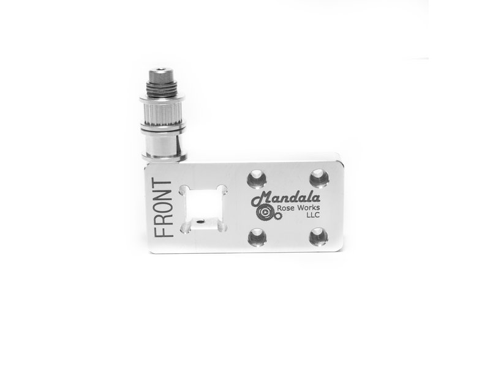](../assets/images/zoom/rYyHPkEk2VpBdGhQ.jpg)

- To prep for the Y rail installation we need to assemble the X carriages and idlers. Locate the X carriage labelled as the "Front".
- Begin by holding the shoulder bolt so the threads are pointed up. Place (3) M5 washers on the bolt, followed by (1) M5 shim. Next put on a toothed idler. Then another M5 shim, then a smooth idler, followed by a final M5 Shim.
- Visually look to see that the final shim is very close to level with the "shoulder" of the bolt.
  - **Note:** If there's a gap, see if it's best filled by a shim, or a washer. You want to place those before the first shim you put on.
  - **Note:** If instead the shim sticks out past the shoulder, you may need to remove a washer and replace it with a shim.
- Once the "stack" is level with the shoulder, thread it into the X carriage (I leave the shoulder bolt pointing up, and turn the X carriage down onto it, being careful not to cross-thread it).
- **Caution:** The shoulder must be tight against the X-Carriage, with as little vertical play as possible. If the idlers don't spin smoothly, it's too tight and you need to remove a washer or shim. THERE MUST ALWAYS BE A SHIM DIRECTLY AGAINST EACH SIDE OF THE IDLERS.

## Step 2: Back X Carriage Idler Assembly

[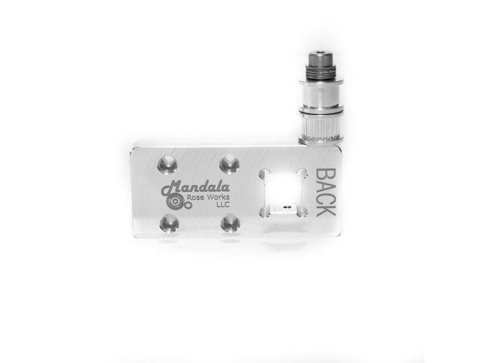](../assets/images/zoom/56pqfjNo3mqYnLNx.jpg)

- Locate the X carriage labelled as the "Back".
- Assemble the back X carriage the same way as the front, but note the smooth and the toothed pulleys are reversed now.

## Step 3: Insert Hardware In X Carriages (x2)

[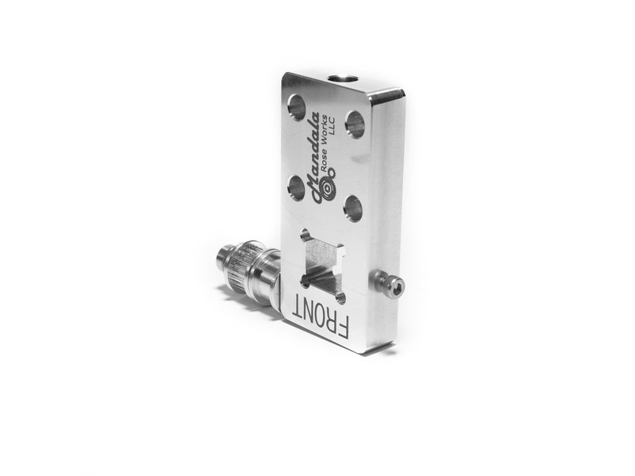](../assets/images/zoom/gsBeMAaUSad3mN1r.jpg) [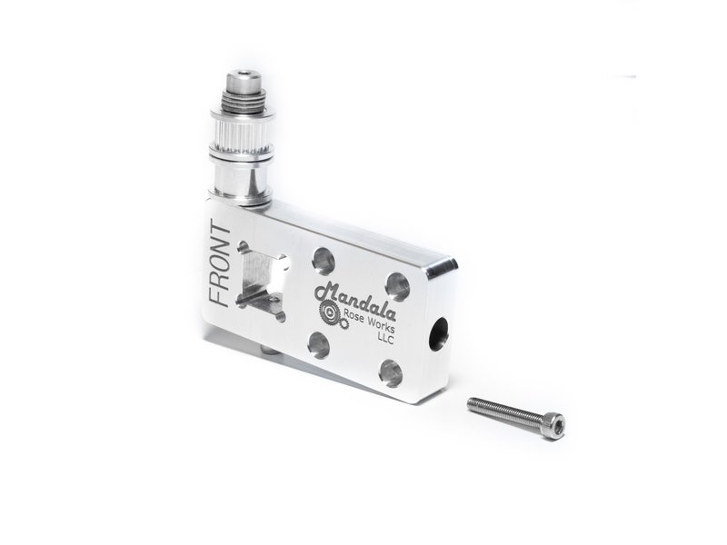](../assets/images/zoom/OidlwAR6vIhwbhlV.jpg)

- Insert (1) M3 x 10 socket head screw in the bottom of each carriage.
- Insert (1) M3 x 16 socket head screw in the size of each carriage.

## Step 4: Insert Y Rail into X Carriages

[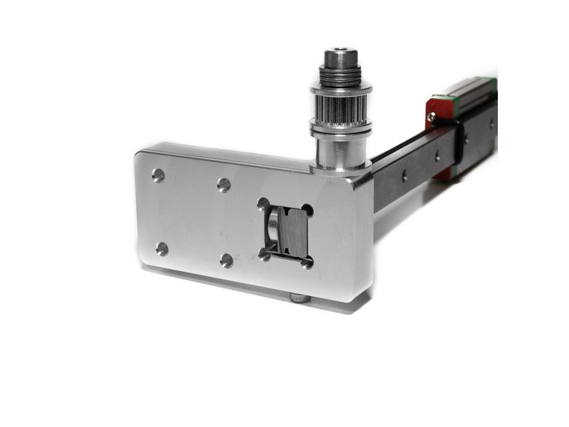](../assets/images/zoom/Vb1PqknyFLjPb5HE.jpg) [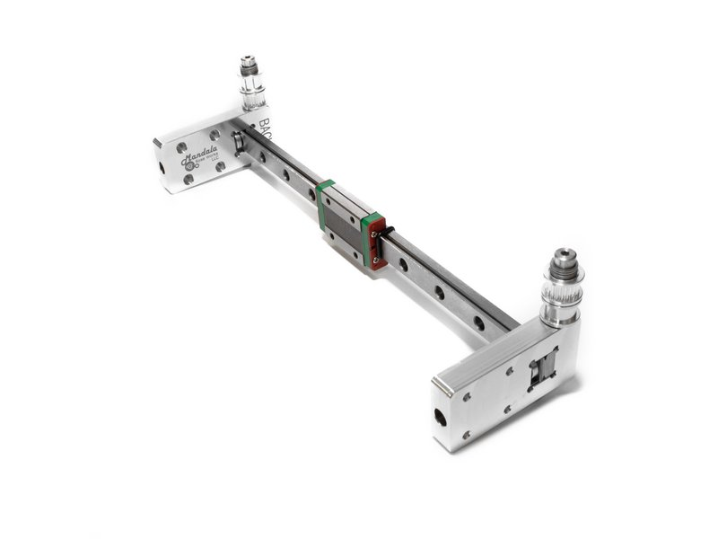](../assets/images/zoom/gFGmnPZc62a2q2ff.jpg)

- To insert the Y rail into the X carriages it gets oriented as in the image. Be sure the "inside' faces with the text milled into them face each other.
- There is a round metal spacer that goes between the Y rail and the horizontal part of the carriage. Lightly tighten the horizontal M3 bolt to hold it in place.
- There is a flat aluminum spacer that goes under the Y rail. Lightly tighten vertical bolt under the Rail against that spacer.

## Step 5: Bolt Y Rail Assembly onto X Rails

[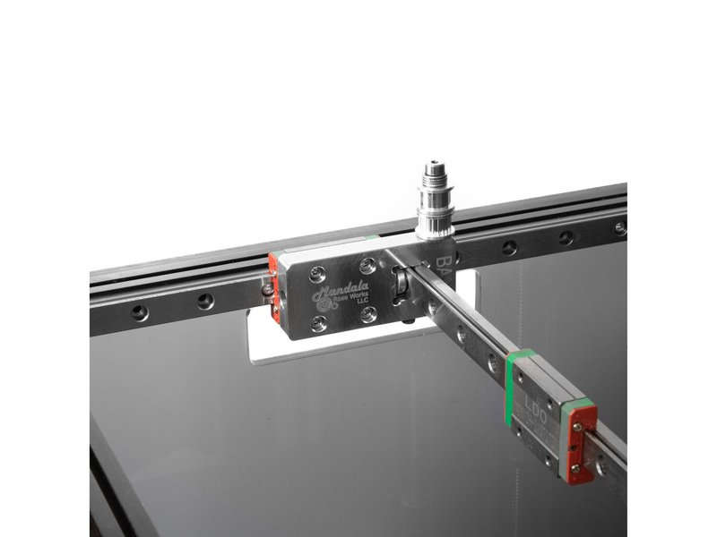](../assets/images/zoom/YCZYdiC1Zd2ntMOm.jpg) [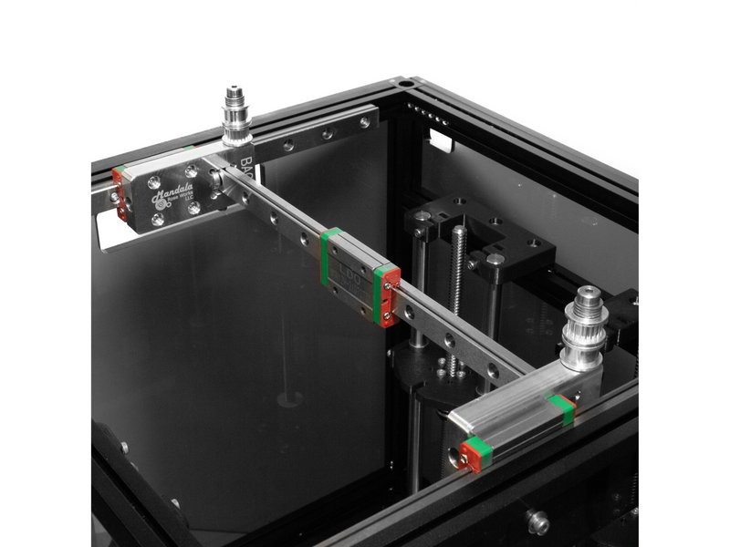](../assets/images/zoom/FQjbQvbQrC1TJhXh.jpg)

- Attach the X carriages to the X rails using (4) M3 x 8mm Button head bolts each.

Previous: [H) Z Motors and Leadscrews](h-z-motors-and-leadscrews.md) · [RailCore® Mini Kit guide list](index.md) · Next: [J) X/Y Steppers and Idlers](j-x-y-steppers-and-idlers.md)

---

Original page: <https://railcore.dozuki.com/Guide/I)+Y+Rail+Installation/31>. Written by Ben Withem on railcore.dozuki.com. This copy was captured on 2026-11-16 and is licensed under [Creative Commons Attribution-ShareAlike 3.0 (CC BY-SA 3.0)](https://creativecommons.org/licenses/by-sa/3.0/), the license stated on the original site. This is an unofficial community mirror and is not affiliated with RailCore Labs, LLC. RAILCORE is a registered trademark of RailCore Labs, LLC.
