# J) X/Y Steppers and Idlers

Category: [RailCore® Mini Kit](index.md) · Original: <https://railcore.dozuki.com/Guide/J)+X-Y+Steppers+and+Idlers/32>

[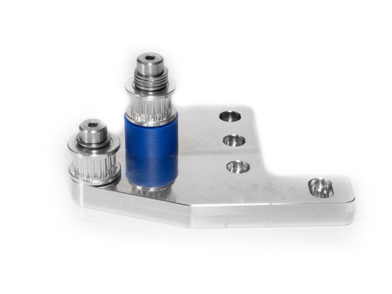](../assets/images/zoom/QMKZH6hkrPEtaOgO.jpg)

**Difficulty:** Moderate  
**Time required:** 1 hour  
**Author:** Ben Withem  
**Steps:** 9  
**Last modified on Dozuki:** 2022-04-04

## Tools

- [Allen Key](../items/allen-key-30.md)

## Parts

- 24 × [M3 x 8 Socket Head Screw](../items/m3-x-8-socket-head-screw-97.md)
- 2 × [16t Pulley](../items/16t-pulley-38.md)
- 2 × [Nema17 Stepper Motor (0.9 Degrees)](../items/nema17-stepper-motor-0-9-degrees-39.md)
- 1 × [Front Motor Mount](../items/front-motor-mount-40.md)
- 1 × [Rear Motor Mount](../items/rear-motor-mount-41.md)
- 2 × [25mm Shoulder Bolt](../items/25mm-shoulder-bolt-42.md)
- 2 × [15mm Shoulder Bolt](../items/15mm-shoulder-bolt-43.md)
- 1 × [Front Idler Mount](../items/front-idler-mount-44.md)
- 1 × [Back Idler Mount](../items/back-idler-mount-45.md)
- 12 × [5mm Shim](../items/5mm-shim-47.md)
- 10 × [M5 Washer](../items/m5-washer-46.md)
- 2 × [Printed Idler Spacer](../items/printed-idler-spacer-48.md)
- 4 × [2GT x 5mm Bore Smooth Idler](../items/gt2-x-5mm-bore-smooth-idler-60.md)

## Step 1: Front Stepper Mount

[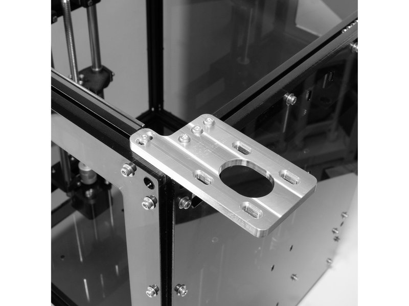](../assets/images/zoom/FG6XRIlZtYnC2mRp.jpg)

- Attach the front stepper mount to the top of the frame using (4) m3 x 8mm socket head screws.

## Step 2: Install Front Stepper

[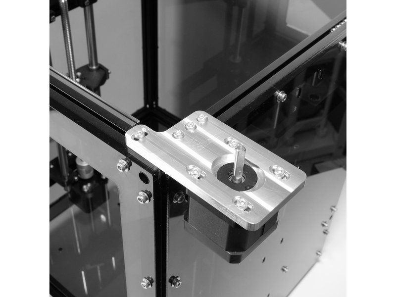](../assets/images/zoom/DjtVJgmLPnSCjSAR.jpg)

- Attach one of the 0.9 degree NEMA 17 steppers to the front idler mount using (4) m3 x 8mm socket head screws.
- **Note:** The wiring connector should point towards the side panel of the machine.

## Step 3: Install Front Pulley

[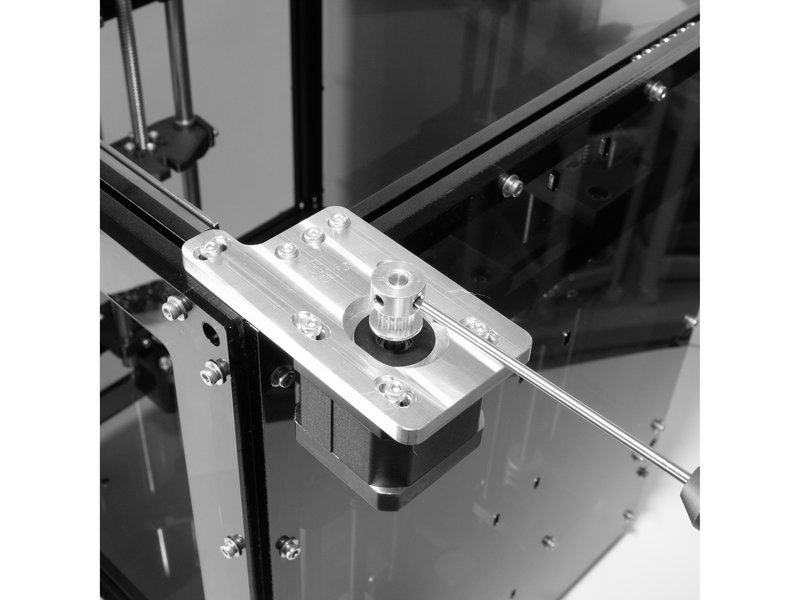](../assets/images/zoom/jVmTGv32F1IVlMDn.jpg)

- Install (1) 16t pulleys onto the stepper shaft with the teeth facing down. There are two set screws, be sure one of them is against the flat of the stepper shaft.
- **Note:** Don't overtighten the set screws, you'll need to adjust the pulley height to align the belt later

## Step 4: Rear Stepper Mount

[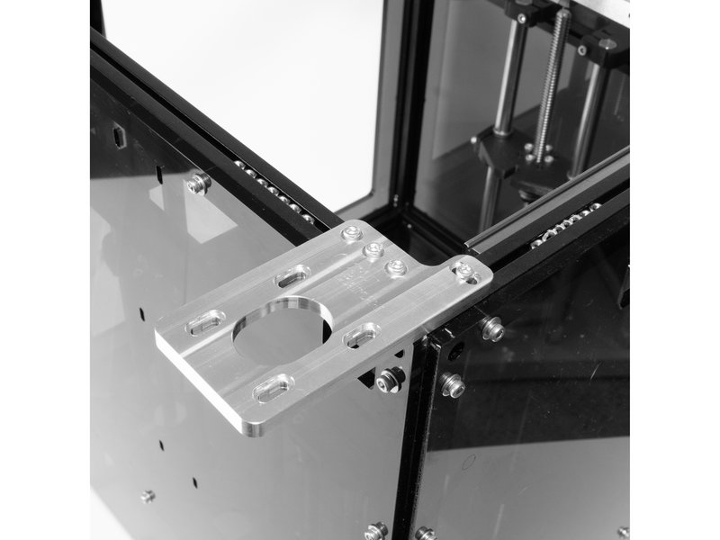](../assets/images/zoom/FKjEGs2gvvjjxmGi.jpg)

- Attach the rear stepper mount to the top of the frame using (4) M3 x 8socket head screws.
- **Note:** Don't overtighten them - you'll need to be able to adjust the position of the idler mount to align the belts later.

## Step 5: Install Rear Stepper

[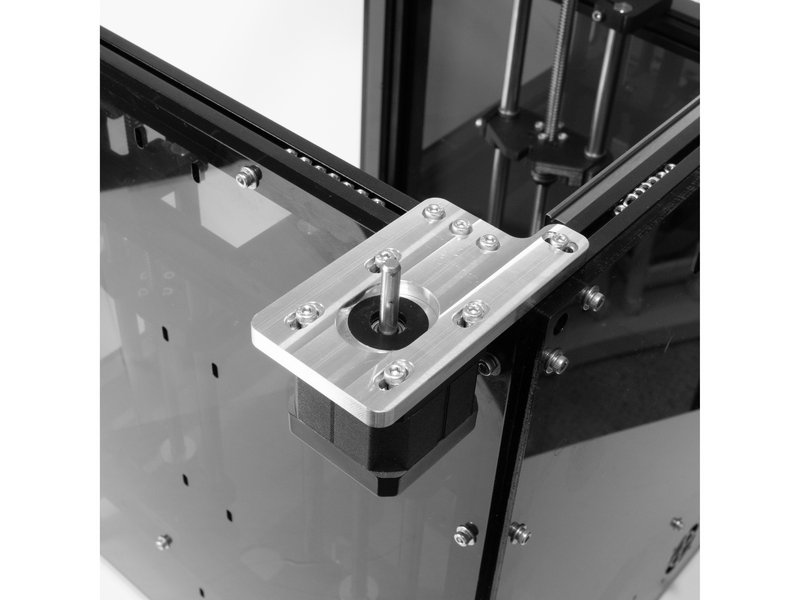](../assets/images/zoom/wCDIk1WgihgoMBMX.jpg)

- Attach one of the 0.9 degree NEMA 17 steppers to the front idler mount using (4) M3 x 8 socket head screws.

## Step 6: Install Rear Pulley

[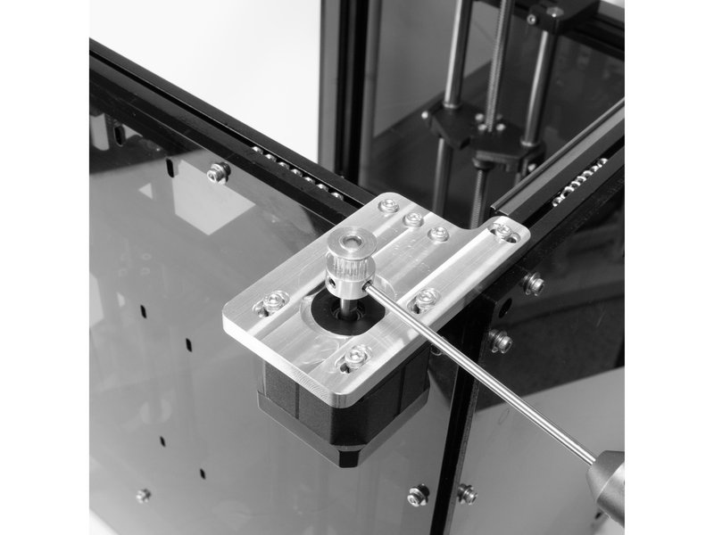](../assets/images/zoom/xmeXPrNx6VYcKl1b.jpg)

- Install one of the 16t pulleys onto the stepper shaft with the teeth facing up. There are two set screws, be sure one of them is against the flat of the stepper shaft.
- **Note:** Don't overtighten the set screws, you'll need to adjust the pulley height to align the belt later

## Step 7: Assemble Front Idler Mount

[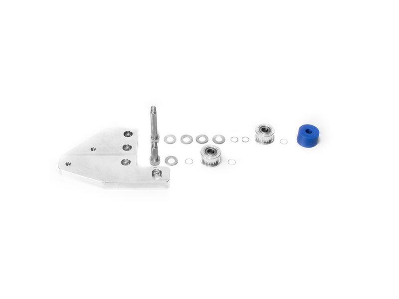](../assets/images/zoom/XJheDPvZSLdNCRnS.jpg) [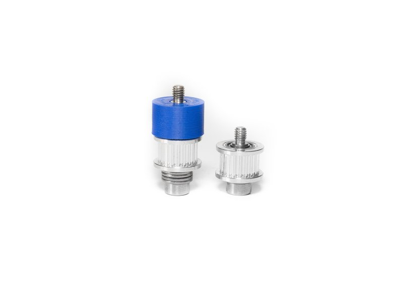](../assets/images/zoom/6YdGGZhvoEio6oQd.jpg) [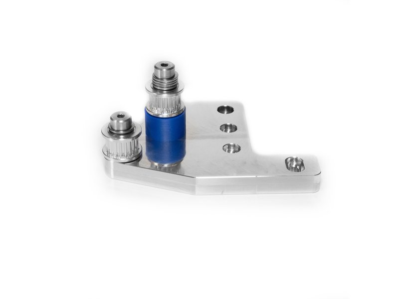](../assets/images/zoom/cAqCIPUVFExMWMc6.jpg)

- Building the idler stacks is very similar to how the stacks were built for the Y carriage stacks.
- **Note:** There are photos to accompany this step in the next step.
- For the front idler, the stack for the outside bolt is the short stack. Turn a 12mm shoulder bolt upside down and install (1) M5 washer, then (1) M5 shim. Next add the 20T idler, then lastly (1) M5 shim.
- **Note:** You want to be sure the total stack is just slightly below the shoulder on the shoulder bolt. If there is room for another shim, take the last shim and pulley off, and put the extra shim on before the pulley.
- Install the shorter idler stack in the outside hole on the idler mount.
- For the front idler, the stack for the inside bolt is the tall stack. Turn a bolt upside down and install (3) M5 washers, then (1) M5 shim. Next add the 20T idler, then lastly (1) M5 shim.
- **Note:** You want to be sure the total stack is just slightly below the shoulder on the shoulder bolt. If there is room for another shim or washer, take the last shim and pulley off, and put the extra shim on before the pulley. If you can fit an extra washer, be sure to put it on before the first shim.
- Install the taller idler stack in the inside hole on the idler mount.

## Step 8: Assemble Rear Idler Mount

[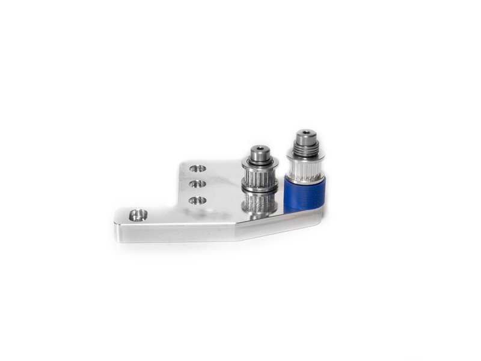](../assets/images/zoom/wHtbw5MEyGnZJA3R.jpg)

- The rear idler mount is assembled the same way as the front, however the orientation of the two shoulder bolts is reversed.

## Step 9: Install Idler Mounts

[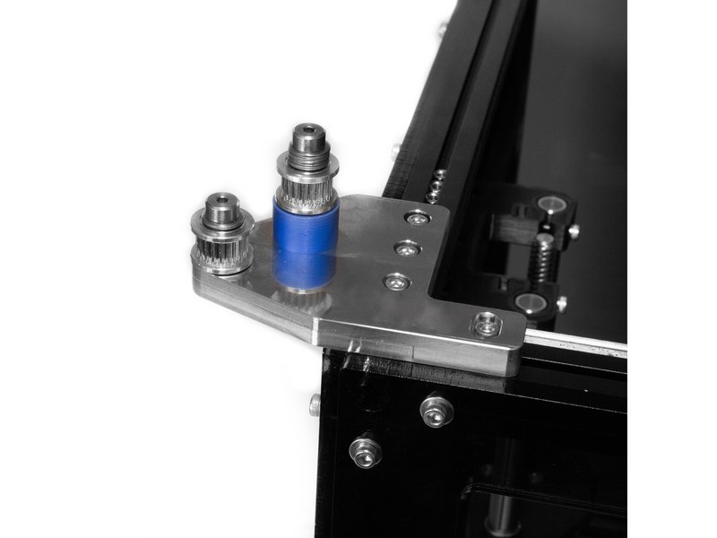](../assets/images/zoom/1IcxGm242mCQpa4p.jpg) [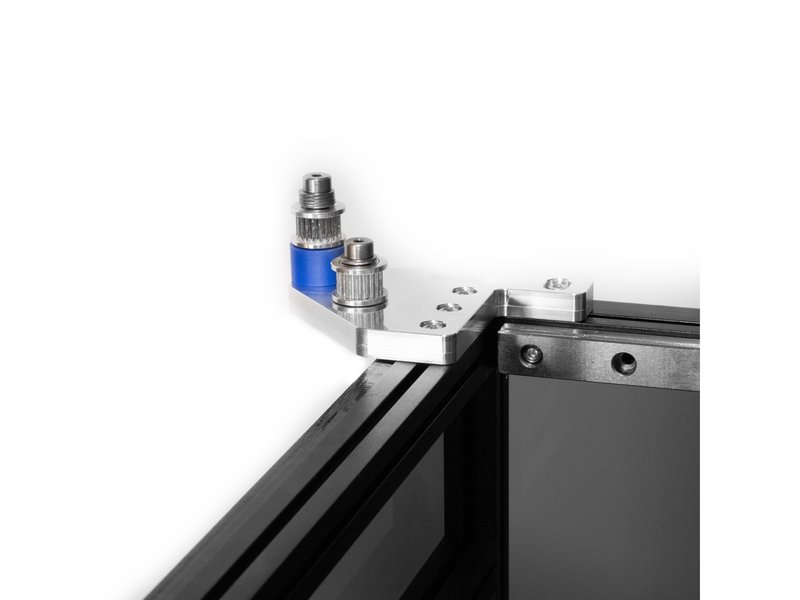](../assets/images/zoom/AgbsErtrWAZjQTeE.jpg)

- Attach the front idler mount to the left side of the top of the frame using (4) M3 x 8 socket head screws. Don't overtighten them - you'll need to be able to adjust the position of the idler mount to align the belts later.
- Attach the rear idler mount to the rear left top of the frame using (4) M3 x 8 socket head screws. Don't overtighten them - you'll need to be able to adjust the position of the idler mount to align the belts later.

Previous: [I) Y Rail Installation](i-y-rail-installation.md) · [RailCore® Mini Kit guide list](index.md) · Next: [K) Y Carriage](k-y-carriage.md)

---

Original page: <https://railcore.dozuki.com/Guide/J)+X-Y+Steppers+and+Idlers/32>. Written by Ben Withem on railcore.dozuki.com. This copy was captured on 2026-11-16 and is licensed under [Creative Commons Attribution-ShareAlike 3.0 (CC BY-SA 3.0)](https://creativecommons.org/licenses/by-sa/3.0/), the license stated on the original site. This is an unofficial community mirror and is not affiliated with RailCore Labs, LLC. RAILCORE is a registered trademark of RailCore Labs, LLC.
