# K) Y Carriage

Category: [RailCore® Mini Kit](index.md) · Original: <https://railcore.dozuki.com/Guide/K)+Y+Carriage/33>

[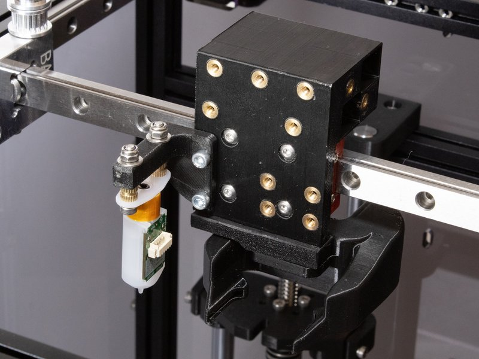](../assets/images/zoom/VnERI25gq5KUtnVs.jpg)

**Difficulty:** Moderate  
**Time required:** 45 minutes  
**Author:** Ben Withem  
**Steps:** 7  
**Last modified on Dozuki:** 2022-04-04

## Parts

- 1 × [Mini Harness W16](../items/mini-harness-w16-114.md)
- 1 × [Printed Mini Y Carriage](../items/printed-mini-y-carriage-95.md)
- 1 × [Printed Layer Fan Adapter](../items/printed-layer-fan-adapter-115.md)
- 1 × [Printed Cooling Shroud](../items/printed-y-endstop-66.md)
- 1 × [BLTouch Sensor](../items/bltouch-sensor-73.md)
- 2 × [M3 Washer](../items/m3-washer-65.md)
- 1 × [Y Endstop Mount](../items/y-endstop-mount-69.md)
- 2 × [M3 Brass Insert](../items/m3-brass-insert-23.md)
- 2 × [M3 x 20 Socket Head Screw](../items/m3-x-20-socket-head-screw-103.md)
- 4 × [M3 x 8 Socket Head Screw](../items/m3-x-8-socket-head-screw-97.md)
- 2 × [M2 Nut](../items/m2-nut-71.md)
- 1 × [M2 x 12mm Bolt](../items/m2-x-12mm-bolt-70.md)
- 2 × [M3 Nut](../items/m3-nut-25.md)
- 1 × [M3 x 6mm button head bolt](../items/m3-x-6mm-button-head-bolt-37.md)
- 1 × [M3 x 12mm Button Head Bolts](../items/m3-x-12mm-button-head-bolts-54.md)
- 4 × [M3 x 8mm Button Head Bolt](../items/m3-x-8mm-button-head-bolt-16.md)
- 2 × [M3 Nylock Nut](../items/m3-nylock-nut-84.md)

## Step 1

[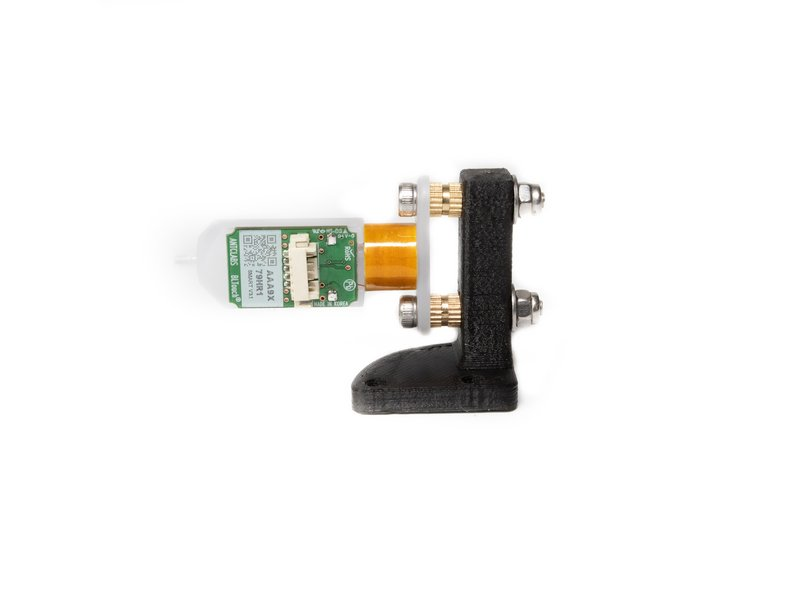](../assets/images/zoom/1EAQayUXCwYDXNOR.jpg) [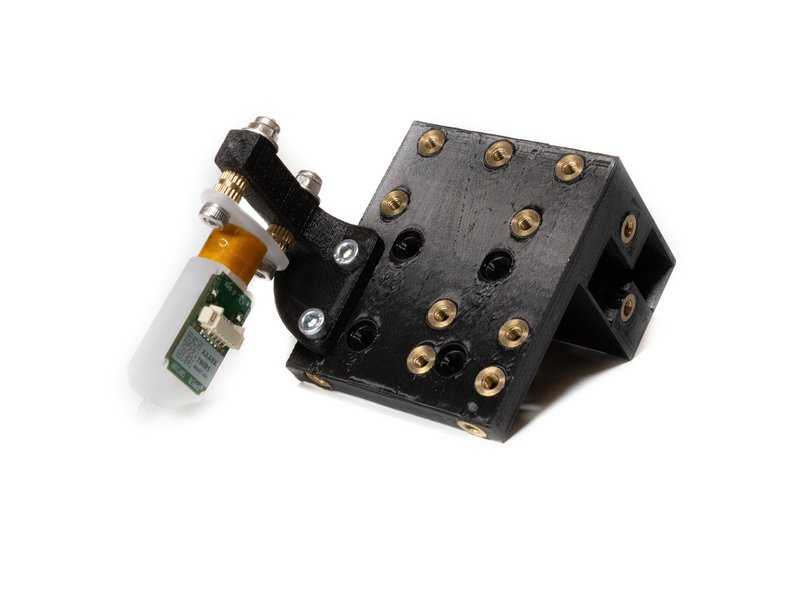](../assets/images/zoom/wLBDCkYaI1ju3l4U.jpg)

- **Note:** Before you anything to the Y carriage, double check that all the brass inserts are in.
- Remove the wiring that comes pre-installed on the bltouch by disconnecting the connector. The kit wiring harness has a connector, these wires are not needed.
- Put (2) m3 x 2 socket head screws pointing up through the holes in the BLTouch.
- Thread a brass insert down on the bolt, tight against the BLTouch.
- Pass the bolt up through the BLTouch mount.
- Put a single M3 washer on each screw, and then an M3 nylock nut.
- Attach the BLTouch mount to the printed Y carriage using (2) M3 x 8 socket head screws.

## Step 2: Prep Layer Fan Install

[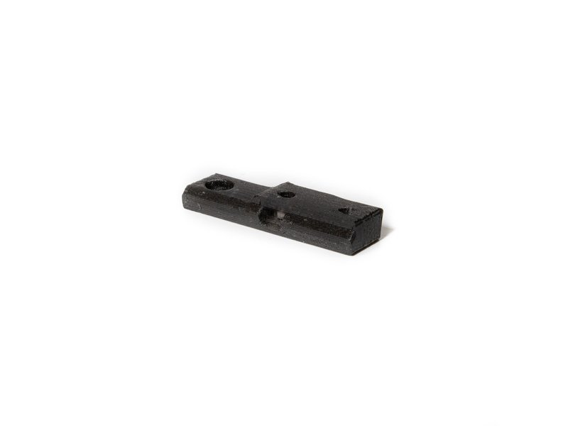](../assets/images/zoom/VmADKm6fIJaOwLGW.jpg) [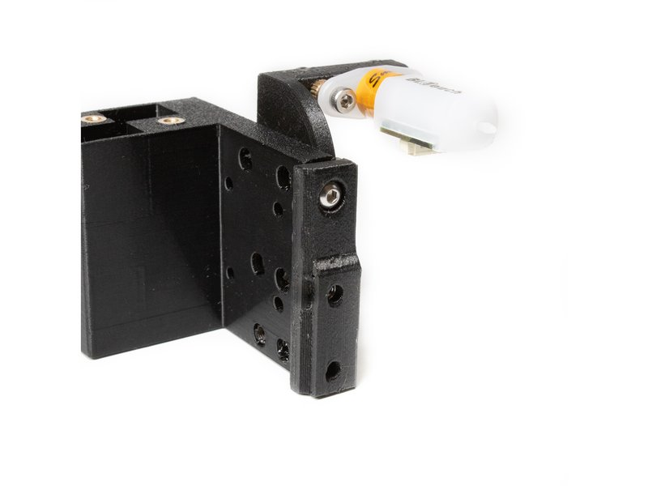](../assets/images/zoom/23tMW2RUuVAcoGjR.jpg)

- Locate the printed layer fan adapter, and insert an M3 nut into the slot on it as shown.
- Attach the layer adapter to the bottom of your Y carriage using a single M3 x 6 button head bolt.

## Step 3: Attach Part Cooling Fan Shroud

[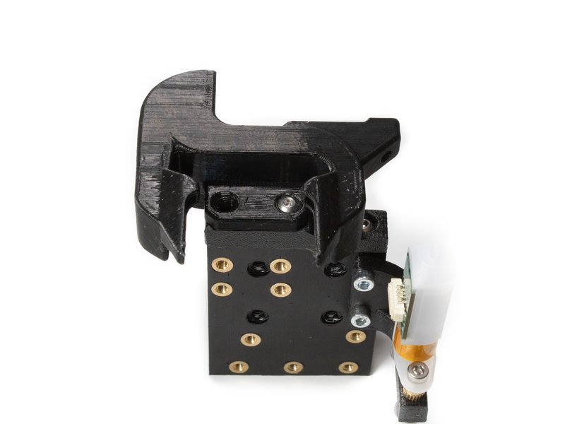](../assets/images/zoom/YIOoXPrbKGNuWiVX.jpg) [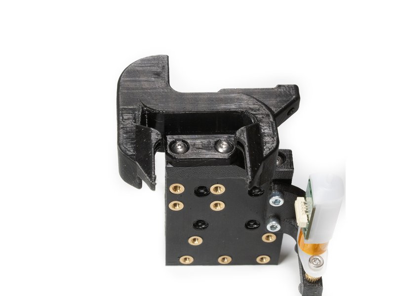](../assets/images/zoom/gPCvqpZWCZDqiCjp.jpg)

- Attach the printed layer fan shroud to the adapter using (1) M3 x 8 button head screw into the hole that has the M3 nut you installed earlier.
- Insert (1) M3 x 12 button head screw in the remaining hole to finish installing the layer fan shroud.

## Step 4: Y Endstop Prep

[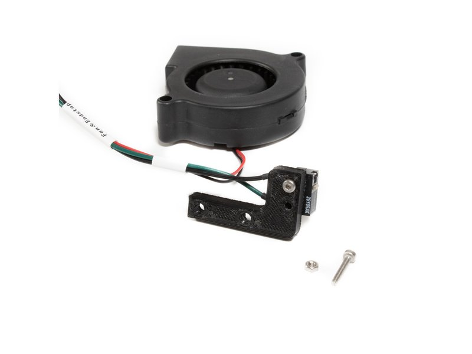](../assets/images/zoom/JEHmBXaXTRZqxw5t.jpg)

- The Y endstop and part cooling fan share a cable harness (W16).
- Attach the Y endstop switch to the Y endstop mount using (2) m2 x 12mm Bolts and (2) m2 nuts.

## Step 5: Y Carriage Installation

[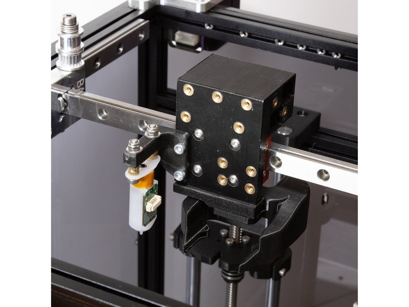](../assets/images/zoom/gpP2kmOZbStMCNb2.jpg)

- Bolt the Y Carriage to the Y rail using (4) M3 x 8mm button head screws. (Socket Cap Head Screws will not work here, use button head regardless of the kit you're building).
- **Note:** You may want a dab of loctite on the bolts for attaching the Y carriage to the Rail, they're hard to get to later.

## Step 6: Install Layer Fan and Y Endstop

[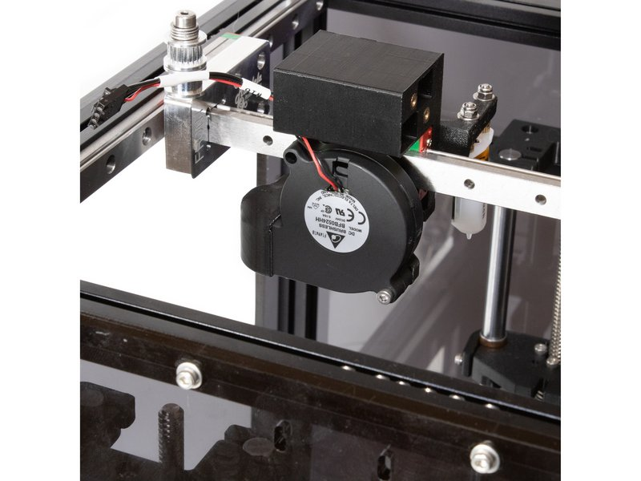](../assets/images/zoom/tR24Hb3hlFR2Pn2M.jpg) [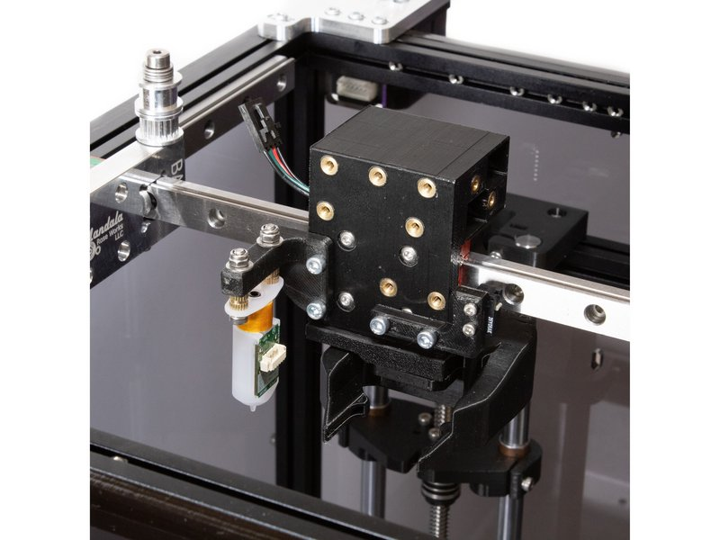](../assets/images/zoom/Rb5HTO3ClgmQyfPA.jpg)

- Attach the 5015 blower to the layer fan shroud using (1) M3 x 20 socket head screw.
- Attach the Y endstop mount to the bottom right two holes in the Y carriage using (2) M3 x 8mm socket head screws.

## Step 7: Attach Revo Micro Mount

[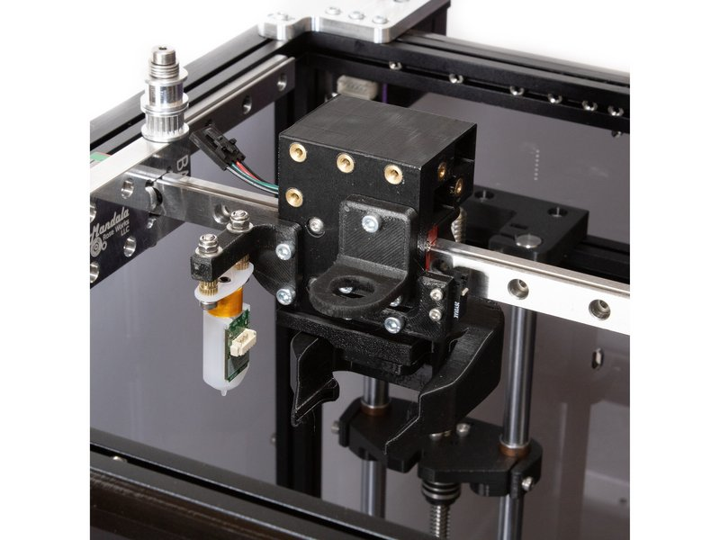](../assets/images/zoom/eWLUHlk65wVVy2X3.jpg)

- Attach the Revo Micro mount to the carriage using (3) M3 x 8 socket head screws.

Previous: [J) X/Y Steppers and Idlers](j-x-y-steppers-and-idlers.md) · [RailCore® Mini Kit guide list](index.md) · Next: [L) X/Y Belts](l-x-y-belts.md)

---

Original page: <https://railcore.dozuki.com/Guide/K)+Y+Carriage/33>. Written by Ben Withem on railcore.dozuki.com. This copy was captured on 2026-11-16 and is licensed under [Creative Commons Attribution-ShareAlike 3.0 (CC BY-SA 3.0)](https://creativecommons.org/licenses/by-sa/3.0/), the license stated on the original site. This is an unofficial community mirror and is not affiliated with RailCore Labs, LLC. RAILCORE is a registered trademark of RailCore Labs, LLC.
