# L) X/Y Belts

Category: [RailCore® Mini Kit](index.md) · Original: <https://railcore.dozuki.com/Guide/L)+X-Y+Belts/34>

[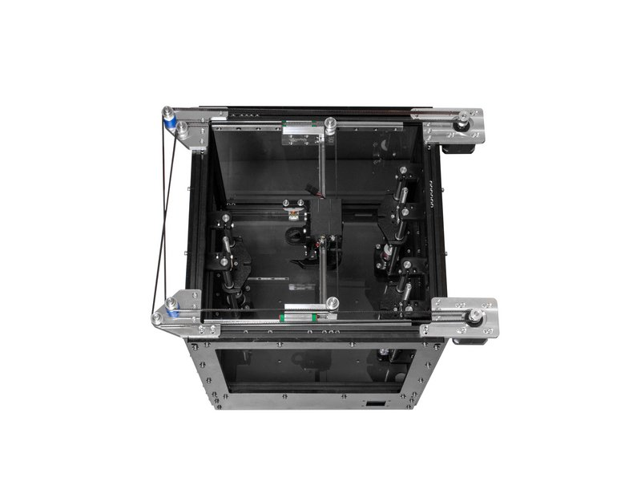](../assets/images/zoom/ZrjVLdrdWyD5Mkfr.jpg)

**Difficulty:** Moderate  
**Time required:** 45 minutes  
**Author:** Ben Withem  
**Steps:** 9  
**Last modified on Dozuki:** 2022-04-04

## Parts

- 4 × [Belt Clip](../items/belt-clip-75.md)
- 4 × [M3 Washer](../items/m3-washer-65.md)
- 4 × [M3 x 45mm Cap Head Bolt](../items/m3-x-45mm-cap-head-bolt-76.md)
- 1 × [Belt](../items/belt-77.md)

## Step 1: How to Install Belt Clips

[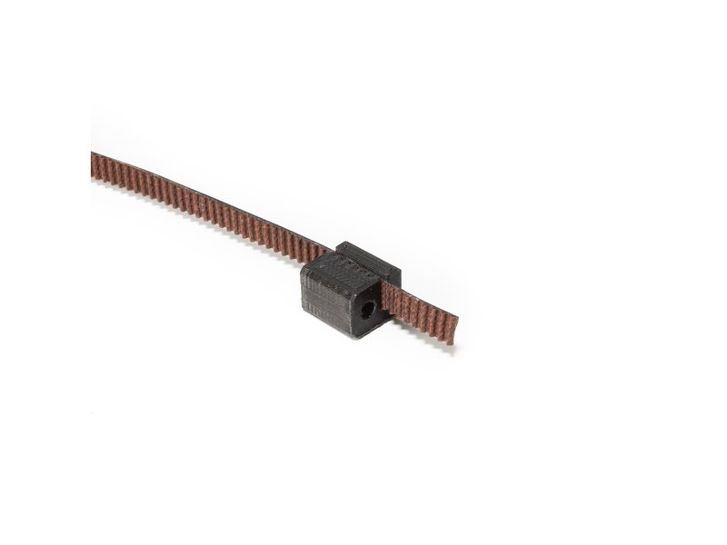](../assets/images/zoom/M1QVuCgNCPgk3w1a.jpg)

- To install a belt into a belt clip, put the belt through the clip, and leave a bit of a tail - about an inch or so, to allow some adjustment later.

## Step 2: Y / Front Belt Installation

[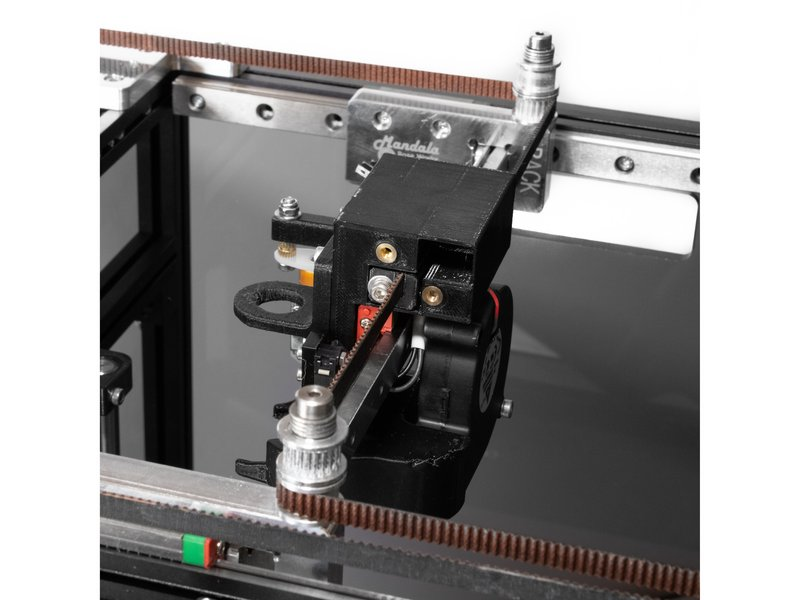](../assets/images/zoom/ZRXcef4xAYRCv6MY.jpg)

- Start with the front or "Y" belt. Insert the clip with the belt on it into the lower left hole at the front of the Y carriage. Make sure the bolt hole lines up properly.
- Attach the clip using (1) M3 x 45socket head screw and (1) M3 washer.
- **Caution:** The Belt teeth should be facing the left of the printer.
- **Note:** Use the pictures in this guide to ensure the belt clips are oriented the correct way.

## Step 3: Y Belt Installation Continued

 [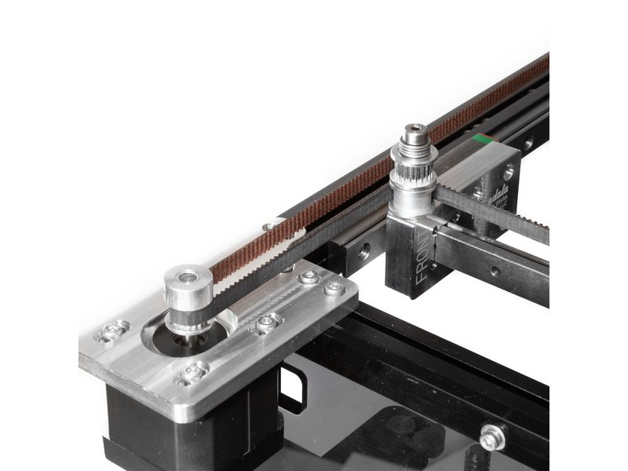](../assets/images/zoom/RvPanJYSlUYcCNGw.jpg) [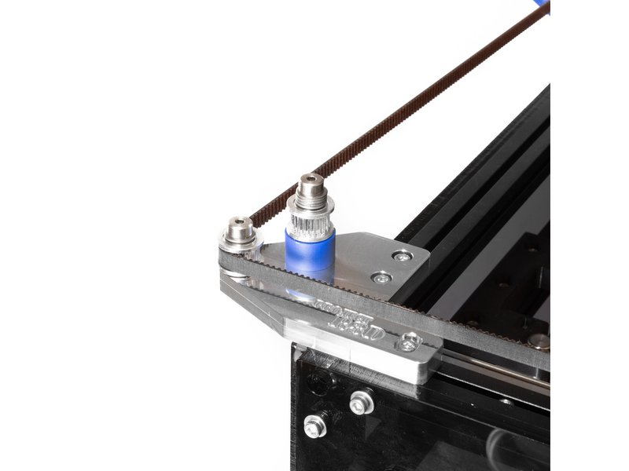](../assets/images/zoom/V1FmUZPG3tYOgPKE.jpg)

- The lower belt should go from the Y carriage and then around the lower smooth idler on the front X carriage.
- From the idler the belt should turn to the right and loop around the front stepper pulley.
- **Caution:** The teeth should engage the pulley.
- From the stepper the belt goes across the front of the printer and around the toothed idler on the outside, shorter shoulder bolt.

## Step 4: Finishing Y Belt Installation

[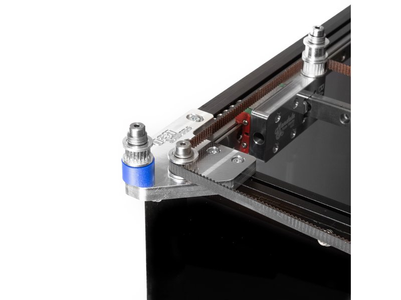](../assets/images/zoom/cIPrJXpIEuWJXZQx.jpg) [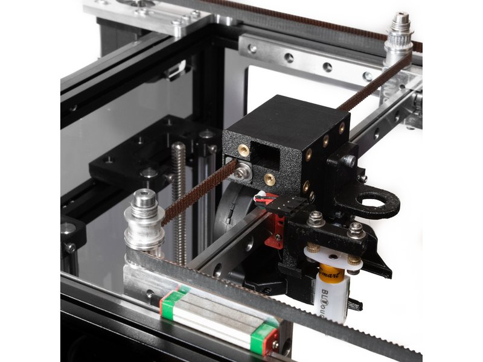](../assets/images/zoom/MXNQbi1HCqsaUKIY.jpg)

- The belt should cross to the left of the printer, and the teeth should engage the toothed idler on the shorter, inside shoulder bolt on the rear idler mount.
- From there the belt should follow along the back of the printer, with the toothed side wrapping around the lower toothed idler on the X carriage.
- Put another belt clip on, and insert the bolt into the lower rear hole on the Y carriage. Attach it with (1) M3 x 45 socket head bolt and (1) M3 washer.
- **Caution:** Be sure the belt is properly seated around the idlers and pulley, and not twisted along its length.
- Don't worry about the belt being tight - we'll tension it later. For now "close" is good enough.
- Cut the belt, leaving an approximately 1" tail in case you need to adjust it.

## Step 5: X / Rear Belt Installation

[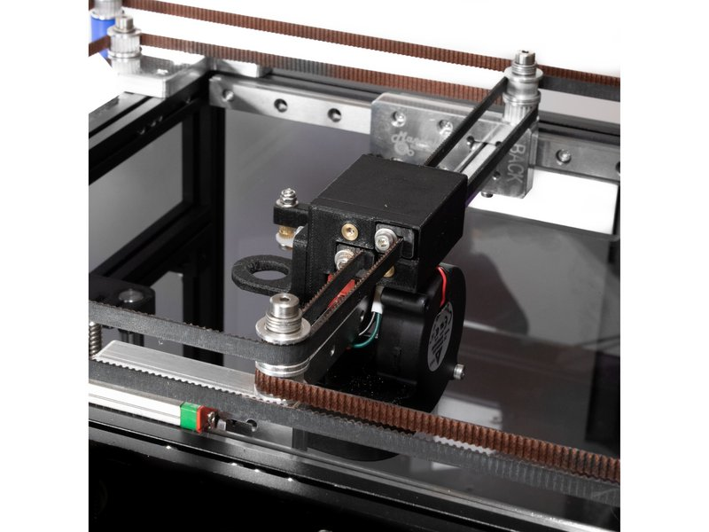](../assets/images/zoom/x1LFLrQxgI1CKwYI.jpg)

- To install the rear or "X" belt, start by installing a belt clip on the end of the belt, and insert it into the top hole on the front of the Y carriage.
- Attach the belt clip using (1) M3 x 45 socket head screw and (1) M3 washer.
- **Caution:** The belt teeth should be facing the left of the printer.

## Step 6: X Belt Installation Continued

 [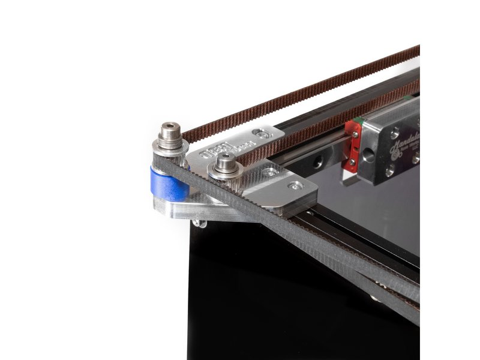](../assets/images/zoom/nwNh6RsCGBml3m3W.jpg)

- To route the belt it should leave the Y carriage and wrap around the toothed idler at the top of the stay on the front X carriage.
- From the X carriage the belt follows along the front of the printer to the toothed idler at the top of the tall stack on the front idler mount.

## Step 7: X Belt Installation Continued

[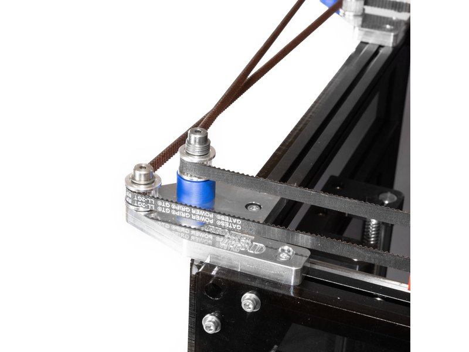](../assets/images/zoom/YO4CEdgKmx6jIcvA.jpg) [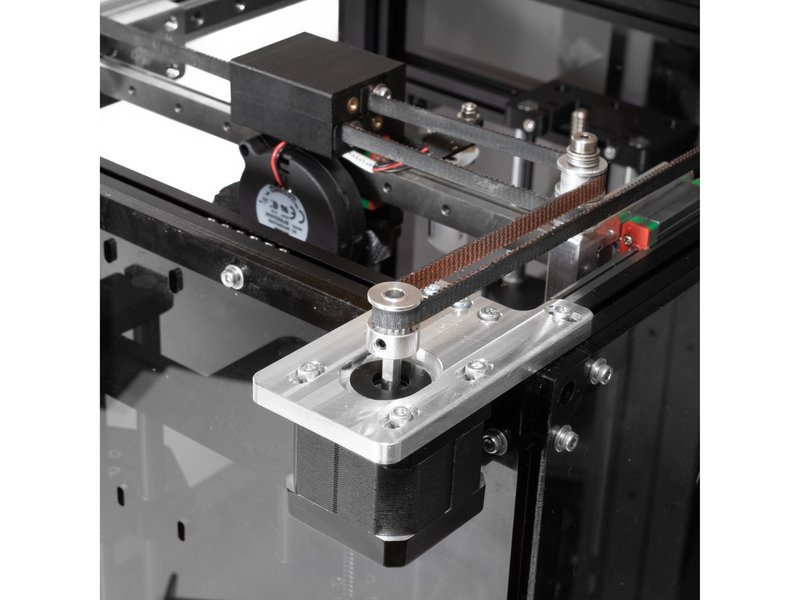](../assets/images/zoom/SEU1Xl4CjqIPLSYf.jpg) [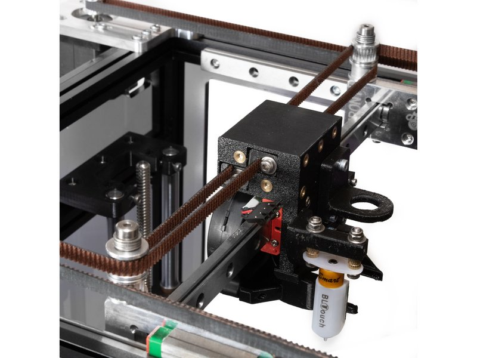](../assets/images/zoom/Q2kNsNNaAcLtuv4j.jpg)

- The belt crosses the left side of the printer, to the toothed idler on the tall stack of the rear idler mount.
- From the rear idler mount the belt extends along the back of the printer, all the way to the rear stepper pulley.
- The belt wraps around the rear stepper pulley, and goes back to the rear X carriage, with the back of the belt against the smooth idler at the top of the rear X carriage idler stack.

## Step 8: Finishing X Belt Installation

- From the Rear X carriage the belt goes back to the Y carriage block.
- Put another belt clip on, and insert the belt and clip into the top hole on the Y carriage. Attach it with (1) M3 x 45 socket head screw and (1) M3 washer.
- Be sure the belt is properly seated around the idlers and pulley, and not twisted along its length.
- Don't worry about the belt being tight - we'll tension it later. For now "close" is good enough.

## Step 9

- At this point both belts should not have any major slack in them. Test tightening them by pulling the X/Y steppers in their grooves, you should be unable to easily pull the steppers to the end of the grooves in the mounts. If you can, remove a belt clip and adjust it a couple teeth, then try again.
- It is best if both belts are the same length and now is a great time to do it, once the clips are adjusted.
  - To do so, remove both belts (Mark the front clip for each so you know which was which), lay them out on the floor side by side, and adjust the clips to be the same number of teeth apart.
  - Reinstall the belts.

Previous: [K) Y Carriage](k-y-carriage.md) · [RailCore® Mini Kit guide list](index.md) · Next: [M) Hotend and Extruder](m-hotend-and-extruder.md)

---

Original page: <https://railcore.dozuki.com/Guide/L)+X-Y+Belts/34>. Written by Ben Withem on railcore.dozuki.com. This copy was captured on 2026-11-16 and is licensed under [Creative Commons Attribution-ShareAlike 3.0 (CC BY-SA 3.0)](https://creativecommons.org/licenses/by-sa/3.0/), the license stated on the original site. This is an unofficial community mirror and is not affiliated with RailCore Labs, LLC. RAILCORE is a registered trademark of RailCore Labs, LLC.
