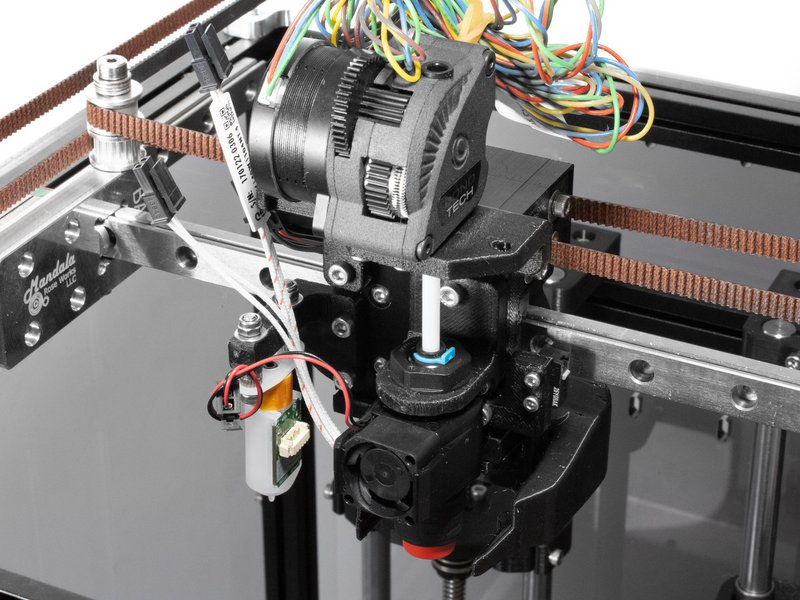
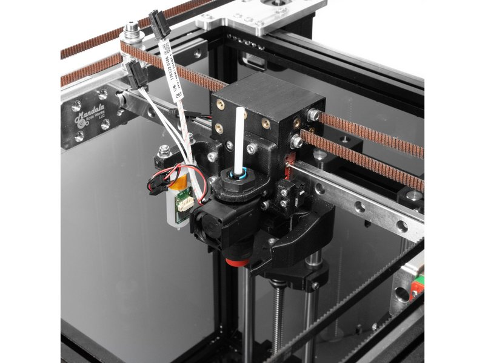
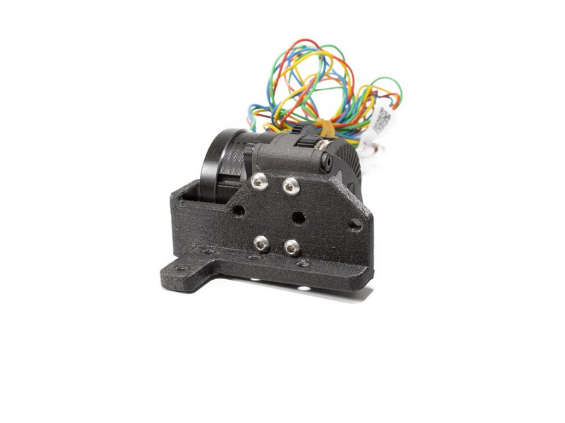
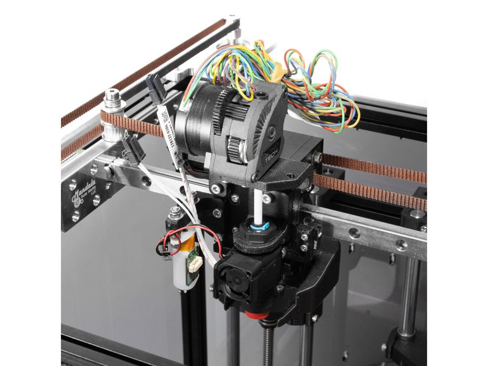
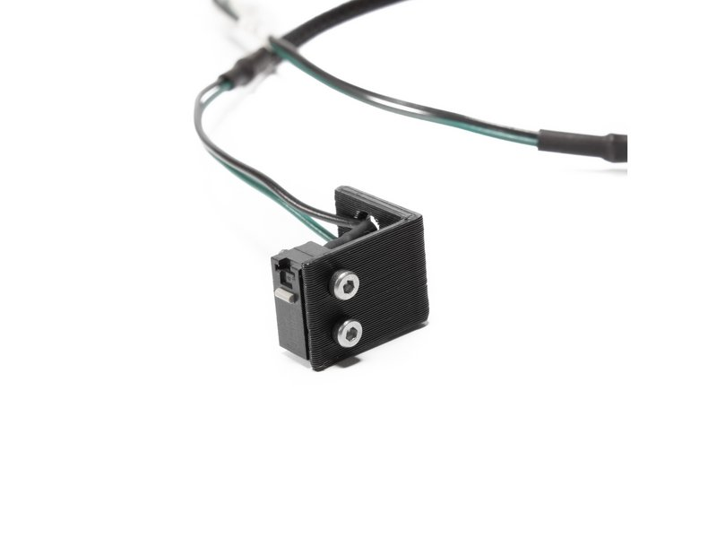
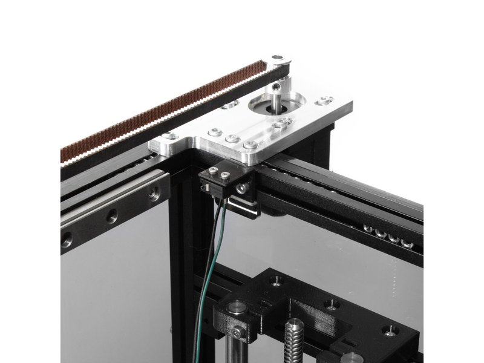

# M) Hotend and Extruder

Category: [RailCore® Mini Kit](index.md) · Original: <https://railcore.dozuki.com/Guide/M)+Hotend+and+Extruder/35>

**Difficulty:** Moderate  
**Time required:** 45 minutes  
**Author:** Ben Withem  
**Steps:** 3  
**Last modified on Dozuki:** 2022-04-04

## Parts

- 1 × [Printed LGX Lite Mount](../items/printed-lgx-lite-mount-116.md)
- 1 × [X Enstop Switch](../items/x-enstop-switch-117.md)
- 1 × [Bondtech LGX Lite](../items/bondtech-lgx-lite-118.md)
- 1 × [E3D Revo Micro](../items/e3d-revo-micro-119.md)
- 2 × [M2 x 12mm Bolt](../items/m2-x-12mm-bolt-70.md)
- 2 × [M2 Nut](../items/m2-nut-71.md)
- 2 × [M3 Washer](../items/m3-washer-65.md)
- 6 × [M3 x 8 Socket Head Screw](../items/m3-x-8-socket-head-screw-97.md)
- 4 × [M3 x 12mm Button Head Bolts](../items/m3-x-12mm-button-head-bolts-54.md)

## Step 1: E3D Revo Micro Install

- Remove the M12 nut from the Revo and insert the threaded side into the printed mount and re-attach the M12 retaining nut.
- Remove the collet and insert a portion of 50mm PTFE tube and reinstall the collet.

## Step 2: Bondtech LGX Lite Install

 

- Using 4 M3 x 12 button head screws, install the LGX Lite on the printed extruder mount in the orientation shown in the pictures.
- **Caution:** Button head screws must be used for the previous step.
- Install the assembled extuder and mount on the printed carriage using 4 M3 x 10 socket head screws.

## Step 3: X Endstop Assembly

 

- Attach the X endstop (it comes pre-wired) to the printed X endstop mount using (2) M2 x 12 socket head screws and (2) M2 Nuts
- **Note:** Don't worry about the wire for now, it's routed later.
- Mount the X endstop to the rear right corner of the frame, on the right inside extrusion, using (2) M3 x 8mm socket head screws and (2) M3 washers.
- **Note:** Don't worry about exact placement for now, it will be adjusted later.

Previous: [L) X/Y Belts](l-x-y-belts.md) · [RailCore® Mini Kit guide list](index.md) · Next: [N) Aligning your RailCore](n-aligning-your-railcore.md)

---

Original page: <https://railcore.dozuki.com/Guide/M)+Hotend+and+Extruder/35>. Written by Ben Withem on railcore.dozuki.com. This copy was captured on 2026-11-16 and is licensed under [Creative Commons Attribution-ShareAlike 3.0 (CC BY-SA 3.0)](https://creativecommons.org/licenses/by-sa/3.0/), the license stated on the original site. This is an unofficial community mirror and is not affiliated with RailCore Labs, LLC. RAILCORE is a registered trademark of RailCore Labs, LLC.
