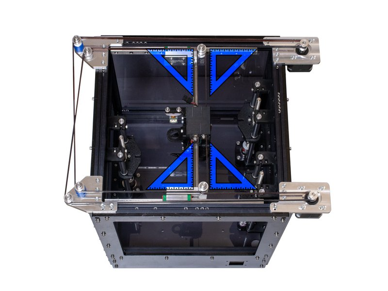
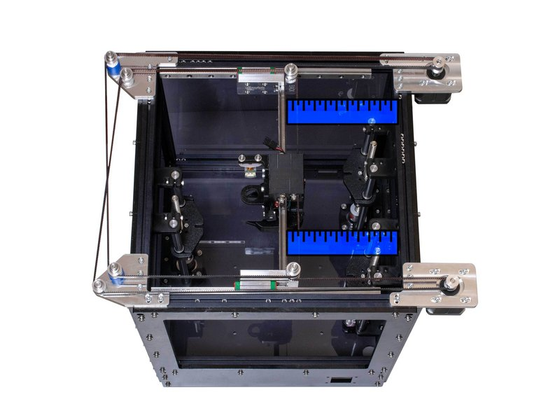
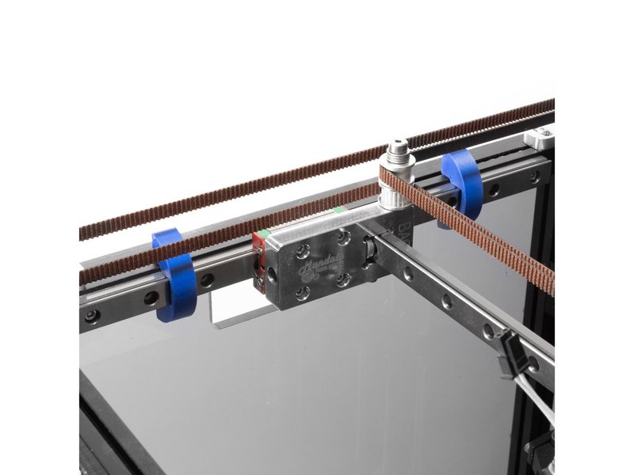

# N) Aligning your RailCore

Category: [RailCore® Mini Kit](index.md) · Original: <https://railcore.dozuki.com/Guide/N)+Aligning+your+RailCore/36>

**Difficulty:** Moderate  
**Time required:** 30 minutes  
**Author:** Ben Withem  
**Steps:** 5  
**Last modified on Dozuki:** 2022-04-04

## Tools

- [Allen Key](../items/allen-key-30.md)

## Parts

- 1 × [Printed Rail Alignment Tool](../items/printed-rail-alignment-tool-120.md)

## Step 1: Align the Belts

- The first step is to align your belts. Adjust the steppers so there's some tension, it doesn't take much, just enough that the belts are straight.
- Loosen the bolts holding each stepper and idler mount, and move them on the frame until the belts form 90 degree angles to each other.

## Step 2: Tension the Belts

- Earlier in the process you should have made sure your belts are equal lengths, if you did, that will make getting proper tension easier.
- **Caution:** Each X Carriage has two bolts retaining the Y rail in place. Loosen those bolts in both carriages just a little before proceeding. (They should still keep the rail in position, but should not be tight)
- Pull on the Front stepper in the mounts to lightly tension the front belt. You don't need too much tension.
- Pull the rear stepper back in the mount until the measurements marked in red on the image are equal. (Measure from the right side of the Y rail marked in red, to the left side of the top right extrusion where marked in red).
- **Caution:** 1-2-3 blocks can be used in place of measuring.
- Once the Y rail is squared you should re-tighten the bolts in the X carriages to retain the Y rail.
- **Note:** Ideal belt tension is between 40 - 50hz as measured on the short spans on the left of the printer between the idler mounts.

## Step 3: Centering the Linear Rails

- Center your X rails by loosening the retaining bolts and installing the alignment jigs on opposite sides of the rail.
- Tighten the rail back to the extrusion and repeat for the next X rail.

## Step 4: Aligning the Z Towers

- Loosen the bolts in the Z brackets for one tower, so it can move freely.
- Lower the Z yoke by spinning the lead screw, until the yoke is just above the leadscrew coupler.
- Tighten down the lower Z bracket, be sure the Z extrusion is pushed flush against the side extrusions as you tighten the brackets.
- Move the yoke into the center of the Z tower.
- Use a calipers or a ruler to measure from your front panel to the Z extrusion at the bottom.
- Repeat the same measurement near the top of the Z tower, and adjust until it's equal.
- Tighten the top of the Z tower. Repeat for all 3 towers.

## Step 5: Adjust X Endstop

- Loosen your X endstop mount. Move it to back side of the right extrusion.
- Move the X endstop to be against the rear X carriage, be sure the switch triggers.
- Tighten down the X endstop.

Previous: [M) Hotend and Extruder](m-hotend-and-extruder.md) · [RailCore® Mini Kit guide list](index.md) · Next: [O) Bed](o-bed.md)

---

Original page: <https://railcore.dozuki.com/Guide/N)+Aligning+your+RailCore/36>. Written by Ben Withem on railcore.dozuki.com. This copy was captured on 2026-11-16 and is licensed under [Creative Commons Attribution-ShareAlike 3.0 (CC BY-SA 3.0)](https://creativecommons.org/licenses/by-sa/3.0/), the license stated on the original site. This is an unofficial community mirror and is not affiliated with RailCore Labs, LLC. RAILCORE is a registered trademark of RailCore Labs, LLC.
