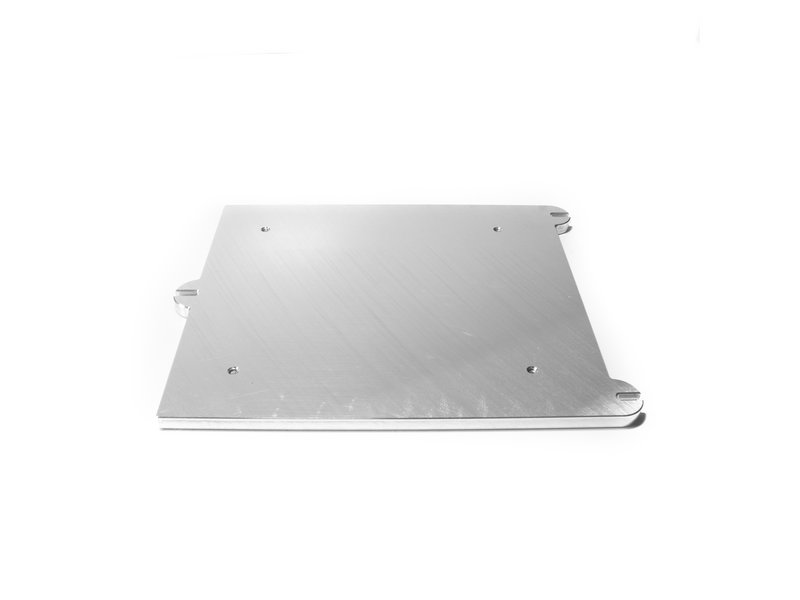
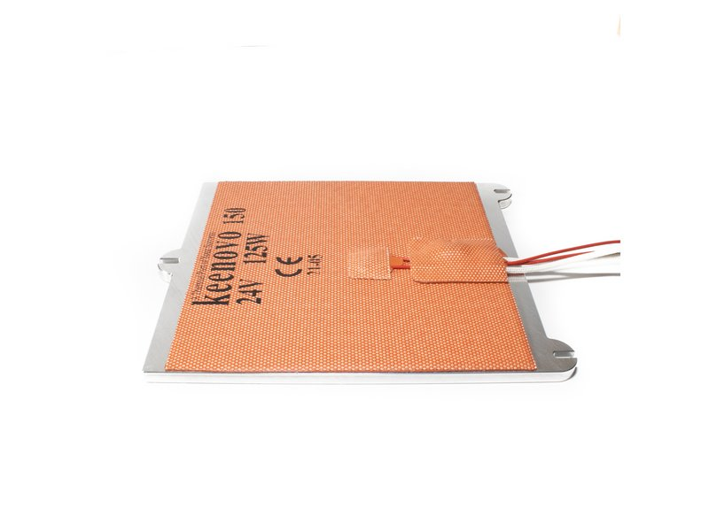
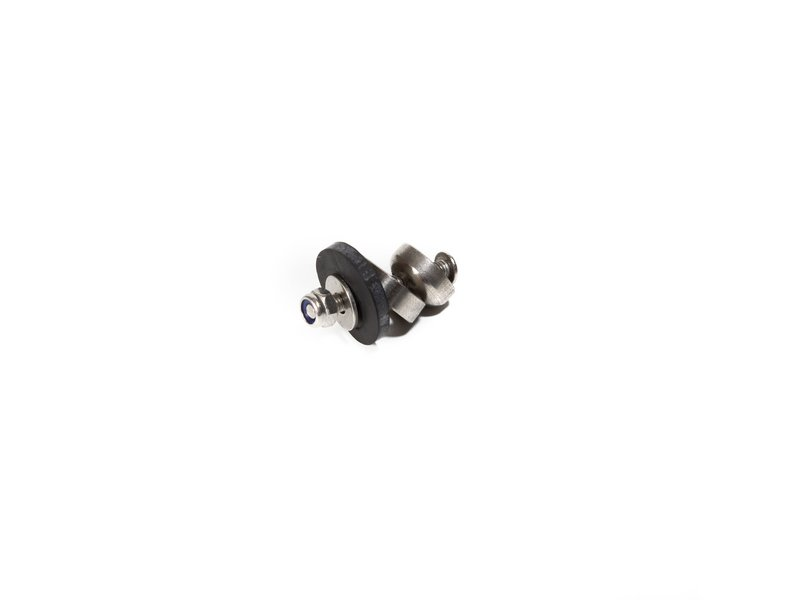
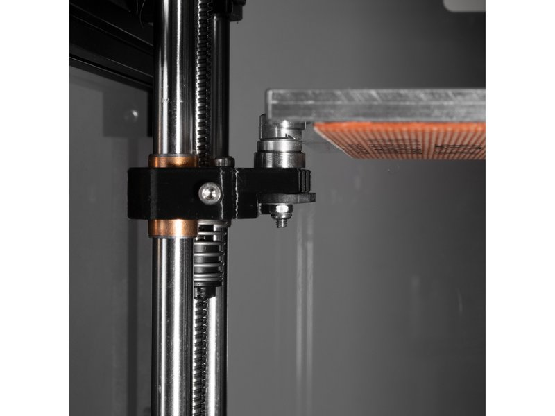
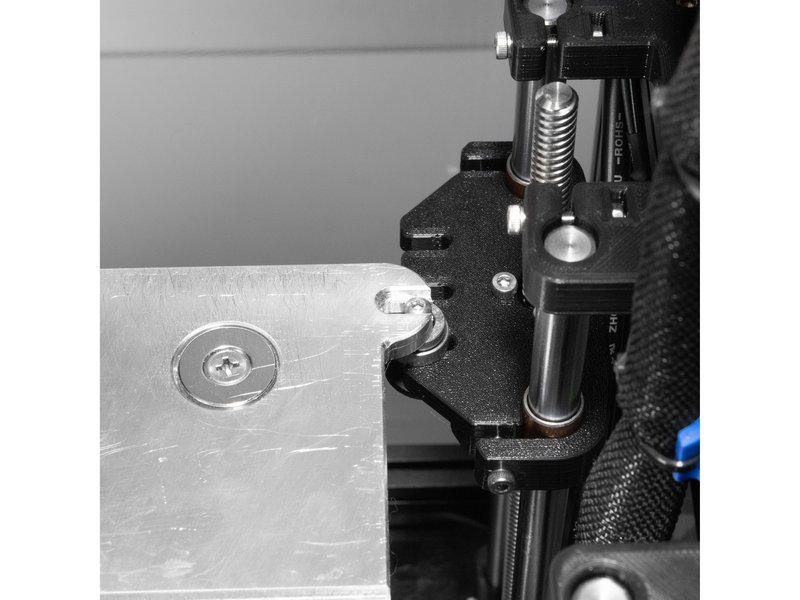

# O) Bed

Category: [RailCore® Mini Kit](index.md) · Original: <https://railcore.dozuki.com/Guide/O)+Bed/37>

**Difficulty:** Moderate  
**Time required:** 30 minutes  
**Author:** Ben Withem  
**Steps:** 2  
**Last modified on Dozuki:** 2022-04-04

## Parts

- 3 × [M3 x 20 Socket Head Screw](../items/m3-x-20-socket-head-screw-103.md)
- 3 × [M3 Washer](../items/m3-washer-65.md)
- 3 × [1/4" Rubber Washer](../items/1-4-rubber-washer-121.md)
- 3 × [M3 Nylock Nut](../items/m3-nylock-nut-84.md)
- 1 × [Mini Aluminum Bed](../items/mini-aluminum-bed-122.md)
- 1 × [Mini Silicon Heater](../items/mini-silicon-heater-123.md)

## Step 1: Install Heater

 

- Remove backing revealing 3M adhesive and install the silicon heater as shown in the image.

## Step 2: Install Bed

  

- The bolt stack for mounting the bed is made up of (1) M3 x 25 socket head screw, (1) set of leveling washers, (1) 1/4" rubber washer, (1) M3 washer, and (1) nylock M3 nut.
- The socket head should go in the milled cutout of the bed, and the bed should sit on the stack of the leveling washers on top of the Z yoke.
- The rubber washer, M3 washer and M3 nylock nut will be below the Z yoke.
- **Caution:** The latest version of the Z yokes have three slots. To match the kit configuration, attach the bed to the yokes using the mounting slots closest to the front of the printer.
- **Note:** Wiring should hang off the right side of the bed when installed.
- Tighten the nylock nuts, attaching the bed to the three Z yokes.

Previous: [N) Aligning your RailCore](n-aligning-your-railcore.md) · [RailCore® Mini Kit guide list](index.md) · Next: [P) Electronics](p-electronics.md)

---

Original page: <https://railcore.dozuki.com/Guide/O)+Bed/37>. Written by Ben Withem on railcore.dozuki.com. This copy was captured on 2026-11-16 and is licensed under [Creative Commons Attribution-ShareAlike 3.0 (CC BY-SA 3.0)](https://creativecommons.org/licenses/by-sa/3.0/), the license stated on the original site. This is an unofficial community mirror and is not affiliated with RailCore Labs, LLC. RAILCORE is a registered trademark of RailCore Labs, LLC.
