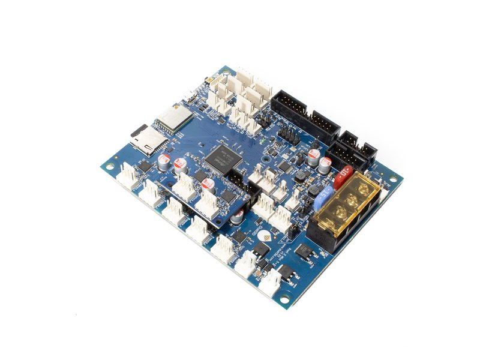
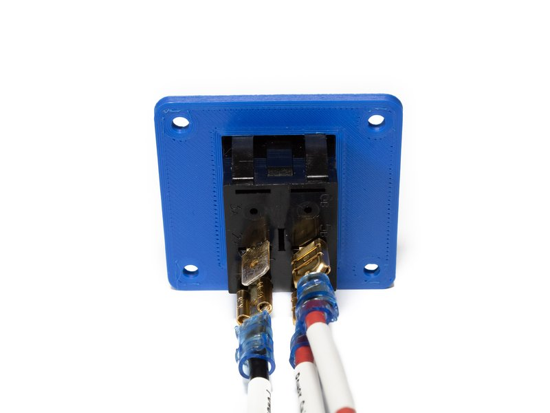
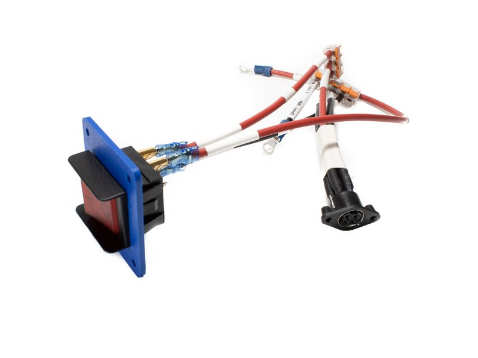
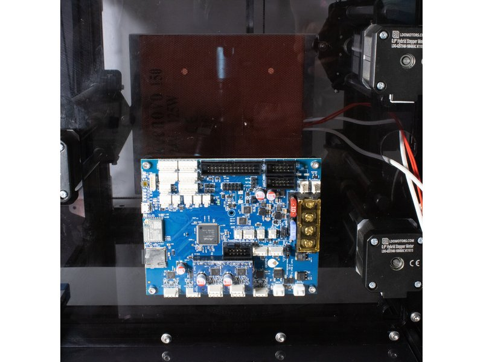
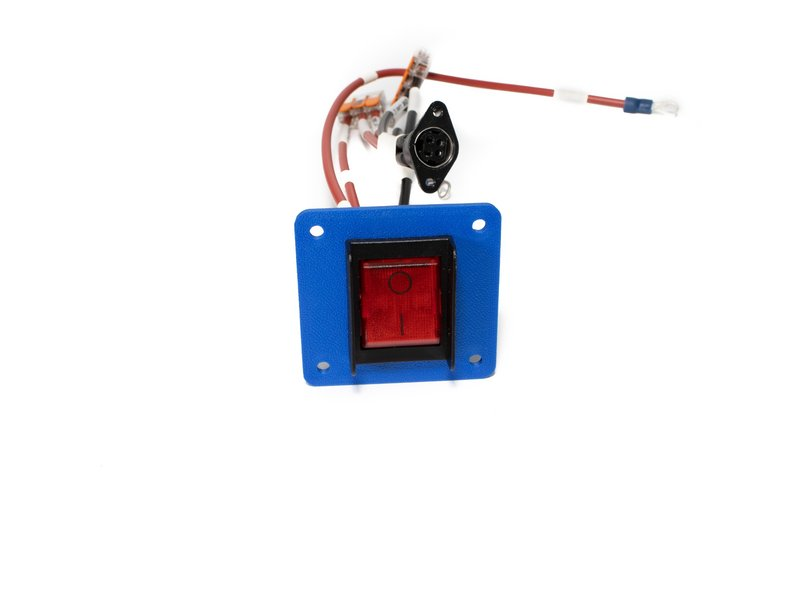
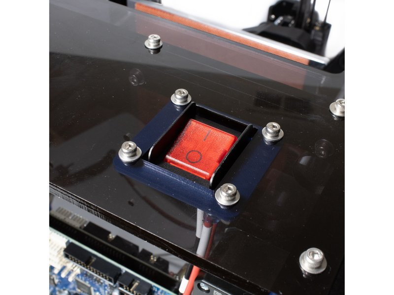
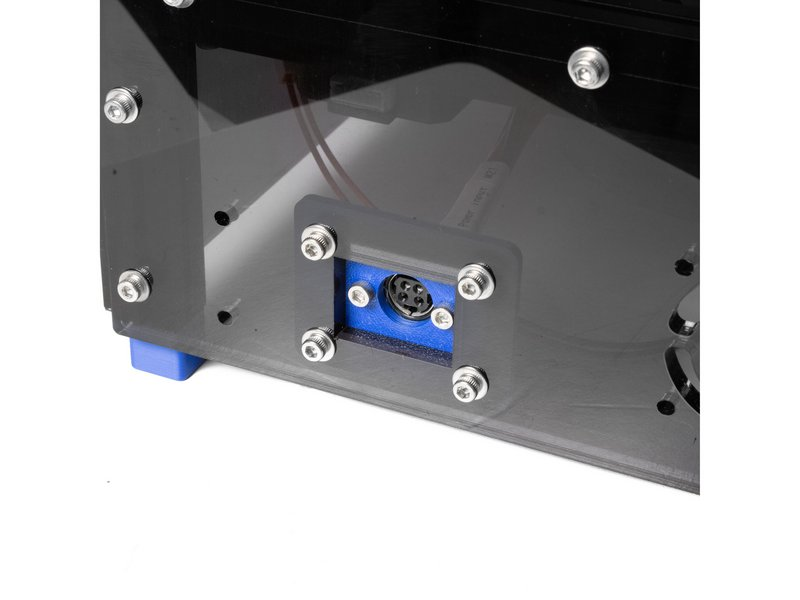
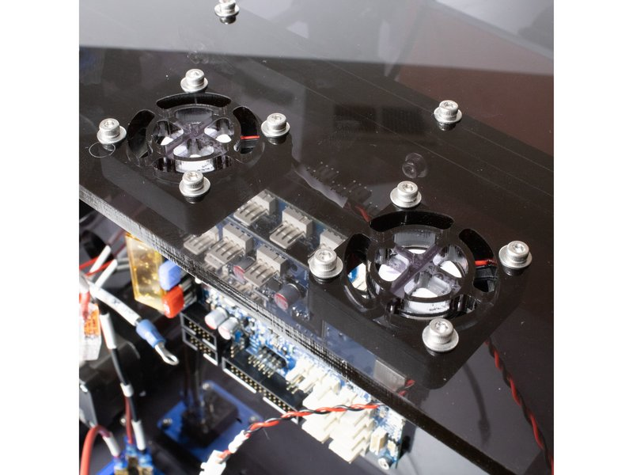

# P) Electronics

Category: [RailCore® Mini Kit](index.md) · Original: <https://railcore.dozuki.com/Guide/P)+Electronics/38>

**Difficulty:** Moderate  
**Time required:** 30 minutes  
**Author:** Ben Withem  
**Steps:** 7  
**Last modified on Dozuki:** 2022-04-04

## Parts

- 1 × [Duet 3 Mini 5+ WiFi](../items/duet-3-mini-5-wifi-124.md)
- 1 × [Duet 3 Mini Expansion 2+](../items/duet-3-mini-expansion-2-125.md)
- 4 × [5mm Nylon Spacer](../items/5mm-nylon-spacer-126.md)
- 4 × [M3 x 16 Socket Head Screw](../items/m3-x-16-socket-head-screw-113.md)
- 20 × [M3 Washer](../items/m3-washer-65.md)
- 20 × [M3 Nut](../items/m3-nut-25.md)
- 8 × [M3 x 20 Socket Head Screw](../items/m3-x-20-socket-head-screw-103.md)
- 8 × [M3 x 12 Socket Head Screw](../items/m3-x-12-socket-head-screw-127.md)
- 2 × [M2.5 x 6 Self Tapping Screw](../items/m2-5-x-6-self-tapping-screw-130.md)

## Step 1: Safety

- **Caution:** The RailCore Mini is a "DIY" project, build safe, build smart, and be responsible.
- **Caution:** Build at your own risk.
- **Caution:** When in doubt, double check things.
- **Caution:** 3D Printers can get very hot, use common sense and quality components.
- **Note:** If you need help, find us at the RailCore Facebook page or RailCore Discord channel. Both are linked from RailCore.org.

## Step 2: Power Switch Reference

- The power switch in your kit should come pre-wired. Below is a cable reference, and also serves as a way to double check it.
  - Pin 1A -> Black, Wago (6 Port) / 150mm
  - Pin 4B -> Red, Wago (3 Port) / 150mm
  - Pin 5B -> Red, Duet VIN (24v) / 250mm

## Step 3: Power Input Reference

- The power input plug in your kit should come pre-wired. Below is a cable reference, and also serves as a way to double check it.
  - Pin 1 -> Black, Wago (6 Port) / 120mm
  - Pin 2 -> Red, Wago (3 Port) / 120mm
  - Pin 3 -> Red, Wago (3 Port) / 120mm
  - Pin 4 -> Black, Wago (6 Port) / 120mm

## Step 4: Install Duet 3 Mini 5+

 

- Install the Duet +2 expansion board on the Duet board as shown in the image.
- Using (4) nylon standoffs, M3 x 16 socket head screws, and M3 washers, attach the Duet to the base of the printer.

## Step 5: Install Power Switch

 

- Using (4) M3 x 12 socket head screws, M3 washers, and M3 nuts, install the power switch under the panel.
- **Note:** Off position should be towards the top of the printer.

## Step 6: Install Power Plug

- Using (2) M3 x 10 self tapping screws, attach the power plug to the printed mount.
- **Note:** The material the plug is made out of can also be tapped for M3.
- Using (4) M3 x 12 socket head screws, M3 washers, and M3 nuts, install the power plug under the panel.

## Step 7: Install Panel Fans

- Using (4) M3 x 20 socket head screws, M3 washers, and M3 nuts, install the (2) panel fans under the rear panel.

Previous: [O) Bed](o-bed.md) · [RailCore® Mini Kit guide list](index.md) · Next: [Q) Wiring the Electronics](q-wiring-the-electronics.md)

---

Original page: <https://railcore.dozuki.com/Guide/P)+Electronics/38>. Written by Ben Withem on railcore.dozuki.com. This copy was captured on 2026-11-16 and is licensed under [Creative Commons Attribution-ShareAlike 3.0 (CC BY-SA 3.0)](https://creativecommons.org/licenses/by-sa/3.0/), the license stated on the original site. This is an unofficial community mirror and is not affiliated with RailCore Labs, LLC. RAILCORE is a registered trademark of RailCore Labs, LLC.
