# Q) Wiring the Electronics

Category: [RailCore® Mini Kit](index.md) · Original: <https://railcore.dozuki.com/Guide/Q)+Wiring+the+Electronics/39>

[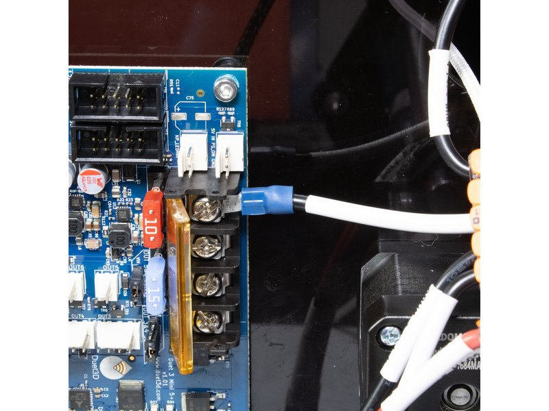](../assets/images/zoom/Vng5xLpfjKQSi5As.jpg)

**Difficulty:** Moderate  
**Time required:** 2 hours  
**Author:** Ben Withem  
**Steps:** 12  
**Last modified on Dozuki:** 2022-04-04

## Parts

- 1 × [Mini Printed IO Panel](../items/mini-printed-io-panel-129.md)
- 2 × [M3 Nut](../items/m3-nut-25.md)
- 2 × [M3 x 10 Socket Head Screw](../items/m3-x-10-socket-head-screw-98.md)
- 2 × [M3 Washer](../items/m3-washer-65.md)

## Step 1: Power Duet

 [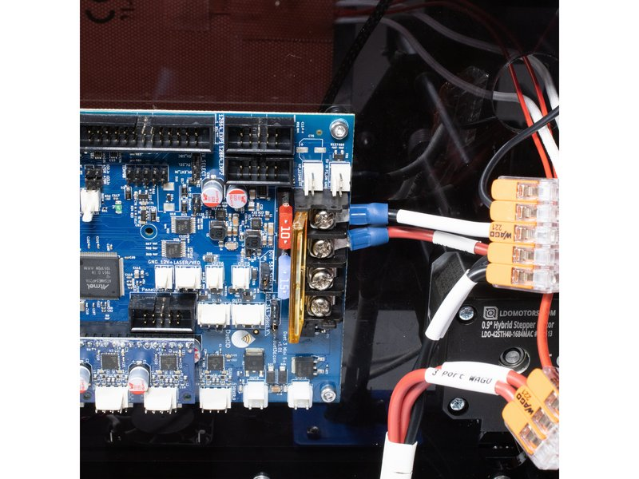](../assets/images/zoom/R3gAJQXSCOVlTHhN.jpg)

- The black wire labeled Duet GND from the 6 slot Wago connector attaches to the first GND on the Duet.
- The red wire labeled Duet 24v from the 3 slot Wago connector attaches to the first VIN terminal on the Duet.

## Step 2: Power Bed

[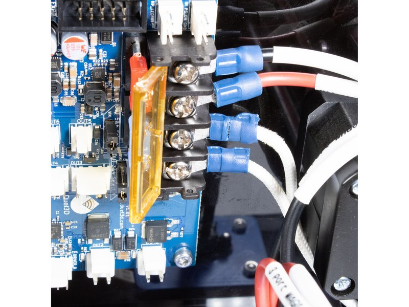](../assets/images/zoom/xO54NQoDqMkapLUy.jpg)

- The ring terminals coming from the bed should attach to the remaining terminals (OUT 0).

## Step 3: Bed Thermistor

[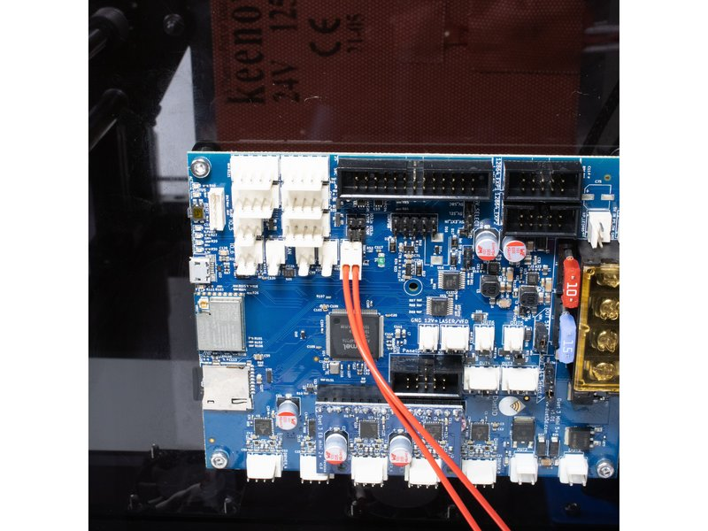](../assets/images/zoom/ENELxKLlZofVcmlZ.jpg)

- The bed thermistor connects to Temp 0.

## Step 4: Hotend Thermistor

[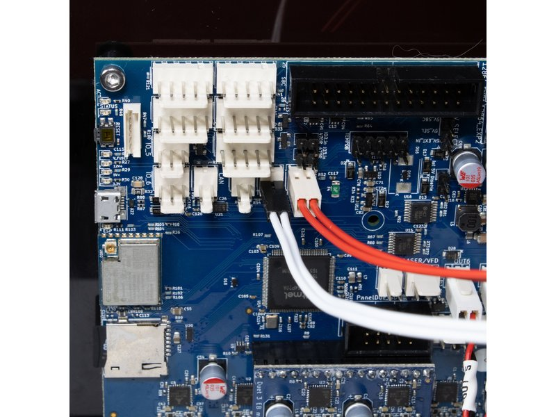](../assets/images/zoom/K2lSixdHrxGyqtkt.jpg)

- The hotend thermistor plugs into temp1 .

## Step 5: End Stops

[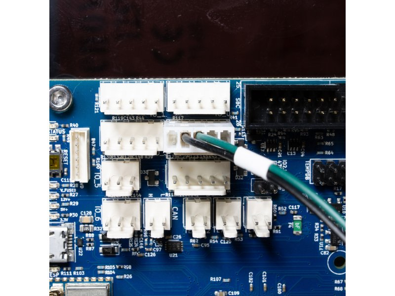](../assets/images/zoom/xi3eyxAERd31ySoN.jpg) [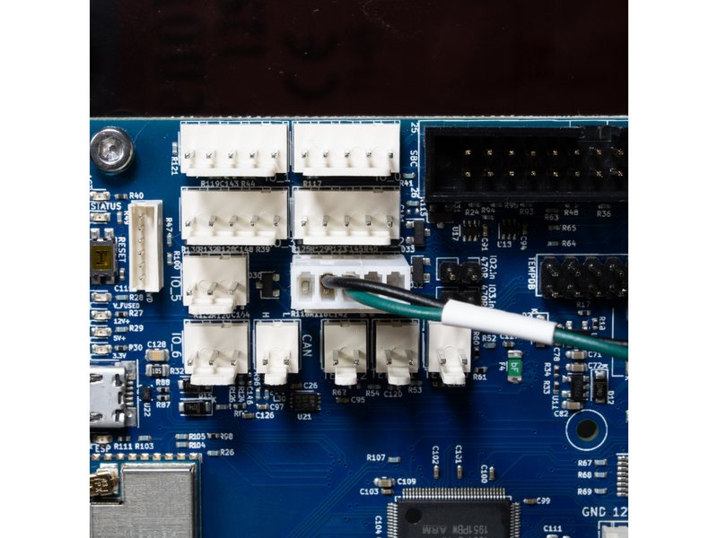](../assets/images/zoom/RyOSdEsBmAdBaQVt.jpg)

- Wire the X endstop to io.2.
- Wire the Y endstop to io.4.

## Step 6: Fans

[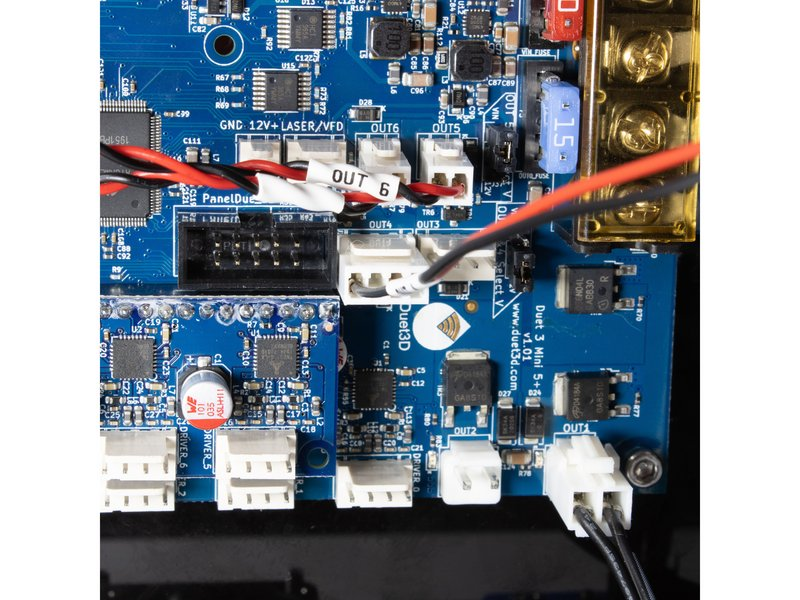](../assets/images/zoom/WOq2SD4oaO1OHoX5.jpg) [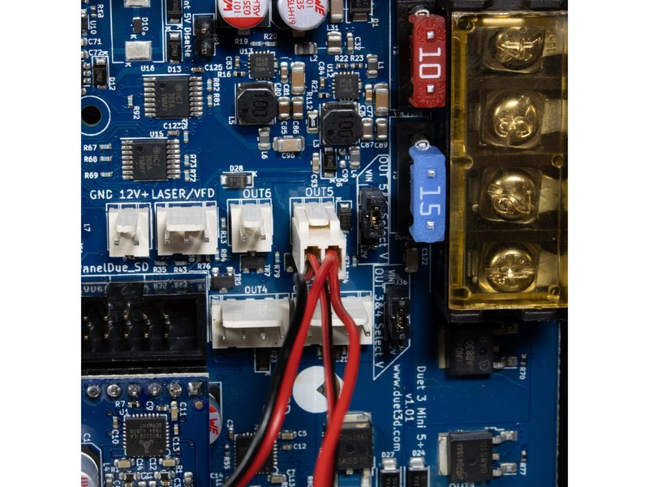](../assets/images/zoom/pxRD4BAyEHQVrJDY.jpg) [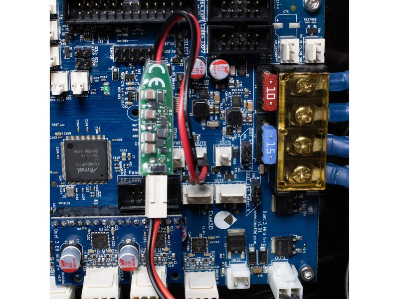](../assets/images/zoom/gGJidbhctBsYA45T.jpg)

- Wire the layer fan to out4.
- Panel fans are wired to out5.
- Hotend fan is wired to out6.
- **Caution:** If you are using the E3D Revo Micro, your hotend fan must use the included 24v -> 5v buck converter.

## Step 7: Hotend Heater

[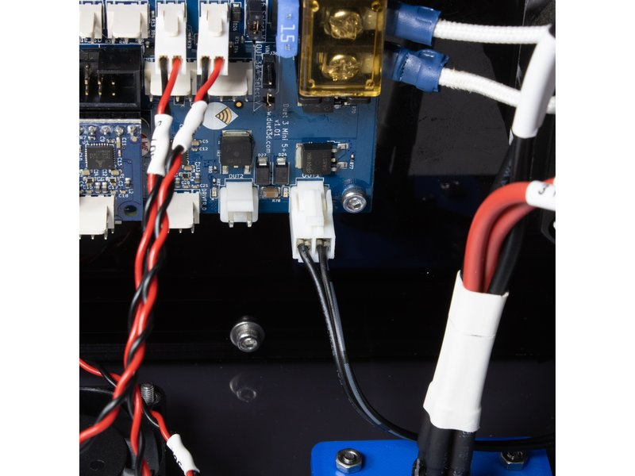](../assets/images/zoom/qxZ6aalvyeHJbVQL.jpg)

- The hotend heater is wired to out1.

## Step 8: BLTouch

[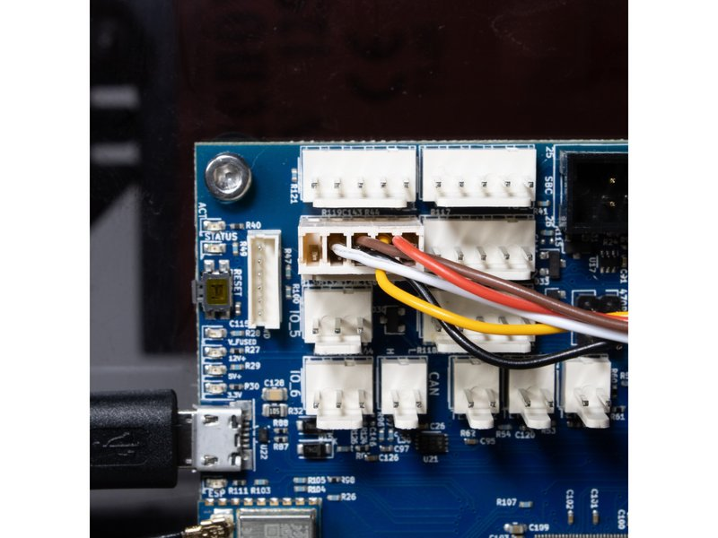](../assets/images/zoom/3rtiAsL4RVtGeINv.jpg)

- The BLTouch is wired to io3.

## Step 9: Extruder

[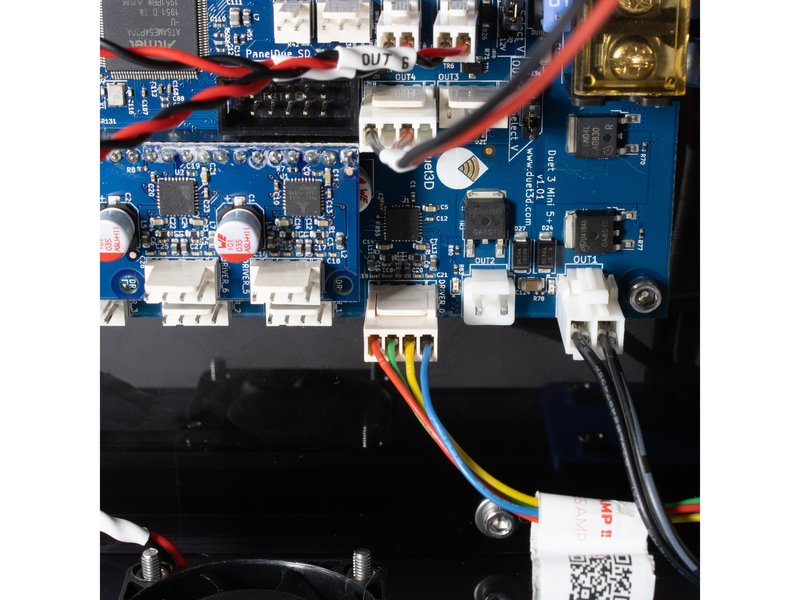](../assets/images/zoom/bTUvNIbcdMhKddDQ.jpg)

- The extruder is wired to Drive 0.

## Step 10: Z Axis

[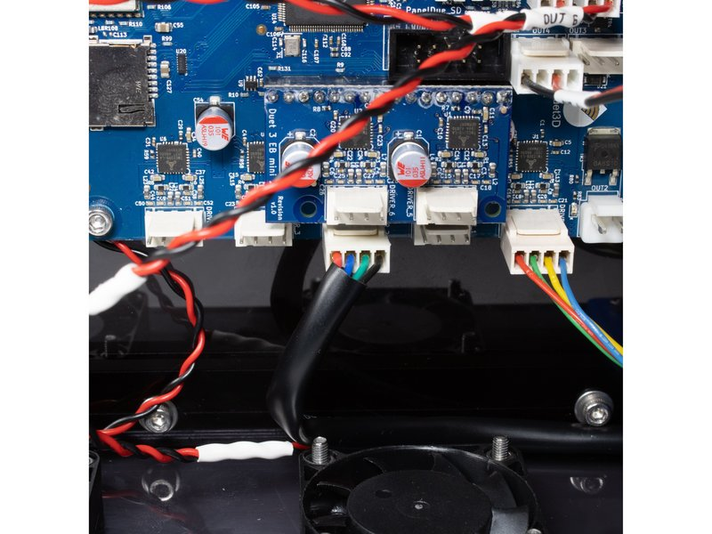](../assets/images/zoom/aTenHGgmevyvCPJL.jpg) [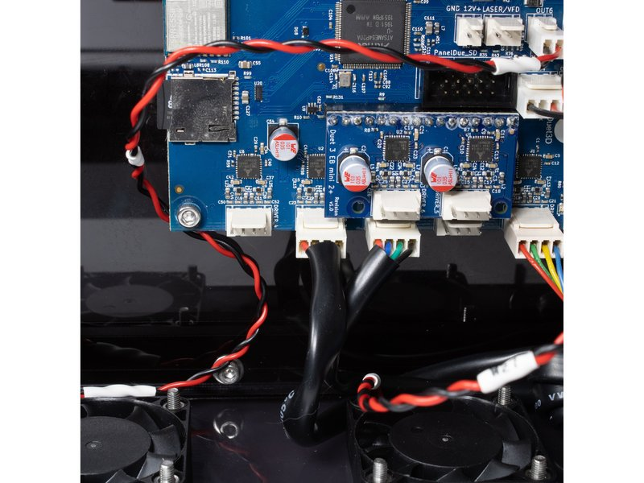](../assets/images/zoom/RrTffgrL2m2NGw34.jpg) [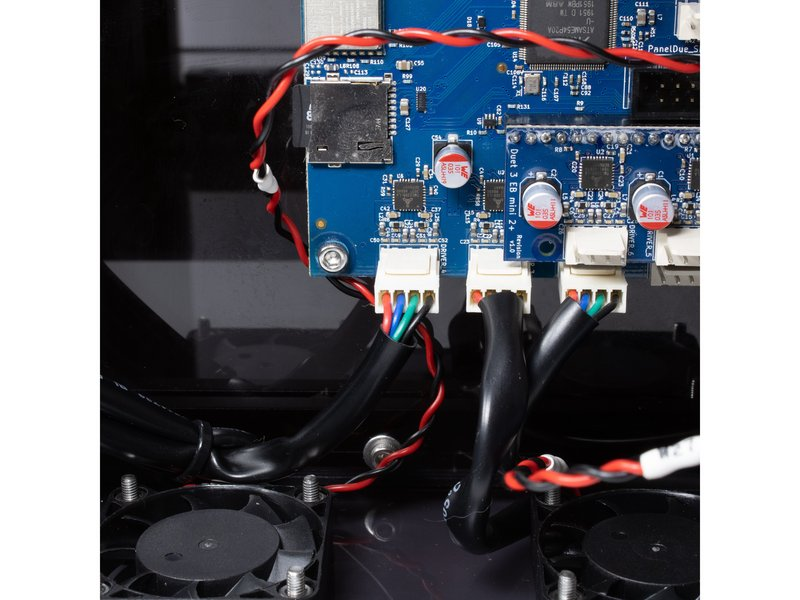](../assets/images/zoom/SSwYsIrGGvHrguws.jpg)

- Front right Z stepper is wired to Drive 2.
- Rear right Z stepper is wired to Drive 3.
- Left Z stepper is wired to Drive 4.

## Step 11: X/Y Axis

[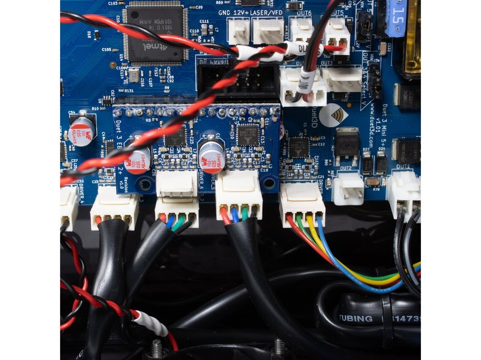](../assets/images/zoom/iEWdB66SBObYVqeB.jpg)

- X stepper (front) is wired to Drive 5 on the expansion board.
- Y stepper (rear) is wired to Drive 6 on the expansion board. This is the last free driver on the expansion board.

## Step 12: WiFi Antenna

[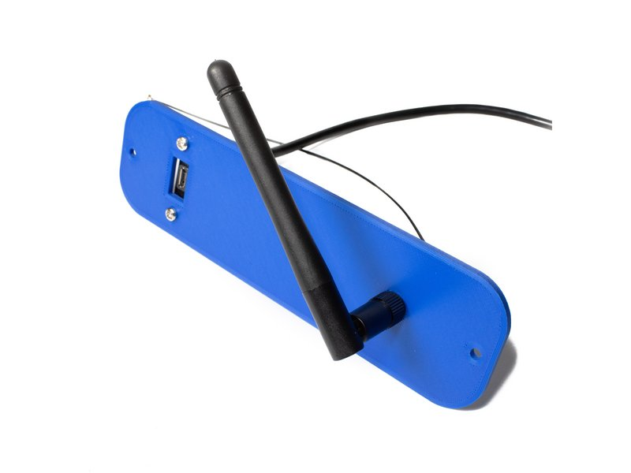](../assets/images/zoom/jZxvtcGjpqNKcF1T.jpg)

- Using (2) M3 x 10 socket head screws, washers and nuts, attach the antenna and USB extender to the outside of the printer panels.
- Plug the USB extension and WiFi pigtails into the Duet.
- **Note:** [https://duet3d.dozuki.com/Wiki/Getting_S...](https://duet3d.dozuki.com/Wiki/Getting_Started_with_Duet_3_Mini_5plus#Section_Connect_external_WiFi_antenna "https://duet3d.dozuki.com/Wiki/Getting_Started_with_Duet_3_Mini_5plus#Section_Connect_external_WiFi_antenna")

Previous: [P) Electronics](p-electronics.md) · [RailCore® Mini Kit guide list](index.md) · Next: [R) Firmware, Config, and Smoke Test](r-firmware-config-and-smoke-test.md)

---

Original page: <https://railcore.dozuki.com/Guide/Q)+Wiring+the+Electronics/39>. Written by Ben Withem on railcore.dozuki.com. This copy was captured on 2026-11-16 and is licensed under [Creative Commons Attribution-ShareAlike 3.0 (CC BY-SA 3.0)](https://creativecommons.org/licenses/by-sa/3.0/), the license stated on the original site. This is an unofficial community mirror and is not affiliated with RailCore Labs, LLC. RAILCORE is a registered trademark of RailCore Labs, LLC.
