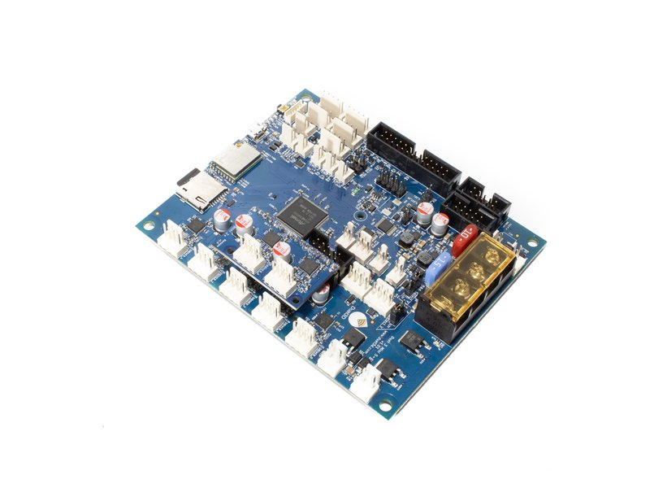

# R) Firmware, Config, and Smoke Test

Category: [RailCore® Mini Kit](index.md) · Original: <https://railcore.dozuki.com/Guide/R)+Firmware+Config+and+Smoke+Test/40>

**Difficulty:** Moderate  
**Time required:** 1 hour  
**Author:** Ben Withem  
**Steps:** 5  
**Last modified on Dozuki:** 2022-04-04

## Step 1: A Word of Warning

- **Caution:** It can be tempting to rush ahead - you're almost done, after all, and you want to see your printer print. Don't rush these steps.
- **Caution:** Read each step carefully, and follow the instructions closely, you'll save yourself a lot of time and headache.
- **Caution:** If at any point you feel over your head here, stop and ask questions in the RailCore Discord (Best option) or RailCore Facebook group.
- **Caution:** Be very careful near your electronics with the cover off. You can install the cover first, but it can be difficult to adjust things, so I install it after the smoke test.
- **Caution:** NEVER UNPLUG ANYTHING FROM YOUR DUET WITH THE POWER ON, ESPECIALLY STEPPERS.

## Step 2: Default Config Files

- Your Duet comes with an SD Card pre-loaded with configuration files. We need to change those to the RailCore default files.
- Remove the SD card and put it in your PC. On it you'll find a series of folders.
- Make a copy of the "sys" folder, and call it "sys_original".
- Copy all of the files from here into your sys folder, overwriting the original files:
- Copy the files here into the /macros folder:
- Eject the SD card from your PC, and put it back in the Duet.

## Step 3: Connecting to your Duet

- Before powering-on the first time, You need to connect to your duet with a microUSB cable.
- Follow the instructions here for getting connected to your Duet: <https://duet3d.dozuki.com/Guide/1.)+Gett>... You can use YAT as suggested, or any other serial console program.
- Don't worry about upgrading your firmware yet, but take note of the version installed.
- Send an M115 command to your Duet, be sure you see "Duet 3 Mini5plus WiFi" in the output.
- Continue following the instructions to get the Duet connected to your network.
- Ensure that you can reach your Duet via Duet Web Control before disconnecting the USB. When you unplug the USB the duet will lose power.

## Step 4: Smoke Test

- Double check all your connections.
- Double check them again.
- Once the printer is powered, do not work on the electronics until you power it off. Keep your fingers entirely away from the electronics area while the printer is on.
- Connect the power cord to the IEC inlet plug.
- Power on the printer.
- You should be able to connect to the web interface you set up earlier.

## Step 5: Updating Duet 3 Firmware

- You can update all firmware and DWC files by uploading the main zip file from the latest stable RRF release.
- Upload the zip file to the system tab. Do not extract it first.
- It should be detected and extracted automatically to the correct locations and prompt you to update and reboot.
- **Note:** The zip files for upgrading the firmware can be found here: [https://github.com/Duet3D/RepRapFirmware...](https://github.com/Duet3D/RepRapFirmware/releases "https://github.com/Duet3D/RepRapFirmware/releases")

Previous: [Q) Wiring the Electronics](q-wiring-the-electronics.md) · [RailCore® Mini Kit guide list](index.md) · Next: [S) First Moves](s-first-moves.md)

---

Original page: <https://railcore.dozuki.com/Guide/R)+Firmware+Config+and+Smoke+Test/40>. Written by Ben Withem on railcore.dozuki.com. This copy was captured on 2026-11-16 and is licensed under [Creative Commons Attribution-ShareAlike 3.0 (CC BY-SA 3.0)](https://creativecommons.org/licenses/by-sa/3.0/), the license stated on the original site. This is an unofficial community mirror and is not affiliated with RailCore Labs, LLC. RAILCORE is a registered trademark of RailCore Labs, LLC.
